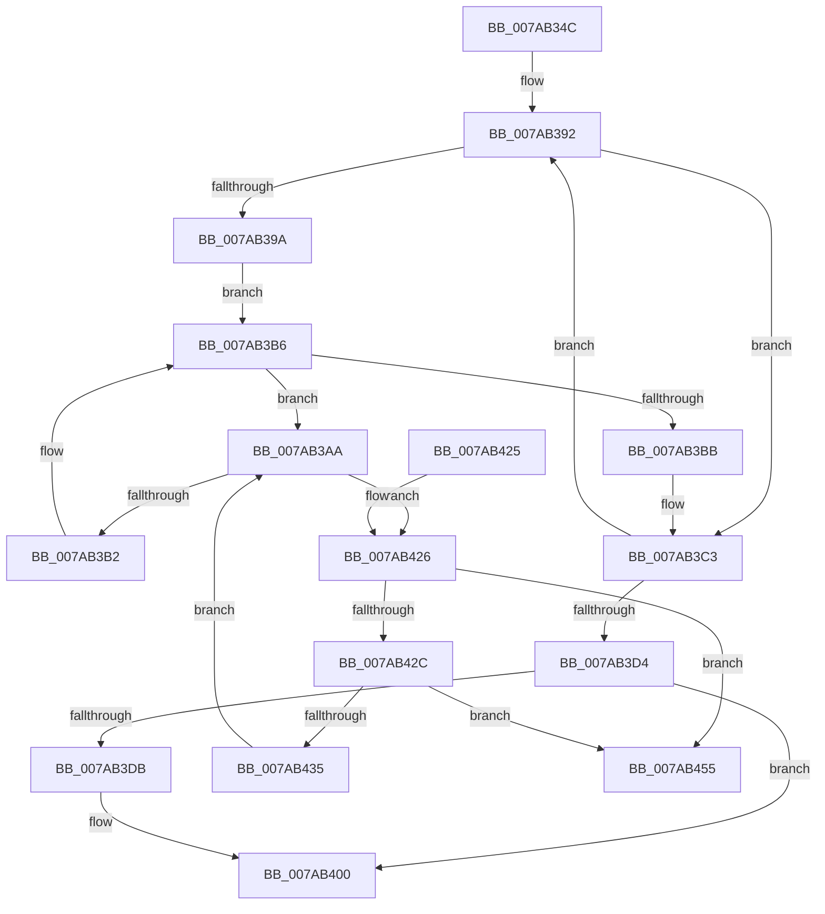

# SmHwAcceleratorPartitionMgrCleanup

- RVA: `0x007AB34C`–`0x007AB45C` (길이 `272` bytes)
- VA: `0x00000001407AB34C`
- 실행 섹션: `PAGE`
- PDB 이름 있음: `예`; PDB Function 태그: `아니요`
- unwind 정보 RVA: `0x000D20C0`
- 디코드: `81`개 명령, `272/272` bytes 표시
- 미해석 바이트: `0` (있으면 어셈블리에 `.byte`로 보존)

> 이 문서는 커널 이미지의 기계어와 PDB 기호를 분석해 생성했습니다. 4번과 5번은 함수 원형과 자료형을 바이너리 사용 방식에서 추정한 C 해석이며 원본 소스 복구 결과는 아닙니다.

## 1. Dependencies

- 직접 호출 지점: **7**; 고유 호출 대상: **6**
- 직접 호출자로 확인된 함수: **2**
- RIP 상대 이미지 참조: **2**

### Outgoing calls
- `0x007AB3BE` → [CmSiFreeMemory](../../text/47/CmSiFreeMemory_function_00475D80.md) (function, `0x00475D80`)
- `0x007AB3E3` → [KeStackAttachProcess](../../text/21/KeStackAttachProcess_function_00216800.md) (function, `0x00216800`)
- `0x007AB3EF` → [SmHwAcceleratorMgrPartitionUnregister](SmHwAcceleratorMgrPartitionUnregister_function_007AAEFC.md) (function, `0x007AAEFC`)
- `0x007AB3FB` → [KiUnstackDetachProcess](../../text/21/KiUnstackDetachProcess_function_00217D30.md) (function, `0x00217D30`)
- `0x007AB408` → [_security_check_cookie](../../text/6A/_security_check_cookie_function_006AC640.md) (function, `0x006AC640`)
- `0x007AB443` → [SmHwAcceleratorPartitionCtxCleanup](SmHwAcceleratorPartitionCtxCleanup_function_007AB2D8.md) (function, `0x007AB2D8`)
- `0x007AB44B` → [CmSiFreeMemory](../../text/47/CmSiFreeMemory_function_00475D80.md) (function, `0x00475D80`)

### Direct callers
- [SmFirstTimeInit](../../text/4E/SmFirstTimeInit_function_004EA944.md) at `0x004EAB6B`
- [SmPartitionCleanup](SmPartitionCleanup_function_007A5C14.md) at `0x007A5CC0`

### Static image references
- `0x007AB360` → RVA `0x00E0A740` (`.data`; read)
- `0x007AB39A` → RVA `0x00FC5000` (`ALMOSTRO`; read)

## 2. Other-region calls and transfers

- 다른 실행 섹션으로 향하는 call: **5**
  - `0x007AB3BE` → [CmSiFreeMemory](../../text/47/CmSiFreeMemory_function_00475D80.md) (`PAGE` → `.text`)
  - `0x007AB3E3` → [KeStackAttachProcess](../../text/21/KeStackAttachProcess_function_00216800.md) (`PAGE` → `.text`)
  - `0x007AB3FB` → [KiUnstackDetachProcess](../../text/21/KiUnstackDetachProcess_function_00217D30.md) (`PAGE` → `.text`)
  - `0x007AB408` → [_security_check_cookie](../../text/6A/_security_check_cookie_function_006AC640.md) (`PAGE` → `.text`)
  - `0x007AB44B` → [CmSiFreeMemory](../../text/47/CmSiFreeMemory_function_00475D80.md) (`PAGE` → `.text`)
- 별도 외부 분기/꼬리 이동을 확인하지 못했습니다.

## 3. Assembly (complete function range)

```asm
007AB34C  48 89 5C 24 18                  mov qword ptr [rsp + 0x18], rbx
007AB351  55                              push rbp
007AB352  56                              push rsi
007AB353  57                              push rdi
007AB354  41 54                           push r12
007AB356  41 55                           push r13
007AB358  41 56                           push r14
007AB35A  41 57                           push r15
007AB35C  48 83 EC 60                     sub rsp, 0x60
007AB360  48 8B 05 D9 F3 65 00            mov rax, qword ptr [rip + 0x65f3d9]
007AB367  48 33 C4                        xor rax, rsp
007AB36A  48 89 44 24 50                  mov qword ptr [rsp + 0x50], rax
007AB36F  0F 57 C0                        xorps xmm0, xmm0
007AB372  4C 8D 71 20                     lea r14, [rcx + 0x20]
007AB376  0F 11 44 24 20                  movups xmmword ptr [rsp + 0x20], xmm0
007AB37B  4C 8B EA                        mov r13, rdx
007AB37E  48 8B E9                        mov rbp, rcx
007AB381  0F 11 44 24 30                  movups xmmword ptr [rsp + 0x30], xmm0
007AB386  45 33 FF                        xor r15d, r15d
007AB389  4C 8D 61 30                     lea r12, [rcx + 0x30]
007AB38D  0F 11 44 24 40                  movups xmmword ptr [rsp + 0x40], xmm0
007AB392  49 8B 1E                        mov rbx, qword ptr [r14]
007AB395  48 85 DB                        test rbx, rbx
007AB398  74 29                           je 0x1407ab3c3
007AB39A  0F B7 35 5F 9C 81 00            movzx esi, word ptr [rip + 0x819c5f]
007AB3A1  48 C1 E6 04                     shl rsi, 4
007AB3A5  48 03 F3                        add rsi, rbx
007AB3A8  EB 0C                           jmp 0x1407ab3b6
007AB3AA  48 8B 3B                        mov rdi, qword ptr [rbx]
007AB3AD  48 3B FB                        cmp rdi, rbx
007AB3B0  75 74                           jne 0x1407ab426
007AB3B2  48 83 C3 10                     add rbx, 0x10
007AB3B6  48 3B DE                        cmp rbx, rsi
007AB3B9  72 EF                           jb 0x1407ab3aa
007AB3BB  49 8B 0E                        mov rcx, qword ptr [r14]
007AB3BE  E8 BD A9 CC FF                  call 0x140475d80
007AB3C3  41 FF C7                        inc r15d
007AB3C6  49 83 C6 08                     add r14, 8
007AB3CA  49 83 C4 04                     add r12, 4
007AB3CE  41 83 FF 02                     cmp r15d, 2
007AB3D2  7C BE                           jl 0x1407ab392
007AB3D4  48 83 7D 10 00                  cmp qword ptr [rbp + 0x10], 0
007AB3D9  74 25                           je 0x1407ab400
007AB3DB  48 8D 54 24 20                  lea rdx, [rsp + 0x20]
007AB3E0  49 8B CD                        mov rcx, r13
007AB3E3  E8 18 B4 A6 FF                  call 0x140216800
007AB3E8  48 8B 4D 10                     mov rcx, qword ptr [rbp + 0x10]
007AB3EC  48 8B D5                        mov rdx, rbp
007AB3EF  E8 08 FB FF FF                  call 0x1407aaefc
007AB3F4  33 D2                           xor edx, edx
007AB3F6  48 8D 4C 24 20                  lea rcx, [rsp + 0x20]
007AB3FB  E8 30 C9 A6 FF                  call 0x140217d30
007AB400  48 8B 4C 24 50                  mov rcx, qword ptr [rsp + 0x50]
007AB405  48 33 CC                        xor rcx, rsp
007AB408  E8 33 12 F0 FF                  call 0x1406ac640
007AB40D  48 8B 9C 24 B0 00 00 00         mov rbx, qword ptr [rsp + 0xb0]
007AB415  48 83 C4 60                     add rsp, 0x60
007AB419  41 5F                           pop r15
007AB41B  41 5E                           pop r14
007AB41D  41 5D                           pop r13
007AB41F  41 5C                           pop r12
007AB421  5F                              pop rdi
007AB422  5E                              pop rsi
007AB423  5D                              pop rbp
007AB424  C3                              ret
007AB425  CC                              int3
007AB426  48 39 5F 08                     cmp qword ptr [rdi + 8], rbx
007AB42A  75 29                           jne 0x1407ab455
007AB42C  48 8B 07                        mov rax, qword ptr [rdi]
007AB42F  48 39 78 08                     cmp qword ptr [rax + 8], rdi
007AB433  75 20                           jne 0x1407ab455
007AB435  48 89 03                        mov qword ptr [rbx], rax
007AB438  48 8B CF                        mov rcx, rdi
007AB43B  48 89 58 08                     mov qword ptr [rax + 8], rbx
007AB43F  41 FF 0C 24                     dec dword ptr [r12]
007AB443  E8 90 FE FF FF                  call 0x1407ab2d8
007AB448  48 8B CF                        mov rcx, rdi
007AB44B  E8 30 A9 CC FF                  call 0x140475d80
007AB450  E9 55 FF FF FF                  jmp 0x1407ab3aa
007AB455  B9 03 00 00 00                  mov ecx, 3
007AB45A  CD 29                           int 0x29
```

## 4. C-style interpretation (structured pseudocode)

```c
__int64 __fastcall SmHwAcceleratorPartitionMgrCleanup(__int64 a1, __int64 a2)
{
    __int64 result;
    __int64 v_r12;
    __int64 v_r14;
    __int64 v_r15;
    __int64 v_rbx;
    __int64 v_rsi;
    __int64 v_rsp;
    unsigned __int64 v_stack_m48;
    unsigned __int64 v_stack_m58;
    unsigned __int64 v_stack_m68;
    unsigned __int64 v_stack_m78;
    unsigned __int64 v_stack_p18;

    v_stack_p18 = v_rbx;
    v_rsp = (v_rsp) - (96);
    result = (*(unsigned __int64 *)(v_rip + 6681561)) ^ (v_rsp);
    v_stack_m48 = result;
    v_stack_m78 = v_xmm0;
    v_stack_m68 = v_xmm0;
    v_r15 = 0;
    v_stack_m58 = v_xmm0;
loc_007AB392:
    if (*(unsigned __int64 *)(a1 + 32) == 0) goto loc_007AB3C3;
    v_rsi = (*(unsigned __int16 *)(v_rip + 8494175)) << (4);
    v_rsi = (v_rsi) + (*(unsigned __int64 *)(a1 + 32));
    goto loc_007AB3B6;
loc_007AB3AA:
    if ((*(unsigned __int64 *)(*(unsigned __int64 *)(a1 + 32))) != (*(unsigned __int64 *)(a1 + 32))) goto loc_007AB426;
    v_rbx = (*(unsigned __int64 *)(a1 + 32)) + (16);
loc_007AB3B6:
    if (v_rbx < v_rsi) goto loc_007AB3AA;
    result = CmSiFreeMemory(*(unsigned __int64 *)(a1 + 32), a2, a3, a4);
loc_007AB3C3:
    v_r15 = (unsigned int)((v_r15) + 1);
    v_r14 = (a1 + 32) + (8);
    v_r12 = (a1 + 48) + (4);
    if (((unsigned int)(v_r15)) < 2) goto loc_007AB392;
    if ((*(unsigned __int64 *)(a1 + 16)) != 0) {
        a2 = v_stack_m78;
        a1 = a2;
        result = KeStackAttachProcess(a1, a2, a3, a4);
        a1 = *(unsigned __int64 *)(a1 + 16);
        a2 = a1;
        result = SmHwAcceleratorMgrPartitionUnregister(a1, a2, a3, a4);
        a2 = 0;
        a1 = v_stack_m78;
        result = KiUnstackDetachProcess(a1, a2, a3, a4);
    }
    a1 = (v_stack_m48) ^ (v_rsp);
    result = _security_check_cookie(a1, a2, a3, a4);
    v_rsp = (v_rsp) + (96);
    return result;
loc_007AB426:
    if ((*(unsigned __int64 *)(*(unsigned __int64 *)(*(unsigned __int64 *)(a1 + 32)) + 8)) != v_stack_p18) goto loc_007AB455;
    if ((*(unsigned __int64 *)(*(unsigned __int64 *)(*(unsigned __int64 *)(*(unsigned __int64 *)(a1 + 32))) + 8)) != (*(unsigned __int64 *)(*(unsigned __int64 *)(a1 + 32)))) goto loc_007AB455;
    *(unsigned __int64 *)(v_stack_p18) = *(unsigned __int64 *)(*(unsigned __int64 *)(*(unsigned __int64 *)(a1 + 32)));
    *(unsigned __int64 *)(*(unsigned __int64 *)(*(unsigned __int64 *)(*(unsigned __int64 *)(a1 + 32))) + 8) = v_stack_p18;
    result = SmHwAcceleratorPartitionCtxCleanup(*(unsigned __int64 *)(*(unsigned __int64 *)(a1 + 32)), a2, a3, a4);
    result = CmSiFreeMemory(*(unsigned __int64 *)(*(unsigned __int64 *)(a1 + 32)), a2, a3, a4);
    goto loc_007AB3AA;
loc_007AB455:
    return result;
}
```

## 5. (Beta) C Style

```c
int64_t SmHwAcceleratorPartitionMgrCleanup(void *Arg1, int64_t Arg2)
{
    uint8_t *arg1 = (uint8_t *)Arg1;

    int64_t result;
    int64_t local_r12;
    int64_t local_r14;
    int64_t local_r15;
    int64_t local_rbx;
    int64_t local_rsi;
    int64_t local_rsp;
    uint64_t v_stack_m48;
    uint64_t v_stack_m58;
    uint64_t v_stack_m68;
    uint64_t v_stack_m78;
    uint64_t v_stack_p18;

    v_stack_p18 = local_rbx;
    local_rsp = (local_rsp) - (96);
    result = (*(uint64_t *)(v_rip + 0x65F3D9)) ^ (local_rsp);
    v_stack_m48 = result;
    v_stack_m78 = v_xmm0;
    v_stack_m68 = v_xmm0;
    local_r15 = 0;
    v_stack_m58 = v_xmm0;
loc_007AB392:
    if (*(uint64_t *)(arg1 + 0x20) == 0) goto loc_007AB3C3;
    local_rsi = (*(uint16_t *)(v_rip + 0x819C5F)) << (4);
    local_rsi = (local_rsi) + (*(uint64_t *)(arg1 + 0x20));
    goto loc_007AB3B6;
loc_007AB3AA:
    if ((*(uint64_t *)(*(uint64_t *)(arg1 + 0x20))) != (*(uint64_t *)(arg1 + 0x20))) goto loc_007AB426;
    local_rbx = (*(uint64_t *)(arg1 + 0x20)) + (16);
loc_007AB3B6:
    if (local_rbx < local_rsi) goto loc_007AB3AA;
    result = CmSiFreeMemory(*(uint64_t *)(arg1 + 0x20), Arg2, a3, a4);
loc_007AB3C3:
    local_r15 = (uint32_t)((local_r15) + 1);
    local_r14 = (Arg1 + 32) + (8);
    local_r12 = (Arg1 + 48) + (4);
    if (((uint32_t)(local_r15)) < 2) goto loc_007AB392;
    if ((*(uint64_t *)(arg1 + 0x10)) != 0) {
        Arg2 = v_stack_m78;
        Arg1 = Arg2;
        result = KeStackAttachProcess(Arg1, Arg2, a3, a4);
        Arg1 = *(uint64_t *)(arg1 + 0x10);
        Arg2 = Arg1;
        result = SmHwAcceleratorMgrPartitionUnregister(Arg1, Arg2, a3, a4);
        Arg2 = 0;
        Arg1 = v_stack_m78;
        result = KiUnstackDetachProcess(Arg1, Arg2, a3, a4);
    }
    Arg1 = (v_stack_m48) ^ (local_rsp);
    result = _security_check_cookie(Arg1, Arg2, a3, a4);
    local_rsp = (local_rsp) + (96);
    return result;
loc_007AB426:
    if ((*(uint64_t *)(*(uint64_t *)(*(uint64_t *)(arg1 + 0x20)) + 0x8)) != v_stack_p18) goto loc_007AB455;
    if ((*(uint64_t *)(*(uint64_t *)(*(uint64_t *)(*(uint64_t *)(arg1 + 0x20))) + 0x8)) != (*(uint64_t *)(*(uint64_t *)(arg1 + 0x20)))) goto loc_007AB455;
    *(uint64_t *)(v_stack_p18) = *(uint64_t *)(*(uint64_t *)(*(uint64_t *)(arg1 + 0x20)));
    *(uint64_t *)(*(uint64_t *)(*(uint64_t *)(*(uint64_t *)(arg1 + 0x20))) + 0x8) = v_stack_p18;
    result = SmHwAcceleratorPartitionCtxCleanup(*(uint64_t *)(*(uint64_t *)(arg1 + 0x20)), Arg2, a3, a4);
    result = CmSiFreeMemory(*(uint64_t *)(*(uint64_t *)(arg1 + 0x20)), Arg2, a3, a4);
    goto loc_007AB3AA;
loc_007AB455:
    return result;
}
```

### 관측된 메모리 오프셋

구조체 형식이 확인되지 않은 접근은 인자 기준의 오프셋으로만 기록했습니다.

| 기준 인자 | 오프셋 표현 | 폭 (bit) | 접근 |
|---|---:|---:|---|
| `Arg1` | `+ 0x0` | `32` | `R/W` |
| `Arg1` | `+ 0x0` | `64` | `R` |
| `Arg1` | `+ 0x10` | `64` | `R` |
| `Arg1` | `+ 0x20` | `64` | `R` |
| `Arg1` | `+ 0x30` | `64` | `R` |

## 6. Execution-region graph

[열기: 2D/3D 그래프와 함수 탐색 컨트롤 패널](../../../control-panel.html?section=page&rva=0x007AB34C&view=graph)

- 2D 그래프는 위에서 아래로 흐르고, 3D 그래프는 빈 공간을 드래그해 회전합니다. Shift+드래그는 이동, 휠은 확대·축소, 함수 노드 선택은 대상 보고서 이동입니다.

### Static fallback


