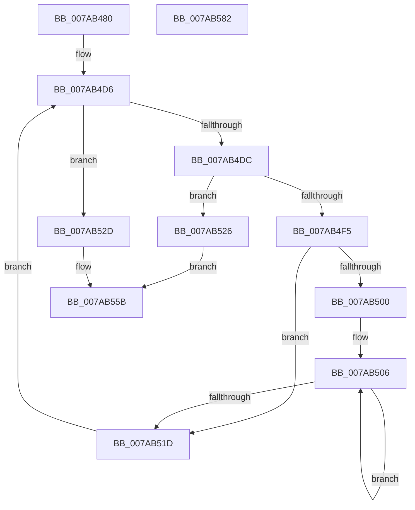

# SmHwAcceleratorPartitionMgrStart

- RVA: `0x007AB480`–`0x007AB583` (길이 `259` bytes)
- VA: `0x00000001407AB480`
- 실행 섹션: `PAGE`
- PDB 이름 있음: `예`; PDB Function 태그: `아니요`
- unwind 정보 RVA: `0x0009B2F8`
- 디코드: `79`개 명령, `259/259` bytes 표시
- 미해석 바이트: `0` (있으면 어셈블리에 `.byte`로 보존)

> 이 문서는 커널 이미지의 기계어와 PDB 기호를 분석해 생성했습니다. 4번과 5번은 함수 원형과 자료형을 바이너리 사용 방식에서 추정한 C 해석이며 원본 소스 복구 결과는 아닙니다.

## 1. Dependencies

- 직접 호출 지점: **5**; 고유 호출 대상: **5**
- 직접 호출자로 확인된 함수: **1**
- RIP 상대 이미지 참조: **2**

### Outgoing calls
- `0x007AB4E8` → [SmAllocEx](../../text/34/SmAllocEx_function_0034C794.md) (function, `0x0034C794`)
- `0x007AB537` → [KiStackAttachProcess](../../text/21/KiStackAttachProcess_function_00216820.md) (function, `0x00216820`)
- `0x007AB542` → [SmHwAcceleratorMgrPartitionRegister](SmHwAcceleratorMgrPartitionRegister_function_007AADDC.md) (function, `0x007AADDC`)
- `0x007AB550` → [KiUnstackDetachProcess](../../text/21/KiUnstackDetachProcess_function_00217D30.md) (function, `0x00217D30`)
- `0x007AB565` → [_security_check_cookie](../../text/6A/_security_check_cookie_function_006AC640.md) (function, `0x006AC640`)

### Direct callers
- [SmFirstTimeInit](../../text/4E/SmFirstTimeInit_function_004EA944.md) at `0x004EAB56`

### Static image references
- `0x007AB494` → RVA `0x00E0A740` (`.data`; read)
- `0x007AB4A3` → RVA `0x00FC5000` (`ALMOSTRO`; read)

## 2. Other-region calls and transfers

- 다른 실행 섹션으로 향하는 call: **4**
  - `0x007AB4E8` → [SmAllocEx](../../text/34/SmAllocEx_function_0034C794.md) (`PAGE` → `.text`)
  - `0x007AB537` → [KiStackAttachProcess](../../text/21/KiStackAttachProcess_function_00216820.md) (`PAGE` → `.text`)
  - `0x007AB550` → [KiUnstackDetachProcess](../../text/21/KiUnstackDetachProcess_function_00217D30.md) (`PAGE` → `.text`)
  - `0x007AB565` → [_security_check_cookie](../../text/6A/_security_check_cookie_function_006AC640.md) (`PAGE` → `.text`)
- 별도 외부 분기/꼬리 이동을 확인하지 못했습니다.

## 3. Assembly (complete function range)

```asm
007AB480  48 89 5C 24 20                  mov qword ptr [rsp + 0x20], rbx
007AB485  55                              push rbp
007AB486  56                              push rsi
007AB487  57                              push rdi
007AB488  41 54                           push r12
007AB48A  41 55                           push r13
007AB48C  41 56                           push r14
007AB48E  41 57                           push r15
007AB490  48 83 EC 60                     sub rsp, 0x60
007AB494  48 8B 05 A5 F2 65 00            mov rax, qword ptr [rip + 0x65f2a5]
007AB49B  48 33 C4                        xor rax, rsp
007AB49E  48 89 44 24 50                  mov qword ptr [rsp + 0x50], rax
007AB4A3  0F B7 35 56 9B 81 00            movzx esi, word ptr [rip + 0x819b56]
007AB4AA  48 8D 69 20                     lea rbp, [rcx + 0x20]
007AB4AE  0F 57 C0                        xorps xmm0, xmm0
007AB4B1  48 C1 E6 04                     shl rsi, 4
007AB4B5  45 33 ED                        xor r13d, r13d
007AB4B8  4D 8B E0                        mov r12, r8
007AB4BB  41 8B FD                        mov edi, r13d
007AB4BE  4C 8B FA                        mov r15, rdx
007AB4C1  4C 8B F1                        mov r14, rcx
007AB4C4  48 8B DD                        mov rbx, rbp
007AB4C7  0F 11 44 24 20                  movups xmmword ptr [rsp + 0x20], xmm0
007AB4CC  0F 11 44 24 30                  movups xmmword ptr [rsp + 0x30], xmm0
007AB4D1  0F 11 44 24 40                  movups xmmword ptr [rsp + 0x40], xmm0
007AB4D6  48 83 FF 02                     cmp rdi, 2
007AB4DA  7D 51                           jge 0x1407ab52d
007AB4DC  41 83 C8 FF                     or r8d, 0xffffffff
007AB4E0  BA 73 6D 41 6C                  mov edx, 0x6c416d73
007AB4E5  48 8B CE                        mov rcx, rsi
007AB4E8  E8 A7 12 BA FF                  call 0x14034c794
007AB4ED  48 89 03                        mov qword ptr [rbx], rax
007AB4F0  48 85 ED                        test rbp, rbp
007AB4F3  74 31                           je 0x1407ab526
007AB4F5  0F B7 05 04 9B 81 00            movzx eax, word ptr [rip + 0x819b04]
007AB4FC  85 C0                           test eax, eax
007AB4FE  74 1D                           je 0x1407ab51d
007AB500  49 8B D5                        mov rdx, r13
007AB503  44 8B C0                        mov r8d, eax
007AB506  48 8B 0B                        mov rcx, qword ptr [rbx]
007AB509  48 03 CA                        add rcx, rdx
007AB50C  48 83 C2 10                     add rdx, 0x10
007AB510  48 89 49 08                     mov qword ptr [rcx + 8], rcx
007AB514  48 89 09                        mov qword ptr [rcx], rcx
007AB517  49 83 E8 01                     sub r8, 1
007AB51B  75 E9                           jne 0x1407ab506
007AB51D  48 FF C7                        inc rdi
007AB520  48 83 C3 08                     add rbx, 8
007AB524  EB B0                           jmp 0x1407ab4d6
007AB526  BB 9A 00 00 C0                  mov ebx, 0xc000009a
007AB52B  EB 2E                           jmp 0x1407ab55b
007AB52D  4C 8D 44 24 20                  lea r8, [rsp + 0x20]
007AB532  33 D2                           xor edx, edx
007AB534  49 8B CC                        mov rcx, r12
007AB537  E8 E4 B2 A6 FF                  call 0x140216820
007AB53C  49 8B D6                        mov rdx, r14
007AB53F  49 8B CF                        mov rcx, r15
007AB542  E8 95 F8 FF FF                  call 0x1407aaddc
007AB547  33 D2                           xor edx, edx
007AB549  48 8D 4C 24 20                  lea rcx, [rsp + 0x20]
007AB54E  8B D8                           mov ebx, eax
007AB550  E8 DB C7 A6 FF                  call 0x140217d30
007AB555  85 DB                           test ebx, ebx
007AB557  41 0F 49 DD                     cmovns ebx, r13d
007AB55B  8B C3                           mov eax, ebx
007AB55D  48 8B 4C 24 50                  mov rcx, qword ptr [rsp + 0x50]
007AB562  48 33 CC                        xor rcx, rsp
007AB565  E8 D6 10 F0 FF                  call 0x1406ac640
007AB56A  48 8B 9C 24 B8 00 00 00         mov rbx, qword ptr [rsp + 0xb8]
007AB572  48 83 C4 60                     add rsp, 0x60
007AB576  41 5F                           pop r15
007AB578  41 5E                           pop r14
007AB57A  41 5D                           pop r13
007AB57C  41 5C                           pop r12
007AB57E  5F                              pop rdi
007AB57F  5E                              pop rsi
007AB580  5D                              pop rbp
007AB581  C3                              ret
007AB582  CC                              int3
```

## 4. C-style interpretation (structured pseudocode)

```c
__int64 __fastcall SmHwAcceleratorPartitionMgrStart(__int64 a1, __int64 a2, __int64 a3)
{
    __int64 result;
    __int64 v_r13;
    __int64 v_rbx;
    __int64 v_rdi;
    __int64 v_rsi;
    __int64 v_rsp;
    unsigned __int64 v_stack_m48;
    unsigned __int64 v_stack_m58;
    unsigned __int64 v_stack_m68;
    unsigned __int64 v_stack_m78;
    unsigned __int64 v_stack_p20;

    v_stack_p20 = v_rbx;
    v_rsp = (v_rsp) - (96);
    result = (*(unsigned __int64 *)(v_rip + 6681253)) ^ (v_rsp);
    v_stack_m48 = result;
    v_rsi = (*(unsigned __int16 *)(v_rip + 8493910)) << (4);
    v_r13 = 0;
    v_stack_m78 = v_xmm0;
    v_stack_m68 = v_xmm0;
    v_stack_m58 = v_xmm0;
loc_007AB4D6:
    if (0 >= 2) goto loc_007AB52D;
    a3 = (unsigned int)((a3) | (0xFFFFFFFFULL));
    result = SmAllocEx(v_rsi, (unsigned int)(0x6C416D73ULL), a3, a4);
    *(unsigned __int64 *)(a1 + 32) = result;
    if (a1 + 32 == 0) goto loc_007AB526;
    if ((unsigned int)(*(unsigned __int16 *)(v_rip + 8493828)) == 0) goto loc_007AB51D;
loc_007AB506:
    a1 = (*(unsigned __int64 *)(a1 + 32)) + (0);
    a2 = (0) + (16);
    *(unsigned __int64 *)(a1 + 8) = a1;
    *(unsigned __int64 *)(a1) = a1;
    a3 = ((unsigned int)((unsigned int)(*(unsigned __int16 *)(v_rip + 8493828)))) - (1);
    if (condition_is_not_equal) goto loc_007AB506;
loc_007AB51D:
    v_rdi = (0) + 1;
    v_rbx = (a1 + 32) + (8);
    goto loc_007AB4D6;
loc_007AB526:
    goto loc_007AB55B;
loc_007AB52D:
    a2 = 0;
    result = KiStackAttachProcess(a3, a2, v_stack_m78, a4);
    result = SmHwAcceleratorMgrPartitionRegister(0, a1, v_stack_m78, a4);
    a2 = 0;
    result = KiUnstackDetachProcess(v_stack_m78, a2, v_stack_m78, a4);
    v_rbx = (unsigned int)((unsigned int)(result));
    if (!sign_flag) { v_rbx = 0; }
loc_007AB55B:
    a1 = (v_stack_m48) ^ (v_rsp);
    result = _security_check_cookie(a1, a2, v_stack_m78, a4);
    v_rsp = (v_rsp) + (96);
    return result;
}
```

## 5. (Beta) C Style

```c
int64_t SmHwAcceleratorPartitionMgrStart(void *Arg1, int64_t Arg2, int64_t Arg3)
{
    uint8_t *arg1 = (uint8_t *)Arg1;

    int64_t result;
    int64_t local_r13;
    int64_t local_rbx;
    int64_t local_rdi;
    int64_t local_rsi;
    int64_t local_rsp;
    uint64_t v_stack_m48;
    uint64_t v_stack_m58;
    uint64_t v_stack_m68;
    uint64_t v_stack_m78;
    uint64_t v_stack_p20;

    v_stack_p20 = local_rbx;
    local_rsp = (local_rsp) - (96);
    result = (*(uint64_t *)(v_rip + 0x65F2A5)) ^ (local_rsp);
    v_stack_m48 = result;
    local_rsi = (*(uint16_t *)(v_rip + 0x819B56)) << (4);
    local_r13 = 0;
    v_stack_m78 = v_xmm0;
    v_stack_m68 = v_xmm0;
    v_stack_m58 = v_xmm0;
loc_007AB4D6:
    if (0 >= 2) goto loc_007AB52D;
    Arg3 = (uint32_t)((Arg3) | (0xFFFFFFFFULL));
    result = SmAllocEx(local_rsi, (uint32_t)(0x6C416D73ULL), Arg3, a4);
    *(uint64_t *)(arg1 + 0x20) = result;
    if (Arg1 + 32 == 0) goto loc_007AB526;
    if ((uint32_t)(*(uint16_t *)(v_rip + 0x819B04)) == 0) goto loc_007AB51D;
loc_007AB506:
    Arg1 = (*(uint64_t *)(arg1 + 0x20)) + (0);
    Arg2 = (0) + (16);
    *(void **)(arg1 + 0x8) = Arg1;
    *(void **)(arg1) = Arg1;
    Arg3 = ((uint32_t)((uint32_t)(*(uint16_t *)(v_rip + 0x819B04)))) - (1);
    if (condition_is_not_equal) goto loc_007AB506;
loc_007AB51D:
    local_rdi = (0) + 1;
    local_rbx = (Arg1 + 32) + (8);
    goto loc_007AB4D6;
loc_007AB526:
    goto loc_007AB55B;
loc_007AB52D:
    Arg2 = 0;
    result = KiStackAttachProcess(Arg3, Arg2, v_stack_m78, a4);
    result = SmHwAcceleratorMgrPartitionRegister(0, Arg1, v_stack_m78, a4);
    Arg2 = 0;
    result = KiUnstackDetachProcess(v_stack_m78, Arg2, v_stack_m78, a4);
    local_rbx = (uint32_t)((uint32_t)(result));
    if (!sign_flag) { local_rbx = 0; }
loc_007AB55B:
    Arg1 = (v_stack_m48) ^ (local_rsp);
    result = _security_check_cookie(Arg1, Arg2, v_stack_m78, a4);
    local_rsp = (local_rsp) + (96);
    return result;
}
```

### 관측된 메모리 오프셋

구조체 형식이 확인되지 않은 접근은 인자 기준의 오프셋으로만 기록했습니다.

| 기준 인자 | 오프셋 표현 | 폭 (bit) | 접근 |
|---|---:|---:|---|
| `Arg1` | `+ 0x0` | `64` | `R` |
| `Arg1` | `+ 0x0` | `64` | `W` |
| `Arg1` | `+ 0x20` | `64` | `R` |

## 6. Execution-region graph

[열기: 2D/3D 그래프와 함수 탐색 컨트롤 패널](../../../control-panel.html?section=page&rva=0x007AB480&view=graph)

- 2D 그래프는 위에서 아래로 흐르고, 3D 그래프는 빈 공간을 드래그해 회전합니다. Shift+드래그는 이동, 휠은 확대·축소, 함수 노드 선택은 대상 보고서 이동입니다.

### Static fallback


