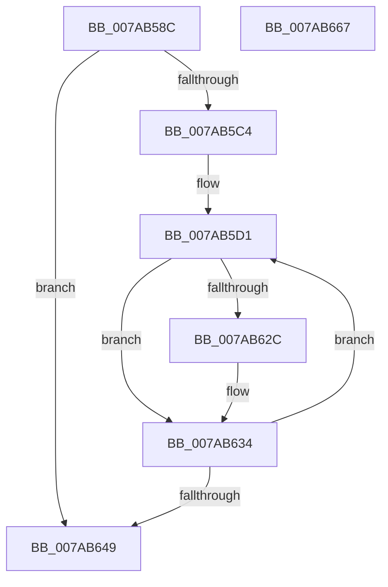

# SmHwInitializeAccelDescriptor

- RVA: `0x007AB58C`–`0x007AB668` (길이 `220` bytes)
- VA: `0x00000001407AB58C`
- 실행 섹션: `PAGE`
- PDB 이름 있음: `예`; PDB Function 태그: `아니요`
- unwind 정보 RVA: `0x000BE68C`
- 디코드: `66`개 명령, `220/220` bytes 표시
- 미해석 바이트: `0` (있으면 어셈블리에 `.byte`로 보존)

> 이 문서는 커널 이미지의 기계어와 PDB 기호를 분석해 생성했습니다. 4번과 5번은 함수 원형과 자료형을 바이너리 사용 방식에서 추정한 C 해석이며 원본 소스 복구 결과는 아닙니다.

## 1. Dependencies

- 직접 호출 지점: **3**; 고유 호출 대상: **3**
- 직접 호출자로 확인된 함수: **1**
- RIP 상대 이미지 참조: **0**

### Outgoing calls
- `0x007AB5DC` → [AccelInitializeDescriptor](../../text/66/AccelInitializeDescriptor_function_0066860C.md) (function, `0x0066860C`)
- `0x007AB61A` → [AccelInitializeCompressionWorkspace](../../text/66/AccelInitializeCompressionWorkspace_function_006684D0.md) (function, `0x006684D0`)
- `0x007AB62F` → [AccelSetDescriptorAddressSpace](../../text/66/AccelSetDescriptorAddressSpace_function_006687F4.md) (function, `0x006687F4`)

### Direct callers
- [SmHwAcceleratorParitionCtxCreate](SmHwAcceleratorParitionCtxCreate_function_007AB0A8.md) at `0x007AB209`
- [SmHwAcceleratorParitionCtxCreate](SmHwAcceleratorParitionCtxCreate_function_007AB0A8.md) at `0x007AB241`

### Static image references
- 디코드된 RIP-relative 메모리 참조가 없습니다.

## 2. Other-region calls and transfers

- 다른 실행 섹션으로 향하는 call: **3**
  - `0x007AB5DC` → [AccelInitializeDescriptor](../../text/66/AccelInitializeDescriptor_function_0066860C.md) (`PAGE` → `.text`)
  - `0x007AB61A` → [AccelInitializeCompressionWorkspace](../../text/66/AccelInitializeCompressionWorkspace_function_006684D0.md) (`PAGE` → `.text`)
  - `0x007AB62F` → [AccelSetDescriptorAddressSpace](../../text/66/AccelSetDescriptorAddressSpace_function_006687F4.md) (`PAGE` → `.text`)
- 별도 외부 분기/꼬리 이동을 확인하지 못했습니다.

## 3. Assembly (complete function range)

```asm
007AB58C  48 89 5C 24 08                  mov qword ptr [rsp + 8], rbx
007AB591  48 89 74 24 10                  mov qword ptr [rsp + 0x10], rsi
007AB596  48 89 7C 24 18                  mov qword ptr [rsp + 0x18], rdi
007AB59B  55                              push rbp
007AB59C  41 54                           push r12
007AB59E  41 55                           push r13
007AB5A0  41 56                           push r14
007AB5A2  41 57                           push r15
007AB5A4  48 8B EC                        mov rbp, rsp
007AB5A7  48 83 EC 60                     sub rsp, 0x60
007AB5AB  4C 8B 79 10                     mov r15, qword ptr [rcx + 0x10]
007AB5AF  48 8D 79 20                     lea rdi, [rcx + 0x20]
007AB5B3  33 F6                           xor esi, esi
007AB5B5  48 8B DA                        mov rbx, rdx
007AB5B8  4C 8B F1                        mov r14, rcx
007AB5BB  39 72 40                        cmp dword ptr [rdx + 0x40], esi
007AB5BE  0F 86 85 00 00 00               jbe 0x1407ab649
007AB5C4  4D 63 E0                        movsxd r12, r8d
007AB5C7  41 F7 D8                        neg r8d
007AB5CA  45 1B ED                        sbb r13d, r13d
007AB5CD  41 83 C5 07                     add r13d, 7
007AB5D1  8B 53 28                        mov edx, dword ptr [rbx + 0x28]
007AB5D4  4C 8B C7                        mov r8, rdi
007AB5D7  4A 8B 4C E3 10                  mov rcx, qword ptr [rbx + r12*8 + 0x10]
007AB5DC  E8 2B D0 EB FF                  call 0x14066860c
007AB5E1  42 8B 44 A3 38                  mov eax, dword ptr [rbx + r12*4 + 0x38]
007AB5E6  33 C9                           xor ecx, ecx
007AB5E8  48 89 4D E8                     mov qword ptr [rbp - 0x18], rcx
007AB5EC  89 4D FC                        mov dword ptr [rbp - 4], ecx
007AB5EF  48 89 4D D0                     mov qword ptr [rbp - 0x30], rcx
007AB5F3  8D 51 01                        lea edx, [rcx + 1]
007AB5F6  89 4D D8                        mov dword ptr [rbp - 0x28], ecx
007AB5F9  48 8D 4D C0                     lea rcx, [rbp - 0x40]
007AB5FD  89 55 E0                        mov dword ptr [rbp - 0x20], edx
007AB600  89 55 E4                        mov dword ptr [rbp - 0x1c], edx
007AB603  48 C7 45 C0 01 00 40 00         mov qword ptr [rbp - 0x40], 0x400001
007AB60B  48 89 7D C8                     mov qword ptr [rbp - 0x38], rdi
007AB60F  44 89 6D DC                     mov dword ptr [rbp - 0x24], r13d
007AB613  4C 89 7D F0                     mov qword ptr [rbp - 0x10], r15
007AB617  89 45 F8                        mov dword ptr [rbp - 8], eax
007AB61A  E8 B1 CE EB FF                  call 0x1406684d0
007AB61F  49 8B 46 08                     mov rax, qword ptr [r14 + 8]
007AB623  48 8B 50 28                     mov rdx, qword ptr [rax + 0x28]
007AB627  48 85 D2                        test rdx, rdx
007AB62A  74 08                           je 0x1407ab634
007AB62C  48 8B CF                        mov rcx, rdi
007AB62F  E8 C0 D1 EB FF                  call 0x1406687f4
007AB634  8B 43 28                        mov eax, dword ptr [rbx + 0x28]
007AB637  FF C6                           inc esi
007AB639  48 03 F8                        add rdi, rax
007AB63C  42 8B 44 A3 38                  mov eax, dword ptr [rbx + r12*4 + 0x38]
007AB641  4C 03 F8                        add r15, rax
007AB644  3B 73 40                        cmp esi, dword ptr [rbx + 0x40]
007AB647  72 88                           jb 0x1407ab5d1
007AB649  4C 8D 5C 24 60                  lea r11, [rsp + 0x60]
007AB64E  49 8B 5B 30                     mov rbx, qword ptr [r11 + 0x30]
007AB652  49 8B 73 38                     mov rsi, qword ptr [r11 + 0x38]
007AB656  49 8B 7B 40                     mov rdi, qword ptr [r11 + 0x40]
007AB65A  49 8B E3                        mov rsp, r11
007AB65D  41 5F                           pop r15
007AB65F  41 5E                           pop r14
007AB661  41 5D                           pop r13
007AB663  41 5C                           pop r12
007AB665  5D                              pop rbp
007AB666  C3                              ret
007AB667  CC                              int3
```

## 4. C-style interpretation (structured pseudocode)

```c
__int64 __fastcall SmHwInitializeAccelDescriptor(__int64 a1, __int64 a2, int a3)
{
    __int64 result;
    __int64 v_r13;
    __int64 v_r15;
    __int64 v_rdi;
    __int64 v_rsi;
    __int64 v_rsp;
    unsigned __int64 v_stack_m28;
    unsigned int v_stack_m2C;
    unsigned int v_stack_m30;
    unsigned __int64 v_stack_m38;
    unsigned __int64 v_stack_m40;
    unsigned int v_stack_m44;
    unsigned int v_stack_m48;
    unsigned int v_stack_m4C;
    unsigned int v_stack_m50;
    unsigned __int64 v_stack_m58;
    unsigned __int64 v_stack_m60;
    unsigned __int64 v_stack_m68;
    unsigned __int64 v_stack_p10;
    unsigned __int64 v_stack_p18;
    unsigned __int64 v_stack_p8;

    v_stack_p8 = v_rbx;
    v_stack_p10 = v_rsi;
    v_stack_p18 = v_rdi;
    v_rsp = (v_rsp) - (96);
    v_rsi = 0;
    if ((*(unsigned int *)(a2 + 64)) <= 0) goto loc_007AB649;
    a3 = (unsigned int)(-(a3));
    v_r13 = (unsigned int)((v_r13) + (7));
loc_007AB5D1:
    result = AccelInitializeDescriptor(*(unsigned __int64 *)(a2 + (int)(a3) * 8 + 16), (unsigned int)(*(unsigned int *)(a2 + 40)), a1 + 32, a4);
    a1 = 0;
    v_stack_m40 = 0;
    v_stack_m2C = 0;
    v_stack_m58 = 0;
    v_stack_m50 = 0;
    v_stack_m48 = (unsigned int)(a1 + 1);
    v_stack_m44 = (unsigned int)(a1 + 1);
    v_stack_m68 = 0x400001ULL;
    v_stack_m60 = a1 + 32;
    v_stack_m4C = (unsigned int)(v_r13);
    v_stack_m38 = *(unsigned __int64 *)(a1 + 16);
    v_stack_m30 = (unsigned int)((unsigned int)(*(unsigned int *)(a2 + (int)(a3) * 4 + 56)));
    result = AccelInitializeCompressionWorkspace(v_stack_m68, a1 + 1, a1 + 32, a4);
    result = *(unsigned __int64 *)(a1 + 8);
    if (*(unsigned __int64 *)(*(unsigned __int64 *)(a1 + 8) + 40) != 0) {
        a1 = a1 + 32;
        result = AccelSetDescriptorAddressSpace(a1, *(unsigned __int64 *)(*(unsigned __int64 *)(a1 + 8) + 40), a1 + 32, a4);
    }
    v_rsi = (unsigned int)((v_rsi) + 1);
    v_rdi = (a1 + 32) + ((unsigned int)(*(unsigned int *)(a2 + 40)));
    v_r15 = (*(unsigned __int64 *)(a1 + 16)) + ((unsigned int)(*(unsigned int *)(a2 + (int)(a3) * 4 + 56)));
    if (((unsigned int)(v_rsi)) < (*(unsigned int *)(a2 + 64))) goto loc_007AB5D1;
loc_007AB649:
    return (unsigned int)(*(unsigned int *)(a2 + (int)(a3) * 4 + 56));
}
```

## 5. (Beta) C Style

```c
int64_t SmHwInitializeAccelDescriptor(void *Arg1, void *Arg2, int32_t Arg3)
{
    uint8_t *arg1 = (uint8_t *)Arg1;
    uint8_t *arg2 = (uint8_t *)Arg2;

    int64_t result;
    int64_t local_r13;
    int64_t local_r15;
    int64_t local_rdi;
    int64_t local_rsi;
    int64_t local_rsp;
    uint64_t v_stack_m28;
    uint32_t v_stack_m2C;
    uint32_t v_stack_m30;
    uint64_t v_stack_m38;
    uint64_t v_stack_m40;
    uint32_t v_stack_m44;
    uint32_t v_stack_m48;
    uint32_t v_stack_m4C;
    uint32_t v_stack_m50;
    uint64_t v_stack_m58;
    uint64_t v_stack_m60;
    uint64_t v_stack_m68;
    uint64_t v_stack_p10;
    uint64_t v_stack_p18;
    uint64_t v_stack_p8;

    v_stack_p8 = local_rbx;
    v_stack_p10 = local_rsi;
    v_stack_p18 = local_rdi;
    local_rsp = (local_rsp) - (96);
    local_rsi = 0;
    if ((*(uint32_t *)(arg2 + 0x40)) <= 0) goto loc_007AB649;
    Arg3 = (uint32_t)(-(Arg3));
    local_r13 = (uint32_t)((local_r13) + (7));
loc_007AB5D1:
    result = AccelInitializeDescriptor(*(uint64_t *)(arg2 + (int32_t)(Arg3) * 8 + 0x10), (uint32_t)(*(uint32_t *)(arg2 + 0x28)), Arg1 + 32, a4);
    Arg1 = 0;
    v_stack_m40 = 0;
    v_stack_m2C = 0;
    v_stack_m58 = 0;
    v_stack_m50 = 0;
    v_stack_m48 = (uint32_t)(Arg1 + 1);
    v_stack_m44 = (uint32_t)(Arg1 + 1);
    v_stack_m68 = 0x400001ULL;
    v_stack_m60 = Arg1 + 32;
    v_stack_m4C = (uint32_t)(local_r13);
    v_stack_m38 = *(uint64_t *)(arg1 + 0x10);
    v_stack_m30 = (uint32_t)((uint32_t)(*(uint32_t *)(arg2 + (int32_t)(Arg3) * 4 + 0x38)));
    result = AccelInitializeCompressionWorkspace(v_stack_m68, Arg1 + 1, Arg1 + 32, a4);
    result = *(uint64_t *)(arg1 + 0x8);
    if (*(uint64_t *)(*(uint64_t *)(arg1 + 0x8) + 0x28) != 0) {
        Arg1 = Arg1 + 32;
        result = AccelSetDescriptorAddressSpace(Arg1, *(uint64_t *)(*(uint64_t *)(arg1 + 0x8) + 0x28), Arg1 + 32, a4);
    }
    local_rsi = (uint32_t)((local_rsi) + 1);
    local_rdi = (Arg1 + 32) + ((uint32_t)(*(uint32_t *)(arg2 + 0x28)));
    local_r15 = (*(uint64_t *)(arg1 + 0x10)) + ((uint32_t)(*(uint32_t *)(arg2 + (int32_t)(Arg3) * 4 + 0x38)));
    if (((uint32_t)(local_rsi)) < (*(uint32_t *)(arg2 + 0x40))) goto loc_007AB5D1;
loc_007AB649:
    return (uint32_t)(*(uint32_t *)(arg2 + (int32_t)(Arg3) * 4 + 0x38));
}
```

### 관측된 메모리 오프셋

구조체 형식이 확인되지 않은 접근은 인자 기준의 오프셋으로만 기록했습니다.

| 기준 인자 | 오프셋 표현 | 폭 (bit) | 접근 |
|---|---:|---:|---|
| `Arg1` | `+ 0x8` | `64` | `R` |
| `Arg1` | `+ 0x10` | `64` | `R` |
| `Arg1` | `+ 0x20` | `64` | `R` |
| `Arg2` | `+ 0x10 + r12*8` | `64` | `R` |
| `Arg2` | `+ 0x28` | `32` | `R` |
| `Arg2` | `+ 0x38 + r12*4` | `32` | `R` |
| `Arg2` | `+ 0x40` | `32` | `R` |

## 6. Execution-region graph

[열기: 2D/3D 그래프와 함수 탐색 컨트롤 패널](../../../control-panel.html?section=page&rva=0x007AB58C&view=graph)

- 2D 그래프는 위에서 아래로 흐르고, 3D 그래프는 빈 공간을 드래그해 회전합니다. Shift+드래그는 이동, 휠은 확대·축소, 함수 노드 선택은 대상 보고서 이동입니다.

### Static fallback


