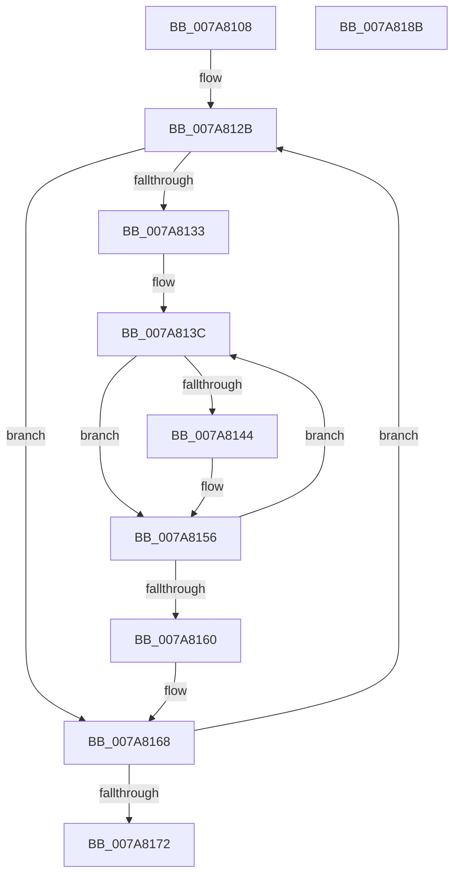

# SmKmCleanup

- RVA: `0x007A8108`–`0x007A818C` (길이 `132` bytes)
- VA: `0x00000001407A8108`
- 실행 섹션: `PAGE`
- PDB 이름 있음: `예`; PDB Function 태그: `아니요`
- unwind 정보 RVA: `0x00060300`
- 디코드: `40`개 명령, `132/132` bytes 표시
- 미해석 바이트: `0` (있으면 어셈블리에 `.byte`로 보존)

> 이 문서는 커널 이미지의 기계어와 PDB 기호를 분석해 생성했습니다. 4번과 5번은 함수 원형과 자료형을 바이너리 사용 방식에서 추정한 C 해석이며 원본 소스 복구 결과는 아닙니다.

## 1. Dependencies

- 직접 호출 지점: **3**; 고유 호출 대상: **3**
- 직접 호출자로 확인된 함수: **1**
- RIP 상대 이미지 참조: **0**

### Outgoing calls
- `0x007A8144` → [SmStoreGetId](../../text/4F/SmStoreGetId_function_004FC730.md) (function, `0x004FC730`)
- `0x007A8151` → [SmKmStoreDelete](../A6/SmKmStoreDelete_function_00A6D7D0.md) (function, `0x00A6D7D0`)
- `0x007A8163` → [CmSiFreeMemory](../../text/47/CmSiFreeMemory_function_00475D80.md) (function, `0x00475D80`)

### Direct callers
- [SMKM_STORE_MGR&lt;SM_TRAITS&gt;::SmCleanup](../../text/60/SMKM_STORE_MGR_SM_TRAITS_SmCleanup_function_0060C214.md) at `0x0060C21D`

### Static image references
- 디코드된 RIP-relative 메모리 참조가 없습니다.

## 2. Other-region calls and transfers

- 다른 실행 섹션으로 향하는 call: **2**
  - `0x007A8144` → [SmStoreGetId](../../text/4F/SmStoreGetId_function_004FC730.md) (`PAGE` → `.text`)
  - `0x007A8163` → [CmSiFreeMemory](../../text/47/CmSiFreeMemory_function_00475D80.md) (`PAGE` → `.text`)
- 별도 외부 분기/꼬리 이동을 확인하지 못했습니다.

## 3. Assembly (complete function range)

```asm
007A8108  48 89 5C 24 08                  mov qword ptr [rsp + 8], rbx
007A810D  48 89 6C 24 10                  mov qword ptr [rsp + 0x10], rbp
007A8112  48 89 74 24 18                  mov qword ptr [rsp + 0x18], rsi
007A8117  57                              push rdi
007A8118  41 56                           push r14
007A811A  41 57                           push r15
007A811C  48 83 EC 20                     sub rsp, 0x20
007A8120  4C 8B F9                        mov r15, rcx
007A8123  48 8B D9                        mov rbx, rcx
007A8126  BD 20 00 00 00                  mov ebp, 0x20
007A812B  48 8B 3B                        mov rdi, qword ptr [rbx]
007A812E  48 85 FF                        test rdi, rdi
007A8131  74 35                           je 0x1407a8168
007A8133  48 8B F7                        mov rsi, rdi
007A8136  41 BE 20 00 00 00               mov r14d, 0x20
007A813C  48 8B 0E                        mov rcx, qword ptr [rsi]
007A813F  48 85 C9                        test rcx, rcx
007A8142  74 12                           je 0x1407a8156
007A8144  E8 E7 45 D5 FF                  call 0x1404fc730
007A8149  8B D0                           mov edx, eax
007A814B  45 33 C0                        xor r8d, r8d
007A814E  49 8B CF                        mov rcx, r15
007A8151  E8 7A 56 2C 00                  call 0x140a6d7d0
007A8156  48 83 C6 28                     add rsi, 0x28
007A815A  49 83 EE 01                     sub r14, 1
007A815E  75 DC                           jne 0x1407a813c
007A8160  48 8B CF                        mov rcx, rdi
007A8163  E8 18 DC CC FF                  call 0x140475d80
007A8168  48 83 C3 08                     add rbx, 8
007A816C  48 83 ED 01                     sub rbp, 1
007A8170  75 B9                           jne 0x1407a812b
007A8172  48 8B 5C 24 40                  mov rbx, qword ptr [rsp + 0x40]
007A8177  48 8B 6C 24 48                  mov rbp, qword ptr [rsp + 0x48]
007A817C  48 8B 74 24 50                  mov rsi, qword ptr [rsp + 0x50]
007A8181  48 83 C4 20                     add rsp, 0x20
007A8185  41 5F                           pop r15
007A8187  41 5E                           pop r14
007A8189  5F                              pop rdi
007A818A  C3                              ret
007A818B  CC                              int3
```

## 4. C-style interpretation (structured pseudocode)

```c
__int64 __fastcall SmKmCleanup(__int64 a1, __int64 a2, int a3)
{
    __int64 result;
    __int64 v_r14;
    __int64 v_rbp;
    __int64 v_rbx;
    __int64 v_rsi;
    __int64 v_rsp;
    unsigned __int64 v_stack_p10;
    unsigned __int64 v_stack_p18;
    unsigned __int64 v_stack_p8;

    v_stack_p8 = v_rbx;
    v_stack_p10 = v_rbp;
    v_stack_p18 = v_rsi;
    v_rsp = (v_rsp) - (32);
loc_007A812B:
    if (*(unsigned __int64 *)(a1) == 0) goto loc_007A8168;
loc_007A813C:
    if (*(unsigned __int64 *)(*(unsigned __int64 *)(a1)) != 0) {
        result = SmStoreGetId(*(unsigned __int64 *)(*(unsigned __int64 *)(a1)), a2, a3, a4);
        a2 = (unsigned int)(result);
        a3 = 0;
        a1 = a1;
        result = SmKmStoreDelete(a1, a2, a3, a4);
    }
    v_rsi = (*(unsigned __int64 *)(a1)) + (40);
    v_r14 = (32) - (1);
    if (condition_is_not_equal) goto loc_007A813C;
    result = CmSiFreeMemory(*(unsigned __int64 *)(a1), a2, a3, a4);
loc_007A8168:
    v_rbx = (a1) + (8);
    v_rbp = (32) - (1);
    if (condition_is_not_equal) goto loc_007A812B;
    v_rsp = (v_rsp) + (32);
    return result;
}
```

## 5. (Beta) C Style

```c
int64_t SmKmCleanup(void *Arg1, int64_t Arg2, int32_t Arg3)
{
    uint8_t *arg1 = (uint8_t *)Arg1;

    int64_t result;
    int64_t local_r14;
    int64_t local_rbp;
    int64_t local_rbx;
    int64_t local_rsi;
    int64_t local_rsp;
    uint64_t v_stack_p10;
    uint64_t v_stack_p18;
    uint64_t v_stack_p8;

    v_stack_p8 = local_rbx;
    v_stack_p10 = local_rbp;
    v_stack_p18 = local_rsi;
    local_rsp = (local_rsp) - (32);
loc_007A812B:
    if (*(uint64_t *)(arg1) == 0) goto loc_007A8168;
loc_007A813C:
    if (*(uint64_t *)(*(uint64_t *)(arg1)) != 0) {
        result = SmStoreGetId(*(uint64_t *)(*(uint64_t *)(arg1)), Arg2, Arg3, a4);
        Arg2 = (uint32_t)(result);
        Arg3 = 0;
        Arg1 = Arg1;
        result = SmKmStoreDelete(Arg1, Arg2, Arg3, a4);
    }
    local_rsi = (*(uint64_t *)(arg1)) + (40);
    local_r14 = (32) - (1);
    if (condition_is_not_equal) goto loc_007A813C;
    result = CmSiFreeMemory(*(uint64_t *)(arg1), Arg2, Arg3, a4);
loc_007A8168:
    local_rbx = (Arg1) + (8);
    local_rbp = (32) - (1);
    if (condition_is_not_equal) goto loc_007A812B;
    local_rsp = (local_rsp) + (32);
    return result;
}
```

### 관측된 메모리 오프셋

구조체 형식이 확인되지 않은 접근은 인자 기준의 오프셋으로만 기록했습니다.

| 기준 인자 | 오프셋 표현 | 폭 (bit) | 접근 |
|---|---:|---:|---|
| `Arg1` | `+ 0x0` | `64` | `R` |

## 6. Execution-region graph

[열기: 2D/3D 그래프와 함수 탐색 컨트롤 패널](../../../control-panel.html?section=page&rva=0x007A8108&view=graph)

- 2D 그래프는 위에서 아래로 흐르고, 3D 그래프는 빈 공간을 드래그해 회전합니다. Shift+드래그는 이동, 휠은 확대·축소, 함수 노드 선택은 대상 보고서 이동입니다.

### Static fallback


