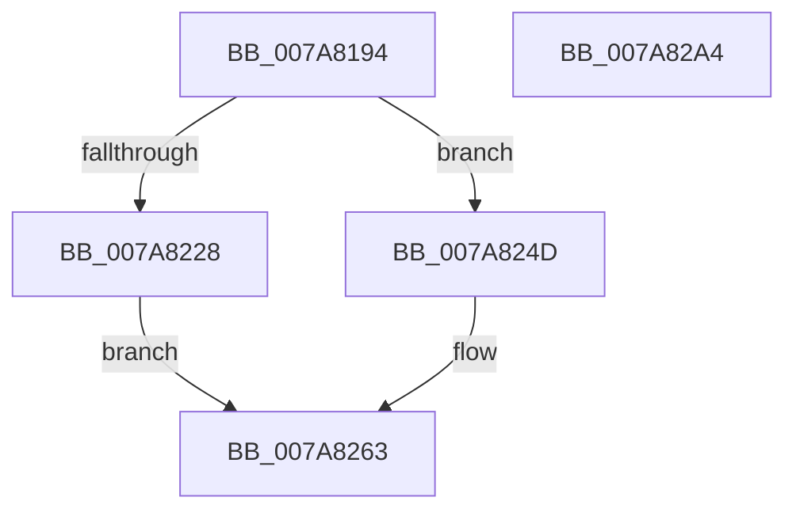

# SmKmEtwLogStoreChange

- RVA: `0x007A8194`–`0x007A82A5` (길이 `273` bytes)
- VA: `0x00000001407A8194`
- 실행 섹션: `PAGE`
- PDB 이름 있음: `예`; PDB Function 태그: `아니요`
- unwind 정보 RVA: `0x000D1E48`
- 디코드: `70`개 명령, `273/273` bytes 표시
- 미해석 바이트: `0` (있으면 어셈블리에 `.byte`로 보존)

> 이 문서는 커널 이미지의 기계어와 PDB 기호를 분석해 생성했습니다. 4번과 5번은 함수 원형과 자료형을 바이너리 사용 방식에서 추정한 C 해석이며 원본 소스 복구 결과는 아닙니다.

## 1. Dependencies

- 직접 호출 지점: **5**; 고유 호출 대상: **4**
- 직접 호출자로 확인된 함수: **3**
- RIP 상대 이미지 참조: **2**

### Outgoing calls
- `0x007A81D7` → [memset](../../text/6C/memset_function_006C6C40.md) (function, `0x006C6C40`)
- `0x007A81E9` → [memset](../../text/6C/memset_function_006C6C40.md) (function, `0x006C6C40`)
- `0x007A8255` → [SMKM_STORE<SM_TRAITS>::SmStEtwFillStoreEvent](../../text/61/SMKM_STORE_SM_TRAITS_SmStEtwFillStoreEvent_function_0061058C.md) (function, `0x0061058C`)
- `0x007A8282` → [EtwWriteEx](../../text/25/EtwWriteEx_function_0025F0D0.md) (function, `0x0025F0D0`)
- `0x007A8291` → [_security_check_cookie](../../text/6A/_security_check_cookie_function_006AC640.md) (function, `0x006AC640`)

### Direct callers
- [SmEtwEnableCallback](SmEtwEnableCallback_function_007AA080.md) at `0x007AA160`
- [SmKmStoreAdd](../A5/SmKmStoreAdd_function_00A512D0.md) at `0x00A51630`
- [SmKmStoreDelete](../A6/SmKmStoreDelete_function_00A6D7D0.md) at `0x00A6DA25`

### Static image references
- `0x007A81AA` → RVA `0x00E0A740` (`.data`; read)
- `0x007A8204` → RVA `0x000215E0` (`.rdata`; read)

## 2. Other-region calls and transfers

- 다른 실행 섹션으로 향하는 call: **5**
  - `0x007A81D7` → [memset](../../text/6C/memset_function_006C6C40.md) (`PAGE` → `.text`)
  - `0x007A81E9` → [memset](../../text/6C/memset_function_006C6C40.md) (`PAGE` → `.text`)
  - `0x007A8255` → [SMKM_STORE<SM_TRAITS>::SmStEtwFillStoreEvent](../../text/61/SMKM_STORE_SM_TRAITS_SmStEtwFillStoreEvent_function_0061058C.md) (`PAGE` → `.text`)
  - `0x007A8282` → [EtwWriteEx](../../text/25/EtwWriteEx_function_0025F0D0.md) (`PAGE` → `.text`)
  - `0x007A8291` → [_security_check_cookie](../../text/6A/_security_check_cookie_function_006AC640.md) (`PAGE` → `.text`)
- 별도 외부 분기/꼬리 이동을 확인하지 못했습니다.

## 3. Assembly (complete function range)

```asm
007A8194  40 55                           push rbp
007A8196  53                              push rbx
007A8197  56                              push rsi
007A8198  57                              push rdi
007A8199  41 57                           push r15
007A819B  48 8D AC 24 90 FE FF FF         lea rbp, [rsp - 0x170]
007A81A3  48 81 EC 70 02 00 00            sub rsp, 0x270
007A81AA  48 8B 05 8F 25 66 00            mov rax, qword ptr [rip + 0x66258f]
007A81B1  48 33 C4                        xor rax, rsp
007A81B4  48 89 85 60 01 00 00            mov qword ptr [rbp + 0x160], rax
007A81BB  49 8B F8                        mov rdi, r8
007A81BE  48 8B DA                        mov rbx, rdx
007A81C1  48 8B F1                        mov rsi, rcx
007A81C4  0F 57 C0                        xorps xmm0, xmm0
007A81C7  33 D2                           xor edx, edx
007A81C9  48 8D 4D 20                     lea rcx, [rbp + 0x20]
007A81CD  41 B8 40 01 00 00               mov r8d, 0x140
007A81D3  0F 11 45 10                     movups xmmword ptr [rbp + 0x10], xmm0
007A81D7  E8 64 EA F1 FF                  call 0x1406c6c40
007A81DC  33 D2                           xor edx, edx
007A81DE  48 8D 4C 24 60                  lea rcx, [rsp + 0x60]
007A81E3  41 B8 A8 00 00 00               mov r8d, 0xa8
007A81E9  E8 52 EA F1 FF                  call 0x1406c6c40
007A81EE  48 8D 44 24 60                  lea rax, [rsp + 0x60]
007A81F3  48 C7 44 24 54 15 00 00 00      mov qword ptr [rsp + 0x54], 0x15
007A81FC  45 33 FF                        xor r15d, r15d
007A81FF  48 89 44 24 48                  mov qword ptr [rsp + 0x48], rax
007A8204  48 8D 05 D5 93 87 FF            lea rax, [rip - 0x786c2b]
007A820B  41 8B D7                        mov edx, r15d
007A820E  89 54 24 50                     mov dword ptr [rsp + 0x50], edx
007A8212  4C 8D 45 10                     lea r8, [rbp + 0x10]
007A8216  4C 89 44 24 40                  mov qword ptr [rsp + 0x40], r8
007A821B  C7 44 24 5C A8 00 00 00         mov dword ptr [rsp + 0x5c], 0xa8
007A8223  48 3B F8                        cmp rdi, rax
007A8226  75 25                           jne 0x1407a824d
007A8228  41 8B C7                        mov eax, r15d
007A822B  48 8D 4C 24 60                  lea rcx, [rsp + 0x60]
007A8230  48 03 C8                        add rcx, rax
007A8233  8B C2                           mov eax, edx
007A8235  48 03 C0                        add rax, rax
007A8238  FF C2                           inc edx
007A823A  48 89 19                        mov qword ptr [rcx], rbx
007A823D  48 89 4C C5 10                  mov qword ptr [rbp + rax*8 + 0x10], rcx
007A8242  48 C7 44 C5 18 08 00 00 00      mov qword ptr [rbp + rax*8 + 0x18], 8
007A824B  EB 16                           jmp 0x1407a8263
007A824D  48 8D 54 24 40                  lea rdx, [rsp + 0x40]
007A8252  48 8B CB                        mov rcx, rbx
007A8255  E8 32 83 E6 FF                  call 0x14061058c
007A825A  8B 54 24 50                     mov edx, dword ptr [rsp + 0x50]
007A825E  4C 8B 44 24 40                  mov r8, qword ptr [rsp + 0x40]
007A8263  48 8B 0E                        mov rcx, qword ptr [rsi]
007A8266  45 33 C9                        xor r9d, r9d
007A8269  4C 89 44 24 38                  mov qword ptr [rsp + 0x38], r8
007A826E  45 33 C0                        xor r8d, r8d
007A8271  89 54 24 30                     mov dword ptr [rsp + 0x30], edx
007A8275  48 8B D7                        mov rdx, rdi
007A8278  4C 89 7C 24 28                  mov qword ptr [rsp + 0x28], r15
007A827D  4C 89 7C 24 20                  mov qword ptr [rsp + 0x20], r15
007A8282  E8 49 6E AB FF                  call 0x14025f0d0
007A8287  48 8B 8D 60 01 00 00            mov rcx, qword ptr [rbp + 0x160]
007A828E  48 33 CC                        xor rcx, rsp
007A8291  E8 AA 43 F0 FF                  call 0x1406ac640
007A8296  48 81 C4 70 02 00 00            add rsp, 0x270
007A829D  41 5F                           pop r15
007A829F  5F                              pop rdi
007A82A0  5E                              pop rsi
007A82A1  5B                              pop rbx
007A82A2  5D                              pop rbp
007A82A3  C3                              ret
007A82A4  CC                              int3
```

## 4. C-style interpretation (structured pseudocode)

```c
__int64 __fastcall SmKmEtwLogStoreChange(__int64 a1, __int64 a2, __int64 a3, int a4)
{
    __int64 result;
    __int64 v_r15;
    __int64 v_rsp;
    unsigned __int64 v_stack_m178;
    unsigned __int64 v_stack_m188;
    unsigned __int64 v_stack_m198;
    unsigned __int64 v_stack_m238;
    unsigned int v_stack_m23C;
    unsigned __int64 v_stack_m244;
    unsigned int v_stack_m248;
    unsigned __int64 v_stack_m250;
    unsigned __int64 v_stack_m258;
    unsigned __int64 v_stack_m260;
    unsigned int v_stack_m268;
    unsigned __int64 v_stack_m270;
    unsigned __int64 v_stack_m278;
    unsigned __int64 v_stack_m38;

    v_rsp = (v_rsp) - (624);
    result = (*(unsigned __int64 *)(v_rip + 6694287)) ^ (v_rsp);
    v_stack_m38 = result;
    a2 = 0;
    v_stack_m188 = v_xmm0;
    result = memset(v_stack_m178, a2, 320, a4);
    a2 = 0;
    result = memset(v_stack_m238, a2, 168, a4);
    v_stack_m244 = 21;
    v_r15 = 0;
    v_stack_m250 = v_stack_m238;
    v_stack_m248 = 0;
    v_stack_m258 = v_stack_m188;
    v_stack_m23C = 168;
    if (a3 != (v_rip - 7892011)) goto loc_007A824D;
    a1 = (v_stack_m238) + (0);
    result = (0) + (0);
    a2 = (unsigned int)((0) + 1);
    *(unsigned __int64 *)(a1) = a2;
    *(unsigned __int64 *)(v_stack_m198 + result * 8 + 16) = a1;
    *(unsigned __int64 *)(v_stack_m198 + result * 8 + 24) = 8;
    goto loc_007A8263;
loc_007A824D:
    result = SMKM_STORE_SM_TRAITS___SmStEtwFillStoreEvent(a2, v_stack_m258, v_stack_m188, a4);
loc_007A8263:
    a4 = 0;
    v_stack_m260 = v_stack_m258;
    a3 = 0;
    v_stack_m268 = (unsigned int)((unsigned int)(v_stack_m248));
    v_stack_m270 = 0;
    v_stack_m278 = 0;
    result = EtwWriteEx(*(unsigned __int64 *)(a1), 0, a3, a4);
    a1 = (v_stack_m38) ^ (v_rsp);
    result = _security_check_cookie(a1, 0, a3, a4);
    v_rsp = (v_rsp) + (624);
    return result;
}
```

## 5. (Beta) C Style

```c
int64_t SmKmEtwLogStoreChange(void *Arg1, int64_t Arg2, int64_t Arg3, int32_t Arg4)
{
    uint8_t *arg1 = (uint8_t *)Arg1;

    int64_t result;
    int64_t local_r15;
    int64_t local_rsp;
    uint64_t v_stack_m178;
    uint64_t v_stack_m188;
    uint64_t v_stack_m198;
    uint64_t v_stack_m238;
    uint32_t v_stack_m23C;
    uint64_t v_stack_m244;
    uint32_t v_stack_m248;
    uint64_t v_stack_m250;
    uint64_t v_stack_m258;
    uint64_t v_stack_m260;
    uint32_t v_stack_m268;
    uint64_t v_stack_m270;
    uint64_t v_stack_m278;
    uint64_t v_stack_m38;

    local_rsp = (local_rsp) - (624);
    result = (*(uint64_t *)(v_rip + 0x66258F)) ^ (local_rsp);
    v_stack_m38 = result;
    Arg2 = 0;
    v_stack_m188 = v_xmm0;
    result = memset(v_stack_m178, Arg2, 320, Arg4);
    Arg2 = 0;
    result = memset(v_stack_m238, Arg2, 168, Arg4);
    v_stack_m244 = 21;
    local_r15 = 0;
    v_stack_m250 = v_stack_m238;
    v_stack_m248 = 0;
    v_stack_m258 = v_stack_m188;
    v_stack_m23C = 168;
    if (Arg3 != (v_rip - 7892011)) goto loc_007A824D;
    Arg1 = (v_stack_m238) + (0);
    result = (0) + (0);
    Arg2 = (uint32_t)((0) + 1);
    *(uint64_t *)(arg1) = Arg2;
    *(void **)(v_stack_m198 + result * 8 + 0x10) = Arg1;
    *(uint64_t *)(v_stack_m198 + result * 8 + 0x18) = 8;
    goto loc_007A8263;
loc_007A824D:
    result = SMKM_STORE_SM_TRAITS___SmStEtwFillStoreEvent(Arg2, v_stack_m258, v_stack_m188, Arg4);
loc_007A8263:
    Arg4 = 0;
    v_stack_m260 = v_stack_m258;
    Arg3 = 0;
    v_stack_m268 = (uint32_t)((uint32_t)(v_stack_m248));
    v_stack_m270 = 0;
    v_stack_m278 = 0;
    result = EtwWriteEx(*(uint64_t *)(arg1), 0, Arg3, Arg4);
    Arg1 = (v_stack_m38) ^ (local_rsp);
    result = _security_check_cookie(Arg1, 0, Arg3, Arg4);
    local_rsp = (local_rsp) + (624);
    return result;
}
```

### 관측된 메모리 오프셋

구조체 형식이 확인되지 않은 접근은 인자 기준의 오프셋으로만 기록했습니다.

| 기준 인자 | 오프셋 표현 | 폭 (bit) | 접근 |
|---|---:|---:|---|
| `Arg1` | `+ 0x0` | `64` | `R` |

## 6. Execution-region graph

[열기: 2D/3D 그래프와 함수 탐색 컨트롤 패널](../../../control-panel.html?section=page&rva=0x007A8194&view=graph)

- 2D 그래프는 위에서 아래로 흐르고, 3D 그래프는 빈 공간을 드래그해 회전합니다. Shift+드래그는 이동, 휠은 확대·축소, 함수 노드 선택은 대상 보고서 이동입니다.

### Static fallback


