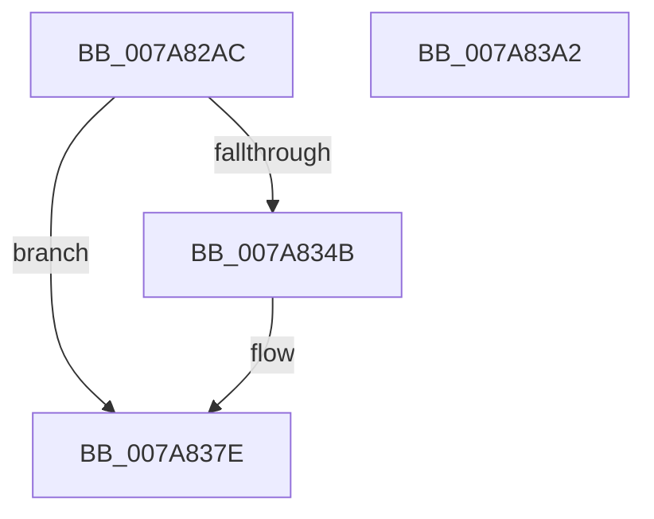

# SmKmEtwLogStoreStats

- RVA: `0x007A82AC`–`0x007A83A3` (길이 `247` bytes)
- VA: `0x00000001407A82AC`
- 실행 섹션: `PAGE`
- PDB 이름 있음: `예`; PDB Function 태그: `아니요`
- unwind 정보 RVA: `0x000D1E28`
- 디코드: `53`개 명령, `247/247` bytes 표시
- 미해석 바이트: `0` (있으면 어셈블리에 `.byte`로 보존)

> 이 문서는 커널 이미지의 기계어와 PDB 기호를 분석해 생성했습니다. 4번과 5번은 함수 원형과 자료형을 바이너리 사용 방식에서 추정한 C 해석이며 원본 소스 복구 결과는 아닙니다.

## 1. Dependencies

- 직접 호출 지점: **4**; 고유 호출 대상: **4**
- 직접 호출자로 확인된 함수: **2**
- RIP 상대 이미지 참조: **2**

### Outgoing calls
- `0x007A8305` → [memset](../../text/6C/memset_function_006C6C40.md) (function, `0x006C6C40`)
- `0x007A8342` → [SMKM_STORE<SM_TRAITS>::SmStEtwFillStoreStatsEvent](../../text/61/SMKM_STORE_SM_TRAITS_SmStEtwFillStoreStatsEvent_function_006109A4.md) (function, `0x006109A4`)
- `0x007A8379` → [EtwWriteEx](../../text/25/EtwWriteEx_function_0025F0D0.md) (function, `0x0025F0D0`)
- `0x007A8388` → [_security_check_cookie](../../text/6A/_security_check_cookie_function_006AC640.md) (function, `0x006AC640`)

### Direct callers
- [SmEtwEnableCallback](SmEtwEnableCallback_function_007AA080.md) at `0x007AA14A`
- [SmKmStoreDelete](../A6/SmKmStoreDelete_function_00A6D7D0.md) at `0x00A6DA13`

### Static image references
- `0x007A82C6` → RVA `0x00E0A740` (`.data`; read)
- `0x007A8350` → RVA `0x00022638` (`.rdata`; read)

## 2. Other-region calls and transfers

- 다른 실행 섹션으로 향하는 call: **4**
  - `0x007A8305` → [memset](../../text/6C/memset_function_006C6C40.md) (`PAGE` → `.text`)
  - `0x007A8342` → [SMKM_STORE<SM_TRAITS>::SmStEtwFillStoreStatsEvent](../../text/61/SMKM_STORE_SM_TRAITS_SmStEtwFillStoreStatsEvent_function_006109A4.md) (`PAGE` → `.text`)
  - `0x007A8379` → [EtwWriteEx](../../text/25/EtwWriteEx_function_0025F0D0.md) (`PAGE` → `.text`)
  - `0x007A8388` → [_security_check_cookie](../../text/6A/_security_check_cookie_function_006AC640.md) (`PAGE` → `.text`)
- 별도 외부 분기/꼬리 이동을 확인하지 못했습니다.

## 3. Assembly (complete function range)

```asm
007A82AC  48 89 5C 24 18                  mov qword ptr [rsp + 0x18], rbx
007A82B1  48 89 7C 24 20                  mov qword ptr [rsp + 0x20], rdi
007A82B6  55                              push rbp
007A82B7  48 8D AC 24 10 FB FF FF         lea rbp, [rsp - 0x4f0]
007A82BF  48 81 EC F0 05 00 00            sub rsp, 0x5f0
007A82C6  48 8B 05 73 24 66 00            mov rax, qword ptr [rip + 0x662473]
007A82CD  48 33 C4                        xor rax, rsp
007A82D0  48 89 85 E0 04 00 00            mov qword ptr [rbp + 0x4e0], rax
007A82D7  0F 57 C9                        xorps xmm1, xmm1
007A82DA  48 8B DA                        mov rbx, rdx
007A82DD  48 8B F9                        mov rdi, rcx
007A82E0  0F 57 C0                        xorps xmm0, xmm0
007A82E3  33 D2                           xor edx, edx
007A82E5  48 8D 4C 24 60                  lea rcx, [rsp + 0x60]
007A82EA  41 B8 50 05 00 00               mov r8d, 0x550
007A82F0  0F 11 85 B0 04 00 00            movups xmmword ptr [rbp + 0x4b0], xmm0
007A82F7  0F 11 8D C0 04 00 00            movups xmmword ptr [rbp + 0x4c0], xmm1
007A82FE  0F 11 8D D0 04 00 00            movups xmmword ptr [rbp + 0x4d0], xmm1
007A8305  E8 36 E9 F1 FF                  call 0x1406c6c40
007A830A  83 64 24 50 00                  and dword ptr [rsp + 0x50], 0
007A830F  48 8D 85 B0 04 00 00            lea rax, [rbp + 0x4b0]
007A8316  83 64 24 58 00                  and dword ptr [rsp + 0x58], 0
007A831B  48 8D 54 24 40                  lea rdx, [rsp + 0x40]
007A8320  48 89 44 24 40                  mov qword ptr [rsp + 0x40], rax
007A8325  48 8B CB                        mov rcx, rbx
007A8328  48 8D 44 24 60                  lea rax, [rsp + 0x60]
007A832D  C7 44 24 54 03 00 00 00         mov dword ptr [rsp + 0x54], 3
007A8335  48 89 44 24 48                  mov qword ptr [rsp + 0x48], rax
007A833A  C7 44 24 5C 50 05 00 00         mov dword ptr [rsp + 0x5c], 0x550
007A8342  E8 5D 86 E6 FF                  call 0x1406109a4
007A8347  85 C0                           test eax, eax
007A8349  74 33                           je 0x1407a837e
007A834B  48 8B 44 24 40                  mov rax, qword ptr [rsp + 0x40]
007A8350  48 8D 15 E1 A2 87 FF            lea rdx, [rip - 0x785d1f]
007A8357  48 8B 0F                        mov rcx, qword ptr [rdi]
007A835A  45 33 C9                        xor r9d, r9d
007A835D  48 89 44 24 38                  mov qword ptr [rsp + 0x38], rax
007A8362  45 33 C0                        xor r8d, r8d
007A8365  8B 44 24 50                     mov eax, dword ptr [rsp + 0x50]
007A8369  89 44 24 30                     mov dword ptr [rsp + 0x30], eax
007A836D  48 83 64 24 28 00               and qword ptr [rsp + 0x28], 0
007A8373  48 83 64 24 20 00               and qword ptr [rsp + 0x20], 0
007A8379  E8 52 6D AB FF                  call 0x14025f0d0
007A837E  48 8B 8D E0 04 00 00            mov rcx, qword ptr [rbp + 0x4e0]
007A8385  48 33 CC                        xor rcx, rsp
007A8388  E8 B3 42 F0 FF                  call 0x1406ac640
007A838D  4C 8D 9C 24 F0 05 00 00         lea r11, [rsp + 0x5f0]
007A8395  49 8B 5B 20                     mov rbx, qword ptr [r11 + 0x20]
007A8399  49 8B 7B 28                     mov rdi, qword ptr [r11 + 0x28]
007A839D  49 8B E3                        mov rsp, r11
007A83A0  5D                              pop rbp
007A83A1  C3                              ret
007A83A2  CC                              int3
```

## 4. C-style interpretation (structured pseudocode)

```c
__int64 __fastcall SmKmEtwLogStoreStats(__int64 a1, __int64 a2, __int64 a3, int a4)
{
    __int64 result;
    __int64 v_rsp;
    unsigned __int64 v_stack_m18;
    unsigned __int64 v_stack_m28;
    unsigned __int64 v_stack_m38;
    unsigned __int64 v_stack_m48;
    unsigned __int64 v_stack_m4F8;
    unsigned __int64 v_stack_m598;
    unsigned int v_stack_m59C;
    unsigned int v_stack_m5A0;
    unsigned int v_stack_m5A4;
    unsigned int v_stack_m5A8;
    unsigned __int64 v_stack_m5B0;
    unsigned __int64 v_stack_m5B8;
    unsigned __int64 v_stack_m5C0;
    unsigned int v_stack_m5C8;
    unsigned __int64 v_stack_m5D0;
    unsigned __int64 v_stack_m5D8;
    unsigned __int64 v_stack_m8;
    unsigned __int64 v_stack_p18;
    unsigned __int64 v_stack_p20;

    v_stack_p18 = v_rbx;
    v_stack_p20 = v_rdi;
    v_rsp = (v_rsp) - (0x5F0ULL);
    result = (*(unsigned __int64 *)(v_rip + 6694003)) ^ (v_rsp);
    v_stack_m18 = result;
    a2 = 0;
    v_stack_m48 = v_xmm0;
    v_stack_m38 = v_xmm1;
    v_stack_m28 = v_xmm1;
    result = memset(v_stack_m598, a2, (unsigned int)(0x550ULL), a4);
    v_stack_m5B8 = v_stack_m48;
    v_stack_m5A4 = 3;
    v_stack_m5B0 = v_stack_m598;
    v_stack_m59C = 0x550ULL;
    result = SMKM_STORE_SM_TRAITS___SmStEtwFillStoreStatsEvent(0, v_stack_m5B8, (unsigned int)(0x550ULL), a4);
    if ((unsigned int)(result) != 0) {
        result = v_stack_m5B8;
        a2 = v_rip - 7888159;
        a1 = *(unsigned __int64 *)(a1);
        a4 = 0;
        v_stack_m5C0 = result;
        a3 = 0;
        result = v_stack_m5A8;
        v_stack_m5C8 = (unsigned int)(result);
        result = EtwWriteEx(a1, a2, a3, a4);
    }
    a1 = (v_stack_m18) ^ (v_rsp);
    result = _security_check_cookie(a1, a2, a3, a4);
    return result;
}
```

## 5. (Beta) C Style

```c
int64_t SmKmEtwLogStoreStats(void *Arg1, int64_t Arg2, int64_t Arg3, int32_t Arg4)
{
    uint8_t *arg1 = (uint8_t *)Arg1;

    int64_t result;
    int64_t local_rsp;
    uint64_t v_stack_m18;
    uint64_t v_stack_m28;
    uint64_t v_stack_m38;
    uint64_t v_stack_m48;
    uint64_t v_stack_m4F8;
    uint64_t v_stack_m598;
    uint32_t v_stack_m59C;
    uint32_t v_stack_m5A0;
    uint32_t v_stack_m5A4;
    uint32_t v_stack_m5A8;
    uint64_t v_stack_m5B0;
    uint64_t v_stack_m5B8;
    uint64_t v_stack_m5C0;
    uint32_t v_stack_m5C8;
    uint64_t v_stack_m5D0;
    uint64_t v_stack_m5D8;
    uint64_t v_stack_m8;
    uint64_t v_stack_p18;
    uint64_t v_stack_p20;

    v_stack_p18 = local_rbx;
    v_stack_p20 = local_rdi;
    local_rsp = (local_rsp) - (0x5F0ULL);
    result = (*(uint64_t *)(v_rip + 0x662473)) ^ (local_rsp);
    v_stack_m18 = result;
    Arg2 = 0;
    v_stack_m48 = v_xmm0;
    v_stack_m38 = v_xmm1;
    v_stack_m28 = v_xmm1;
    result = memset(v_stack_m598, Arg2, (uint32_t)(0x550ULL), Arg4);
    v_stack_m5B8 = v_stack_m48;
    v_stack_m5A4 = 3;
    v_stack_m5B0 = v_stack_m598;
    v_stack_m59C = 0x550ULL;
    result = SMKM_STORE_SM_TRAITS___SmStEtwFillStoreStatsEvent(0, v_stack_m5B8, (uint32_t)(0x550ULL), Arg4);
    if ((uint32_t)(result) != 0) {
        result = v_stack_m5B8;
        Arg2 = v_rip - 7888159;
        Arg1 = *(uint64_t *)(arg1);
        Arg4 = 0;
        v_stack_m5C0 = result;
        Arg3 = 0;
        result = v_stack_m5A8;
        v_stack_m5C8 = (uint32_t)(result);
        result = EtwWriteEx(Arg1, Arg2, Arg3, Arg4);
    }
    Arg1 = (v_stack_m18) ^ (local_rsp);
    result = _security_check_cookie(Arg1, Arg2, Arg3, Arg4);
    return result;
}
```

### 관측된 메모리 오프셋

구조체 형식이 확인되지 않은 접근은 인자 기준의 오프셋으로만 기록했습니다.

| 기준 인자 | 오프셋 표현 | 폭 (bit) | 접근 |
|---|---:|---:|---|
| `Arg1` | `+ 0x0` | `64` | `R` |

## 6. Execution-region graph

[열기: 2D/3D 그래프와 함수 탐색 컨트롤 패널](../../../control-panel.html?section=page&rva=0x007A82AC&view=graph)

- 2D 그래프는 위에서 아래로 흐르고, 3D 그래프는 빈 공간을 드래그해 회전합니다. Shift+드래그는 이동, 휠은 확대·축소, 함수 노드 선택은 대상 보고서 이동입니다.

### Static fallback


