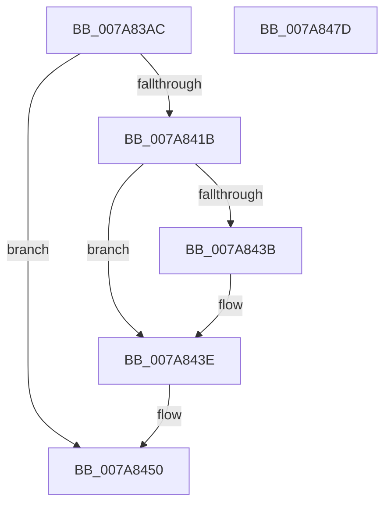

# SmKmFileInfoGetPath

- RVA: `0x007A83AC`–`0x007A847E` (길이 `210` bytes)
- VA: `0x00000001407A83AC`
- 실행 섹션: `PAGE`
- PDB 이름 있음: `예`; PDB Function 태그: `아니요`
- unwind 정보 RVA: `0x000D1FB8`
- 디코드: `56`개 명령, `210/210` bytes 표시
- 미해석 바이트: `0` (있으면 어셈블리에 `.byte`로 보존)

> 이 문서는 커널 이미지의 기계어와 PDB 기호를 분석해 생성했습니다. 4번과 5번은 함수 원형과 자료형을 바이너리 사용 방식에서 추정한 C 해석이며 원본 소스 복구 결과는 아닙니다.

## 1. Dependencies

- 직접 호출 지점: **7**; 고유 호출 대상: **5**
- 직접 호출자로 확인된 함수: **2**
- RIP 상대 이미지 참조: **1**

### Outgoing calls
- `0x007A83E8` → [memset](../../text/6C/memset_function_006C6C40.md) (function, `0x006C6C40`)
- `0x007A83EF` → [IoSetThreadHardErrorMode](../../text/46/IoSetThreadHardErrorMode_function_00466BF0.md) (function, `0x00466BF0`)
- `0x007A8410` → [ObQueryNameStringMode](../8A/ObQueryNameStringMode_function_008A7ED0.md) (function, `0x008A7ED0`)
- `0x007A8423` → [memset](../../text/6C/memset_function_006C6C40.md) (function, `0x006C6C40`)
- `0x007A8449` → [memcpy](../../text/6C/memcpy_function_006C6840.md) (function, `0x006C6840`)
- `0x007A8453` → [IoSetThreadHardErrorMode](../../text/46/IoSetThreadHardErrorMode_function_00466BF0.md) (function, `0x00466BF0`)
- `0x007A8465` → [_security_check_cookie](../../text/6A/_security_check_cookie_function_006AC640.md) (function, `0x006AC640`)

### Direct callers
- [SmProcessListRequestExtended](SmProcessListRequestExtended_function_007A6A28.md) at `0x007A6ADC`
- [SmcGetCacheStats](SmcGetCacheStats_function_007ABE0C.md) at `0x007ABEB3`

### Static image references
- `0x007A83BB` → RVA `0x00E0A740` (`.data`; read)

## 2. Other-region calls and transfers

- 다른 실행 섹션으로 향하는 call: **6**
  - `0x007A83E8` → [memset](../../text/6C/memset_function_006C6C40.md) (`PAGE` → `.text`)
  - `0x007A83EF` → [IoSetThreadHardErrorMode](../../text/46/IoSetThreadHardErrorMode_function_00466BF0.md) (`PAGE` → `.text`)
  - `0x007A8423` → [memset](../../text/6C/memset_function_006C6C40.md) (`PAGE` → `.text`)
  - `0x007A8449` → [memcpy](../../text/6C/memcpy_function_006C6840.md) (`PAGE` → `.text`)
  - `0x007A8453` → [IoSetThreadHardErrorMode](../../text/46/IoSetThreadHardErrorMode_function_00466BF0.md) (`PAGE` → `.text`)
  - `0x007A8465` → [_security_check_cookie](../../text/6A/_security_check_cookie_function_006AC640.md) (`PAGE` → `.text`)
- 별도 외부 분기/꼬리 이동을 확인하지 못했습니다.

## 3. Assembly (complete function range)

```asm
007A83AC  48 89 5C 24 20                  mov qword ptr [rsp + 0x20], rbx
007A83B1  55                              push rbp
007A83B2  56                              push rsi
007A83B3  57                              push rdi
007A83B4  48 81 EC 60 02 00 00            sub rsp, 0x260
007A83BB  48 8B 05 7E 23 66 00            mov rax, qword ptr [rip + 0x66237e]
007A83C2  48 33 C4                        xor rax, rsp
007A83C5  48 89 84 24 50 02 00 00         mov qword ptr [rsp + 0x250], rax
007A83CD  83 64 24 30 00                  and dword ptr [rsp + 0x30], 0
007A83D2  48 8B F2                        mov rsi, rdx
007A83D5  41 8B F8                        mov edi, r8d
007A83D8  48 8B D9                        mov rbx, rcx
007A83DB  33 D2                           xor edx, edx
007A83DD  48 8D 4C 24 40                  lea rcx, [rsp + 0x40]
007A83E2  41 B8 10 02 00 00               mov r8d, 0x210
007A83E8  E8 53 E8 F1 FF                  call 0x1406c6c40
007A83ED  33 C9                           xor ecx, ecx
007A83EF  E8 FC E7 CB FF                  call 0x140466bf0
007A83F4  48 8B 4B 08                     mov rcx, qword ptr [rbx + 8]
007A83F8  4C 8D 4C 24 30                  lea r9, [rsp + 0x30]
007A83FD  41 B8 10 02 00 00               mov r8d, 0x210
007A8403  C6 44 24 20 00                  mov byte ptr [rsp + 0x20], 0
007A8408  48 8D 54 24 40                  lea rdx, [rsp + 0x40]
007A840D  40 8A E8                        mov bpl, al
007A8410  E8 BB FA 0F 00                  call 0x1408a7ed0
007A8415  8B D8                           mov ebx, eax
007A8417  85 C0                           test eax, eax
007A8419  78 35                           js 0x1407a8450
007A841B  44 8B C7                        mov r8d, edi
007A841E  33 D2                           xor edx, edx
007A8420  48 8B CE                        mov rcx, rsi
007A8423  E8 18 E8 F1 FF                  call 0x1406c6c40
007A8428  0F B7 44 24 40                  movzx eax, word ptr [rsp + 0x40]
007A842D  48 8D 4F FE                     lea rcx, [rdi - 2]
007A8431  48 3B C1                        cmp rax, rcx
007A8434  0F B7 44 24 40                  movzx eax, word ptr [rsp + 0x40]
007A8439  72 03                           jb 0x1407a843e
007A843B  8D 47 FE                        lea eax, [rdi - 2]
007A843E  48 8B 54 24 48                  mov rdx, qword ptr [rsp + 0x48]
007A8443  48 8B CE                        mov rcx, rsi
007A8446  44 8B C0                        mov r8d, eax
007A8449  E8 F2 E3 F1 FF                  call 0x1406c6840
007A844E  33 DB                           xor ebx, ebx
007A8450  40 8A CD                        mov cl, bpl
007A8453  E8 98 E7 CB FF                  call 0x140466bf0
007A8458  8B C3                           mov eax, ebx
007A845A  48 8B 8C 24 50 02 00 00         mov rcx, qword ptr [rsp + 0x250]
007A8462  48 33 CC                        xor rcx, rsp
007A8465  E8 D6 41 F0 FF                  call 0x1406ac640
007A846A  48 8B 9C 24 98 02 00 00         mov rbx, qword ptr [rsp + 0x298]
007A8472  48 81 C4 60 02 00 00            add rsp, 0x260
007A8479  5F                              pop rdi
007A847A  5E                              pop rsi
007A847B  5D                              pop rbp
007A847C  C3                              ret
007A847D  CC                              int3
```

## 4. C-style interpretation (structured pseudocode)

```c
__int64 __fastcall SmKmFileInfoGetPath(__int64 a1, __int64 a2, int a3)
{
    __int64 result;
    __int64 v_rbx;
    __int64 v_rsp;
    unsigned __int64 v_stack_m230;
    unsigned __int64 v_stack_m238;
    unsigned int v_stack_m248;
    unsigned __int8 v_stack_m258;
    unsigned __int64 v_stack_m28;
    unsigned __int64 v_stack_p20;

    v_stack_p20 = v_rbx;
    v_rsp = (v_rsp) - (608);
    result = (*(unsigned __int64 *)(v_rip + 6693758)) ^ (v_rsp);
    v_stack_m28 = result;
    a2 = 0;
    result = memset(v_stack_m238, a2, 528, a4);
    a1 = 0;
    result = IoSetThreadHardErrorMode(a1, a2, 528, a4);
    v_stack_m258 = 0;
    result = ObQueryNameStringMode(*(unsigned __int64 *)(a1 + 8), v_stack_m238, 528, v_stack_m248);
    if (sign_flag) goto loc_007A8450;
    a2 = 0;
    result = memset(0, a2, (unsigned int)((unsigned int)((unsigned int)(a3))), v_stack_m248);
    result = v_stack_m238;
    if (v_stack_m238 >= ((unsigned int)(a3) - 2)) {
        result = (unsigned int)(a3) - 2;
    }
    result = memcpy(0, v_stack_m230, (unsigned int)((unsigned int)(result)), v_stack_m248);
    v_rbx = 0;
loc_007A8450:
    result = IoSetThreadHardErrorMode((unsigned __int8)((unsigned __int8)(result)), v_stack_m230, (unsigned int)((unsigned int)(result)), v_stack_m248);
    a1 = (v_stack_m28) ^ (v_rsp);
    result = _security_check_cookie(a1, v_stack_m230, (unsigned int)((unsigned int)(result)), v_stack_m248);
    v_rsp = (v_rsp) + (608);
    return result;
}
```

## 5. (Beta) C Style

```c
int64_t SmKmFileInfoGetPath(void *Arg1, int64_t Arg2, void *Arg3)
{
    uint8_t *arg1 = (uint8_t *)Arg1;
    uint8_t *arg3 = (uint8_t *)Arg3;

    int64_t result;
    int64_t local_rbx;
    int64_t local_rsp;
    uint64_t v_stack_m230;
    uint64_t v_stack_m238;
    uint32_t v_stack_m248;
    uint8_t v_stack_m258;
    uint64_t v_stack_m28;
    uint64_t v_stack_p20;

    v_stack_p20 = local_rbx;
    local_rsp = (local_rsp) - (608);
    result = (*(uint64_t *)(v_rip + 0x66237E)) ^ (local_rsp);
    v_stack_m28 = result;
    Arg2 = 0;
    result = memset(v_stack_m238, Arg2, 528, a4);
    Arg1 = 0;
    result = IoSetThreadHardErrorMode(Arg1, Arg2, 528, a4);
    v_stack_m258 = 0;
    result = ObQueryNameStringMode(*(uint64_t *)(arg1 + 0x8), v_stack_m238, 528, v_stack_m248);
    if (sign_flag) goto loc_007A8450;
    Arg2 = 0;
    result = memset(0, Arg2, (uint32_t)((uint32_t)((uint32_t)(Arg3))), v_stack_m248);
    result = v_stack_m238;
    if (v_stack_m238 >= ((uint32_t)(Arg3) - 2)) {
        result = (uint32_t)(Arg3) - 2;
    }
    result = memcpy(0, v_stack_m230, (uint32_t)((uint32_t)(result)), v_stack_m248);
    local_rbx = 0;
loc_007A8450:
    result = IoSetThreadHardErrorMode((uint8_t)((uint8_t)(result)), v_stack_m230, (uint32_t)((uint32_t)(result)), v_stack_m248);
    Arg1 = (v_stack_m28) ^ (local_rsp);
    result = _security_check_cookie(Arg1, v_stack_m230, (uint32_t)((uint32_t)(result)), v_stack_m248);
    local_rsp = (local_rsp) + (608);
    return result;
}
```

### 관측된 메모리 오프셋

구조체 형식이 확인되지 않은 접근은 인자 기준의 오프셋으로만 기록했습니다.

| 기준 인자 | 오프셋 표현 | 폭 (bit) | 접근 |
|---|---:|---:|---|
| `Arg1` | `+ 0x8` | `64` | `R` |
| `Arg3` | `- 0x2` | `32` | `R` |
| `Arg3` | `- 0x2` | `64` | `R` |

## 6. Execution-region graph

[열기: 2D/3D 그래프와 함수 탐색 컨트롤 패널](../../../control-panel.html?section=page&rva=0x007A83AC&view=graph)

- 2D 그래프는 위에서 아래로 흐르고, 3D 그래프는 빈 공간을 드래그해 회전합니다. Shift+드래그는 이동, 휠은 확대·축소, 함수 노드 선택은 대상 보고서 이동입니다.

### Static fallback


