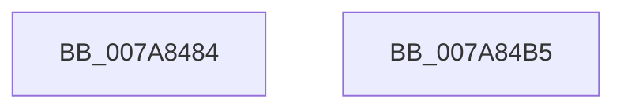

# SmKmInitialize

- RVA: `0x007A8484`–`0x007A84B6` (길이 `50` bytes)
- VA: `0x00000001407A8484`
- 실행 섹션: `PAGE`
- PDB 이름 있음: `예`; PDB Function 태그: `아니요`
- unwind 정보 RVA: `0x0005CF00`
- 디코드: `13`개 명령, `50/50` bytes 표시
- 미해석 바이트: `0` (있으면 어셈블리에 `.byte`로 보존)

> 이 문서는 커널 이미지의 기계어와 PDB 기호를 분석해 생성했습니다. 4번과 5번은 함수 원형과 자료형을 바이너리 사용 방식에서 추정한 C 해석이며 원본 소스 복구 결과는 아닙니다.

## 1. Dependencies

- 직접 호출 지점: **1**; 고유 호출 대상: **1**
- 직접 호출자로 확인된 함수: **1**
- RIP 상대 이미지 참조: **1**

### Outgoing calls
- `0x007A8495` → [memset](../../text/6C/memset_function_006C6C40.md) (function, `0x006C6C40`)

### Direct callers
- [SMKM_STORE_MGR&lt;SM_TRAITS&gt;::SmInitialize](../../text/60/SMKM_STORE_MGR_SM_TRAITS_SmInitialize_function_0060C8CC.md) at `0x0060C914`

### Static image references
- `0x007A84A1` → RVA `0x003B0040` (`SMKM_STORE_MGR<SM_TRAITS>::SmStoreMgrCallback`; read)

## 2. Other-region calls and transfers

- 다른 실행 섹션으로 향하는 call: **1**
  - `0x007A8495` → [memset](../../text/6C/memset_function_006C6C40.md) (`PAGE` → `.text`)
- 별도 외부 분기/꼬리 이동을 확인하지 못했습니다.

## 3. Assembly (complete function range)

```asm
007A8484  40 53                           push rbx
007A8486  48 83 EC 20                     sub rsp, 0x20
007A848A  33 D2                           xor edx, edx
007A848C  41 B8 B8 01 00 00               mov r8d, 0x1b8
007A8492  48 8B D9                        mov rbx, rcx
007A8495  E8 A6 E7 F1 FF                  call 0x1406c6c40
007A849A  83 8B B0 01 00 00 FF            or dword ptr [rbx + 0x1b0], 0xffffffff
007A84A1  48 8D 05 98 7B C0 FF            lea rax, [rip - 0x3f8468]
007A84A8  48 89 83 00 01 00 00            mov qword ptr [rbx + 0x100], rax
007A84AF  48 83 C4 20                     add rsp, 0x20
007A84B3  5B                              pop rbx
007A84B4  C3                              ret
007A84B5  CC                              int3
```

## 4. C-style interpretation (structured pseudocode)

```c
__int64 __fastcall SmKmInitialize(__int64 a1, int a2)
{
    __int64 result;
    __int64 v_rsp;

    v_rsp = (v_rsp) - (32);
    a2 = 0;
    result = memset(a1, a2, 440, a4);
    *(unsigned __int64 *)(a1 + 256) = v_rip - 4162664;
    v_rsp = (v_rsp) + (32);
    return v_rip - 4162664;
}
```

## 5. (Beta) C Style

```c
int64_t SmKmInitialize(void *Arg1, int32_t Arg2)
{
    uint8_t *arg1 = (uint8_t *)Arg1;

    int64_t result;
    int64_t local_rsp;

    local_rsp = (local_rsp) - (32);
    Arg2 = 0;
    result = memset(Arg1, Arg2, 440, a4);
    *(uint64_t *)(arg1 + 0x100) = v_rip - 4162664;
    local_rsp = (local_rsp) + (32);
    return v_rip - 4162664;
}
```

### 관측된 메모리 오프셋

구조체 형식이 확인되지 않은 접근은 인자 기준의 오프셋으로만 기록했습니다.

| 기준 인자 | 오프셋 표현 | 폭 (bit) | 접근 |
|---|---:|---:|---|
| `Arg1` | `+ 0x100` | `64` | `W` |
| `Arg1` | `+ 0x1B0` | `32` | `R/W` |

## 6. Execution-region graph

[열기: 2D/3D 그래프와 함수 탐색 컨트롤 패널](../../../control-panel.html?section=page&rva=0x007A8484&view=graph)

- 2D 그래프는 위에서 아래로 흐르고, 3D 그래프는 빈 공간을 드래그해 회전합니다. Shift+드래그는 이동, 휠은 확대·축소, 함수 노드 선택은 대상 보고서 이동입니다.

### Static fallback


