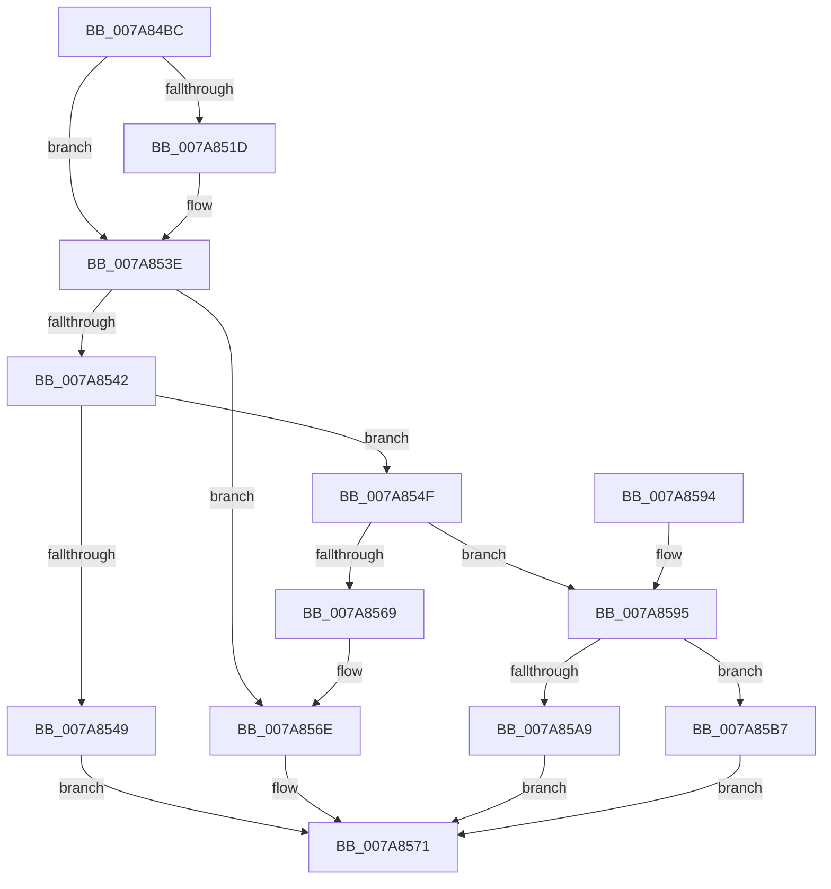

# SmKmIsVolumeIoPossible

- RVA: `0x007A84BC`–`0x007A85C3` (길이 `263` bytes)
- VA: `0x00000001407A84BC`
- 실행 섹션: `PAGE`
- PDB 이름 있음: `예`; PDB Function 태그: `아니요`
- unwind 정보 RVA: `0x000D1F80`
- 디코드: `78`개 명령, `263/263` bytes 표시
- 미해석 바이트: `0` (있으면 어셈블리에 `.byte`로 보존)

> 이 문서는 커널 이미지의 기계어와 PDB 기호를 분석해 생성했습니다. 4번과 5번은 함수 원형과 자료형을 바이너리 사용 방식에서 추정한 C 해석이며 원본 소스 복구 결과는 아닙니다.

## 1. Dependencies

- 직접 호출 지점: **8**; 고유 호출 대상: **7**
- 직접 호출자로 확인된 함수: **1**
- RIP 상대 이미지 참조: **0**

### Outgoing calls
- `0x007A84E8` → [IoSetThreadHardErrorMode](../../text/46/IoSetThreadHardErrorMode_function_00466BF0.md) (function, `0x00466BF0`)
- `0x007A850B` → [ZwQueryVolumeInformationFile](../../text/6A/ZwQueryVolumeInformationFile_function_006AD9F0.md) (function, `0x006AD9F0`)
- `0x007A8535` → [KeWaitForSingleObject](../../text/20/KeWaitForSingleObject_function_0020E6B0.md) (function, `0x0020E6B0`)
- `0x007A8552` → [IoGetRelatedDeviceObject](../../text/29/IoGetRelatedDeviceObject_function_0029B120.md) (function, `0x0029B120`)
- `0x007A855C` → [IoAllocateIrp](../../text/20/IoAllocateIrp_function_002065D0.md) (function, `0x002065D0`)
- `0x007A8574` → [IoSetThreadHardErrorMode](../../text/46/IoSetThreadHardErrorMode_function_00466BF0.md) (function, `0x00466BF0`)
- `0x007A859E` → [SmKmSendUsageNotification](SmKmSendUsageNotification_function_007A8E44.md) (function, `0x007A8E44`)
- `0x007A85B0` → [IoFreeIrp](../../text/24/IoFreeIrp_function_0024DF70.md) (function, `0x0024DF70`)

### Direct callers
- [SmKmStoreFileCreateForIoType](SmKmStoreFileCreateForIoType_function_007A93C8.md) at `0x007A95A1`

### Static image references
- 디코드된 RIP-relative 메모리 참조가 없습니다.

## 2. Other-region calls and transfers

- 다른 실행 섹션으로 향하는 call: **7**
  - `0x007A84E8` → [IoSetThreadHardErrorMode](../../text/46/IoSetThreadHardErrorMode_function_00466BF0.md) (`PAGE` → `.text`)
  - `0x007A850B` → [ZwQueryVolumeInformationFile](../../text/6A/ZwQueryVolumeInformationFile_function_006AD9F0.md) (`PAGE` → `.text`)
  - `0x007A8535` → [KeWaitForSingleObject](../../text/20/KeWaitForSingleObject_function_0020E6B0.md) (`PAGE` → `.text`)
  - `0x007A8552` → [IoGetRelatedDeviceObject](../../text/29/IoGetRelatedDeviceObject_function_0029B120.md) (`PAGE` → `.text`)
  - `0x007A855C` → [IoAllocateIrp](../../text/20/IoAllocateIrp_function_002065D0.md) (`PAGE` → `.text`)
  - `0x007A8574` → [IoSetThreadHardErrorMode](../../text/46/IoSetThreadHardErrorMode_function_00466BF0.md) (`PAGE` → `.text`)
  - `0x007A85B0` → [IoFreeIrp](../../text/24/IoFreeIrp_function_0024DF70.md) (`PAGE` → `.text`)
- 별도 외부 분기/꼬리 이동을 확인하지 못했습니다.

## 3. Assembly (complete function range)

```asm
007A84BC  48 8B C4                        mov rax, rsp
007A84BF  48 89 58 10                     mov qword ptr [rax + 0x10], rbx
007A84C3  48 89 68 18                     mov qword ptr [rax + 0x18], rbp
007A84C7  48 89 70 20                     mov qword ptr [rax + 0x20], rsi
007A84CB  57                              push rdi
007A84CC  41 56                           push r14
007A84CE  41 57                           push r15
007A84D0  48 83 EC 40                     sub rsp, 0x40
007A84D4  48 83 60 08 00                  and qword ptr [rax + 8], 0
007A84D9  4C 8B F1                        mov r14, rcx
007A84DC  0F 57 C0                        xorps xmm0, xmm0
007A84DF  33 C9                           xor ecx, ecx
007A84E1  0F 11 40 D8                     movups xmmword ptr [rax - 0x28], xmm0
007A84E5  48 8B FA                        mov rdi, rdx
007A84E8  E8 03 E7 CB FF                  call 0x140466bf0
007A84ED  49 8B 0E                        mov rcx, qword ptr [r14]
007A84F0  4C 8D 44 24 60                  lea r8, [rsp + 0x60]
007A84F5  41 B9 08 00 00 00               mov r9d, 8
007A84FB  C7 44 24 20 04 00 00 00         mov dword ptr [rsp + 0x20], 4
007A8503  48 8D 54 24 30                  lea rdx, [rsp + 0x30]
007A8508  44 8A F8                        mov r15b, al
007A850B  E8 E0 54 F0 FF                  call 0x1406ad9f0
007A8510  49 8D 76 08                     lea rsi, [r14 + 8]
007A8514  8B D8                           mov ebx, eax
007A8516  3D 03 01 00 00                  cmp eax, 0x103
007A851B  75 21                           jne 0x1407a853e
007A851D  48 8B 0E                        mov rcx, qword ptr [rsi]
007A8520  45 33 C9                        xor r9d, r9d
007A8523  48 83 64 24 20 00               and qword ptr [rsp + 0x20], 0
007A8529  48 81 C1 98 00 00 00            add rcx, 0x98
007A8530  45 33 C0                        xor r8d, r8d
007A8533  33 D2                           xor edx, edx
007A8535  E8 76 61 A6 FF                  call 0x14020e6b0
007A853A  8B 5C 24 30                     mov ebx, dword ptr [rsp + 0x30]
007A853E  85 DB                           test ebx, ebx
007A8540  78 2C                           js 0x1407a856e
007A8542  F6 44 24 64 01                  test byte ptr [rsp + 0x64], 1
007A8547  74 06                           je 0x1407a854f
007A8549  33 DB                           xor ebx, ebx
007A854B  21 1F                           and dword ptr [rdi], ebx
007A854D  EB 22                           jmp 0x1407a8571
007A854F  48 8B 0E                        mov rcx, qword ptr [rsi]
007A8552  E8 C9 2B AF FF                  call 0x14029b120
007A8557  33 D2                           xor edx, edx
007A8559  8A 48 4C                        mov cl, byte ptr [rax + 0x4c]
007A855C  E8 6F E0 A5 FF                  call 0x1402065d0
007A8561  48 8B E8                        mov rbp, rax
007A8564  48 85 C0                        test rax, rax
007A8567  75 2C                           jne 0x1407a8595
007A8569  BB 9A 00 00 C0                  mov ebx, 0xc000009a
007A856E  83 27 00                        and dword ptr [rdi], 0
007A8571  41 8A CF                        mov cl, r15b
007A8574  E8 77 E6 CB FF                  call 0x140466bf0
007A8579  48 8B 6C 24 70                  mov rbp, qword ptr [rsp + 0x70]
007A857E  8B C3                           mov eax, ebx
007A8580  48 8B 5C 24 68                  mov rbx, qword ptr [rsp + 0x68]
007A8585  48 8B 74 24 78                  mov rsi, qword ptr [rsp + 0x78]
007A858A  48 83 C4 40                     add rsp, 0x40
007A858E  41 5F                           pop r15
007A8590  41 5E                           pop r14
007A8592  5F                              pop rdi
007A8593  C3                              ret
007A8594  CC                              int3
007A8595  48 8B 16                        mov rdx, qword ptr [rsi]
007A8598  45 33 C0                        xor r8d, r8d
007A859B  48 8B CD                        mov rcx, rbp
007A859E  E8 A1 08 00 00                  call 0x1407a8e44
007A85A3  8B D8                           mov ebx, eax
007A85A5  85 C0                           test eax, eax
007A85A7  79 0E                           jns 0x1407a85b7
007A85A9  33 DB                           xor ebx, ebx
007A85AB  48 8B CD                        mov rcx, rbp
007A85AE  21 1F                           and dword ptr [rdi], ebx
007A85B0  E8 BB 59 AA FF                  call 0x14024df70
007A85B5  EB BA                           jmp 0x1407a8571
007A85B7  49 89 6E 28                     mov qword ptr [r14 + 0x28], rbp
007A85BB  C7 07 01 00 00 00               mov dword ptr [rdi], 1
007A85C1  EB AE                           jmp 0x1407a8571
```

## 4. C-style interpretation (structured pseudocode)

```c
__int64 __fastcall SmKmIsVolumeIoPossible(__int64 a1, __int64 a2)
{
    __int64 result;
    __int64 v_rbx;
    __int64 v_rsp;
    unsigned __int64 v_stack_m28;
    unsigned int v_stack_m38;
    unsigned __int64 v_stack_p10;
    unsigned __int64 v_stack_p18;
    unsigned __int64 v_stack_p20;
    unsigned __int64 v_stack_p8;
    unsigned __int8 v_stack_pC;

    *(unsigned __int64 *)(v_rsp + 16) = v_rbx;
    *(unsigned __int64 *)(v_rsp + 24) = v_rbp;
    *(unsigned __int64 *)(v_rsp + 32) = v_rsi;
    v_rsp = (v_rsp) - (64);
    a1 = 0;
    *(unsigned __int64 *)(v_rsp - 40) = v_xmm0;
    result = IoSetThreadHardErrorMode(a1, a2, a3, a4);
    v_stack_m38 = 4;
    result = ZwQueryVolumeInformationFile(*(unsigned __int64 *)(a1), v_stack_m28, v_stack_p8, 8);
    v_rbx = (unsigned int)((unsigned int)(result));
    if (((unsigned int)(result)) == 259) {
        a1 = *(unsigned __int64 *)(a1 + 8);
        a4 = 0;
        a1 = (a1) + (152);
        a3 = 0;
        a2 = 0;
        result = KeWaitForSingleObject(a1, a2, a3, a4);
        v_rbx = v_stack_m28;
    }
    if (sign_flag) goto loc_007A856E;
    if (((v_stack_pC) & (1)) == 0) goto loc_007A854F;
    v_rbx = 0;
    goto loc_007A8571;
loc_007A854F:
    result = IoGetRelatedDeviceObject(*(unsigned __int64 *)(a1 + 8), a2, a3, a4);
    a2 = 0;
    result = IoAllocateIrp(*(unsigned __int8 *)(result + 76), a2, a3, a4);
    if (result != 0) goto loc_007A8595;
loc_007A856E:
loc_007A8571:
    result = IoSetThreadHardErrorMode((unsigned __int8)((unsigned __int8)(result)), a2, a3, a4);
    v_rsp = (v_rsp) + (64);
    return (unsigned int)((unsigned int)((unsigned int)(0xC000009AULL)));
loc_007A8595:
    a3 = 0;
    result = SmKmSendUsageNotification(v_stack_p18, *(unsigned __int64 *)(v_stack_p20), a3, a4);
    if (!sign_flag) goto loc_007A85B7;
    v_rbx = 0;
    result = IoFreeIrp(v_stack_p18, *(unsigned __int64 *)(v_stack_p20), a3, a4);
    goto loc_007A8571;
loc_007A85B7:
    *(unsigned __int64 *)(a1 + 40) = v_stack_p18;
    *(unsigned int *)(a2) = 1;
    goto loc_007A8571;
}
```

## 5. (Beta) C Style

```c
int64_t SmKmIsVolumeIoPossible(void *Arg1, void *Arg2)
{
    uint8_t *arg1 = (uint8_t *)Arg1;
    uint8_t *arg2 = (uint8_t *)Arg2;

    int64_t result;
    int64_t local_rbx;
    int64_t local_rsp;
    uint64_t v_stack_m28;
    uint32_t v_stack_m38;
    uint64_t v_stack_p10;
    uint64_t v_stack_p18;
    uint64_t v_stack_p20;
    uint64_t v_stack_p8;
    uint8_t v_stack_pC;

    *(uint64_t *)(local_rsp + 0x10) = local_rbx;
    *(uint64_t *)(local_rsp + 0x18) = local_rbp;
    *(uint64_t *)(local_rsp + 0x20) = local_rsi;
    local_rsp = (local_rsp) - (64);
    Arg1 = 0;
    *(uint64_t *)(local_rsp - 0x28) = v_xmm0;
    result = IoSetThreadHardErrorMode(Arg1, Arg2, a3, a4);
    v_stack_m38 = 4;
    result = ZwQueryVolumeInformationFile(*(uint64_t *)(arg1), v_stack_m28, v_stack_p8, 8);
    local_rbx = (uint32_t)((uint32_t)(result));
    if (((uint32_t)(result)) == 259) {
        Arg1 = *(uint64_t *)(arg1 + 0x8);
        a4 = 0;
        Arg1 = (Arg1) + (152);
        a3 = 0;
        Arg2 = 0;
        result = KeWaitForSingleObject(Arg1, Arg2, a3, a4);
        local_rbx = v_stack_m28;
    }
    if (sign_flag) goto loc_007A856E;
    if (((v_stack_pC) & (1)) == 0) goto loc_007A854F;
    local_rbx = 0;
    goto loc_007A8571;
loc_007A854F:
    result = IoGetRelatedDeviceObject(*(uint64_t *)(arg1 + 0x8), Arg2, a3, a4);
    Arg2 = 0;
    result = IoAllocateIrp(*(uint8_t *)(result + 0x4C), Arg2, a3, a4);
    if (result != 0) goto loc_007A8595;
loc_007A856E:
loc_007A8571:
    result = IoSetThreadHardErrorMode((uint8_t)((uint8_t)(result)), Arg2, a3, a4);
    local_rsp = (local_rsp) + (64);
    return (uint32_t)((uint32_t)((uint32_t)(0xC000009AULL)));
loc_007A8595:
    a3 = 0;
    result = SmKmSendUsageNotification(v_stack_p18, *(uint64_t *)(v_stack_p20), a3, a4);
    if (!sign_flag) goto loc_007A85B7;
    local_rbx = 0;
    result = IoFreeIrp(v_stack_p18, *(uint64_t *)(v_stack_p20), a3, a4);
    goto loc_007A8571;
loc_007A85B7:
    *(uint64_t *)(arg1 + 0x28) = v_stack_p18;
    *(uint32_t *)(arg2) = 1;
    goto loc_007A8571;
}
```

### 관측된 메모리 오프셋

구조체 형식이 확인되지 않은 접근은 인자 기준의 오프셋으로만 기록했습니다.

| 기준 인자 | 오프셋 표현 | 폭 (bit) | 접근 |
|---|---:|---:|---|
| `Arg1` | `+ 0x0` | `64` | `R` |
| `Arg1` | `+ 0x8` | `64` | `R` |
| `Arg1` | `+ 0x28` | `64` | `W` |
| `Arg2` | `+ 0x0` | `32` | `R/W` |
| `Arg2` | `+ 0x0` | `32` | `W` |

## 6. Execution-region graph

[열기: 2D/3D 그래프와 함수 탐색 컨트롤 패널](../../../control-panel.html?section=page&rva=0x007A84BC&view=graph)

- 2D 그래프는 위에서 아래로 흐르고, 3D 그래프는 빈 공간을 드래그해 회전합니다. Shift+드래그는 이동, 휠은 확대·축소, 함수 노드 선택은 대상 보고서 이동입니다.

### Static fallback


