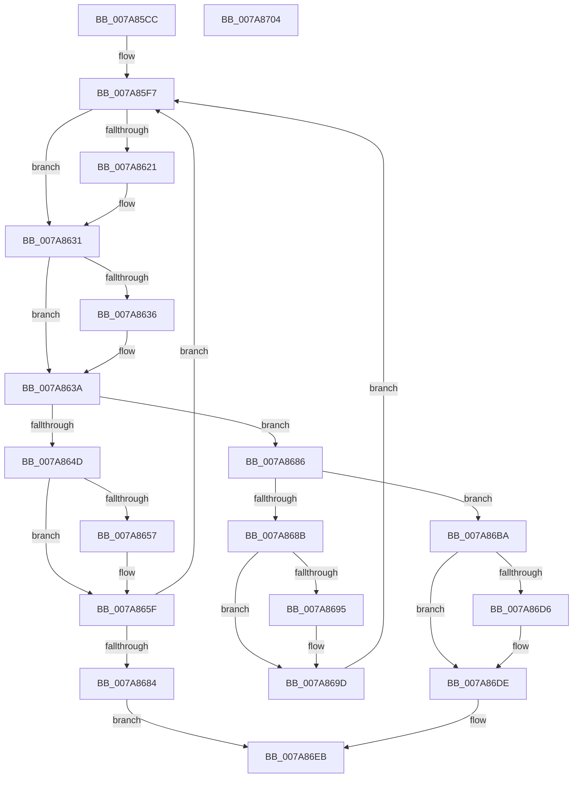

# SmKmKeyGenGenerate

- RVA: `0x007A85CC`–`0x007A8705` (길이 `313` bytes)
- VA: `0x00000001407A85CC`
- 실행 섹션: `PAGE`
- PDB 이름 있음: `예`; PDB Function 태그: `아니요`
- unwind 정보 RVA: `0x00083688`
- 디코드: `93`개 명령, `313/313` bytes 표시
- 미해석 바이트: `0` (있으면 어셈블리에 `.byte`로 보존)

> 이 문서는 커널 이미지의 기계어와 PDB 기호를 분석해 생성했습니다. 4번과 5번은 함수 원형과 자료형을 바이너리 사용 방식에서 추정한 C 해석이며 원본 소스 복구 결과는 아닙니다.

## 1. Dependencies

- 직접 호출 지점: **15**; 고유 호출 대상: **9**
- 직접 호출자로 확인된 함수: **1**
- RIP 상대 이미지 참조: **0**

### Outgoing calls
- `0x007A8610` → [KeAbPreAcquire](../../text/21/KeAbPreAcquire_function_00210230.md) (function, `0x00210230`)
- `0x007A862C` → [ExfAcquirePushLockSharedEx](../../text/21/ExfAcquirePushLockSharedEx_function_0021044C.md) (function, `0x0021044C`)
- `0x007A8640` → [SmKmKeyGenKeyFind](SmKmKeyGenKeyFind_function_007A87D0.md) (function, `0x007A87D0`)
- `0x007A865A` → [ExfReleasePushLockShared](../../text/26/ExfReleasePushLockShared_function_00263440.md) (function, `0x00263440`)
- `0x007A8662` → [KeAbPostRelease](../../text/2E/KeAbPostRelease_function_002E1600.md) (function, `0x002E1600`)
- `0x007A8667` → [KeLeaveCriticalRegion](../../text/25/KeLeaveCriticalRegion_function_0025D8B0.md) (function, `0x0025D8B0`)
- `0x007A8675` → [SmKmKeyGenNewKey](SmKmKeyGenNewKey_function_007A8990.md) (function, `0x007A8990`)
- `0x007A8698` → [ExfReleasePushLockShared](../../text/26/ExfReleasePushLockShared_function_00263440.md) (function, `0x00263440`)
- `0x007A86A0` → [KeAbPostRelease](../../text/2E/KeAbPostRelease_function_002E1600.md) (function, `0x002E1600`)
- `0x007A86A5` → [KeLeaveCriticalRegion](../../text/25/KeLeaveCriticalRegion_function_0025D8B0.md) (function, `0x0025D8B0`)
- `0x007A86B0` → [SmKmKeyGenKeyDelete](SmKmKeyGenKeyDelete_function_007A870C.md) (function, `0x007A870C`)
- `0x007A86C4` → [memcpy](../../text/6C/memcpy_function_006C6840.md) (function, `0x006C6840`)
- `0x007A86D9` → [ExfReleasePushLockShared](../../text/26/ExfReleasePushLockShared_function_00263440.md) (function, `0x00263440`)
- `0x007A86E1` → [KeAbPostRelease](../../text/2E/KeAbPostRelease_function_002E1600.md) (function, `0x002E1600`)
- `0x007A86E6` → [KeLeaveCriticalRegion](../../text/25/KeLeaveCriticalRegion_function_0025D8B0.md) (function, `0x0025D8B0`)

### Direct callers
- [SmcStoreCreate](SmcStoreCreate_function_007ABFB4.md) at `0x007AC196`

### Static image references
- 디코드된 RIP-relative 메모리 참조가 없습니다.

## 2. Other-region calls and transfers

- 다른 실행 섹션으로 향하는 call: **12**
  - `0x007A8610` → [KeAbPreAcquire](../../text/21/KeAbPreAcquire_function_00210230.md) (`PAGE` → `.text`)
  - `0x007A862C` → [ExfAcquirePushLockSharedEx](../../text/21/ExfAcquirePushLockSharedEx_function_0021044C.md) (`PAGE` → `.text`)
  - `0x007A865A` → [ExfReleasePushLockShared](../../text/26/ExfReleasePushLockShared_function_00263440.md) (`PAGE` → `.text`)
  - `0x007A8662` → [KeAbPostRelease](../../text/2E/KeAbPostRelease_function_002E1600.md) (`PAGE` → `.text`)
  - `0x007A8667` → [KeLeaveCriticalRegion](../../text/25/KeLeaveCriticalRegion_function_0025D8B0.md) (`PAGE` → `.text`)
  - `0x007A8698` → [ExfReleasePushLockShared](../../text/26/ExfReleasePushLockShared_function_00263440.md) (`PAGE` → `.text`)
  - `0x007A86A0` → [KeAbPostRelease](../../text/2E/KeAbPostRelease_function_002E1600.md) (`PAGE` → `.text`)
  - `0x007A86A5` → [KeLeaveCriticalRegion](../../text/25/KeLeaveCriticalRegion_function_0025D8B0.md) (`PAGE` → `.text`)
  - `0x007A86C4` → [memcpy](../../text/6C/memcpy_function_006C6840.md) (`PAGE` → `.text`)
  - `0x007A86D9` → [ExfReleasePushLockShared](../../text/26/ExfReleasePushLockShared_function_00263440.md) (`PAGE` → `.text`)
  - `0x007A86E1` → [KeAbPostRelease](../../text/2E/KeAbPostRelease_function_002E1600.md) (`PAGE` → `.text`)
  - `0x007A86E6` → [KeLeaveCriticalRegion](../../text/25/KeLeaveCriticalRegion_function_0025D8B0.md) (`PAGE` → `.text`)
- 별도 외부 분기/꼬리 이동을 확인하지 못했습니다.

## 3. Assembly (complete function range)

```asm
007A85CC  48 89 5C 24 10                  mov qword ptr [rsp + 0x10], rbx
007A85D1  48 89 6C 24 18                  mov qword ptr [rsp + 0x18], rbp
007A85D6  56                              push rsi
007A85D7  57                              push rdi
007A85D8  41 54                           push r12
007A85DA  41 56                           push r14
007A85DC  41 57                           push r15
007A85DE  48 83 EC 20                     sub rsp, 0x20
007A85E2  41 8B F1                        mov esi, r9d
007A85E5  4D 8B F0                        mov r14, r8
007A85E8  48 8B EA                        mov rbp, rdx
007A85EB  48 8B D9                        mov rbx, rcx
007A85EE  41 BC 11 00 00 00               mov r12d, 0x11
007A85F4  45 33 FF                        xor r15d, r15d
007A85F7  65 48 8B 04 25 88 01 00 00      mov rax, qword ptr gs:[0x188]
007A8600  45 33 C0                        xor r8d, r8d
007A8603  33 D2                           xor edx, edx
007A8605  48 8B CB                        mov rcx, rbx
007A8608  66 FF 88 E4 01 00 00            dec word ptr [rax + 0x1e4]
007A860F  90                              nop
007A8610  E8 1B 7C A6 FF                  call 0x140210230
007A8615  48 8B F8                        mov rdi, rax
007A8618  33 C0                           xor eax, eax
007A861A  F0 4C 0F B1 23                  lock cmpxchg qword ptr [rbx], r12
007A861F  74 10                           je 0x1407a8631
007A8621  4C 8B CB                        mov r9, rbx
007A8624  4C 8B C7                        mov r8, rdi
007A8627  33 D2                           xor edx, edx
007A8629  48 8B CB                        mov rcx, rbx
007A862C  E8 1B 7E A6 FF                  call 0x14021044c
007A8631  48 85 FF                        test rdi, rdi
007A8634  74 04                           je 0x1407a863a
007A8636  C6 47 0A 01                     mov byte ptr [rdi + 0xa], 1
007A863A  48 8B D5                        mov rdx, rbp
007A863D  48 8B CB                        mov rcx, rbx
007A8640  E8 8B 01 00 00                  call 0x1407a87d0
007A8645  48 8B F8                        mov rdi, rax
007A8648  48 85 C0                        test rax, rax
007A864B  75 39                           jne 0x1407a8686
007A864D  49 8B C4                        mov rax, r12
007A8650  F0 4C 0F B1 3B                  lock cmpxchg qword ptr [rbx], r15
007A8655  74 08                           je 0x1407a865f
007A8657  48 8B CB                        mov rcx, rbx
007A865A  E8 E1 AD AB FF                  call 0x140263440
007A865F  48 8B CB                        mov rcx, rbx
007A8662  E8 99 8F B3 FF                  call 0x1402e1600
007A8667  E8 44 52 AB FF                  call 0x14025d8b0
007A866C  44 8B C6                        mov r8d, esi
007A866F  48 8B D5                        mov rdx, rbp
007A8672  48 8B CB                        mov rcx, rbx
007A8675  E8 16 03 00 00                  call 0x1407a8990
007A867A  8B F8                           mov edi, eax
007A867C  85 C0                           test eax, eax
007A867E  0F 89 73 FF FF FF               jns 0x1407a85f7
007A8684  EB 65                           jmp 0x1407a86eb
007A8686  39 70 20                        cmp dword ptr [rax + 0x20], esi
007A8689  74 2F                           je 0x1407a86ba
007A868B  49 8B C4                        mov rax, r12
007A868E  F0 4C 0F B1 3B                  lock cmpxchg qword ptr [rbx], r15
007A8693  74 08                           je 0x1407a869d
007A8695  48 8B CB                        mov rcx, rbx
007A8698  E8 A3 AD AB FF                  call 0x140263440
007A869D  48 8B CB                        mov rcx, rbx
007A86A0  E8 5B 8F B3 FF                  call 0x1402e1600
007A86A5  E8 06 52 AB FF                  call 0x14025d8b0
007A86AA  48 8B D7                        mov rdx, rdi
007A86AD  48 8B CB                        mov rcx, rbx
007A86B0  E8 57 00 00 00                  call 0x1407a870c
007A86B5  E9 3D FF FF FF                  jmp 0x1407a85f7
007A86BA  48 8B 50 18                     mov rdx, qword ptr [rax + 0x18]
007A86BE  4C 8B C6                        mov r8, rsi
007A86C1  49 8B CE                        mov rcx, r14
007A86C4  E8 77 E1 F1 FF                  call 0x1406c6840
007A86C9  41 8B FF                        mov edi, r15d
007A86CC  49 8B C4                        mov rax, r12
007A86CF  F0 4C 0F B1 3B                  lock cmpxchg qword ptr [rbx], r15
007A86D4  74 08                           je 0x1407a86de
007A86D6  48 8B CB                        mov rcx, rbx
007A86D9  E8 62 AD AB FF                  call 0x140263440
007A86DE  48 8B CB                        mov rcx, rbx
007A86E1  E8 1A 8F B3 FF                  call 0x1402e1600
007A86E6  E8 C5 51 AB FF                  call 0x14025d8b0
007A86EB  48 8B 5C 24 58                  mov rbx, qword ptr [rsp + 0x58]
007A86F0  8B C7                           mov eax, edi
007A86F2  48 8B 6C 24 60                  mov rbp, qword ptr [rsp + 0x60]
007A86F7  48 83 C4 20                     add rsp, 0x20
007A86FB  41 5F                           pop r15
007A86FD  41 5E                           pop r14
007A86FF  41 5C                           pop r12
007A8701  5F                              pop rdi
007A8702  5E                              pop rsi
007A8703  C3                              ret
007A8704  CC                              int3
```

## 4. C-style interpretation (structured pseudocode)

```c
__int64 __fastcall SmKmKeyGenGenerate(__int64 a1, __int64 a2, __int64 a3, int a4)
{
    __int64 result;
    __int64 v_r15;
    __int64 v_rsp;
    unsigned __int64 v_stack_p10;
    unsigned __int64 v_stack_p18;

    v_stack_p10 = v_rbx;
    v_stack_p18 = v_rbp;
    v_rsp = (v_rsp) - (32);
    v_r15 = 0;
loc_007A85F7:
    a3 = 0;
    a2 = 0;
    result = KeAbPreAcquire(a1, a2, a3, a4);
    result = 0;
    if (!(condition_is_equal)) {
        a4 = a1;
        a3 = 0;
        a2 = 0;
        a1 = a1;
        result = ExfAcquirePushLockSharedEx(a1, a2, a3, a4);
    }
    if (result != 0) {
        *(unsigned __int8 *)(result + 10) = 1;
    }
    result = SmKmKeyGenKeyFind(a1, 0, a3, a4);
    if (result != 0) goto loc_007A8686;
    result = 17;
    if (result != 0) {
        a1 = a1;
        result = ExfReleasePushLockShared(a1, 0, a3, a4);
    }
    result = KeAbPostRelease(a1, 0, a3, a4);
    result = KeLeaveCriticalRegion(a1, 0, a3, a4);
    result = SmKmKeyGenNewKey(a1, 0, (unsigned int)((unsigned int)((unsigned int)(a4))), a4);
    if (!sign_flag) goto loc_007A85F7;
    goto loc_007A86EB;
loc_007A8686:
    if ((*(unsigned int *)(result + 32)) == ((unsigned int)((unsigned int)(a4)))) goto loc_007A86BA;
    result = 17;
    if ((*(unsigned int *)(result + 32)) != ((unsigned int)((unsigned int)(a4)))) {
        a1 = a1;
        result = ExfReleasePushLockShared(a1, 0, (unsigned int)((unsigned int)((unsigned int)(a4))), a4);
    }
    result = KeAbPostRelease(a1, 0, (unsigned int)((unsigned int)((unsigned int)(a4))), a4);
    result = KeLeaveCriticalRegion(a1, 0, (unsigned int)((unsigned int)((unsigned int)(a4))), a4);
    result = SmKmKeyGenKeyDelete(a1, (unsigned int)((unsigned int)(result)), (unsigned int)((unsigned int)((unsigned int)(a4))), a4);
    goto loc_007A85F7;
loc_007A86BA:
    result = memcpy(a3, *(unsigned __int64 *)(result + 24), (unsigned int)(a4), a4);
    result = 17;
    if ((*(unsigned int *)(result + 32)) != ((unsigned int)((unsigned int)(a4)))) {
        a1 = a1;
        result = ExfReleasePushLockShared(a1, *(unsigned __int64 *)(result + 24), (unsigned int)(a4), a4);
    }
    result = KeAbPostRelease(a1, *(unsigned __int64 *)(result + 24), (unsigned int)(a4), a4);
    result = KeLeaveCriticalRegion(a1, *(unsigned __int64 *)(result + 24), (unsigned int)(a4), a4);
loc_007A86EB:
    v_rsp = (v_rsp) + (32);
    return 0;
}
```

## 5. (Beta) C Style

```c
int64_t SmKmKeyGenGenerate(void *Arg1, int64_t Arg2, int64_t Arg3, int32_t Arg4)
{
    uint8_t *arg1 = (uint8_t *)Arg1;

    int64_t result;
    int64_t local_r15;
    int64_t local_rsp;
    uint64_t v_stack_p10;
    uint64_t v_stack_p18;

    v_stack_p10 = local_rbx;
    v_stack_p18 = local_rbp;
    local_rsp = (local_rsp) - (32);
    local_r15 = 0;
loc_007A85F7:
    Arg3 = 0;
    Arg2 = 0;
    result = KeAbPreAcquire(Arg1, Arg2, Arg3, Arg4);
    result = 0;
    if (!(condition_is_equal)) {
        Arg4 = Arg1;
        Arg3 = 0;
        Arg2 = 0;
        Arg1 = Arg1;
        result = ExfAcquirePushLockSharedEx(Arg1, Arg2, Arg3, Arg4);
    }
    if (result != 0) {
        *(uint8_t *)(result + 0xA) = 1;
    }
    result = SmKmKeyGenKeyFind(Arg1, 0, Arg3, Arg4);
    if (result != 0) goto loc_007A8686;
    result = 17;
    if (result != 0) {
        Arg1 = Arg1;
        result = ExfReleasePushLockShared(Arg1, 0, Arg3, Arg4);
    }
    result = KeAbPostRelease(Arg1, 0, Arg3, Arg4);
    result = KeLeaveCriticalRegion(Arg1, 0, Arg3, Arg4);
    result = SmKmKeyGenNewKey(Arg1, 0, (uint32_t)((uint32_t)((uint32_t)(Arg4))), Arg4);
    if (!sign_flag) goto loc_007A85F7;
    goto loc_007A86EB;
loc_007A8686:
    if ((*(uint32_t *)(result + 0x20)) == ((uint32_t)((uint32_t)(Arg4)))) goto loc_007A86BA;
    result = 17;
    if ((*(uint32_t *)(result + 0x20)) != ((uint32_t)((uint32_t)(Arg4)))) {
        Arg1 = Arg1;
        result = ExfReleasePushLockShared(Arg1, 0, (uint32_t)((uint32_t)((uint32_t)(Arg4))), Arg4);
    }
    result = KeAbPostRelease(Arg1, 0, (uint32_t)((uint32_t)((uint32_t)(Arg4))), Arg4);
    result = KeLeaveCriticalRegion(Arg1, 0, (uint32_t)((uint32_t)((uint32_t)(Arg4))), Arg4);
    result = SmKmKeyGenKeyDelete(Arg1, (uint32_t)((uint32_t)(result)), (uint32_t)((uint32_t)((uint32_t)(Arg4))), Arg4);
    goto loc_007A85F7;
loc_007A86BA:
    result = memcpy(Arg3, *(uint64_t *)(result + 0x18), (uint32_t)(Arg4), Arg4);
    result = 17;
    if ((*(uint32_t *)(result + 0x20)) != ((uint32_t)((uint32_t)(Arg4)))) {
        Arg1 = Arg1;
        result = ExfReleasePushLockShared(Arg1, *(uint64_t *)(result + 0x18), (uint32_t)(Arg4), Arg4);
    }
    result = KeAbPostRelease(Arg1, *(uint64_t *)(result + 0x18), (uint32_t)(Arg4), Arg4);
    result = KeLeaveCriticalRegion(Arg1, *(uint64_t *)(result + 0x18), (uint32_t)(Arg4), Arg4);
loc_007A86EB:
    local_rsp = (local_rsp) + (32);
    return 0;
}
```

### 관측된 메모리 오프셋

구조체 형식이 확인되지 않은 접근은 인자 기준의 오프셋으로만 기록했습니다.

| 기준 인자 | 오프셋 표현 | 폭 (bit) | 접근 |
|---|---:|---:|---|
| `Arg1` | `+ 0x0` | `64` | `R` |

## 6. Execution-region graph

[열기: 2D/3D 그래프와 함수 탐색 컨트롤 패널](../../../control-panel.html?section=page&rva=0x007A85CC&view=graph)

- 2D 그래프는 위에서 아래로 흐르고, 3D 그래프는 빈 공간을 드래그해 회전합니다. Shift+드래그는 이동, 휠은 확대·축소, 함수 노드 선택은 대상 보고서 이동입니다.

### Static fallback


