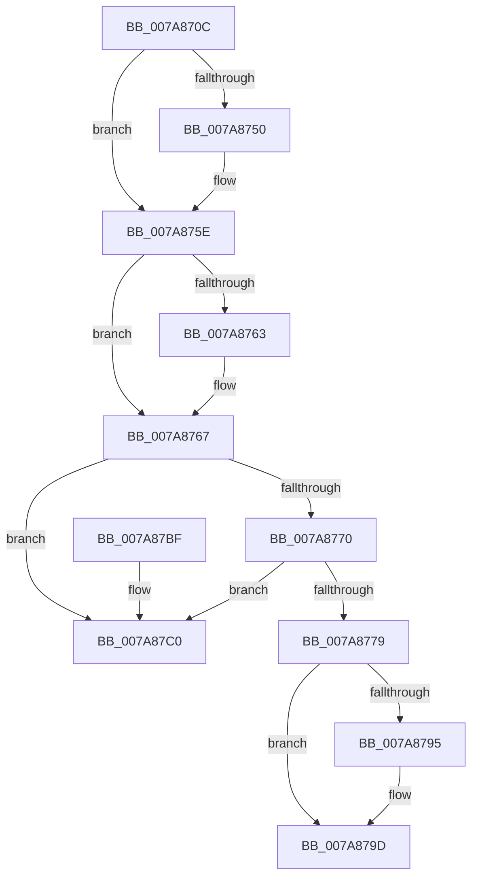

# SmKmKeyGenKeyDelete

- RVA: `0x007A870C`–`0x007A87C7` (길이 `187` bytes)
- VA: `0x00000001407A870C`
- 실행 섹션: `PAGE`
- PDB 이름 있음: `예`; PDB Function 태그: `아니요`
- unwind 정보 RVA: `0x00069AD0`
- 디코드: `52`개 명령, `187/187` bytes 표시
- 미해석 바이트: `0` (있으면 어셈블리에 `.byte`로 보존)

> 이 문서는 커널 이미지의 기계어와 PDB 기호를 분석해 생성했습니다. 4번과 5번은 함수 원형과 자료형을 바이너리 사용 방식에서 추정한 C 해석이며 원본 소스 복구 결과는 아닙니다.

## 1. Dependencies

- 직접 호출 지점: **6**; 고유 호출 대상: **6**
- 직접 호출자로 확인된 함수: **1**
- RIP 상대 이미지 참조: **0**

### Outgoing calls
- `0x007A8740` → [KeAbPreAcquire](../../text/21/KeAbPreAcquire_function_00210230.md) (function, `0x00210230`)
- `0x007A8759` → [ExfAcquirePushLockExclusiveEx](../../text/20/ExfAcquirePushLockExclusiveEx_function_0020FC90.md) (function, `0x0020FC90`)
- `0x007A8783` → [CmSiFreeMemory](../../text/47/CmSiFreeMemory_function_00475D80.md) (function, `0x00475D80`)
- `0x007A8798` → [ExfTryToWakePushLock](../../text/26/ExfTryToWakePushLock_function_00265DD0.md) (function, `0x00265DD0`)
- `0x007A87A0` → [KeAbPostRelease](../../text/2E/KeAbPostRelease_function_002E1600.md) (function, `0x002E1600`)
- `0x007A87A5` → [KeLeaveCriticalRegion](../../text/25/KeLeaveCriticalRegion_function_0025D8B0.md) (function, `0x0025D8B0`)

### Direct callers
- [SmKmKeyGenGenerate](SmKmKeyGenGenerate_function_007A85CC.md) at `0x007A86B0`

### Static image references
- 디코드된 RIP-relative 메모리 참조가 없습니다.

## 2. Other-region calls and transfers

- 다른 실행 섹션으로 향하는 call: **6**
  - `0x007A8740` → [KeAbPreAcquire](../../text/21/KeAbPreAcquire_function_00210230.md) (`PAGE` → `.text`)
  - `0x007A8759` → [ExfAcquirePushLockExclusiveEx](../../text/20/ExfAcquirePushLockExclusiveEx_function_0020FC90.md) (`PAGE` → `.text`)
  - `0x007A8783` → [CmSiFreeMemory](../../text/47/CmSiFreeMemory_function_00475D80.md) (`PAGE` → `.text`)
  - `0x007A8798` → [ExfTryToWakePushLock](../../text/26/ExfTryToWakePushLock_function_00265DD0.md) (`PAGE` → `.text`)
  - `0x007A87A0` → [KeAbPostRelease](../../text/2E/KeAbPostRelease_function_002E1600.md) (`PAGE` → `.text`)
  - `0x007A87A5` → [KeLeaveCriticalRegion](../../text/25/KeLeaveCriticalRegion_function_0025D8B0.md) (`PAGE` → `.text`)
- 별도 외부 분기/꼬리 이동을 확인하지 못했습니다.

## 3. Assembly (complete function range)

```asm
007A870C  48 89 5C 24 08                  mov qword ptr [rsp + 8], rbx
007A8711  48 89 6C 24 10                  mov qword ptr [rsp + 0x10], rbp
007A8716  48 89 74 24 18                  mov qword ptr [rsp + 0x18], rsi
007A871B  57                              push rdi
007A871C  48 83 EC 20                     sub rsp, 0x20
007A8720  65 48 8B 04 25 88 01 00 00      mov rax, qword ptr gs:[0x188]
007A8729  48 8B F2                        mov rsi, rdx
007A872C  48 83 CB FF                     or rbx, 0xffffffffffffffff
007A8730  45 33 C0                        xor r8d, r8d
007A8733  33 D2                           xor edx, edx
007A8735  48 8B F9                        mov rdi, rcx
007A8738  66 01 98 E4 01 00 00            add word ptr [rax + 0x1e4], bx
007A873F  90                              nop
007A8740  E8 EB 7A A6 FF                  call 0x140210230
007A8745  F0 48 0F BA 2F 00               lock bts qword ptr [rdi], 0
007A874B  48 8B E8                        mov rbp, rax
007A874E  73 0E                           jae 0x1407a875e
007A8750  4C 8B C7                        mov r8, rdi
007A8753  48 8B D0                        mov rdx, rax
007A8756  48 8B CF                        mov rcx, rdi
007A8759  E8 32 75 A6 FF                  call 0x14020fc90
007A875E  48 85 ED                        test rbp, rbp
007A8761  74 04                           je 0x1407a8767
007A8763  C6 45 0A 01                     mov byte ptr [rbp + 0xa], 1
007A8767  48 8B 0E                        mov rcx, qword ptr [rsi]
007A876A  48 39 71 08                     cmp qword ptr [rcx + 8], rsi
007A876E  75 50                           jne 0x1407a87c0
007A8770  48 8B 46 08                     mov rax, qword ptr [rsi + 8]
007A8774  48 39 30                        cmp qword ptr [rax], rsi
007A8777  75 47                           jne 0x1407a87c0
007A8779  48 89 08                        mov qword ptr [rax], rcx
007A877C  48 89 41 08                     mov qword ptr [rcx + 8], rax
007A8780  48 8B CE                        mov rcx, rsi
007A8783  E8 F8 D5 CC FF                  call 0x140475d80
007A8788  F0 48 0F C1 1F                  lock xadd qword ptr [rdi], rbx
007A878D  80 E3 06                        and bl, 6
007A8790  80 FB 02                        cmp bl, 2
007A8793  75 08                           jne 0x1407a879d
007A8795  48 8B CF                        mov rcx, rdi
007A8798  E8 33 D6 AB FF                  call 0x140265dd0
007A879D  48 8B CF                        mov rcx, rdi
007A87A0  E8 5B 8E B3 FF                  call 0x1402e1600
007A87A5  E8 06 51 AB FF                  call 0x14025d8b0
007A87AA  48 8B 5C 24 30                  mov rbx, qword ptr [rsp + 0x30]
007A87AF  48 8B 6C 24 38                  mov rbp, qword ptr [rsp + 0x38]
007A87B4  48 8B 74 24 40                  mov rsi, qword ptr [rsp + 0x40]
007A87B9  48 83 C4 20                     add rsp, 0x20
007A87BD  5F                              pop rdi
007A87BE  C3                              ret
007A87BF  CC                              int3
007A87C0  B9 03 00 00 00                  mov ecx, 3
007A87C5  CD 29                           int 0x29
```

## 4. C-style interpretation (structured pseudocode)

```c
__int64 __fastcall SmKmKeyGenKeyDelete(__int64 a1, __int64 a2, int a3)
{
    __int64 result;
    __int64 v_rbx;
    __int64 v_rsp;
    unsigned __int64 v_stack_p10;
    unsigned __int64 v_stack_p18;
    unsigned __int64 v_stack_p8;

    v_stack_p8 = v_rbx;
    v_stack_p10 = v_rbp;
    v_stack_p18 = v_rsi;
    v_rsp = (v_rsp) - (32);
    v_rbx = (v_rbx) | (-1);
    a3 = 0;
    a2 = 0;
    result = KeAbPreAcquire(a1, a2, a3, a4);
    if (!(condition_is_above_or_equal)) {
        a3 = a1;
        a2 = result;
        a1 = a1;
        result = ExfAcquirePushLockExclusiveEx(a1, a2, a3, a4);
    }
    if (result != 0) {
        *(unsigned __int8 *)(result + 10) = 1;
    }
    if ((*(unsigned __int64 *)(*(unsigned __int64 *)(a2) + 8)) != a2) goto loc_007A87C0;
    if ((*(unsigned __int64 *)(*(unsigned __int64 *)(a2 + 8))) != a2) goto loc_007A87C0;
    *(unsigned __int64 *)(*(unsigned __int64 *)(a2 + 8)) = *(unsigned __int64 *)(a2);
    *(unsigned __int64 *)(*(unsigned __int64 *)(a2) + 8) = *(unsigned __int64 *)(a2 + 8);
    result = CmSiFreeMemory(a2, a2, a3, a4);
    v_rbx = (unsigned __int8)((v_rbx) & (6));
    if (((unsigned __int8)(v_rbx)) == 2) {
        a1 = a1;
        result = ExfTryToWakePushLock(a1, a2, a3, a4);
    }
    result = KeAbPostRelease(a1, a2, a3, a4);
    result = KeLeaveCriticalRegion(a1, a2, a3, a4);
    v_rsp = (v_rsp) + (32);
    return result;
loc_007A87C0:
    return result;
}
```

## 5. (Beta) C Style

```c
int64_t SmKmKeyGenKeyDelete(void *Arg1, void *Arg2, int32_t Arg3)
{
    uint8_t *arg1 = (uint8_t *)Arg1;
    uint8_t *arg2 = (uint8_t *)Arg2;

    int64_t result;
    int64_t local_rbx;
    int64_t local_rsp;
    uint64_t v_stack_p10;
    uint64_t v_stack_p18;
    uint64_t v_stack_p8;

    v_stack_p8 = local_rbx;
    v_stack_p10 = local_rbp;
    v_stack_p18 = local_rsi;
    local_rsp = (local_rsp) - (32);
    local_rbx = (local_rbx) | (-1);
    Arg3 = 0;
    Arg2 = 0;
    result = KeAbPreAcquire(Arg1, Arg2, Arg3, a4);
    if (!(condition_is_above_or_equal)) {
        Arg3 = Arg1;
        Arg2 = result;
        Arg1 = Arg1;
        result = ExfAcquirePushLockExclusiveEx(Arg1, Arg2, Arg3, a4);
    }
    if (result != 0) {
        *(uint8_t *)(result + 0xA) = 1;
    }
    if ((*(uint64_t *)(*(uint64_t *)(arg2) + 0x8)) != Arg2) goto loc_007A87C0;
    if ((*(uint64_t *)(*(uint64_t *)(arg2 + 0x8))) != Arg2) goto loc_007A87C0;
    *(uint64_t *)(*(uint64_t *)(arg2 + 0x8)) = *(uint64_t *)(arg2);
    *(uint64_t *)(*(uint64_t *)(arg2) + 0x8) = *(uint64_t *)(arg2 + 0x8);
    result = CmSiFreeMemory(Arg2, Arg2, Arg3, a4);
    local_rbx = (uint8_t)((local_rbx) & (6));
    if (((uint8_t)(local_rbx)) == 2) {
        Arg1 = Arg1;
        result = ExfTryToWakePushLock(Arg1, Arg2, Arg3, a4);
    }
    result = KeAbPostRelease(Arg1, Arg2, Arg3, a4);
    result = KeLeaveCriticalRegion(Arg1, Arg2, Arg3, a4);
    local_rsp = (local_rsp) + (32);
    return result;
loc_007A87C0:
    return result;
}
```

### 관측된 메모리 오프셋

구조체 형식이 확인되지 않은 접근은 인자 기준의 오프셋으로만 기록했습니다.

| 기준 인자 | 오프셋 표현 | 폭 (bit) | 접근 |
|---|---:|---:|---|
| `Arg1` | `+ 0x0` | `64` | `R/W` |
| `Arg2` | `+ 0x0` | `64` | `R` |
| `Arg2` | `+ 0x8` | `64` | `R` |

## 6. Execution-region graph

[열기: 2D/3D 그래프와 함수 탐색 컨트롤 패널](../../../control-panel.html?section=page&rva=0x007A870C&view=graph)

- 2D 그래프는 위에서 아래로 흐르고, 3D 그래프는 빈 공간을 드래그해 회전합니다. Shift+드래그는 이동, 휠은 확대·축소, 함수 노드 선택은 대상 보고서 이동입니다.

### Static fallback


