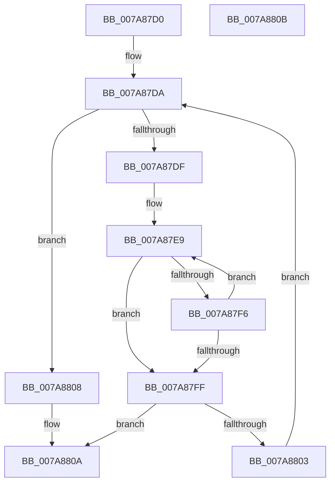

# SmKmKeyGenKeyFind

- RVA: `0x007A87D0`–`0x007A880C` (길이 `60` bytes)
- VA: `0x00000001407A87D0`
- 실행 섹션: `PAGE`
- PDB 이름 있음: `예`; PDB Function 태그: `아니요`
- unwind 정보 RVA: `0x000DB714`
- 디코드: `22`개 명령, `60/60` bytes 표시
- 미해석 바이트: `0` (있으면 어셈블리에 `.byte`로 보존)

> 이 문서는 커널 이미지의 기계어와 PDB 기호를 분석해 생성했습니다. 4번과 5번은 함수 원형과 자료형을 바이너리 사용 방식에서 추정한 C 해석이며 원본 소스 복구 결과는 아닙니다.

## 1. Dependencies

- 직접 호출 지점: **0**; 고유 호출 대상: **0**
- 직접 호출자로 확인된 함수: **2**
- RIP 상대 이미지 참조: **0**

### Outgoing calls
- 직접 디코드된 call 명령이 없습니다.

### Direct callers
- [SmKmKeyGenGenerate](SmKmKeyGenGenerate_function_007A85CC.md) at `0x007A8640`
- [SmKmKeyGenNewKey](SmKmKeyGenNewKey_function_007A8990.md) at `0x007A8AB2`

### Static image references
- 디코드된 RIP-relative 메모리 참조가 없습니다.

## 2. Other-region calls and transfers

- 다른 실행 섹션으로 향하는 call: **0**
- 별도 외부 분기/꼬리 이동을 확인하지 못했습니다.

## 3. Assembly (complete function range)

```asm
007A87D0  4C 8D 51 08                     lea r10, [rcx + 8]
007A87D4  4C 8B DA                        mov r11, rdx
007A87D7  49 8B 02                        mov rax, qword ptr [r10]
007A87DA  49 3B C2                        cmp rax, r10
007A87DD  74 29                           je 0x1407a8808
007A87DF  4C 8B 40 10                     mov r8, qword ptr [rax + 0x10]
007A87E3  49 8B CB                        mov rcx, r11
007A87E6  4D 2B C3                        sub r8, r11
007A87E9  0F B7 11                        movzx edx, word ptr [rcx]
007A87EC  46 0F B7 0C 01                  movzx r9d, word ptr [rcx + r8]
007A87F1  41 2B D1                        sub edx, r9d
007A87F4  75 09                           jne 0x1407a87ff
007A87F6  48 83 C1 02                     add rcx, 2
007A87FA  45 85 C9                        test r9d, r9d
007A87FD  75 EA                           jne 0x1407a87e9
007A87FF  85 D2                           test edx, edx
007A8801  74 07                           je 0x1407a880a
007A8803  48 8B 00                        mov rax, qword ptr [rax]
007A8806  EB D2                           jmp 0x1407a87da
007A8808  33 C0                           xor eax, eax
007A880A  C3                              ret
007A880B  CC                              int3
```

## 4. C-style interpretation (structured pseudocode)

```c
__int64 __fastcall SmKmKeyGenKeyFind(__int64 a1, __int64 a2)
{
    __int64 result;

loc_007A87DA:
    if ((*(unsigned __int64 *)(a1 + 8)) == (a1 + 8)) goto loc_007A8808;
    a3 = (*(unsigned __int64 *)(*(unsigned __int64 *)(a1 + 8) + 16)) - (a2);
loc_007A87E9:
    a2 = (unsigned int)((*(unsigned __int16 *)(a2)) - ((unsigned int)(*(unsigned __int16 *)(a2 + a3 * 1))));
    if (condition_is_not_equal) goto loc_007A87FF;
    a1 = (a2) + (2);
    if ((unsigned int)(*(unsigned __int16 *)(a2 + a3 * 1)) != 0) goto loc_007A87E9;
loc_007A87FF:
    if ((unsigned int)(a2) == 0) goto loc_007A880A;
    goto loc_007A87DA;
loc_007A8808:
    result = 0;
loc_007A880A:
    return result;
}
```

## 5. (Beta) C Style

```c
int64_t SmKmKeyGenKeyFind(void *Arg1, void *Arg2)
{
    uint8_t *arg1 = (uint8_t *)Arg1;
    uint8_t *arg2 = (uint8_t *)Arg2;

    int64_t result;

loc_007A87DA:
    if ((*(uint64_t *)(arg1 + 0x8)) == (Arg1 + 8)) goto loc_007A8808;
    a3 = (*(uint64_t *)(*(uint64_t *)(arg1 + 0x8) + 0x10)) - (Arg2);
loc_007A87E9:
    Arg2 = (uint32_t)((*(uint16_t *)(arg2)) - ((uint32_t)(*(uint16_t *)(arg2 + a3 * 1))));
    if (condition_is_not_equal) goto loc_007A87FF;
    Arg1 = (Arg2) + (2);
    if ((uint32_t)(*(uint16_t *)(arg2 + a3 * 1)) != 0) goto loc_007A87E9;
loc_007A87FF:
    if ((uint32_t)(Arg2) == 0) goto loc_007A880A;
    goto loc_007A87DA;
loc_007A8808:
    result = 0;
loc_007A880A:
    return result;
}
```

### 관측된 메모리 오프셋

구조체 형식이 확인되지 않은 접근은 인자 기준의 오프셋으로만 기록했습니다.

| 기준 인자 | 오프셋 표현 | 폭 (bit) | 접근 |
|---|---:|---:|---|
| `Arg1` | `+ 0x0` | `64` | `R` |
| `Arg1` | `+ 0x8` | `64` | `R` |
| `Arg2` | `+ 0x0` | `16` | `R` |
| `Arg2` | `+ 0x0 + r8*1` | `16` | `R` |

## 6. Execution-region graph

[열기: 2D/3D 그래프와 함수 탐색 컨트롤 패널](../../../control-panel.html?section=page&rva=0x007A87D0&view=graph)

- 2D 그래프는 위에서 아래로 흐르고, 3D 그래프는 빈 공간을 드래그해 회전합니다. Shift+드래그는 이동, 휠은 확대·축소, 함수 노드 선택은 대상 보고서 이동입니다.

### Static fallback


