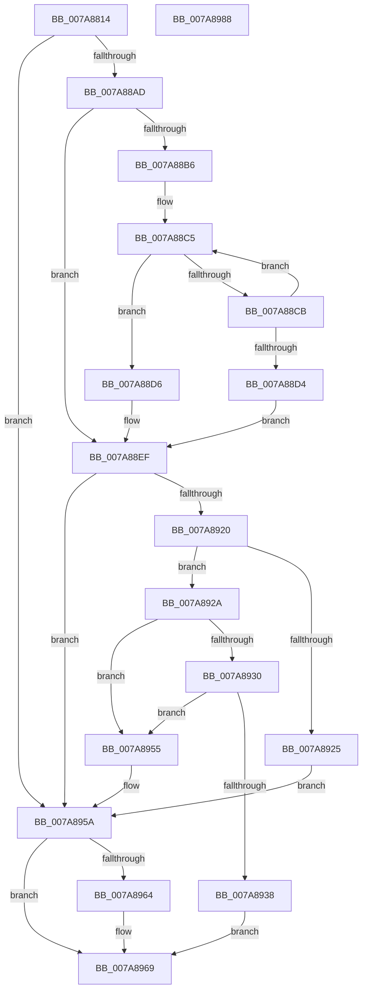

# SmKmKeyGenLoadKey

- RVA: `0x007A8814`–`0x007A8989` (길이 `373` bytes)
- VA: `0x00000001407A8814`
- 실행 섹션: `PAGE`
- PDB 이름 있음: `예`; PDB Function 태그: `아니요`
- unwind 정보 RVA: `0x000D1DEC`
- 디코드: `99`개 명령, `373/373` bytes 표시
- 미해석 바이트: `0` (있으면 어셈블리에 `.byte`로 보존)

> 이 문서는 커널 이미지의 기계어와 PDB 기호를 분석해 생성했습니다. 4번과 5번은 함수 원형과 자료형을 바이너리 사용 방식에서 추정한 C 해석이며 원본 소스 복구 결과는 아닙니다.

## 1. Dependencies

- 직접 호출 지점: **6**; 고유 호출 대상: **6**
- 직접 호출자로 확인된 함수: **1**
- RIP 상대 이미지 참조: **1**

### Outgoing calls
- `0x007A8872` → [memset](../../text/6C/memset_function_006C6C40.md) (function, `0x006C6C40`)
- `0x007A889E` → [ZwOpenKey](../../text/6A/ZwOpenKey_function_006AD310.md) (function, `0x006AD310`)
- `0x007A8915` → [ZwQueryValueKey](../../text/6A/ZwQueryValueKey_function_006AD3B0.md) (function, `0x006AD3B0`)
- `0x007A8943` → [memcpy](../../text/6C/memcpy_function_006C6840.md) (function, `0x006C6840`)
- `0x007A8964` → [ZwClose](../../text/6A/ZwClose_function_006AD2B0.md) (function, `0x006AD2B0`)
- `0x007A8975` → [_security_check_cookie](../../text/6A/_security_check_cookie_function_006AC640.md) (function, `0x006AC640`)

### Direct callers
- [SmKmKeyGenNewKey](SmKmKeyGenNewKey_function_007A8990.md) at `0x007A8A40`

### Static image references
- `0x007A882A` → RVA `0x00E0A740` (`.data`; read)

## 2. Other-region calls and transfers

- 다른 실행 섹션으로 향하는 call: **6**
  - `0x007A8872` → [memset](../../text/6C/memset_function_006C6C40.md) (`PAGE` → `.text`)
  - `0x007A889E` → [ZwOpenKey](../../text/6A/ZwOpenKey_function_006AD310.md) (`PAGE` → `.text`)
  - `0x007A8915` → [ZwQueryValueKey](../../text/6A/ZwQueryValueKey_function_006AD3B0.md) (`PAGE` → `.text`)
  - `0x007A8943` → [memcpy](../../text/6C/memcpy_function_006C6840.md) (`PAGE` → `.text`)
  - `0x007A8964` → [ZwClose](../../text/6A/ZwClose_function_006AD2B0.md) (`PAGE` → `.text`)
  - `0x007A8975` → [_security_check_cookie](../../text/6A/_security_check_cookie_function_006AC640.md) (`PAGE` → `.text`)
- 별도 외부 분기/꼬리 이동을 확인하지 못했습니다.

## 3. Assembly (complete function range)

```asm
007A8814  40 55                           push rbp
007A8816  53                              push rbx
007A8817  56                              push rsi
007A8818  57                              push rdi
007A8819  41 56                           push r14
007A881B  48 8D AC 24 60 FF FF FF         lea rbp, [rsp - 0xa0]
007A8823  48 81 EC A0 01 00 00            sub rsp, 0x1a0
007A882A  48 8B 05 0F 1F 66 00            mov rax, qword ptr [rip + 0x661f0f]
007A8831  48 33 C4                        xor rax, rsp
007A8834  48 89 85 90 00 00 00            mov qword ptr [rbp + 0x90], rax
007A883B  49 8B F0                        mov rsi, r8
007A883E  48 C7 44 24 50 30 00 00 00      mov qword ptr [rsp + 0x50], 0x30
007A8847  48 8B FA                        mov rdi, rdx
007A884A  48 C7 44 24 68 40 02 00 00      mov qword ptr [rsp + 0x68], 0x240
007A8853  48 8B D9                        mov rbx, rcx
007A8856  0F 57 C0                        xorps xmm0, xmm0
007A8859  45 33 F6                        xor r14d, r14d
007A885C  48 8D 4D 80                     lea rcx, [rbp - 0x80]
007A8860  33 D2                           xor edx, edx
007A8862  44 89 74 24 38                  mov dword ptr [rsp + 0x38], r14d
007A8867  41 B8 0C 01 00 00               mov r8d, 0x10c
007A886D  0F 11 44 24 40                  movups xmmword ptr [rsp + 0x40], xmm0
007A8872  E8 C9 E3 F1 FF                  call 0x1406c6c40
007A8877  0F 57 C0                        xorps xmm0, xmm0
007A887A  4C 89 74 24 30                  mov qword ptr [rsp + 0x30], r14
007A887F  4C 8D 44 24 50                  lea r8, [rsp + 0x50]
007A8884  4C 89 74 24 58                  mov qword ptr [rsp + 0x58], r14
007A8889  BA 19 00 02 00                  mov edx, 0x20019
007A888E  48 89 5C 24 60                  mov qword ptr [rsp + 0x60], rbx
007A8893  48 8D 4C 24 30                  lea rcx, [rsp + 0x30]
007A8898  F3 0F 7F 44 24 70               movdqu xmmword ptr [rsp + 0x70], xmm0
007A889E  E8 6D 4A F0 FF                  call 0x1406ad310
007A88A3  8B D8                           mov ebx, eax
007A88A5  85 C0                           test eax, eax
007A88A7  0F 88 AD 00 00 00               js 0x1407a895a
007A88AD  48 8B 4F 10                     mov rcx, qword ptr [rdi + 0x10]
007A88B1  48 85 C9                        test rcx, rcx
007A88B4  74 39                           je 0x1407a88ef
007A88B6  B8 FF 7F 00 00                  mov eax, 0x7fff
007A88BB  45 8D 4E 02                     lea r9d, [r14 + 2]
007A88BF  44 8B C0                        mov r8d, eax
007A88C2  48 8B D1                        mov rdx, rcx
007A88C5  66 44 39 32                     cmp word ptr [rdx], r14w
007A88C9  74 0B                           je 0x1407a88d6
007A88CB  49 03 D1                        add rdx, r9
007A88CE  49 83 E8 01                     sub r8, 1
007A88D2  75 F1                           jne 0x1407a88c5
007A88D4  EB 19                           jmp 0x1407a88ef
007A88D6  49 2B C0                        sub rax, r8
007A88D9  48 89 4C 24 48                  mov qword ptr [rsp + 0x48], rcx
007A88DE  66 03 C0                        add ax, ax
007A88E1  66 89 44 24 40                  mov word ptr [rsp + 0x40], ax
007A88E6  66 41 03 C1                     add ax, r9w
007A88EA  66 89 44 24 42                  mov word ptr [rsp + 0x42], ax
007A88EF  48 8B 4C 24 30                  mov rcx, qword ptr [rsp + 0x30]
007A88F4  48 8D 44 24 38                  lea rax, [rsp + 0x38]
007A88F9  48 89 44 24 28                  mov qword ptr [rsp + 0x28], rax
007A88FE  4C 8D 4D 80                     lea r9, [rbp - 0x80]
007A8902  41 B8 04 00 00 00               mov r8d, 4
007A8908  C7 44 24 20 0C 01 00 00         mov dword ptr [rsp + 0x20], 0x10c
007A8910  48 8D 54 24 40                  lea rdx, [rsp + 0x40]
007A8915  E8 96 4A F0 FF                  call 0x1406ad3b0
007A891A  8B D8                           mov ebx, eax
007A891C  85 C0                           test eax, eax
007A891E  78 3A                           js 0x1407a895a
007A8920  48 85 F6                        test rsi, rsi
007A8923  75 05                           jne 0x1407a892a
007A8925  41 8B DE                        mov ebx, r14d
007A8928  EB 30                           jmp 0x1407a895a
007A892A  83 7D 80 03                     cmp dword ptr [rbp - 0x80], 3
007A892E  75 25                           jne 0x1407a8955
007A8930  8B 47 20                        mov eax, dword ptr [rdi + 0x20]
007A8933  39 45 84                        cmp dword ptr [rbp - 0x7c], eax
007A8936  75 1D                           jne 0x1407a8955
007A8938  48 8B 4F 18                     mov rcx, qword ptr [rdi + 0x18]
007A893C  48 8D 55 88                     lea rdx, [rbp - 0x78]
007A8940  44 8B C0                        mov r8d, eax
007A8943  E8 F8 DE F1 FF                  call 0x1406c6840
007A8948  48 8B 44 24 30                  mov rax, qword ptr [rsp + 0x30]
007A894D  41 8B DE                        mov ebx, r14d
007A8950  48 89 06                        mov qword ptr [rsi], rax
007A8953  EB 14                           jmp 0x1407a8969
007A8955  BB 34 00 00 C0                  mov ebx, 0xc0000034
007A895A  48 8B 4C 24 30                  mov rcx, qword ptr [rsp + 0x30]
007A895F  48 85 C9                        test rcx, rcx
007A8962  74 05                           je 0x1407a8969
007A8964  E8 47 49 F0 FF                  call 0x1406ad2b0
007A8969  8B C3                           mov eax, ebx
007A896B  48 8B 8D 90 00 00 00            mov rcx, qword ptr [rbp + 0x90]
007A8972  48 33 CC                        xor rcx, rsp
007A8975  E8 C6 3C F0 FF                  call 0x1406ac640
007A897A  48 81 C4 A0 01 00 00            add rsp, 0x1a0
007A8981  41 5E                           pop r14
007A8983  5F                              pop rdi
007A8984  5E                              pop rsi
007A8985  5B                              pop rbx
007A8986  5D                              pop rbp
007A8987  C3                              ret
007A8988  CC                              int3
```

## 4. C-style interpretation (structured pseudocode)

```c
__int64 __fastcall SmKmKeyGenLoadKey(__int64 a1, __int64 a2, __int64 a3)
{
    __int64 result;
    __int64 v_r14;
    __int64 v_rsp;
    unsigned __int64 v_stack_m140;
    unsigned int v_stack_m144;
    unsigned __int64 v_stack_m148;
    unsigned __int64 v_stack_m158;
    unsigned __int64 v_stack_m160;
    unsigned __int64 v_stack_m168;
    unsigned __int64 v_stack_m170;
    unsigned __int64 v_stack_m178;
    unsigned __int64 v_stack_m180;
    unsigned __int16 v_stack_m186;
    unsigned __int64 v_stack_m188;
    unsigned int v_stack_m190;
    unsigned __int64 v_stack_m198;
    unsigned __int64 v_stack_m1A0;
    unsigned int v_stack_m1A8;
    unsigned __int64 v_stack_m38;
    unsigned __int64 v_stack_mC8;

    v_rsp = (v_rsp) - (416);
    result = (*(unsigned __int64 *)(v_rip + 6692623)) ^ (v_rsp);
    v_stack_m38 = result;
    v_stack_m178 = 48;
    v_stack_m160 = 576;
    v_r14 = 0;
    a2 = 0;
    v_stack_m190 = 0;
    v_stack_m188 = v_xmm0;
    result = memset(v_stack_m148, a2, 268, a4);
    v_stack_m198 = 0;
    v_stack_m170 = 0;
    v_stack_m168 = a1;
    v_stack_m158 = v_xmm0;
    result = ZwOpenKey(v_stack_m198, (unsigned int)(0x20019ULL), v_stack_m178, a4);
    if (sign_flag) goto loc_007A895A;
    if (*(unsigned __int64 *)(a2 + 16) == 0) goto loc_007A88EF;
loc_007A88C5:
    if ((*(unsigned __int16 *)(*(unsigned __int64 *)(a2 + 16))) == 0) goto loc_007A88D6;
    a2 = (*(unsigned __int64 *)(a2 + 16)) + (v_r14 + 2);
    a3 = ((unsigned int)((unsigned int)((unsigned int)(0x7FFFULL)))) - (1);
    if (condition_is_not_equal) goto loc_007A88C5;
    goto loc_007A88EF;
loc_007A88D6:
    result = ((unsigned int)(0x7FFFULL)) - (a3);
    v_stack_m180 = *(unsigned __int64 *)(a2 + 16);
    result = (unsigned __int16)((result) + ((unsigned __int16)(result)));
    v_stack_m188 = (unsigned __int16)(result);
    result = (unsigned __int16)((result) + ((unsigned __int16)(v_r14 + 2)));
    v_stack_m186 = (unsigned __int16)(result);
loc_007A88EF:
    v_stack_m1A0 = v_stack_m190;
    v_stack_m1A8 = 268;
    result = ZwQueryValueKey(v_stack_m198, v_stack_m188, 4, v_stack_m148);
    if (sign_flag) goto loc_007A895A;
    if (a3 != 0) goto loc_007A892A;
    goto loc_007A895A;
loc_007A892A:
    if (v_stack_m148 != 3) goto loc_007A8955;
    if (v_stack_m144 != ((unsigned int)((unsigned int)(*(unsigned int *)(a2 + 32))))) goto loc_007A8955;
    result = memcpy(*(unsigned __int64 *)(a2 + 24), v_stack_m140, (unsigned int)((unsigned int)((unsigned int)(*(unsigned int *)(a2 + 32)))), v_stack_m148);
    *(unsigned __int64 *)(a3) = v_stack_m198;
    goto loc_007A8969;
loc_007A8955:
loc_007A895A:
    result = v_stack_m198;
    if (v_stack_m198 != 0) {
        result = ZwClose(v_stack_m198, v_stack_m140, (unsigned int)((unsigned int)((unsigned int)(*(unsigned int *)(a2 + 32)))), v_stack_m148);
    }
    a1 = (v_stack_m38) ^ (v_rsp);
    result = _security_check_cookie(a1, v_stack_m140, (unsigned int)((unsigned int)((unsigned int)(*(unsigned int *)(a2 + 32)))), v_stack_m148);
    v_rsp = (v_rsp) + (416);
    return result;
}
```

## 5. (Beta) C Style

```c
int64_t SmKmKeyGenLoadKey(int64_t Arg1, void *Arg2, int64_t Arg3)
{
    uint8_t *arg2 = (uint8_t *)Arg2;

    int64_t result;
    int64_t local_r14;
    int64_t local_rsp;
    uint64_t v_stack_m140;
    uint32_t v_stack_m144;
    uint64_t v_stack_m148;
    uint64_t v_stack_m158;
    uint64_t v_stack_m160;
    uint64_t v_stack_m168;
    uint64_t v_stack_m170;
    uint64_t v_stack_m178;
    uint64_t v_stack_m180;
    uint16_t v_stack_m186;
    uint64_t v_stack_m188;
    uint32_t v_stack_m190;
    uint64_t v_stack_m198;
    uint64_t v_stack_m1A0;
    uint32_t v_stack_m1A8;
    uint64_t v_stack_m38;
    uint64_t v_stack_mC8;

    local_rsp = (local_rsp) - (416);
    result = (*(uint64_t *)(v_rip + 0x661F0F)) ^ (local_rsp);
    v_stack_m38 = result;
    v_stack_m178 = 48;
    v_stack_m160 = 576;
    local_r14 = 0;
    Arg2 = 0;
    v_stack_m190 = 0;
    v_stack_m188 = v_xmm0;
    result = memset(v_stack_m148, Arg2, 268, a4);
    v_stack_m198 = 0;
    v_stack_m170 = 0;
    v_stack_m168 = Arg1;
    v_stack_m158 = v_xmm0;
    result = ZwOpenKey(v_stack_m198, (uint32_t)(0x20019ULL), v_stack_m178, a4);
    if (sign_flag) goto loc_007A895A;
    if (*(uint64_t *)(arg2 + 0x10) == 0) goto loc_007A88EF;
loc_007A88C5:
    if ((*(uint16_t *)(*(uint64_t *)(arg2 + 0x10))) == 0) goto loc_007A88D6;
    Arg2 = (*(uint64_t *)(arg2 + 0x10)) + (local_r14 + 2);
    Arg3 = ((uint32_t)((uint32_t)((uint32_t)(0x7FFFULL)))) - (1);
    if (condition_is_not_equal) goto loc_007A88C5;
    goto loc_007A88EF;
loc_007A88D6:
    result = ((uint32_t)(0x7FFFULL)) - (Arg3);
    v_stack_m180 = *(uint64_t *)(arg2 + 0x10);
    result = (uint16_t)((result) + ((uint16_t)(result)));
    v_stack_m188 = (uint16_t)(result);
    result = (uint16_t)((result) + ((uint16_t)(local_r14 + 2)));
    v_stack_m186 = (uint16_t)(result);
loc_007A88EF:
    v_stack_m1A0 = v_stack_m190;
    v_stack_m1A8 = 268;
    result = ZwQueryValueKey(v_stack_m198, v_stack_m188, 4, v_stack_m148);
    if (sign_flag) goto loc_007A895A;
    if (Arg3 != 0) goto loc_007A892A;
    goto loc_007A895A;
loc_007A892A:
    if (v_stack_m148 != 3) goto loc_007A8955;
    if (v_stack_m144 != ((uint32_t)((uint32_t)(*(uint32_t *)(arg2 + 0x20))))) goto loc_007A8955;
    result = memcpy(*(uint64_t *)(arg2 + 0x18), v_stack_m140, (uint32_t)((uint32_t)((uint32_t)(*(uint32_t *)(arg2 + 0x20)))), v_stack_m148);
    *(uint64_t *)(Arg3) = v_stack_m198;
    goto loc_007A8969;
loc_007A8955:
loc_007A895A:
    result = v_stack_m198;
    if (v_stack_m198 != 0) {
        result = ZwClose(v_stack_m198, v_stack_m140, (uint32_t)((uint32_t)((uint32_t)(*(uint32_t *)(arg2 + 0x20)))), v_stack_m148);
    }
    Arg1 = (v_stack_m38) ^ (local_rsp);
    result = _security_check_cookie(Arg1, v_stack_m140, (uint32_t)((uint32_t)((uint32_t)(*(uint32_t *)(arg2 + 0x20)))), v_stack_m148);
    local_rsp = (local_rsp) + (416);
    return result;
}
```

### 관측된 메모리 오프셋

구조체 형식이 확인되지 않은 접근은 인자 기준의 오프셋으로만 기록했습니다.

| 기준 인자 | 오프셋 표현 | 폭 (bit) | 접근 |
|---|---:|---:|---|
| `Arg2` | `+ 0x10` | `64` | `R` |
| `Arg2` | `+ 0x18` | `64` | `R` |
| `Arg2` | `+ 0x20` | `32` | `R` |

## 6. Execution-region graph

[열기: 2D/3D 그래프와 함수 탐색 컨트롤 패널](../../../control-panel.html?section=page&rva=0x007A8814&view=graph)

- 2D 그래프는 위에서 아래로 흐르고, 3D 그래프는 빈 공간을 드래그해 회전합니다. Shift+드래그는 이동, 휠은 확대·축소, 함수 노드 선택은 대상 보고서 이동입니다.

### Static fallback


