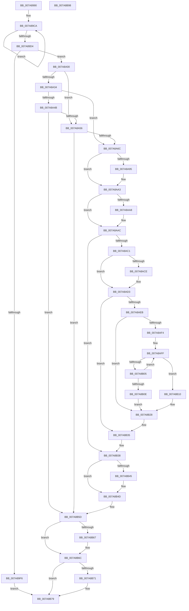

# SmKmKeyGenNewKey

- RVA: `0x007A8990`–`0x007A8B99` (길이 `521` bytes)
- VA: `0x00000001407A8990`
- 실행 섹션: `PAGE`
- PDB 이름 있음: `예`; PDB Function 태그: `아니요`
- unwind 정보 RVA: `0x0008C20C`
- 디코드: `152`개 명령, `521/521` bytes 표시
- 미해석 바이트: `0` (있으면 어셈블리에 `.byte`로 보존)

> 이 문서는 커널 이미지의 기계어와 PDB 기호를 분석해 생성했습니다. 4번과 5번은 함수 원형과 자료형을 바이너리 사용 방식에서 추정한 C 해석이며 원본 소스 복구 결과는 아닙니다.

## 1. Dependencies

- 직접 호출 지점: **14**; 고유 호출 대상: **14**
- 직접 호출자로 확인된 함수: **1**
- RIP 상대 이미지 참조: **0**

### Outgoing calls
- `0x007A89E9` → [SmAllocEx](../../text/34/SmAllocEx_function_0034C794.md) (function, `0x0034C794`)
- `0x007A8A08` → [memset](../../text/6C/memset_function_006C6C40.md) (function, `0x006C6C40`)
- `0x007A8A29` → [memcpy](../../text/6C/memcpy_function_006C6840.md) (function, `0x006C6840`)
- `0x007A8A40` → [SmKmKeyGenLoadKey](SmKmKeyGenLoadKey_function_007A8814.md) (function, `0x007A8814`)
- `0x007A8A5D` → [SmCrGenRandom](../../text/61/SmCrGenRandom_function_006114A4.md) (function, `0x006114A4`)
- `0x007A8A85` → [KeAbPreAcquire](../../text/21/KeAbPreAcquire_function_00210230.md) (function, `0x00210230`)
- `0x007A8A9E` → [ExfAcquirePushLockExclusiveEx](../../text/20/ExfAcquirePushLockExclusiveEx_function_0020FC90.md) (function, `0x0020FC90`)
- `0x007A8AB2` → [SmKmKeyGenKeyFind](SmKmKeyGenKeyFind_function_007A87D0.md) (function, `0x007A87D0`)
- `0x007A8B30` → [ZwDeleteValueKey](../../text/6A/ZwDeleteValueKey_function_006AECB0.md) (function, `0x006AECB0`)
- `0x007A8B48` → [ExfTryToWakePushLock](../../text/26/ExfTryToWakePushLock_function_00265DD0.md) (function, `0x00265DD0`)
- `0x007A8B50` → [KeAbPostRelease](../../text/2E/KeAbPostRelease_function_002E1600.md) (function, `0x002E1600`)
- `0x007A8B55` → [KeLeaveCriticalRegion](../../text/25/KeLeaveCriticalRegion_function_0025D8B0.md) (function, `0x0025D8B0`)
- `0x007A8B67` → [ZwClose](../../text/6A/ZwClose_function_006AD2B0.md) (function, `0x006AD2B0`)
- `0x007A8B74` → [CmSiFreeMemory](../../text/47/CmSiFreeMemory_function_00475D80.md) (function, `0x00475D80`)

### Direct callers
- [SmKmKeyGenGenerate](SmKmKeyGenGenerate_function_007A85CC.md) at `0x007A8675`

### Static image references
- 디코드된 RIP-relative 메모리 참조가 없습니다.

## 2. Other-region calls and transfers

- 다른 실행 섹션으로 향하는 call: **12**
  - `0x007A89E9` → [SmAllocEx](../../text/34/SmAllocEx_function_0034C794.md) (`PAGE` → `.text`)
  - `0x007A8A08` → [memset](../../text/6C/memset_function_006C6C40.md) (`PAGE` → `.text`)
  - `0x007A8A29` → [memcpy](../../text/6C/memcpy_function_006C6840.md) (`PAGE` → `.text`)
  - `0x007A8A5D` → [SmCrGenRandom](../../text/61/SmCrGenRandom_function_006114A4.md) (`PAGE` → `.text`)
  - `0x007A8A85` → [KeAbPreAcquire](../../text/21/KeAbPreAcquire_function_00210230.md) (`PAGE` → `.text`)
  - `0x007A8A9E` → [ExfAcquirePushLockExclusiveEx](../../text/20/ExfAcquirePushLockExclusiveEx_function_0020FC90.md) (`PAGE` → `.text`)
  - `0x007A8B30` → [ZwDeleteValueKey](../../text/6A/ZwDeleteValueKey_function_006AECB0.md) (`PAGE` → `.text`)
  - `0x007A8B48` → [ExfTryToWakePushLock](../../text/26/ExfTryToWakePushLock_function_00265DD0.md) (`PAGE` → `.text`)
  - `0x007A8B50` → [KeAbPostRelease](../../text/2E/KeAbPostRelease_function_002E1600.md) (`PAGE` → `.text`)
  - `0x007A8B55` → [KeLeaveCriticalRegion](../../text/25/KeLeaveCriticalRegion_function_0025D8B0.md) (`PAGE` → `.text`)
  - `0x007A8B67` → [ZwClose](../../text/6A/ZwClose_function_006AD2B0.md) (`PAGE` → `.text`)
  - `0x007A8B74` → [CmSiFreeMemory](../../text/47/CmSiFreeMemory_function_00475D80.md) (`PAGE` → `.text`)
- 별도 외부 분기/꼬리 이동을 확인하지 못했습니다.

## 3. Assembly (complete function range)

```asm
007A8990  48 8B C4                        mov rax, rsp
007A8993  48 89 58 08                     mov qword ptr [rax + 8], rbx
007A8997  48 89 68 10                     mov qword ptr [rax + 0x10], rbp
007A899B  48 89 70 18                     mov qword ptr [rax + 0x18], rsi
007A899F  57                              push rdi
007A89A0  41 54                           push r12
007A89A2  41 55                           push r13
007A89A4  41 56                           push r14
007A89A6  41 57                           push r15
007A89A8  48 83 EC 30                     sub rsp, 0x30
007A89AC  45 33 ED                        xor r13d, r13d
007A89AF  45 8B F0                        mov r14d, r8d
007A89B2  48 83 CB FF                     or rbx, 0xffffffffffffffff
007A89B6  4C 89 68 20                     mov qword ptr [rax + 0x20], r13
007A89BA  0F 57 C0                        xorps xmm0, xmm0
007A89BD  48 8B EB                        mov rbp, rbx
007A89C0  4C 8B FA                        mov r15, rdx
007A89C3  48 8B F1                        mov rsi, rcx
007A89C6  0F 11 40 C8                     movups xmmword ptr [rax - 0x38], xmm0
007A89CA  48 FF C5                        inc rbp
007A89CD  66 44 39 2C 6A                  cmp word ptr [rdx + rbp*2], r13w
007A89D2  75 F6                           jne 0x1407a89ca
007A89D4  41 8D 46 2A                     lea eax, [r14 + 0x2a]
007A89D8  41 83 C8 FF                     or r8d, 0xffffffff
007A89DC  8D 04 68                        lea eax, [rax + rbp*2]
007A89DF  BA 73 6D 4B 47                  mov edx, 0x474b6d73
007A89E4  8B C8                           mov ecx, eax
007A89E6  44 8B E0                        mov r12d, eax
007A89E9  E8 A6 3D BA FF                  call 0x14034c794
007A89EE  48 8B F8                        mov rdi, rax
007A89F1  48 85 C0                        test rax, rax
007A89F4  75 0A                           jne 0x1407a8a00
007A89F6  BD 9A 00 00 C0                  mov ebp, 0xc000009a
007A89FB  E9 79 01 00 00                  jmp 0x1407a8b79
007A8A00  4D 8B C4                        mov r8, r12
007A8A03  33 D2                           xor edx, edx
007A8A05  48 8B CF                        mov rcx, rdi
007A8A08  E8 33 E2 F1 FF                  call 0x1406c6c40
007A8A0D  48 8D 4F 28                     lea rcx, [rdi + 0x28]
007A8A11  44 8B C5                        mov r8d, ebp
007A8A14  48 89 4F 18                     mov qword ptr [rdi + 0x18], rcx
007A8A18  4D 03 C0                        add r8, r8
007A8A1B  49 03 CE                        add rcx, r14
007A8A1E  44 89 77 20                     mov dword ptr [rdi + 0x20], r14d
007A8A22  49 8B D7                        mov rdx, r15
007A8A25  48 89 4F 10                     mov qword ptr [rdi + 0x10], rcx
007A8A29  E8 12 DE F1 FF                  call 0x1406c6840
007A8A2E  4C 39 6E 20                     cmp qword ptr [rsi + 0x20], r13
007A8A32  74 22                           je 0x1407a8a56
007A8A34  48 8D 4E 18                     lea rcx, [rsi + 0x18]
007A8A38  48 8B D7                        mov rdx, rdi
007A8A3B  4C 8D 44 24 78                  lea r8, [rsp + 0x78]
007A8A40  E8 CF FD FF FF                  call 0x1407a8814
007A8A45  8B E8                           mov ebp, eax
007A8A47  85 C0                           test eax, eax
007A8A49  79 21                           jns 0x1407a8a6c
007A8A4B  3D 34 00 00 C0                  cmp eax, 0xc0000034
007A8A50  0F 85 07 01 00 00               jne 0x1407a8b5d
007A8A56  48 8B 4F 18                     mov rcx, qword ptr [rdi + 0x18]
007A8A5A  41 8B D6                        mov edx, r14d
007A8A5D  E8 42 8A E6 FF                  call 0x1406114a4
007A8A62  8B E8                           mov ebp, eax
007A8A64  85 C0                           test eax, eax
007A8A66  0F 88 F1 00 00 00               js 0x1407a8b5d
007A8A6C  65 48 8B 04 25 88 01 00 00      mov rax, qword ptr gs:[0x188]
007A8A75  45 33 C0                        xor r8d, r8d
007A8A78  33 D2                           xor edx, edx
007A8A7A  48 8B CE                        mov rcx, rsi
007A8A7D  66 01 98 E4 01 00 00            add word ptr [rax + 0x1e4], bx
007A8A84  90                              nop
007A8A85  E8 A6 77 A6 FF                  call 0x140210230
007A8A8A  F0 48 0F BA 2E 00               lock bts qword ptr [rsi], 0
007A8A90  48 8B E8                        mov rbp, rax
007A8A93  73 0E                           jae 0x1407a8aa3
007A8A95  4C 8B C6                        mov r8, rsi
007A8A98  48 8B D0                        mov rdx, rax
007A8A9B  48 8B CE                        mov rcx, rsi
007A8A9E  E8 ED 71 A6 FF                  call 0x14020fc90
007A8AA3  48 85 ED                        test rbp, rbp
007A8AA6  74 04                           je 0x1407a8aac
007A8AA8  C6 45 0A 01                     mov byte ptr [rbp + 0xa], 1
007A8AAC  49 8B D7                        mov rdx, r15
007A8AAF  48 8B CE                        mov rcx, rsi
007A8AB2  E8 19 FD FF FF                  call 0x1407a87d0
007A8AB7  BD 02 00 00 00                  mov ebp, 2
007A8ABC  48 85 C0                        test rax, rax
007A8ABF  75 77                           jne 0x1407a8b38
007A8AC1  48 8D 46 08                     lea rax, [rsi + 8]
007A8AC5  48 8B 08                        mov rcx, qword ptr [rax]
007A8AC8  48 39 41 08                     cmp qword ptr [rcx + 8], rax
007A8ACC  74 05                           je 0x1407a8ad3
007A8ACE  8D 4D 01                        lea ecx, [rbp + 1]
007A8AD1  CD 29                           int 0x29
007A8AD3  4C 8B 4C 24 78                  mov r9, qword ptr [rsp + 0x78]
007A8AD8  48 89 0F                        mov qword ptr [rdi], rcx
007A8ADB  48 89 47 08                     mov qword ptr [rdi + 8], rax
007A8ADF  48 89 79 08                     mov qword ptr [rcx + 8], rdi
007A8AE3  48 89 38                        mov qword ptr [rax], rdi
007A8AE6  4D 85 C9                        test r9, r9
007A8AE9  74 4A                           je 0x1407a8b35
007A8AEB  48 8B 57 10                     mov rdx, qword ptr [rdi + 0x10]
007A8AEF  48 85 D2                        test rdx, rdx
007A8AF2  74 34                           je 0x1407a8b28
007A8AF4  B8 FF 7F 00 00                  mov eax, 0x7fff
007A8AF9  48 8B CA                        mov rcx, rdx
007A8AFC  44 8B C0                        mov r8d, eax
007A8AFF  66 44 39 29                     cmp word ptr [rcx], r13w
007A8B03  74 0B                           je 0x1407a8b10
007A8B05  48 03 CD                        add rcx, rbp
007A8B08  49 83 E8 01                     sub r8, 1
007A8B0C  75 F1                           jne 0x1407a8aff
007A8B0E  EB 18                           jmp 0x1407a8b28
007A8B10  49 2B C0                        sub rax, r8
007A8B13  48 89 54 24 28                  mov qword ptr [rsp + 0x28], rdx
007A8B18  66 03 C0                        add ax, ax
007A8B1B  66 89 44 24 20                  mov word ptr [rsp + 0x20], ax
007A8B20  66 03 C5                        add ax, bp
007A8B23  66 89 44 24 22                  mov word ptr [rsp + 0x22], ax
007A8B28  48 8D 54 24 20                  lea rdx, [rsp + 0x20]
007A8B2D  49 8B C9                        mov rcx, r9
007A8B30  E8 7B 61 F0 FF                  call 0x1406aecb0
007A8B35  49 8B FD                        mov rdi, r13
007A8B38  F0 48 0F C1 1E                  lock xadd qword ptr [rsi], rbx
007A8B3D  80 E3 06                        and bl, 6
007A8B40  40 3A DD                        cmp bl, bpl
007A8B43  75 08                           jne 0x1407a8b4d
007A8B45  48 8B CE                        mov rcx, rsi
007A8B48  E8 83 D2 AB FF                  call 0x140265dd0
007A8B4D  48 8B CE                        mov rcx, rsi
007A8B50  E8 AB 8A B3 FF                  call 0x1402e1600
007A8B55  E8 56 4D AB FF                  call 0x14025d8b0
007A8B5A  41 8B ED                        mov ebp, r13d
007A8B5D  48 8B 4C 24 78                  mov rcx, qword ptr [rsp + 0x78]
007A8B62  48 85 C9                        test rcx, rcx
007A8B65  74 05                           je 0x1407a8b6c
007A8B67  E8 44 47 F0 FF                  call 0x1406ad2b0
007A8B6C  48 85 FF                        test rdi, rdi
007A8B6F  74 08                           je 0x1407a8b79
007A8B71  48 8B CF                        mov rcx, rdi
007A8B74  E8 07 D2 CC FF                  call 0x140475d80
007A8B79  48 8B 5C 24 60                  mov rbx, qword ptr [rsp + 0x60]
007A8B7E  8B C5                           mov eax, ebp
007A8B80  48 8B 6C 24 68                  mov rbp, qword ptr [rsp + 0x68]
007A8B85  48 8B 74 24 70                  mov rsi, qword ptr [rsp + 0x70]
007A8B8A  48 83 C4 30                     add rsp, 0x30
007A8B8E  41 5F                           pop r15
007A8B90  41 5E                           pop r14
007A8B92  41 5D                           pop r13
007A8B94  41 5C                           pop r12
007A8B96  5F                              pop rdi
007A8B97  C3                              ret
007A8B98  CC                              int3
```

## 4. C-style interpretation (structured pseudocode)

```c
__int64 __fastcall SmKmKeyGenNewKey(__int64 a1, __int64 a2, int a3)
{
    __int64 result;
    __int64 v_r13;
    __int64 v_rbp;
    __int64 v_rbx;
    __int64 v_rsp;
    unsigned __int64 v_stack_m30;
    unsigned __int16 v_stack_m36;
    unsigned __int16 v_stack_m38;
    unsigned __int64 v_stack_p10;
    unsigned __int64 v_stack_p18;
    unsigned __int64 v_stack_p20;
    unsigned __int64 v_stack_p8;

    *(unsigned __int64 *)(v_rsp + 8) = v_rbx;
    *(unsigned __int64 *)(v_rsp + 16) = v_rbp;
    *(unsigned __int64 *)(v_rsp + 24) = v_rsi;
    v_rsp = (v_rsp) - (48);
    v_r13 = 0;
    v_rbx = (v_rbx) | (-1);
    *(unsigned __int64 *)(v_rsp + 32) = 0;
    *(unsigned __int64 *)(v_rsp - 56) = v_xmm0;
loc_007A89CA:
    v_rbp = (v_rbx) + 1;
    if ((*(unsigned __int16 *)(a2 + v_rbp * 2)) != 0) goto loc_007A89CA;
    a3 = (unsigned int)((a3) | (0xFFFFFFFFULL));
    result = SmAllocEx((unsigned int)((unsigned int)((unsigned int)(a3) + 42 + v_rbp * 2)), (unsigned int)(0x474B6D73ULL), a3, a4);
    if (result != 0) goto loc_007A8A00;
    goto loc_007A8B79;
loc_007A8A00:
    a2 = 0;
    result = memset(result, a2, (unsigned int)((unsigned int)((unsigned int)(a3) + 42 + v_rbp * 2)), a4);
    *(unsigned __int64 *)(result + 24) = result + 40;
    a3 = ((unsigned int)((unsigned int)((unsigned int)(0xC000009AULL)))) + ((unsigned int)((unsigned int)((unsigned int)(0xC000009AULL))));
    a1 = (result + 40) + ((unsigned int)(a3));
    *(unsigned int *)(result + 32) = (unsigned int)((unsigned int)(a3));
    *(unsigned __int64 *)(result + 16) = a1;
    result = memcpy(a1, 0, a3, a4);
    if ((*(unsigned __int64 *)(a1 + 32)) == 0) goto loc_007A8A56;
    result = SmKmKeyGenLoadKey(a1 + 24, result, v_stack_p20, a4);
    if (!sign_flag) goto loc_007A8A6C;
    if (((unsigned int)(result)) != 0xC0000034ULL) goto loc_007A8B5D;
loc_007A8A56:
    result = SmCrGenRandom(*(unsigned __int64 *)(result + 24), (unsigned int)((unsigned int)((unsigned int)(a3))), v_stack_p20, a4);
    if (sign_flag) goto loc_007A8B5D;
loc_007A8A6C:
    a3 = 0;
    a2 = 0;
    result = KeAbPreAcquire(a1, a2, a3, a4);
    if (!(condition_is_above_or_equal)) {
        a3 = a1;
        a2 = result;
        a1 = a1;
        result = ExfAcquirePushLockExclusiveEx(a1, a2, a3, a4);
    }
    if (result != 0) {
        *(unsigned __int8 *)(result + 10) = 1;
    }
    result = SmKmKeyGenKeyFind(a1, a2, a3, a4);
    if (result != 0) goto loc_007A8B38;
    if ((*(unsigned __int64 *)(*(unsigned __int64 *)(a1 + 8) + 8)) != (a1 + 8)) {
        a1 = 2 + 1;
    }
    *(unsigned __int64 *)(result) = a1;
    *(unsigned __int64 *)(result + 8) = a1 + 8;
    *(unsigned __int64 *)(a1 + 8) = result;
    *(unsigned __int64 *)(a1 + 8) = result;
    if (v_stack_p20 == 0) goto loc_007A8B35;
    if (*(unsigned __int64 *)(result + 16) == 0) goto loc_007A8B28;
loc_007A8AFF:
    if ((*(unsigned __int16 *)(*(unsigned __int64 *)(result + 16))) == 0) goto loc_007A8B10;
    a1 = (*(unsigned __int64 *)(result + 16)) + (2);
    a3 = ((unsigned int)((unsigned int)((unsigned int)(0x7FFFULL)))) - (1);
    if (condition_is_not_equal) goto loc_007A8AFF;
    goto loc_007A8B28;
loc_007A8B10:
    result = ((unsigned int)(0x7FFFULL)) - (a3);
    v_stack_m30 = *(unsigned __int64 *)(result + 16);
    result = (unsigned __int16)((result) + ((unsigned __int16)(result)));
    v_stack_m38 = (unsigned __int16)(result);
    result = (unsigned __int16)((result) + (2));
    v_stack_m36 = (unsigned __int16)(result);
loc_007A8B28:
    result = ZwDeleteValueKey(v_stack_p20, v_stack_m38, a3, v_stack_p20);
loc_007A8B35:
loc_007A8B38:
    v_rbx = (unsigned __int8)((v_rbx) & (6));
    if (((unsigned __int8)(v_rbx)) == 2) {
        a1 = a1;
        result = ExfTryToWakePushLock(a1, v_stack_m38, a3, v_stack_p20);
    }
    result = KeAbPostRelease(a1, v_stack_m38, a3, v_stack_p20);
    result = KeLeaveCriticalRegion(a1, v_stack_m38, a3, v_stack_p20);
loc_007A8B5D:
    if (v_stack_p20 != 0) {
        result = ZwClose(v_stack_p20, v_stack_m38, a3, v_stack_p20);
    }
    if (0 != 0) {
        a1 = 0;
        result = CmSiFreeMemory(a1, v_stack_m38, a3, v_stack_p20);
    }
    v_rsp = (v_rsp) + (48);
    return 0;
}
```

## 5. (Beta) C Style

```c
int64_t SmKmKeyGenNewKey(void *Arg1, void *Arg2, void *Arg3)
{
    uint8_t *arg1 = (uint8_t *)Arg1;
    uint8_t *arg2 = (uint8_t *)Arg2;
    uint8_t *arg3 = (uint8_t *)Arg3;

    int64_t result;
    int64_t local_r13;
    int64_t local_rbp;
    int64_t local_rbx;
    int64_t local_rsp;
    uint64_t v_stack_m30;
    uint16_t v_stack_m36;
    uint16_t v_stack_m38;
    uint64_t v_stack_p10;
    uint64_t v_stack_p18;
    uint64_t v_stack_p20;
    uint64_t v_stack_p8;

    *(uint64_t *)(local_rsp + 0x8) = local_rbx;
    *(uint64_t *)(local_rsp + 0x10) = local_rbp;
    *(uint64_t *)(local_rsp + 0x18) = local_rsi;
    local_rsp = (local_rsp) - (48);
    local_r13 = 0;
    local_rbx = (local_rbx) | (-1);
    *(uint64_t *)(local_rsp + 0x20) = 0;
    *(uint64_t *)(local_rsp - 0x38) = v_xmm0;
loc_007A89CA:
    local_rbp = (local_rbx) + 1;
    if ((*(uint16_t *)(arg2 + local_rbp * 2)) != 0) goto loc_007A89CA;
    Arg3 = (uint32_t)((Arg3) | (0xFFFFFFFFULL));
    result = SmAllocEx((uint32_t)((uint32_t)((uint32_t)(Arg3) + 42 + local_rbp * 2)), (uint32_t)(0x474B6D73ULL), Arg3, a4);
    if (result != 0) goto loc_007A8A00;
    goto loc_007A8B79;
loc_007A8A00:
    Arg2 = 0;
    result = memset(result, Arg2, (uint32_t)((uint32_t)((uint32_t)(Arg3) + 42 + local_rbp * 2)), a4);
    *(uint64_t *)(result + 0x18) = result + 40;
    Arg3 = ((uint32_t)((uint32_t)((uint32_t)(0xC000009AULL)))) + ((uint32_t)((uint32_t)((uint32_t)(0xC000009AULL))));
    Arg1 = (result + 40) + ((uint32_t)(Arg3));
    *(uint32_t *)(result + 0x20) = (uint32_t)((uint32_t)(Arg3));
    *(void **)(result + 0x10) = Arg1;
    result = memcpy(Arg1, 0, Arg3, a4);
    if ((*(uint64_t *)(arg1 + 0x20)) == 0) goto loc_007A8A56;
    result = SmKmKeyGenLoadKey(Arg1 + 24, result, v_stack_p20, a4);
    if (!sign_flag) goto loc_007A8A6C;
    if (((uint32_t)(result)) != 0xC0000034ULL) goto loc_007A8B5D;
loc_007A8A56:
    result = SmCrGenRandom(*(uint64_t *)(result + 0x18), (uint32_t)((uint32_t)((uint32_t)(Arg3))), v_stack_p20, a4);
    if (sign_flag) goto loc_007A8B5D;
loc_007A8A6C:
    Arg3 = 0;
    Arg2 = 0;
    result = KeAbPreAcquire(Arg1, Arg2, Arg3, a4);
    if (!(condition_is_above_or_equal)) {
        Arg3 = Arg1;
        Arg2 = result;
        Arg1 = Arg1;
        result = ExfAcquirePushLockExclusiveEx(Arg1, Arg2, Arg3, a4);
    }
    if (result != 0) {
        *(uint8_t *)(result + 0xA) = 1;
    }
    result = SmKmKeyGenKeyFind(Arg1, Arg2, Arg3, a4);
    if (result != 0) goto loc_007A8B38;
    if ((*(uint64_t *)(*(uint64_t *)(arg1 + 0x8) + 0x8)) != (Arg1 + 8)) {
        Arg1 = 2 + 1;
    }
    *(void **)(result) = Arg1;
    *(void **)(result + 0x8) = Arg1 + 8;
    *(uint64_t *)(arg1 + 0x8) = result;
    *(uint64_t *)(arg1 + 0x8) = result;
    if (v_stack_p20 == 0) goto loc_007A8B35;
    if (*(uint64_t *)(result + 0x10) == 0) goto loc_007A8B28;
loc_007A8AFF:
    if ((*(uint16_t *)(*(uint64_t *)(result + 0x10))) == 0) goto loc_007A8B10;
    Arg1 = (*(uint64_t *)(result + 0x10)) + (2);
    Arg3 = ((uint32_t)((uint32_t)((uint32_t)(0x7FFFULL)))) - (1);
    if (condition_is_not_equal) goto loc_007A8AFF;
    goto loc_007A8B28;
loc_007A8B10:
    result = ((uint32_t)(0x7FFFULL)) - (Arg3);
    v_stack_m30 = *(uint64_t *)(result + 0x10);
    result = (uint16_t)((result) + ((uint16_t)(result)));
    v_stack_m38 = (uint16_t)(result);
    result = (uint16_t)((result) + (2));
    v_stack_m36 = (uint16_t)(result);
loc_007A8B28:
    result = ZwDeleteValueKey(v_stack_p20, v_stack_m38, Arg3, v_stack_p20);
loc_007A8B35:
loc_007A8B38:
    local_rbx = (uint8_t)((local_rbx) & (6));
    if (((uint8_t)(local_rbx)) == 2) {
        Arg1 = Arg1;
        result = ExfTryToWakePushLock(Arg1, v_stack_m38, Arg3, v_stack_p20);
    }
    result = KeAbPostRelease(Arg1, v_stack_m38, Arg3, v_stack_p20);
    result = KeLeaveCriticalRegion(Arg1, v_stack_m38, Arg3, v_stack_p20);
loc_007A8B5D:
    if (v_stack_p20 != 0) {
        result = ZwClose(v_stack_p20, v_stack_m38, Arg3, v_stack_p20);
    }
    if (0 != 0) {
        Arg1 = 0;
        result = CmSiFreeMemory(Arg1, v_stack_m38, Arg3, v_stack_p20);
    }
    local_rsp = (local_rsp) + (48);
    return 0;
}
```

### 관측된 메모리 오프셋

구조체 형식이 확인되지 않은 접근은 인자 기준의 오프셋으로만 기록했습니다.

| 기준 인자 | 오프셋 표현 | 폭 (bit) | 접근 |
|---|---:|---:|---|
| `Arg1` | `+ 0x0` | `64` | `R` |
| `Arg1` | `+ 0x0` | `64` | `R/W` |
| `Arg1` | `+ 0x0` | `64` | `W` |
| `Arg1` | `+ 0x8` | `64` | `R` |
| `Arg1` | `+ 0x18` | `64` | `R` |
| `Arg1` | `+ 0x20` | `64` | `R` |
| `Arg2` | `+ 0x0 + rbp*2` | `16` | `R` |
| `Arg3` | `+ 0x0 + rbp*2` | `32` | `R` |
| `Arg3` | `+ 0x2A` | `32` | `R` |

## 6. Execution-region graph

[열기: 2D/3D 그래프와 함수 탐색 컨트롤 패널](../../../control-panel.html?section=page&rva=0x007A8990&view=graph)

- 2D 그래프는 위에서 아래로 흐르고, 3D 그래프는 빈 공간을 드래그해 회전합니다. Shift+드래그는 이동, 휠은 확대·축소, 함수 노드 선택은 대상 보고서 이동입니다.

### Static fallback


