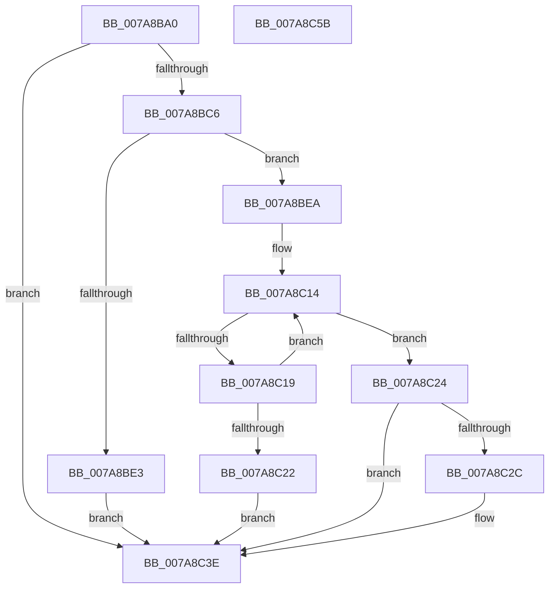

# SmKmKeyGenStart

- RVA: `0x007A8BA0`–`0x007A8C5C` (길이 `188` bytes)
- VA: `0x00000001407A8BA0`
- 실행 섹션: `PAGE`
- PDB 이름 있음: `예`; PDB Function 태그: `아니요`
- unwind 정보 RVA: `0x0005E6B4`
- 디코드: `56`개 명령, `188/188` bytes 표시
- 미해석 바이트: `0` (있으면 어셈블리에 `.byte`로 보존)

> 이 문서는 커널 이미지의 기계어와 PDB 기호를 분석해 생성했습니다. 4번과 5번은 함수 원형과 자료형을 바이너리 사용 방식에서 추정한 C 해석이며 원본 소스 복구 결과는 아닙니다.

## 1. Dependencies

- 직접 호출 지점: **2**; 고유 호출 대상: **2**
- 직접 호출자로 확인된 함수: **1**
- RIP 상대 이미지 참조: **0**

### Outgoing calls
- `0x007A8BD6` → [SmAllocEx](../../text/34/SmAllocEx_function_0034C794.md) (function, `0x0034C794`)
- `0x007A8BF4` → [RtlStringCbCopyUnicodeString](../../text/60/RtlStringCbCopyUnicodeString_function_0060F24C.md) (function, `0x0060F24C`)

### Direct callers
- [SmcCacheManagerStart](SmcCacheManagerStart_function_007AB958.md) at `0x007ABAC2`

### Static image references
- 디코드된 RIP-relative 메모리 참조가 없습니다.

## 2. Other-region calls and transfers

- 다른 실행 섹션으로 향하는 call: **2**
  - `0x007A8BD6` → [SmAllocEx](../../text/34/SmAllocEx_function_0034C794.md) (`PAGE` → `.text`)
  - `0x007A8BF4` → [RtlStringCbCopyUnicodeString](../../text/60/RtlStringCbCopyUnicodeString_function_0060F24C.md) (`PAGE` → `.text`)
- 별도 외부 분기/꼬리 이동을 확인하지 못했습니다.

## 3. Assembly (complete function range)

```asm
007A8BA0  48 8B C4                        mov rax, rsp
007A8BA3  48 89 58 08                     mov qword ptr [rax + 8], rbx
007A8BA7  48 89 68 10                     mov qword ptr [rax + 0x10], rbp
007A8BAB  48 89 70 18                     mov qword ptr [rax + 0x18], rsi
007A8BAF  48 89 78 20                     mov qword ptr [rax + 0x20], rdi
007A8BB3  41 56                           push r14
007A8BB5  48 83 EC 20                     sub rsp, 0x20
007A8BB9  33 DB                           xor ebx, ebx
007A8BBB  48 8B FA                        mov rdi, rdx
007A8BBE  4C 8B F1                        mov r14, rcx
007A8BC1  48 85 D2                        test rdx, rdx
007A8BC4  74 78                           je 0x1407a8c3e
007A8BC6  0F B7 2A                        movzx ebp, word ptr [rdx]
007A8BC9  41 83 C8 FF                     or r8d, 0xffffffff
007A8BCD  BA 73 6D 4B 47                  mov edx, 0x474b6d73
007A8BD2  48 8D 4D 02                     lea rcx, [rbp + 2]
007A8BD6  E8 B9 3B BA FF                  call 0x14034c794
007A8BDB  48 8B F0                        mov rsi, rax
007A8BDE  48 85 C0                        test rax, rax
007A8BE1  75 07                           jne 0x1407a8bea
007A8BE3  BB 9A 00 00 C0                  mov ebx, 0xc000009a
007A8BE8  EB 54                           jmp 0x1407a8c3e
007A8BEA  4C 8B C7                        mov r8, rdi
007A8BED  48 8D 55 02                     lea rdx, [rbp + 2]
007A8BF1  48 8B CE                        mov rcx, rsi
007A8BF4  E8 53 66 E6 FF                  call 0x14060f24c
007A8BF9  49 8D 4E 18                     lea rcx, [r14 + 0x18]
007A8BFD  B8 FF 7F 00 00                  mov eax, 0x7fff
007A8C02  0F 57 C0                        xorps xmm0, xmm0
007A8C05  44 8B C0                        mov r8d, eax
007A8C08  0F 11 01                        movups xmmword ptr [rcx], xmm0
007A8C0B  48 8B D6                        mov rdx, rsi
007A8C0E  41 B9 02 00 00 00               mov r9d, 2
007A8C14  66 39 1A                        cmp word ptr [rdx], bx
007A8C17  74 0B                           je 0x1407a8c24
007A8C19  49 03 D1                        add rdx, r9
007A8C1C  49 83 E8 01                     sub r8, 1
007A8C20  75 F2                           jne 0x1407a8c14
007A8C22  EB 1A                           jmp 0x1407a8c3e
007A8C24  49 2B C0                        sub rax, r8
007A8C27  48 85 C9                        test rcx, rcx
007A8C2A  74 12                           je 0x1407a8c3e
007A8C2C  66 03 C0                        add ax, ax
007A8C2F  48 89 71 08                     mov qword ptr [rcx + 8], rsi
007A8C33  66 89 01                        mov word ptr [rcx], ax
007A8C36  66 41 03 C1                     add ax, r9w
007A8C3A  66 89 41 02                     mov word ptr [rcx + 2], ax
007A8C3E  48 8B 6C 24 38                  mov rbp, qword ptr [rsp + 0x38]
007A8C43  8B C3                           mov eax, ebx
007A8C45  48 8B 5C 24 30                  mov rbx, qword ptr [rsp + 0x30]
007A8C4A  48 8B 74 24 40                  mov rsi, qword ptr [rsp + 0x40]
007A8C4F  48 8B 7C 24 48                  mov rdi, qword ptr [rsp + 0x48]
007A8C54  48 83 C4 20                     add rsp, 0x20
007A8C58  41 5E                           pop r14
007A8C5A  C3                              ret
007A8C5B  CC                              int3
```

## 4. C-style interpretation (structured pseudocode)

```c
__int64 __fastcall SmKmKeyGenStart(__int64 a1, __int64 a2, int a3)
{
    __int64 result;
    __int64 v_rbx;
    __int64 v_rsp;
    unsigned __int64 v_stack_p10;
    unsigned __int64 v_stack_p18;
    unsigned __int64 v_stack_p20;
    unsigned __int64 v_stack_p8;

    *(unsigned __int64 *)(v_rsp + 8) = v_rbx;
    *(unsigned __int64 *)(v_rsp + 16) = v_rbp;
    *(unsigned __int64 *)(v_rsp + 24) = v_rsi;
    *(unsigned __int64 *)(v_rsp + 32) = v_rdi;
    v_rsp = (v_rsp) - (32);
    v_rbx = 0;
    if (a2 == 0) goto loc_007A8C3E;
    a3 = (unsigned int)((a3) | (0xFFFFFFFFULL));
    result = SmAllocEx(*(unsigned __int16 *)(a2) + 2, (unsigned int)(0x474B6D73ULL), a3, a4);
    if (result != 0) goto loc_007A8BEA;
    goto loc_007A8C3E;
loc_007A8BEA:
    result = RtlStringCbCopyUnicodeString(result, *(unsigned __int16 *)(a2) + 2, a2, a4);
    *(unsigned __int64 *)(a1 + 24) = v_xmm0;
loc_007A8C14:
    if ((*(unsigned __int16 *)(result)) == ((unsigned __int16)((unsigned int)(0xC000009AULL)))) goto loc_007A8C24;
    a2 = (result) + (2);
    a3 = ((unsigned int)((unsigned int)((unsigned int)(0x7FFFULL)))) - (1);
    if (condition_is_not_equal) goto loc_007A8C14;
    goto loc_007A8C3E;
loc_007A8C24:
    result = ((unsigned int)(0x7FFFULL)) - (a3);
    if (a1 + 24 != 0) {
        result = (unsigned __int16)((result) + ((unsigned __int16)(result)));
        *(unsigned __int64 *)(a1 + 24 + 8) = result;
        *(unsigned __int16 *)(a1 + 24) = (unsigned __int16)(result);
        result = (unsigned __int16)((result) + (2));
        *(unsigned __int16 *)(a1 + 24 + 2) = (unsigned __int16)(result);
    }
    v_rsp = (v_rsp) + (32);
    return (unsigned int)((unsigned int)((unsigned int)(0xC000009AULL)));
}
```

## 5. (Beta) C Style

```c
int64_t SmKmKeyGenStart(void *Arg1, int64_t Arg2, int32_t Arg3)
{
    uint8_t *arg1 = (uint8_t *)Arg1;

    int64_t result;
    int64_t local_rbx;
    int64_t local_rsp;
    uint64_t v_stack_p10;
    uint64_t v_stack_p18;
    uint64_t v_stack_p20;
    uint64_t v_stack_p8;

    *(uint64_t *)(local_rsp + 0x8) = local_rbx;
    *(uint64_t *)(local_rsp + 0x10) = local_rbp;
    *(uint64_t *)(local_rsp + 0x18) = local_rsi;
    *(uint64_t *)(local_rsp + 0x20) = local_rdi;
    local_rsp = (local_rsp) - (32);
    local_rbx = 0;
    if (Arg2 == 0) goto loc_007A8C3E;
    Arg3 = (uint32_t)((Arg3) | (0xFFFFFFFFULL));
    result = SmAllocEx(*(uint16_t *)(Arg2) + 2, (uint32_t)(0x474B6D73ULL), Arg3, a4);
    if (result != 0) goto loc_007A8BEA;
    goto loc_007A8C3E;
loc_007A8BEA:
    result = RtlStringCbCopyUnicodeString(result, *(uint16_t *)(Arg2) + 2, Arg2, a4);
    *(uint64_t *)(arg1 + 0x18) = v_xmm0;
loc_007A8C14:
    if ((*(uint16_t *)(result)) == ((uint16_t)((uint32_t)(0xC000009AULL)))) goto loc_007A8C24;
    Arg2 = (result) + (2);
    Arg3 = ((uint32_t)((uint32_t)((uint32_t)(0x7FFFULL)))) - (1);
    if (condition_is_not_equal) goto loc_007A8C14;
    goto loc_007A8C3E;
loc_007A8C24:
    result = ((uint32_t)(0x7FFFULL)) - (Arg3);
    if (Arg1 + 24 != 0) {
        result = (uint16_t)((result) + ((uint16_t)(result)));
        *(uint64_t *)(arg1 + 0x18 + 0x8) = result;
        *(uint16_t *)(arg1 + 0x18) = (uint16_t)(result);
        result = (uint16_t)((result) + (2));
        *(uint16_t *)(arg1 + 0x18 + 0x2) = (uint16_t)(result);
    }
    local_rsp = (local_rsp) + (32);
    return (uint32_t)((uint32_t)((uint32_t)(0xC000009AULL)));
}
```

### 관측된 메모리 오프셋

구조체 형식이 확인되지 않은 접근은 인자 기준의 오프셋으로만 기록했습니다.

| 기준 인자 | 오프셋 표현 | 폭 (bit) | 접근 |
|---|---:|---:|---|
| `Arg1` | `+ 0x0` | `128` | `R` |
| `Arg1` | `+ 0x18` | `64` | `R` |

## 6. Execution-region graph

[열기: 2D/3D 그래프와 함수 탐색 컨트롤 패널](../../../control-panel.html?section=page&rva=0x007A8BA0&view=graph)

- 2D 그래프는 위에서 아래로 흐르고, 3D 그래프는 빈 공간을 드래그해 회전합니다. Shift+드래그는 이동, 휠은 확대·축소, 함수 노드 선택은 대상 보고서 이동입니다.

### Static fallback


