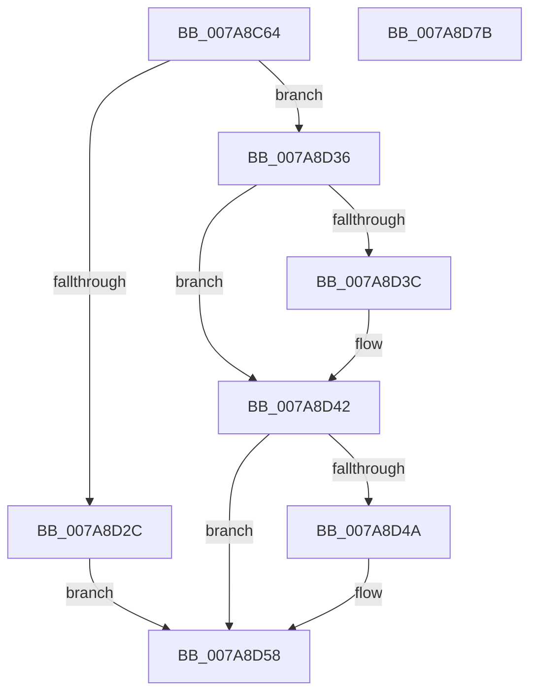

# SmKmRegParamsLoad

- RVA: `0x007A8C64`–`0x007A8D7C` (길이 `280` bytes)
- VA: `0x00000001407A8C64`
- 실행 섹션: `PAGE`
- PDB 이름 있음: `예`; PDB Function 태그: `아니요`
- unwind 정보 RVA: `0x000D1DCC`
- 디코드: `78`개 명령, `280/280` bytes 표시
- 미해석 바이트: `0` (있으면 어셈블리에 `.byte`로 보존)

> 이 문서는 커널 이미지의 기계어와 PDB 기호를 분석해 생성했습니다. 4번과 5번은 함수 원형과 자료형을 바이너리 사용 방식에서 추정한 C 해석이며 원본 소스 복구 결과는 아닙니다.

## 1. Dependencies

- 직접 호출 지점: **2**; 고유 호출 대상: **2**
- 직접 호출자로 확인된 함수: **1**
- RIP 상대 이미지 참조: **4**

### Outgoing calls
- `0x007A8D23` → [RtlpQueryRegistryValues](../8C/RtlpQueryRegistryValues_function_008C9050.md) (function, `0x008C9050`)
- `0x007A8D61` → [_security_check_cookie](../../text/6A/_security_check_cookie_function_006AC640.md) (function, `0x006AC640`)

### Direct callers
- [SmcStoreCreate](SmcStoreCreate_function_007ABFB4.md) at `0x007AC0EC`

### Static image references
- `0x007A8C7B` → RVA `0x00E0A740` (`.data`; read)
- `0x007A8CA8` → RVA `0x00B063D0` (` ?? ::NNGAKEGL::`string'`; read)
- `0x007A8CC5` → RVA `0x00B06410` (` ?? ::NNGAKEGL::`string'`; read)
- `0x007A8CCC` → RVA `0x00B063F0` (` ?? ::NNGAKEGL::`string'`; read)

## 2. Other-region calls and transfers

- 다른 실행 섹션으로 향하는 call: **1**
  - `0x007A8D61` → [_security_check_cookie](../../text/6A/_security_check_cookie_function_006AC640.md) (`PAGE` → `.text`)
- 별도 외부 분기/꼬리 이동을 확인하지 못했습니다.

## 3. Assembly (complete function range)

```asm
007A8C64  48 89 5C 24 10                  mov qword ptr [rsp + 0x10], rbx
007A8C69  48 89 7C 24 18                  mov qword ptr [rsp + 0x18], rdi
007A8C6E  55                              push rbp
007A8C6F  48 8D 6C 24 A9                  lea rbp, [rsp - 0x57]
007A8C74  48 81 EC 00 01 00 00            sub rsp, 0x100
007A8C7B  48 8B 05 BE 1A 66 00            mov rax, qword ptr [rip + 0x661abe]
007A8C82  48 33 C4                        xor rax, rsp
007A8C85  48 89 45 47                     mov qword ptr [rbp + 0x47], rax
007A8C89  33 DB                           xor ebx, ebx
007A8C8B  C6 44 24 28 01                  mov byte ptr [rsp + 0x28], 1
007A8C90  48 8B F9                        mov rdi, rcx
007A8C93  48 89 5D 97                     mov qword ptr [rbp - 0x69], rbx
007A8C97  B9 00 00 00 04                  mov ecx, 0x4000000
007A8C9C  48 89 5D BF                     mov qword ptr [rbp - 0x41], rbx
007A8CA0  BA 20 01 00 00                  mov edx, 0x120
007A8CA5  89 4D B7                        mov dword ptr [rbp - 0x49], ecx
007A8CA8  48 8D 05 21 D7 35 00            lea rax, [rip + 0x35d721]
007A8CAF  89 55 9F                        mov dword ptr [rbp - 0x61], edx
007A8CB2  48 89 45 A7                     mov qword ptr [rbp - 0x59], rax
007A8CB6  4C 8D 45 97                     lea r8, [rbp - 0x69]
007A8CBA  48 8D 45 87                     lea rax, [rbp - 0x79]
007A8CBE  89 55 D7                        mov dword ptr [rbp - 0x29], edx
007A8CC1  48 89 45 AF                     mov qword ptr [rbp - 0x51], rax
007A8CC5  48 8D 15 44 D7 35 00            lea rdx, [rip + 0x35d744]
007A8CCC  48 8D 05 1D D7 35 00            lea rax, [rip + 0x35d71d]
007A8CD3  89 4D EF                        mov dword ptr [rbp - 0x11], ecx
007A8CD6  48 89 45 DF                     mov qword ptr [rbp - 0x21], rax
007A8CDA  0F 57 C0                        xorps xmm0, xmm0
007A8CDD  48 8D 45 8B                     lea rax, [rbp - 0x75]
007A8CE1  89 5D C7                        mov dword ptr [rbp - 0x39], ebx
007A8CE4  48 89 45 E7                     mov qword ptr [rbp - 0x19], rax
007A8CE8  45 33 C9                        xor r9d, r9d
007A8CEB  33 C0                           xor eax, eax
007A8CED  48 89 5D CF                     mov qword ptr [rbp - 0x31], rbx
007A8CF1  48 89 07                        mov qword ptr [rdi], rax
007A8CF4  33 C9                           xor ecx, ecx
007A8CF6  83 67 04 FC                     and dword ptr [rdi + 4], 0xfffffffc
007A8CFA  C7 07 10 00 00 00               mov dword ptr [rdi], 0x10
007A8D00  48 89 5D F7                     mov qword ptr [rbp - 9], rbx
007A8D04  89 5D FF                        mov dword ptr [rbp - 1], ebx
007A8D07  48 89 5D 07                     mov qword ptr [rbp + 7], rbx
007A8D0B  89 5D 0F                        mov dword ptr [rbp + 0xf], ebx
007A8D0E  66 0F 7F 45 17                  movdqa xmmword ptr [rbp + 0x17], xmm0
007A8D13  89 5D 27                        mov dword ptr [rbp + 0x27], ebx
007A8D16  48 89 5D 2F                     mov qword ptr [rbp + 0x2f], rbx
007A8D1A  89 5D 37                        mov dword ptr [rbp + 0x37], ebx
007A8D1D  89 5D 87                        mov dword ptr [rbp - 0x79], ebx
007A8D20  89 5D 8B                        mov dword ptr [rbp - 0x75], ebx
007A8D23  E8 28 03 12 00                  call 0x1408c9050
007A8D28  85 C0                           test eax, eax
007A8D2A  79 0A                           jns 0x1407a8d36
007A8D2C  3D 34 00 00 C0                  cmp eax, 0xc0000034
007A8D31  0F 45 D8                        cmovne ebx, eax
007A8D34  EB 22                           jmp 0x1407a8d58
007A8D36  83 7D 87 01                     cmp dword ptr [rbp - 0x79], 1
007A8D3A  75 06                           jne 0x1407a8d42
007A8D3C  8B 07                           mov eax, dword ptr [rdi]
007A8D3E  03 C0                           add eax, eax
007A8D40  89 07                           mov dword ptr [rdi], eax
007A8D42  8B 55 8B                        mov edx, dword ptr [rbp - 0x75]
007A8D45  83 FA 03                        cmp edx, 3
007A8D48  73 0E                           jae 0x1407a8d58
007A8D4A  8B 4F 04                        mov ecx, dword ptr [rdi + 4]
007A8D4D  83 E2 03                        and edx, 3
007A8D50  83 E1 FC                        and ecx, 0xfffffffc
007A8D53  0B CA                           or ecx, edx
007A8D55  89 4F 04                        mov dword ptr [rdi + 4], ecx
007A8D58  8B C3                           mov eax, ebx
007A8D5A  48 8B 4D 47                     mov rcx, qword ptr [rbp + 0x47]
007A8D5E  48 33 CC                        xor rcx, rsp
007A8D61  E8 DA 38 F0 FF                  call 0x1406ac640
007A8D66  4C 8D 9C 24 00 01 00 00         lea r11, [rsp + 0x100]
007A8D6E  49 8B 5B 18                     mov rbx, qword ptr [r11 + 0x18]
007A8D72  49 8B 7B 20                     mov rdi, qword ptr [r11 + 0x20]
007A8D76  49 8B E3                        mov rsp, r11
007A8D79  5D                              pop rbp
007A8D7A  C3                              ret
007A8D7B  CC                              int3
```

## 4. C-style interpretation (structured pseudocode)

```c
__int64 __fastcall SmKmRegParamsLoad(__int64 a1, __int64 a2, __int64 a3, int a4)
{
    __int64 result;
    __int64 v_rbx;
    __int64 v_rsp;
    unsigned __int64 v_stack_m18;
    unsigned int v_stack_m28;
    unsigned __int64 v_stack_m30;
    unsigned int v_stack_m38;
    unsigned __int64 v_stack_m48;
    unsigned int v_stack_m50;
    unsigned __int64 v_stack_m58;
    unsigned __int64 v_stack_m5F;
    unsigned int v_stack_m60;
    unsigned __int64 v_stack_m68;
    unsigned int v_stack_m70;
    unsigned __int64 v_stack_m78;
    unsigned __int64 v_stack_m8;
    unsigned __int64 v_stack_m80;
    unsigned int v_stack_m88;
    unsigned __int64 v_stack_m90;
    unsigned int v_stack_m98;
    unsigned __int64 v_stack_mA0;
    unsigned int v_stack_mA8;
    unsigned __int64 v_stack_mB0;
    unsigned __int64 v_stack_mB8;
    unsigned int v_stack_mC0;
    unsigned __int64 v_stack_mC8;
    unsigned __int64 v_stack_mD4;
    unsigned __int64 v_stack_mD8;
    unsigned __int8 v_stack_mE0;
    unsigned __int64 v_stack_p10;
    unsigned __int64 v_stack_p18;

    v_stack_p10 = v_rbx;
    v_stack_p18 = v_rdi;
    v_rsp = (v_rsp) - (256);
    result = (*(unsigned __int64 *)(v_rip + 6691518)) ^ (v_rsp);
    v_stack_m18 = result;
    v_rbx = 0;
    v_stack_mE0 = 1;
    v_stack_mC8 = 0;
    v_stack_mA0 = 0;
    v_stack_mA8 = (unsigned int)((unsigned int)(0x4000000ULL));
    v_stack_mC0 = 288;
    v_stack_mB8 = v_rip + 3528481;
    v_stack_m88 = 288;
    v_stack_mB0 = v_stack_mD8;
    v_stack_m70 = (unsigned int)((unsigned int)(0x4000000ULL));
    v_stack_m80 = v_rip + 3528477;
    v_stack_m98 = 0;
    v_stack_m78 = v_stack_mD4;
    a4 = 0;
    result = 0;
    v_stack_m90 = 0;
    *(unsigned __int64 *)(a1) = 0;
    a1 = 0;
    *(unsigned int *)(a1) = 16;
    v_stack_m68 = 0;
    v_stack_m60 = 0;
    v_stack_m58 = 0;
    v_stack_m50 = 0;
    v_stack_m48 = v_xmm0;
    v_stack_m38 = 0;
    v_stack_m30 = 0;
    v_stack_m28 = 0;
    v_stack_mD8 = 0;
    v_stack_mD4 = 0;
    result = RtlpQueryRegistryValues(a1, v_rip + 3528516, v_stack_mC8, a4);
    if (!sign_flag) goto loc_007A8D36;
    if (((unsigned int)(result)) != 0xC0000034ULL) { v_rbx = (unsigned int)(result); }
    goto loc_007A8D58;
loc_007A8D36:
    if (v_stack_mD8 == 1) {
        result = *(unsigned int *)(a1);
        result = (unsigned int)((result) + ((unsigned int)(result)));
        *(unsigned int *)(a1) = (unsigned int)(result);
    }
    if (((unsigned int)((unsigned int)(v_stack_mD4))) < 3) {
        a1 = *(unsigned int *)(a1 + 4);
        a2 = (unsigned int)(((unsigned int)(v_stack_mD4)) & (3));
        a1 = (unsigned int)((a1) & (0xFFFFFFFCULL));
        a1 = (unsigned int)((a1) | ((unsigned int)(a2)));
        *(unsigned int *)(a1 + 4) = (unsigned int)(a1);
    }
    a1 = (v_stack_m18) ^ (v_rsp);
    result = _security_check_cookie(a1, a2, v_stack_mC8, a4);
    return result;
}
```

## 5. (Beta) C Style

```c
int64_t SmKmRegParamsLoad(void *Arg1, int64_t Arg2, int64_t Arg3, int32_t Arg4)
{
    uint8_t *arg1 = (uint8_t *)Arg1;

    int64_t result;
    int64_t local_rbx;
    int64_t local_rsp;
    uint64_t v_stack_m18;
    uint32_t v_stack_m28;
    uint64_t v_stack_m30;
    uint32_t v_stack_m38;
    uint64_t v_stack_m48;
    uint32_t v_stack_m50;
    uint64_t v_stack_m58;
    uint64_t v_stack_m5F;
    uint32_t v_stack_m60;
    uint64_t v_stack_m68;
    uint32_t v_stack_m70;
    uint64_t v_stack_m78;
    uint64_t v_stack_m8;
    uint64_t v_stack_m80;
    uint32_t v_stack_m88;
    uint64_t v_stack_m90;
    uint32_t v_stack_m98;
    uint64_t v_stack_mA0;
    uint32_t v_stack_mA8;
    uint64_t v_stack_mB0;
    uint64_t v_stack_mB8;
    uint32_t v_stack_mC0;
    uint64_t v_stack_mC8;
    uint64_t v_stack_mD4;
    uint64_t v_stack_mD8;
    uint8_t v_stack_mE0;
    uint64_t v_stack_p10;
    uint64_t v_stack_p18;

    v_stack_p10 = local_rbx;
    v_stack_p18 = local_rdi;
    local_rsp = (local_rsp) - (256);
    result = (*(uint64_t *)(v_rip + 0x661ABE)) ^ (local_rsp);
    v_stack_m18 = result;
    local_rbx = 0;
    v_stack_mE0 = 1;
    v_stack_mC8 = 0;
    v_stack_mA0 = 0;
    v_stack_mA8 = (uint32_t)((uint32_t)(0x4000000ULL));
    v_stack_mC0 = 288;
    v_stack_mB8 = v_rip + 3528481;
    v_stack_m88 = 288;
    v_stack_mB0 = v_stack_mD8;
    v_stack_m70 = (uint32_t)((uint32_t)(0x4000000ULL));
    v_stack_m80 = v_rip + 3528477;
    v_stack_m98 = 0;
    v_stack_m78 = v_stack_mD4;
    Arg4 = 0;
    result = 0;
    v_stack_m90 = 0;
    *(uint64_t *)(arg1) = 0;
    Arg1 = 0;
    *(uint32_t *)(arg1) = 16;
    v_stack_m68 = 0;
    v_stack_m60 = 0;
    v_stack_m58 = 0;
    v_stack_m50 = 0;
    v_stack_m48 = v_xmm0;
    v_stack_m38 = 0;
    v_stack_m30 = 0;
    v_stack_m28 = 0;
    v_stack_mD8 = 0;
    v_stack_mD4 = 0;
    result = RtlpQueryRegistryValues(Arg1, v_rip + 3528516, v_stack_mC8, Arg4);
    if (!sign_flag) goto loc_007A8D36;
    if (((uint32_t)(result)) != 0xC0000034ULL) { local_rbx = (uint32_t)(result); }
    goto loc_007A8D58;
loc_007A8D36:
    if (v_stack_mD8 == 1) {
        result = *(uint32_t *)(arg1);
        result = (uint32_t)((result) + ((uint32_t)(result)));
        *(uint32_t *)(arg1) = (uint32_t)(result);
    }
    if (((uint32_t)((uint32_t)(v_stack_mD4))) < 3) {
        Arg1 = *(uint32_t *)(arg1 + 0x4);
        Arg2 = (uint32_t)(((uint32_t)(v_stack_mD4)) & (3));
        Arg1 = (uint32_t)((Arg1) & (0xFFFFFFFCULL));
        Arg1 = (uint32_t)((Arg1) | ((uint32_t)(Arg2)));
        *(uint32_t *)(arg1 + 0x4) = (uint32_t)(Arg1);
    }
    Arg1 = (v_stack_m18) ^ (local_rsp);
    result = _security_check_cookie(Arg1, Arg2, v_stack_mC8, Arg4);
    return result;
}
```

### 관측된 메모리 오프셋

구조체 형식이 확인되지 않은 접근은 인자 기준의 오프셋으로만 기록했습니다.

| 기준 인자 | 오프셋 표현 | 폭 (bit) | 접근 |
|---|---:|---:|---|
| `Arg1` | `+ 0x0` | `32` | `R` |
| `Arg1` | `+ 0x0` | `32` | `W` |
| `Arg1` | `+ 0x0` | `64` | `W` |
| `Arg1` | `+ 0x4` | `32` | `R` |
| `Arg1` | `+ 0x4` | `32` | `R/W` |
| `Arg1` | `+ 0x4` | `32` | `W` |

## 6. Execution-region graph

[열기: 2D/3D 그래프와 함수 탐색 컨트롤 패널](../../../control-panel.html?section=page&rva=0x007A8C64&view=graph)

- 2D 그래프는 위에서 아래로 흐르고, 3D 그래프는 빈 공간을 드래그해 회전합니다. Shift+드래그는 이동, 휠은 확대·축소, 함수 노드 선택은 대상 보고서 이동입니다.

### Static fallback


