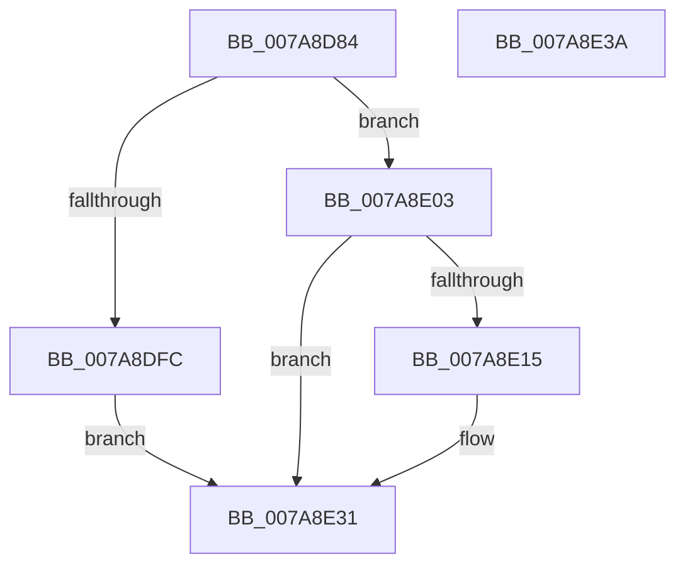

# SmKmSendDeviceControl

- RVA: `0x007A8D84`–`0x007A8E3B` (길이 `183` bytes)
- VA: `0x00000001407A8D84`
- 실행 섹션: `PAGE`
- PDB 이름 있음: `예`; PDB Function 태그: `아니요`
- unwind 정보 RVA: `0x000BA960`
- 디코드: `46`개 명령, `183/183` bytes 표시
- 미해석 바이트: `0` (있으면 어셈블리에 `.byte`로 보존)

> 이 문서는 커널 이미지의 기계어와 PDB 기호를 분석해 생성했습니다. 4번과 5번은 함수 원형과 자료형을 바이너리 사용 방식에서 추정한 C 해석이며 원본 소스 복구 결과는 아닙니다.

## 1. Dependencies

- 직접 호출 지점: **4**; 고유 호출 대상: **4**
- 직접 호출자로 확인된 함수: **1**
- RIP 상대 이미지 참조: **0**

### Outgoing calls
- `0x007A8DAE` → [KeInitializeEvent](../../text/40/KeInitializeEvent_function_0040DD10.md) (function, `0x0040DD10`)
- `0x007A8DF2` → [IoBuildDeviceIoControlRequest](../../text/20/IoBuildDeviceIoControlRequest_function_00204FD0.md) (function, `0x00204FD0`)
- `0x007A8E09` → [IofCallDriver](../../text/29/IofCallDriver_function_0029B4B0.md) (function, `0x0029B4B0`)
- `0x007A8E28` → [KeWaitForSingleObject](../../text/20/KeWaitForSingleObject_function_0020E6B0.md) (function, `0x0020E6B0`)

### Direct callers
- [SmKmVolumeQueryUniqueId](SmKmVolumeQueryUniqueId_function_007A9FE8.md) at `0x007AA01B`

### Static image references
- 디코드된 RIP-relative 메모리 참조가 없습니다.

## 2. Other-region calls and transfers

- 다른 실행 섹션으로 향하는 call: **4**
  - `0x007A8DAE` → [KeInitializeEvent](../../text/40/KeInitializeEvent_function_0040DD10.md) (`PAGE` → `.text`)
  - `0x007A8DF2` → [IoBuildDeviceIoControlRequest](../../text/20/IoBuildDeviceIoControlRequest_function_00204FD0.md) (`PAGE` → `.text`)
  - `0x007A8E09` → [IofCallDriver](../../text/29/IofCallDriver_function_0029B4B0.md) (`PAGE` → `.text`)
  - `0x007A8E28` → [KeWaitForSingleObject](../../text/20/KeWaitForSingleObject_function_0020E6B0.md) (`PAGE` → `.text`)
- 별도 외부 분기/꼬리 이동을 확인하지 못했습니다.

## 3. Assembly (complete function range)

```asm
007A8D84  40 53                           push rbx
007A8D86  48 81 EC 80 00 00 00            sub rsp, 0x80
007A8D8D  0F 57 C0                        xorps xmm0, xmm0
007A8D90  48 8D 4C 24 60                  lea rcx, [rsp + 0x60]
007A8D95  48 8B DA                        mov rbx, rdx
007A8D98  33 C0                           xor eax, eax
007A8D9A  33 D2                           xor edx, edx
007A8D9C  48 89 44 24 70                  mov qword ptr [rsp + 0x70], rax
007A8DA1  45 33 C0                        xor r8d, r8d
007A8DA4  0F 11 44 24 60                  movups xmmword ptr [rsp + 0x60], xmm0
007A8DA9  0F 11 44 24 50                  movups xmmword ptr [rsp + 0x50], xmm0
007A8DAE  E8 5D 4F C6 FF                  call 0x14040dd10
007A8DB3  48 8D 44 24 50                  lea rax, [rsp + 0x50]
007A8DB8  45 33 C9                        xor r9d, r9d
007A8DBB  48 89 44 24 40                  mov qword ptr [rsp + 0x40], rax
007A8DC0  45 33 C0                        xor r8d, r8d
007A8DC3  48 8D 44 24 60                  lea rax, [rsp + 0x60]
007A8DC8  48 8B D3                        mov rdx, rbx
007A8DCB  48 89 44 24 38                  mov qword ptr [rsp + 0x38], rax
007A8DD0  B9 00 00 4D 00                  mov ecx, 0x4d0000
007A8DD5  8B 84 24 B8 00 00 00            mov eax, dword ptr [rsp + 0xb8]
007A8DDC  C6 44 24 30 00                  mov byte ptr [rsp + 0x30], 0
007A8DE1  89 44 24 28                     mov dword ptr [rsp + 0x28], eax
007A8DE5  48 8B 84 24 B0 00 00 00         mov rax, qword ptr [rsp + 0xb0]
007A8DED  48 89 44 24 20                  mov qword ptr [rsp + 0x20], rax
007A8DF2  E8 D9 C1 A5 FF                  call 0x140204fd0
007A8DF7  48 85 C0                        test rax, rax
007A8DFA  75 07                           jne 0x1407a8e03
007A8DFC  B8 9A 00 00 C0                  mov eax, 0xc000009a
007A8E01  EB 2E                           jmp 0x1407a8e31
007A8E03  48 8B D0                        mov rdx, rax
007A8E06  48 8B CB                        mov rcx, rbx
007A8E09  E8 A2 26 AF FF                  call 0x14029b4b0
007A8E0E  3D 03 01 00 00                  cmp eax, 0x103
007A8E13  75 1C                           jne 0x1407a8e31
007A8E15  48 83 64 24 20 00               and qword ptr [rsp + 0x20], 0
007A8E1B  48 8D 4C 24 60                  lea rcx, [rsp + 0x60]
007A8E20  45 33 C9                        xor r9d, r9d
007A8E23  45 33 C0                        xor r8d, r8d
007A8E26  33 D2                           xor edx, edx
007A8E28  E8 83 58 A6 FF                  call 0x14020e6b0
007A8E2D  8B 44 24 50                     mov eax, dword ptr [rsp + 0x50]
007A8E31  48 81 C4 80 00 00 00            add rsp, 0x80
007A8E38  5B                              pop rbx
007A8E39  C3                              ret
007A8E3A  CC                              int3
```

## 4. C-style interpretation (structured pseudocode)

```c
__int64 __fastcall SmKmSendDeviceControl(__int64 a1, __int64 a2, int a3, int a4, __int64 a5, unsigned int a6)
{
    __int64 result;
    __int64 v_rsp;
    unsigned __int64 v_stack_m18;
    unsigned __int64 v_stack_m28;
    unsigned __int64 v_stack_m38;
    unsigned __int64 v_stack_m48;
    unsigned __int64 v_stack_m50;
    unsigned __int8 v_stack_m58;
    unsigned int v_stack_m60;
    unsigned __int64 v_stack_m68;

    v_rsp = (v_rsp) - (128);
    result = 0;
    a2 = 0;
    v_stack_m18 = 0;
    a3 = 0;
    v_stack_m28 = v_xmm0;
    v_stack_m38 = v_xmm0;
    result = KeInitializeEvent(v_stack_m28, a2, a3, a4);
    a4 = 0;
    v_stack_m48 = v_stack_m38;
    a3 = 0;
    v_stack_m50 = v_stack_m28;
    v_stack_m58 = 0;
    v_stack_m60 = (unsigned int)((unsigned int)(a6));
    v_stack_m68 = a5;
    result = IoBuildDeviceIoControlRequest((unsigned int)(0x4D0000ULL), 0, a3, a4);
    if (result != 0) goto loc_007A8E03;
    goto loc_007A8E31;
loc_007A8E03:
    result = IofCallDriver(0, (unsigned int)(0xC000009AULL), a3, a4);
    if (((unsigned int)(result)) == 259) {
        a1 = v_stack_m28;
        a4 = 0;
        a3 = 0;
        a2 = 0;
        result = KeWaitForSingleObject(a1, a2, a3, a4);
        result = v_stack_m38;
    }
    v_rsp = (v_rsp) + (128);
    return result;
}
```

## 5. (Beta) C Style

```c
int64_t SmKmSendDeviceControl(int64_t Arg1, int64_t Arg2, int32_t Arg3, int32_t Arg4, int64_t Arg5, uint32_t Arg6)
{
    int64_t result;
    int64_t local_rsp;
    uint64_t v_stack_m18;
    uint64_t v_stack_m28;
    uint64_t v_stack_m38;
    uint64_t v_stack_m48;
    uint64_t v_stack_m50;
    uint8_t v_stack_m58;
    uint32_t v_stack_m60;
    uint64_t v_stack_m68;

    local_rsp = (local_rsp) - (128);
    result = 0;
    Arg2 = 0;
    v_stack_m18 = 0;
    Arg3 = 0;
    v_stack_m28 = v_xmm0;
    v_stack_m38 = v_xmm0;
    result = KeInitializeEvent(v_stack_m28, Arg2, Arg3, Arg4);
    Arg4 = 0;
    v_stack_m48 = v_stack_m38;
    Arg3 = 0;
    v_stack_m50 = v_stack_m28;
    v_stack_m58 = 0;
    v_stack_m60 = (uint32_t)((uint32_t)(Arg6));
    v_stack_m68 = Arg5;
    result = IoBuildDeviceIoControlRequest((uint32_t)(0x4D0000ULL), 0, Arg3, Arg4);
    if (result != 0) goto loc_007A8E03;
    goto loc_007A8E31;
loc_007A8E03:
    result = IofCallDriver(0, (uint32_t)(0xC000009AULL), Arg3, Arg4);
    if (((uint32_t)(result)) == 259) {
        Arg1 = v_stack_m28;
        Arg4 = 0;
        Arg3 = 0;
        Arg2 = 0;
        result = KeWaitForSingleObject(Arg1, Arg2, Arg3, Arg4);
        result = v_stack_m38;
    }
    local_rsp = (local_rsp) + (128);
    return result;
}
```

## 6. Execution-region graph

[열기: 2D/3D 그래프와 함수 탐색 컨트롤 패널](../../../control-panel.html?section=page&rva=0x007A8D84&view=graph)

- 2D 그래프는 위에서 아래로 흐르고, 3D 그래프는 빈 공간을 드래그해 회전합니다. Shift+드래그는 이동, 휠은 확대·축소, 함수 노드 선택은 대상 보고서 이동입니다.

### Static fallback


