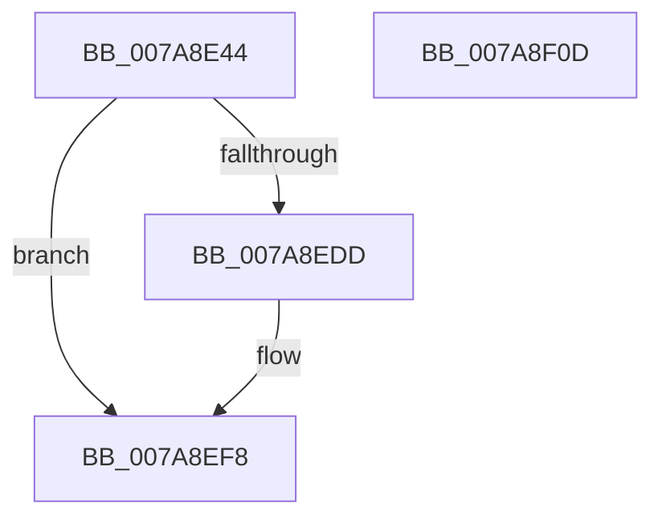

# SmKmSendUsageNotification

- RVA: `0x007A8E44`–`0x007A8F0E` (길이 `202` bytes)
- VA: `0x00000001407A8E44`
- 실행 섹션: `PAGE`
- PDB 이름 있음: `예`; PDB Function 태그: `아니요`
- unwind 정보 RVA: `0x0006F874`
- 디코드: `52`개 명령, `202/202` bytes 표시
- 미해석 바이트: `0` (있으면 어셈블리에 `.byte`로 보존)

> 이 문서는 커널 이미지의 기계어와 PDB 기호를 분석해 생성했습니다. 4번과 5번은 함수 원형과 자료형을 바이너리 사용 방식에서 추정한 C 해석이며 원본 소스 복구 결과는 아닙니다.

## 1. Dependencies

- 직접 호출 지점: **4**; 고유 호출 대상: **4**
- 직접 호출자로 확인된 함수: **2**
- RIP 상대 이미지 참조: **1**

### Outgoing calls
- `0x007A8E78` → [KeInitializeEvent](../../text/40/KeInitializeEvent_function_0040DD10.md) (function, `0x0040DD10`)
- `0x007A8E87` → [IoGetRelatedDeviceObject](../../text/29/IoGetRelatedDeviceObject_function_0029B120.md) (function, `0x0029B120`)
- `0x007A8ED1` → [IofCallDriver](../../text/29/IofCallDriver_function_0029B4B0.md) (function, `0x0029B4B0`)
- `0x007A8EF0` → [KeWaitForSingleObject](../../text/20/KeWaitForSingleObject_function_0020E6B0.md) (function, `0x0020E6B0`)

### Direct callers
- [SmKmIsVolumeIoPossible](SmKmIsVolumeIoPossible_function_007A84BC.md) at `0x007A859E`
- [SmKmFileInfoCleanup](../AC/SmKmFileInfoCleanup_function_00AC9A90.md) at `0x00AC9AE1`

### Static image references
- `0x007A8E92` → RVA `0x0048B010` (`CmpCompleteFlushAndPurgeIrp`; read)

## 2. Other-region calls and transfers

- 다른 실행 섹션으로 향하는 call: **4**
  - `0x007A8E78` → [KeInitializeEvent](../../text/40/KeInitializeEvent_function_0040DD10.md) (`PAGE` → `.text`)
  - `0x007A8E87` → [IoGetRelatedDeviceObject](../../text/29/IoGetRelatedDeviceObject_function_0029B120.md) (`PAGE` → `.text`)
  - `0x007A8ED1` → [IofCallDriver](../../text/29/IofCallDriver_function_0029B4B0.md) (`PAGE` → `.text`)
  - `0x007A8EF0` → [KeWaitForSingleObject](../../text/20/KeWaitForSingleObject_function_0020E6B0.md) (`PAGE` → `.text`)
- 별도 외부 분기/꼬리 이동을 확인하지 못했습니다.

## 3. Assembly (complete function range)

```asm
007A8E44  4C 8B DC                        mov r11, rsp
007A8E47  49 89 5B 08                     mov qword ptr [r11 + 8], rbx
007A8E4B  49 89 6B 10                     mov qword ptr [r11 + 0x10], rbp
007A8E4F  49 89 73 18                     mov qword ptr [r11 + 0x18], rsi
007A8E53  57                              push rdi
007A8E54  48 83 EC 50                     sub rsp, 0x50
007A8E58  0F 57 C0                        xorps xmm0, xmm0
007A8E5B  41 8B F8                        mov edi, r8d
007A8E5E  48 8B F2                        mov rsi, rdx
007A8E61  48 8B E9                        mov rbp, rcx
007A8E64  33 C0                           xor eax, eax
007A8E66  49 8D 4B D8                     lea rcx, [r11 - 0x28]
007A8E6A  0F 11 44 24 30                  movups xmmword ptr [rsp + 0x30], xmm0
007A8E6F  45 33 C0                        xor r8d, r8d
007A8E72  49 89 43 E8                     mov qword ptr [r11 - 0x18], rax
007A8E76  33 D2                           xor edx, edx
007A8E78  E8 93 4E C6 FF                  call 0x14040dd10
007A8E7D  48 8B 9D B8 00 00 00            mov rbx, qword ptr [rbp + 0xb8]
007A8E84  48 8B CE                        mov rcx, rsi
007A8E87  E8 94 22 AF FF                  call 0x14029b120
007A8E8C  66 C7 43 B8 1B 16               mov word ptr [rbx - 0x48], 0x161b
007A8E92  48 8D 15 77 21 CE FF            lea rdx, [rip - 0x31de89]
007A8E99  C7 43 C8 01 00 00 00            mov dword ptr [rbx - 0x38], 1
007A8EA0  85 FF                           test edi, edi
007A8EA2  48 89 73 E8                     mov qword ptr [rbx - 0x18], rsi
007A8EA6  0F 94 C1                        sete cl
007A8EA9  88 4B C0                        mov byte ptr [rbx - 0x40], cl
007A8EAC  48 8B 8D B8 00 00 00            mov rcx, qword ptr [rbp + 0xb8]
007A8EB3  C7 45 30 BB 00 00 C0            mov dword ptr [rbp + 0x30], 0xc00000bb
007A8EBA  48 89 51 F0                     mov qword ptr [rcx - 0x10], rdx
007A8EBE  48 8D 54 24 30                  lea rdx, [rsp + 0x30]
007A8EC3  48 89 51 F8                     mov qword ptr [rcx - 8], rdx
007A8EC7  48 8B D5                        mov rdx, rbp
007A8ECA  C6 41 BB E0                     mov byte ptr [rcx - 0x45], 0xe0
007A8ECE  48 8B C8                        mov rcx, rax
007A8ED1  E8 DA 25 AF FF                  call 0x14029b4b0
007A8ED6  3D 03 01 00 00                  cmp eax, 0x103
007A8EDB  75 1B                           jne 0x1407a8ef8
007A8EDD  48 83 64 24 20 00               and qword ptr [rsp + 0x20], 0
007A8EE3  48 8D 4C 24 30                  lea rcx, [rsp + 0x30]
007A8EE8  45 33 C9                        xor r9d, r9d
007A8EEB  45 33 C0                        xor r8d, r8d
007A8EEE  33 D2                           xor edx, edx
007A8EF0  E8 BB 57 A6 FF                  call 0x14020e6b0
007A8EF5  8B 45 30                        mov eax, dword ptr [rbp + 0x30]
007A8EF8  48 8B 5C 24 60                  mov rbx, qword ptr [rsp + 0x60]
007A8EFD  48 8B 6C 24 68                  mov rbp, qword ptr [rsp + 0x68]
007A8F02  48 8B 74 24 70                  mov rsi, qword ptr [rsp + 0x70]
007A8F07  48 83 C4 50                     add rsp, 0x50
007A8F0B  5F                              pop rdi
007A8F0C  C3                              ret
007A8F0D  CC                              int3
```

## 4. C-style interpretation (structured pseudocode)

```c
__int64 __fastcall SmKmSendUsageNotification(__int64 a1, __int64 a2, int a3, int a4)
{
    __int64 result;
    __int64 v_rsp;
    unsigned __int64 v_stack_m28;
    unsigned __int64 v_stack_m38;
    unsigned __int64 v_stack_p10;
    unsigned __int64 v_stack_p18;
    unsigned __int64 v_stack_p8;

    *(unsigned __int64 *)(v_rsp + 8) = v_rbx;
    *(unsigned __int64 *)(v_rsp + 16) = v_rbp;
    *(unsigned __int64 *)(v_rsp + 24) = v_rsi;
    v_rsp = (v_rsp) - (80);
    result = 0;
    v_stack_m28 = v_xmm0;
    a3 = 0;
    *(unsigned __int64 *)(v_rsp - 24) = 0;
    a2 = 0;
    result = KeInitializeEvent(v_rsp - 40, a2, a3, a4);
    result = IoGetRelatedDeviceObject(0, a2, a3, a4);
    *(unsigned __int16 *)(*(unsigned __int64 *)(a1 + 184) - 72) = 0x161BULL;
    *(unsigned int *)(*(unsigned __int64 *)(a1 + 184) - 56) = 1;
    *(unsigned __int64 *)(*(unsigned __int64 *)(a1 + 184) - 24) = 0;
    a1 = ((unsigned int)((unsigned int)(a3)) == 0) ? 1 : 0;
    *(unsigned __int8 *)(*(unsigned __int64 *)(a1 + 184) - 64) = (unsigned __int8)(a1);
    *(unsigned int *)(a1 + 48) = 0xC00000BBULL;
    *(unsigned __int64 *)(*(unsigned __int64 *)(a1 + 184) - 16) = v_rip - 3268233;
    *(unsigned __int64 *)(*(unsigned __int64 *)(a1 + 184) - 8) = v_stack_m28;
    *(unsigned __int8 *)(*(unsigned __int64 *)(a1 + 184) - 69) = 224;
    result = IofCallDriver(result, a1, a3, a4);
    if (((unsigned int)(result)) == 259) {
        a1 = v_stack_m28;
        a4 = 0;
        a3 = 0;
        a2 = 0;
        result = KeWaitForSingleObject(a1, a2, a3, a4);
        result = *(unsigned int *)(a1 + 48);
    }
    v_rsp = (v_rsp) + (80);
    return result;
}
```

## 5. (Beta) C Style

```c
int64_t SmKmSendUsageNotification(void *Arg1, int64_t Arg2, int32_t Arg3, int32_t Arg4)
{
    uint8_t *arg1 = (uint8_t *)Arg1;

    int64_t result;
    int64_t local_rsp;
    uint64_t v_stack_m28;
    uint64_t v_stack_m38;
    uint64_t v_stack_p10;
    uint64_t v_stack_p18;
    uint64_t v_stack_p8;

    *(uint64_t *)(local_rsp + 0x8) = local_rbx;
    *(uint64_t *)(local_rsp + 0x10) = local_rbp;
    *(uint64_t *)(local_rsp + 0x18) = local_rsi;
    local_rsp = (local_rsp) - (80);
    result = 0;
    v_stack_m28 = v_xmm0;
    Arg3 = 0;
    *(uint64_t *)(local_rsp - 0x18) = 0;
    Arg2 = 0;
    result = KeInitializeEvent(local_rsp - 40, Arg2, Arg3, Arg4);
    result = IoGetRelatedDeviceObject(0, Arg2, Arg3, Arg4);
    *(uint16_t *)(*(uint64_t *)(arg1 + 0xB8) - 0x48) = 0x161BULL;
    *(uint32_t *)(*(uint64_t *)(arg1 + 0xB8) - 0x38) = 1;
    *(uint64_t *)(*(uint64_t *)(arg1 + 0xB8) - 0x18) = 0;
    Arg1 = ((uint32_t)((uint32_t)(Arg3)) == 0) ? 1 : 0;
    *(uint8_t *)(*(uint64_t *)(arg1 + 0xB8) - 0x40) = (uint8_t)(Arg1);
    *(uint32_t *)(arg1 + 0x30) = 0xC00000BBULL;
    *(uint64_t *)(*(uint64_t *)(arg1 + 0xB8) - 0x10) = v_rip - 3268233;
    *(uint64_t *)(*(uint64_t *)(arg1 + 0xB8) - 0x8) = v_stack_m28;
    *(uint8_t *)(*(uint64_t *)(arg1 + 0xB8) - 0x45) = 224;
    result = IofCallDriver(result, Arg1, Arg3, Arg4);
    if (((uint32_t)(result)) == 259) {
        Arg1 = v_stack_m28;
        Arg4 = 0;
        Arg3 = 0;
        Arg2 = 0;
        result = KeWaitForSingleObject(Arg1, Arg2, Arg3, Arg4);
        result = *(uint32_t *)(arg1 + 0x30);
    }
    local_rsp = (local_rsp) + (80);
    return result;
}
```

### 관측된 메모리 오프셋

구조체 형식이 확인되지 않은 접근은 인자 기준의 오프셋으로만 기록했습니다.

| 기준 인자 | 오프셋 표현 | 폭 (bit) | 접근 |
|---|---:|---:|---|
| `Arg1` | `+ 0x30` | `32` | `R` |
| `Arg1` | `+ 0x30` | `32` | `W` |
| `Arg1` | `+ 0xB8` | `64` | `R` |

## 6. Execution-region graph

[열기: 2D/3D 그래프와 함수 탐색 컨트롤 패널](../../../control-panel.html?section=page&rva=0x007A8E44&view=graph)

- 2D 그래프는 위에서 아래로 흐르고, 3D 그래프는 빈 공간을 드래그해 회전합니다. Shift+드래그는 이동, 휠은 확대·축소, 함수 노드 선택은 대상 보고서 이동입니다.

### Static fallback


