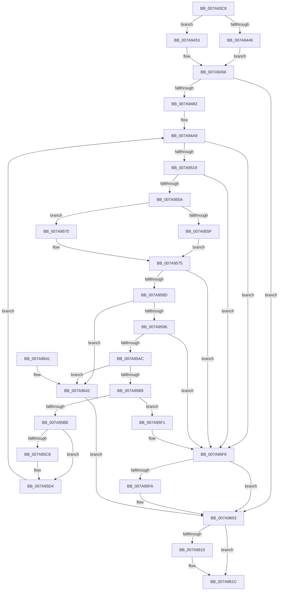

# SmKmStoreFileCreateForIoType

- RVA: `0x007A93C8`–`0x007A9679` (길이 `689` bytes)
- VA: `0x00000001407A93C8`
- 실행 섹션: `PAGE`
- PDB 이름 있음: `예`; PDB Function 태그: `아니요`
- unwind 정보 RVA: `0x000D1F60`
- 디코드: `178`개 명령, `689/689` bytes 표시
- 미해석 바이트: `0` (있으면 어셈블리에 `.byte`로 보존)

> 이 문서는 커널 이미지의 기계어와 PDB 기호를 분석해 생성했습니다. 4번과 5번은 함수 원형과 자료형을 바이너리 사용 방식에서 추정한 C 해석이며 원본 소스 복구 결과는 아닙니다.

## 1. Dependencies

- 직접 호출 지점: **16**; 고유 호출 대상: **11**
- 직접 호출자로 확인된 함수: **1**
- RIP 상대 이미지 참조: **0**

### Outgoing calls
- `0x007A9438` → [memset](../../text/6C/memset_function_006C6C40.md) (function, `0x006C6C40`)
- `0x007A9458` → [IoSetThreadHardErrorMode](../../text/46/IoSetThreadHardErrorMode_function_00466BF0.md) (function, `0x00466BF0`)
- `0x007A9467` → [RtlInitUnicodeString](../../text/42/RtlInitUnicodeString_function_0042A780.md) (function, `0x0042A780`)
- `0x007A9474` → [SmKmStoreFileMakeSecurityDescriptor](SmKmStoreFileMakeSecurityDescriptor_function_007A9988.md) (function, `0x007A9988`)
- `0x007A950A` → [IopCreateFile](../8A/IopCreateFile_function_008AB298.md) (function, `0x008AB298`)
- `0x007A9540` → [ObReferenceObjectByHandle](../86/ObReferenceObjectByHandle_function_00868DB0.md) (function, `0x00868DB0`)
- `0x007A9582` → [ZwSetSecurityObject](../../text/6B/ZwSetSecurityObject_function_006B0810.md) (function, `0x006B0810`)
- `0x007A95A1` → [SmKmIsVolumeIoPossible](SmKmIsVolumeIoPossible_function_007A84BC.md) (function, `0x007A84BC`)
- `0x007A95CC` → [SmKmStoreFileDelete](SmKmStoreFileDelete_function_007A9680.md) (function, `0x007A9680`)
- `0x007A95D8` → [SmKmFileInfoCleanup](../AC/SmKmFileInfoCleanup_function_00AC9A90.md) (function, `0x00AC9A90`)
- `0x007A95E7` → [memset](../../text/6C/memset_function_006C6C40.md) (function, `0x006C6C40`)
- `0x007A95FE` → [SmKmStoreFileDelete](SmKmStoreFileDelete_function_007A9680.md) (function, `0x007A9680`)
- `0x007A9607` → [SmKmFileInfoCleanup](../AC/SmKmFileInfoCleanup_function_00AC9A90.md) (function, `0x00AC9A90`)
- `0x007A9617` → [ExFreePoolWithTag](../../poolcode/B8/ExFreePoolWithTag_function_00B82870.md) (function, `0x00B82870`)
- `0x007A961F` → [IoSetThreadHardErrorMode](../../text/46/IoSetThreadHardErrorMode_function_00466BF0.md) (function, `0x00466BF0`)
- `0x007A966F` → [memset](../../text/6C/memset_function_006C6C40.md) (function, `0x006C6C40`)

### Direct callers
- [SmKmStoreFileCreate](SmKmStoreFileCreate_function_007A8F14.md) at `0x007A9067`

### Static image references
- 디코드된 RIP-relative 메모리 참조가 없습니다.

## 2. Other-region calls and transfers

- 다른 실행 섹션으로 향하는 call: **8**
  - `0x007A9438` → [memset](../../text/6C/memset_function_006C6C40.md) (`PAGE` → `.text`)
  - `0x007A9458` → [IoSetThreadHardErrorMode](../../text/46/IoSetThreadHardErrorMode_function_00466BF0.md) (`PAGE` → `.text`)
  - `0x007A9467` → [RtlInitUnicodeString](../../text/42/RtlInitUnicodeString_function_0042A780.md) (`PAGE` → `.text`)
  - `0x007A9582` → [ZwSetSecurityObject](../../text/6B/ZwSetSecurityObject_function_006B0810.md) (`PAGE` → `.text`)
  - `0x007A95E7` → [memset](../../text/6C/memset_function_006C6C40.md) (`PAGE` → `.text`)
  - `0x007A9617` → [ExFreePoolWithTag](../../poolcode/B8/ExFreePoolWithTag_function_00B82870.md) (`PAGE` → `POOLCODE`)
  - `0x007A961F` → [IoSetThreadHardErrorMode](../../text/46/IoSetThreadHardErrorMode_function_00466BF0.md) (`PAGE` → `.text`)
  - `0x007A966F` → [memset](../../text/6C/memset_function_006C6C40.md) (`PAGE` → `.text`)
- 별도 외부 분기/꼬리 이동을 확인하지 못했습니다.

## 3. Assembly (complete function range)

```asm
007A93C8  48 89 5C 24 08                  mov qword ptr [rsp + 8], rbx
007A93CD  44 89 4C 24 20                  mov dword ptr [rsp + 0x20], r9d
007A93D2  55                              push rbp
007A93D3  56                              push rsi
007A93D4  57                              push rdi
007A93D5  41 54                           push r12
007A93D7  41 55                           push r13
007A93D9  41 56                           push r14
007A93DB  41 57                           push r15
007A93DD  48 8D 6C 24 B0                  lea rbp, [rsp - 0x50]
007A93E2  48 81 EC 50 01 00 00            sub rsp, 0x150
007A93E9  0F 57 C0                        xorps xmm0, xmm0
007A93EC  45 33 ED                        xor r13d, r13d
007A93EF  49 8B F0                        mov rsi, r8
007A93F2  44 89 AD A8 00 00 00            mov dword ptr [rbp + 0xa8], r13d
007A93F9  48 8B DA                        mov rbx, rdx
007A93FC  44 89 AD B0 00 00 00            mov dword ptr [rbp + 0xb0], r13d
007A9403  4C 8B F9                        mov r15, rcx
007A9406  0F 57 C9                        xorps xmm1, xmm1
007A9409  33 C0                           xor eax, eax
007A940B  45 8D 45 40                     lea r8d, [r13 + 0x40]
007A940F  33 D2                           xor edx, edx
007A9411  48 89 45 40                     mov qword ptr [rbp + 0x40], rax
007A9415  48 8D 4D 90                     lea rcx, [rbp - 0x70]
007A9419  41 8B FD                        mov edi, r13d
007A941C  0F 11 45 00                     movups xmmword ptr [rbp], xmm0
007A9420  0F 11 4D 10                     movups xmmword ptr [rbp + 0x10], xmm1
007A9424  0F 11 45 D0                     movups xmmword ptr [rbp - 0x30], xmm0
007A9428  0F 11 45 E0                     movups xmmword ptr [rbp - 0x20], xmm0
007A942C  0F 11 45 F0                     movups xmmword ptr [rbp - 0x10], xmm0
007A9430  0F 11 45 20                     movups xmmword ptr [rbp + 0x20], xmm0
007A9434  0F 11 45 30                     movups xmmword ptr [rbp + 0x30], xmm0
007A9438  E8 03 D8 F1 FF                  call 0x1406c6c40
007A943D  4C 89 6D 80                     mov qword ptr [rbp - 0x80], r13
007A9441  48 85 F6                        test rsi, rsi
007A9444  75 0D                           jne 0x1407a9453
007A9446  45 8D 75 01                     lea r14d, [r13 + 1]
007A944A  48 8D B5 B0 00 00 00            lea rsi, [rbp + 0xb0]
007A9451  EB 03                           jmp 0x1407a9456
007A9453  45 8B F5                        mov r14d, r13d
007A9456  33 C9                           xor ecx, ecx
007A9458  E8 93 D7 CB FF                  call 0x140466bf0
007A945D  48 8B D3                        mov rdx, rbx
007A9460  48 8D 4D 00                     lea rcx, [rbp]
007A9464  44 8A E0                        mov r12b, al
007A9467  E8 14 13 C8 FF                  call 0x14042a780
007A946C  48 8D 55 80                     lea rdx, [rbp - 0x80]
007A9470  48 8D 4D 20                     lea rcx, [rbp + 0x20]
007A9474  E8 0F 05 00 00                  call 0x1407a9988
007A9479  8B D8                           mov ebx, eax
007A947B  85 C0                           test eax, eax
007A947D  0F 88 80 01 00 00               js 0x1407a9603
007A9483  48 8D 45 00                     lea rax, [rbp]
007A9487  C7 45 D0 30 00 00 00            mov dword ptr [rbp - 0x30], 0x30
007A948E  48 89 45 E0                     mov qword ptr [rbp - 0x20], rax
007A9492  48 8D 45 20                     lea rax, [rbp + 0x20]
007A9496  48 89 45 F0                     mov qword ptr [rbp - 0x10], rax
007A949A  4C 89 6D D8                     mov qword ptr [rbp - 0x28], r13
007A949E  C7 45 E8 40 02 00 00            mov dword ptr [rbp - 0x18], 0x240
007A94A5  4C 89 6D F8                     mov qword ptr [rbp - 8], r13
007A94A9  8B 06                           mov eax, dword ptr [rsi]
007A94AB  4C 8D 4D 10                     lea r9, [rbp + 0x10]
007A94AF  4C 89 6C 24 78                  mov qword ptr [rsp + 0x78], r13
007A94B4  4C 8D 45 D0                     lea r8, [rbp - 0x30]
007A94B8  44 89 6C 24 70                  mov dword ptr [rsp + 0x70], r13d
007A94BD  F7 D8                           neg eax
007A94BF  BA 03 00 14 00                  mov edx, 0x140003
007A94C4  1B C9                           sbb ecx, ecx
007A94C6  83 E1 FE                        and ecx, 0xfffffffe
007A94C9  81 C1 0A 01 00 00               add ecx, 0x10a
007A94CF  89 4C 24 68                     mov dword ptr [rsp + 0x68], ecx
007A94D3  48 8D 4D 90                     lea rcx, [rbp - 0x70]
007A94D7  4C 89 6C 24 60                  mov qword ptr [rsp + 0x60], r13
007A94DC  44 89 6C 24 58                  mov dword ptr [rsp + 0x58], r13d
007A94E1  44 89 6C 24 50                  mov dword ptr [rsp + 0x50], r13d
007A94E6  4C 89 6C 24 48                  mov qword ptr [rsp + 0x48], r13
007A94EB  C7 44 24 40 0A 80 00 00         mov dword ptr [rsp + 0x40], 0x800a
007A94F3  44 89 6C 24 38                  mov dword ptr [rsp + 0x38], r13d
007A94F8  44 89 6C 24 30                  mov dword ptr [rsp + 0x30], r13d
007A94FD  C7 44 24 28 00 20 00 00         mov dword ptr [rsp + 0x28], 0x2000
007A9505  4C 89 6C 24 20                  mov qword ptr [rsp + 0x20], r13
007A950A  E8 89 1D 10 00                  call 0x1408ab298
007A950F  8B D8                           mov ebx, eax
007A9511  85 C0                           test eax, eax
007A9513  0F 88 DD 00 00 00               js 0x1407a95f6
007A9519  48 8B 4D 90                     mov rcx, qword ptr [rbp - 0x70]
007A951D  48 8D 85 A0 00 00 00            lea rax, [rbp + 0xa0]
007A9524  4C 89 6C 24 28                  mov qword ptr [rsp + 0x28], r13
007A9529  45 33 C9                        xor r9d, r9d
007A952C  45 33 C0                        xor r8d, r8d
007A952F  48 89 44 24 20                  mov qword ptr [rsp + 0x20], rax
007A9534  BA 03 00 01 00                  mov edx, 0x10003
007A9539  4C 89 AD A0 00 00 00            mov qword ptr [rbp + 0xa0], r13
007A9540  E8 6B F8 0B 00                  call 0x140868db0
007A9545  8B D8                           mov ebx, eax
007A9547  48 8B 85 A0 00 00 00            mov rax, qword ptr [rbp + 0xa0]
007A954E  48 89 45 98                     mov qword ptr [rbp - 0x68], rax
007A9552  85 DB                           test ebx, ebx
007A9554  0F 88 9C 00 00 00               js 0x1407a95f6
007A955A  44 39 2E                        cmp dword ptr [rsi], r13d
007A955D  74 11                           je 0x1407a9570
007A955F  48 F7 45 18 FD FF FF FF         test qword ptr [rbp + 0x18], -3
007A9567  41 8B FD                        mov edi, r13d
007A956A  40 0F 94 C7                     sete dil
007A956E  EB 05                           jmp 0x1407a9575
007A9570  BF 01 00 00 00                  mov edi, 1
007A9575  48 8B 4D 90                     mov rcx, qword ptr [rbp - 0x70]
007A9579  4C 8D 45 20                     lea r8, [rbp + 0x20]
007A957D  BA 04 00 00 00                  mov edx, 4
007A9582  E8 89 72 F0 FF                  call 0x1406b0810
007A9587  8B D8                           mov ebx, eax
007A9589  85 C0                           test eax, eax
007A958B  78 69                           js 0x1407a95f6
007A958D  44 39 2E                        cmp dword ptr [rsi], r13d
007A9590  0F 85 AC 00 00 00               jne 0x1407a9642
007A9596  48 8D 95 A8 00 00 00            lea rdx, [rbp + 0xa8]
007A959D  48 8D 4D 90                     lea rcx, [rbp - 0x70]
007A95A1  E8 16 EF FF FF                  call 0x1407a84bc
007A95A6  8B D8                           mov ebx, eax
007A95A8  85 C0                           test eax, eax
007A95AA  78 4A                           js 0x1407a95f6
007A95AC  44 39 AD A8 00 00 00            cmp dword ptr [rbp + 0xa8], r13d
007A95B3  0F 85 89 00 00 00               jne 0x1407a9642
007A95B9  45 85 F6                        test r14d, r14d
007A95BC  75 33                           jne 0x1407a95f1
007A95BE  C7 06 01 00 00 00               mov dword ptr [rsi], 1
007A95C4  85 FF                           test edi, edi
007A95C6  74 0C                           je 0x1407a95d4
007A95C8  48 8D 4D 90                     lea rcx, [rbp - 0x70]
007A95CC  E8 AF 00 00 00                  call 0x1407a9680
007A95D1  41 8B FD                        mov edi, r13d
007A95D4  48 8D 4D 90                     lea rcx, [rbp - 0x70]
007A95D8  E8 B3 04 32 00                  call 0x140ac9a90
007A95DD  33 D2                           xor edx, edx
007A95DF  48 8D 4D 90                     lea rcx, [rbp - 0x70]
007A95E3  44 8D 42 40                     lea r8d, [rdx + 0x40]
007A95E7  E8 54 D6 F1 FF                  call 0x1406c6c40
007A95EC  E9 B8 FE FF FF                  jmp 0x1407a94a9
007A95F1  BB BB 00 00 C0                  mov ebx, 0xc00000bb
007A95F6  85 FF                           test edi, edi
007A95F8  74 09                           je 0x1407a9603
007A95FA  48 8D 4D 90                     lea rcx, [rbp - 0x70]
007A95FE  E8 7D 00 00 00                  call 0x1407a9680
007A9603  48 8D 4D 90                     lea rcx, [rbp - 0x70]
007A9607  E8 84 04 32 00                  call 0x140ac9a90
007A960C  48 8B 4D 80                     mov rcx, qword ptr [rbp - 0x80]
007A9610  48 85 C9                        test rcx, rcx
007A9613  74 07                           je 0x1407a961c
007A9615  33 D2                           xor edx, edx
007A9617  E8 54 92 3D 00                  call 0x140b82870
007A961C  41 8A CC                        mov cl, r12b
007A961F  E8 CC D5 CB FF                  call 0x140466bf0
007A9624  8B C3                           mov eax, ebx
007A9626  48 8B 9C 24 90 01 00 00         mov rbx, qword ptr [rsp + 0x190]
007A962E  48 81 C4 50 01 00 00            add rsp, 0x150
007A9635  41 5F                           pop r15
007A9637  41 5E                           pop r14
007A9639  41 5D                           pop r13
007A963B  41 5C                           pop r12
007A963D  5F                              pop rdi
007A963E  5E                              pop rsi
007A963F  5D                              pop rbp
007A9640  C3                              ret
007A9641  CC                              int3
007A9642  0F 28 45 90                     movaps xmm0, xmmword ptr [rbp - 0x70]
007A9646  48 8D 4D 90                     lea rcx, [rbp - 0x70]
007A964A  0F 28 4D A0                     movaps xmm1, xmmword ptr [rbp - 0x60]
007A964E  33 D2                           xor edx, edx
007A9650  41 0F 29 07                     movaps xmmword ptr [r15], xmm0
007A9654  0F 28 45 B0                     movaps xmm0, xmmword ptr [rbp - 0x50]
007A9658  41 0F 29 4F 10                  movaps xmmword ptr [r15 + 0x10], xmm1
007A965D  0F 28 4D C0                     movaps xmm1, xmmword ptr [rbp - 0x40]
007A9661  44 8D 42 40                     lea r8d, [rdx + 0x40]
007A9665  41 0F 29 47 20                  movaps xmmword ptr [r15 + 0x20], xmm0
007A966A  41 0F 29 4F 30                  movaps xmmword ptr [r15 + 0x30], xmm1
007A966F  E8 CC D5 F1 FF                  call 0x1406c6c40
007A9674  41 8B DD                        mov ebx, r13d
007A9677  EB 8A                           jmp 0x1407a9603
```

## 4. C-style interpretation (structured pseudocode)

```c
__int64 __fastcall SmKmStoreFileCreateForIoType(__int64 a1, __int64 a2, __int64 a3, int a4, __int64 a5)
{
    __int64 result;
    __int64 v_r13;
    __int64 v_rdi;
    __int64 v_rsp;
    unsigned __int64 v_stack_m108;
    unsigned __int64 v_stack_m110;
    unsigned int v_stack_m118;
    unsigned int v_stack_m120;
    unsigned __int64 v_stack_m128;
    unsigned int v_stack_m130;
    unsigned int v_stack_m138;
    unsigned __int64 v_stack_m140;
    unsigned int v_stack_m148;
    unsigned int v_stack_m150;
    unsigned int v_stack_m158;
    unsigned int v_stack_m160;
    unsigned __int64 v_stack_m168;
    unsigned __int64 v_stack_m48;
    unsigned __int64 v_stack_m58;
    unsigned __int64 v_stack_m68;
    unsigned __int64 v_stack_m70;
    unsigned __int64 v_stack_m78;
    unsigned __int64 v_stack_m88;
    unsigned __int64 v_stack_m90;
    unsigned __int64 v_stack_m98;
    unsigned int v_stack_mA0;
    unsigned __int64 v_stack_mA8;
    unsigned __int64 v_stack_mB0;
    unsigned __int64 v_stack_mB8;
    unsigned __int64 v_stack_mC8;
    unsigned __int64 v_stack_mD8;
    unsigned __int64 v_stack_mE8;
    unsigned __int64 v_stack_mF0;
    unsigned __int64 v_stack_mF8;
    unsigned __int64 v_stack_p18;
    unsigned int v_stack_p20;
    unsigned int v_stack_p28;
    unsigned __int64 v_stack_p8;

    v_stack_p8 = v_rbx;
    v_stack_p20 = a4;
    v_rsp = (v_rsp) - (336);
    v_r13 = 0;
    v_stack_p20 = 0;
    v_stack_p28 = 0;
    result = 0;
    a2 = 0;
    v_stack_m48 = 0;
    v_stack_m88 = v_xmm0;
    v_stack_m78 = v_xmm1;
    v_stack_mB8 = v_xmm0;
    v_stack_mA8 = v_xmm0;
    v_stack_m98 = v_xmm0;
    v_stack_m68 = v_xmm0;
    v_stack_m58 = v_xmm0;
    result = memset(v_stack_mF8, a2, v_r13 + 64, a4);
    v_stack_m108 = 0;
    if (a3 != 0) goto loc_007A9453;
    goto loc_007A9456;
loc_007A9453:
loc_007A9456:
    a1 = 0;
    result = IoSetThreadHardErrorMode(a1, a2, v_r13 + 64, a4);
    result = RtlInitUnicodeString(v_stack_m88, 0, v_r13 + 64, a4);
    result = SmKmStoreFileMakeSecurityDescriptor(v_stack_m68, v_stack_m108, v_r13 + 64, a4);
    if (sign_flag) goto loc_007A9603;
    v_stack_mB8 = 48;
    v_stack_mA8 = v_stack_m88;
    v_stack_m98 = v_stack_m68;
    v_stack_mB0 = 0;
    v_stack_mA0 = 576;
    v_stack_m90 = 0;
loc_007A94A9:
    v_stack_m110 = 0;
    v_stack_m118 = 0;
    result = (unsigned int)(-((unsigned int)(*(unsigned int *)(a5))));
    a1 = (unsigned int)((v_stack_m68) & (0xFFFFFFFEULL));
    a1 = (unsigned int)((a1) + (266));
    v_stack_m120 = (unsigned int)(a1);
    v_stack_m128 = 0;
    v_stack_m130 = 0;
    v_stack_m138 = 0;
    v_stack_m140 = 0;
    v_stack_m148 = 0x800AULL;
    v_stack_m150 = 0;
    v_stack_m158 = 0;
    v_stack_m160 = 0x2000ULL;
    v_stack_m168 = 0;
    result = IopCreateFile(v_stack_mF8, (unsigned int)(0x140003ULL), v_stack_mB8, v_stack_m78);
    if (sign_flag) goto loc_007A95F6;
    v_stack_m160 = 0;
    a4 = 0;
    a3 = 0;
    v_stack_m168 = v_stack_p18;
    v_stack_p18 = 0;
    result = ObReferenceObjectByHandle(v_stack_mF8, (unsigned int)(0x10003ULL), a3, a4);
    v_stack_mF0 = v_stack_p18;
    if (sign_flag) goto loc_007A95F6;
    if ((*(unsigned int *)(a5)) == 0) goto loc_007A9570;
    v_rdi = (((v_stack_m70) & (-3)) == 0) ? 1 : 0;
    goto loc_007A9575;
loc_007A9570:
loc_007A9575:
    result = ZwSetSecurityObject(v_stack_mF8, 4, v_stack_m68, a4);
    if (sign_flag) goto loc_007A95F6;
    if ((*(unsigned int *)(a5)) != 0) goto loc_007A9642;
    result = SmKmIsVolumeIoPossible(v_stack_mF8, v_stack_p20, v_stack_m68, a4);
    if (sign_flag) goto loc_007A95F6;
    if (v_stack_p20 != 0) goto loc_007A9642;
    if (0 != 0) goto loc_007A95F1;
    *(unsigned int *)(a5) = 1;
    v_rdi = 1;
    if (1 != 0) {
        a1 = v_stack_mF8;
        result = SmKmStoreFileDelete(a1, v_stack_p20, v_stack_m68, a4);
        v_rdi = 0;
    }
    result = SmKmFileInfoCleanup(v_stack_mF8, v_stack_p20, v_stack_m68, a4);
    a2 = 0;
    result = memset(v_stack_mF8, a2, a2 + 64, a4);
    goto loc_007A94A9;
loc_007A95F1:
loc_007A95F6:
    if ((unsigned int)(v_rdi) != 0) {
        a1 = v_stack_mF8;
        result = SmKmStoreFileDelete(a1, a2, a2 + 64, a4);
    }
    result = SmKmFileInfoCleanup(v_stack_mF8, a2, a2 + 64, a4);
    if (v_stack_m108 != 0) {
        a2 = 0;
        result = ExFreePoolWithTag(v_stack_m108, a2, a2 + 64, a4);
    }
    result = IoSetThreadHardErrorMode((unsigned __int8)((unsigned __int8)(result)), a2, a2 + 64, a4);
    v_rsp = (v_rsp) + (336);
    return (unsigned int)((unsigned int)((unsigned int)(0xC00000BBULL)));
loc_007A9642:
    a2 = 0;
    *(unsigned __int64 *)(a1) = v_xmm0;
    *(unsigned __int64 *)(a1 + 16) = v_xmm1;
    *(unsigned __int64 *)(a1 + 32) = v_xmm0;
    *(unsigned __int64 *)(a1 + 48) = v_xmm1;
    result = memset(v_stack_mF8, a2, a2 + 64, a4);
    goto loc_007A9603;
}
```

## 5. (Beta) C Style

```c
int64_t SmKmStoreFileCreateForIoType(void *Arg1, int64_t Arg2, int64_t Arg3, int32_t Arg4, int64_t Arg5)
{
    uint8_t *arg1 = (uint8_t *)Arg1;

    int64_t result;
    int64_t local_r13;
    int64_t local_rdi;
    int64_t local_rsp;
    uint64_t v_stack_m108;
    uint64_t v_stack_m110;
    uint32_t v_stack_m118;
    uint32_t v_stack_m120;
    uint64_t v_stack_m128;
    uint32_t v_stack_m130;
    uint32_t v_stack_m138;
    uint64_t v_stack_m140;
    uint32_t v_stack_m148;
    uint32_t v_stack_m150;
    uint32_t v_stack_m158;
    uint32_t v_stack_m160;
    uint64_t v_stack_m168;
    uint64_t v_stack_m48;
    uint64_t v_stack_m58;
    uint64_t v_stack_m68;
    uint64_t v_stack_m70;
    uint64_t v_stack_m78;
    uint64_t v_stack_m88;
    uint64_t v_stack_m90;
    uint64_t v_stack_m98;
    uint32_t v_stack_mA0;
    uint64_t v_stack_mA8;
    uint64_t v_stack_mB0;
    uint64_t v_stack_mB8;
    uint64_t v_stack_mC8;
    uint64_t v_stack_mD8;
    uint64_t v_stack_mE8;
    uint64_t v_stack_mF0;
    uint64_t v_stack_mF8;
    uint64_t v_stack_p18;
    uint32_t v_stack_p20;
    uint32_t v_stack_p28;
    uint64_t v_stack_p8;

    v_stack_p8 = local_rbx;
    v_stack_p20 = Arg4;
    local_rsp = (local_rsp) - (336);
    local_r13 = 0;
    v_stack_p20 = 0;
    v_stack_p28 = 0;
    result = 0;
    Arg2 = 0;
    v_stack_m48 = 0;
    v_stack_m88 = v_xmm0;
    v_stack_m78 = v_xmm1;
    v_stack_mB8 = v_xmm0;
    v_stack_mA8 = v_xmm0;
    v_stack_m98 = v_xmm0;
    v_stack_m68 = v_xmm0;
    v_stack_m58 = v_xmm0;
    result = memset(v_stack_mF8, Arg2, local_r13 + 64, Arg4);
    v_stack_m108 = 0;
    if (Arg3 != 0) goto loc_007A9453;
    goto loc_007A9456;
loc_007A9453:
loc_007A9456:
    Arg1 = 0;
    result = IoSetThreadHardErrorMode(Arg1, Arg2, local_r13 + 64, Arg4);
    result = RtlInitUnicodeString(v_stack_m88, 0, local_r13 + 64, Arg4);
    result = SmKmStoreFileMakeSecurityDescriptor(v_stack_m68, v_stack_m108, local_r13 + 64, Arg4);
    if (sign_flag) goto loc_007A9603;
    v_stack_mB8 = 48;
    v_stack_mA8 = v_stack_m88;
    v_stack_m98 = v_stack_m68;
    v_stack_mB0 = 0;
    v_stack_mA0 = 576;
    v_stack_m90 = 0;
loc_007A94A9:
    v_stack_m110 = 0;
    v_stack_m118 = 0;
    result = (uint32_t)(-((uint32_t)(*(uint32_t *)(Arg5))));
    Arg1 = (uint32_t)((v_stack_m68) & (0xFFFFFFFEULL));
    Arg1 = (uint32_t)((Arg1) + (266));
    v_stack_m120 = (uint32_t)(Arg1);
    v_stack_m128 = 0;
    v_stack_m130 = 0;
    v_stack_m138 = 0;
    v_stack_m140 = 0;
    v_stack_m148 = 0x800AULL;
    v_stack_m150 = 0;
    v_stack_m158 = 0;
    v_stack_m160 = 0x2000ULL;
    v_stack_m168 = 0;
    result = IopCreateFile(v_stack_mF8, (uint32_t)(0x140003ULL), v_stack_mB8, v_stack_m78);
    if (sign_flag) goto loc_007A95F6;
    v_stack_m160 = 0;
    Arg4 = 0;
    Arg3 = 0;
    v_stack_m168 = v_stack_p18;
    v_stack_p18 = 0;
    result = ObReferenceObjectByHandle(v_stack_mF8, (uint32_t)(0x10003ULL), Arg3, Arg4);
    v_stack_mF0 = v_stack_p18;
    if (sign_flag) goto loc_007A95F6;
    if ((*(uint32_t *)(Arg5)) == 0) goto loc_007A9570;
    local_rdi = (((v_stack_m70) & (-3)) == 0) ? 1 : 0;
    goto loc_007A9575;
loc_007A9570:
loc_007A9575:
    result = ZwSetSecurityObject(v_stack_mF8, 4, v_stack_m68, Arg4);
    if (sign_flag) goto loc_007A95F6;
    if ((*(uint32_t *)(Arg5)) != 0) goto loc_007A9642;
    result = SmKmIsVolumeIoPossible(v_stack_mF8, v_stack_p20, v_stack_m68, Arg4);
    if (sign_flag) goto loc_007A95F6;
    if (v_stack_p20 != 0) goto loc_007A9642;
    if (0 != 0) goto loc_007A95F1;
    *(uint32_t *)(Arg5) = 1;
    local_rdi = 1;
    if (1 != 0) {
        Arg1 = v_stack_mF8;
        result = SmKmStoreFileDelete(Arg1, v_stack_p20, v_stack_m68, Arg4);
        local_rdi = 0;
    }
    result = SmKmFileInfoCleanup(v_stack_mF8, v_stack_p20, v_stack_m68, Arg4);
    Arg2 = 0;
    result = memset(v_stack_mF8, Arg2, Arg2 + 64, Arg4);
    goto loc_007A94A9;
loc_007A95F1:
loc_007A95F6:
    if ((uint32_t)(local_rdi) != 0) {
        Arg1 = v_stack_mF8;
        result = SmKmStoreFileDelete(Arg1, Arg2, Arg2 + 64, Arg4);
    }
    result = SmKmFileInfoCleanup(v_stack_mF8, Arg2, Arg2 + 64, Arg4);
    if (v_stack_m108 != 0) {
        Arg2 = 0;
        result = ExFreePoolWithTag(v_stack_m108, Arg2, Arg2 + 64, Arg4);
    }
    result = IoSetThreadHardErrorMode((uint8_t)((uint8_t)(result)), Arg2, Arg2 + 64, Arg4);
    local_rsp = (local_rsp) + (336);
    return (uint32_t)((uint32_t)((uint32_t)(0xC00000BBULL)));
loc_007A9642:
    Arg2 = 0;
    *(uint64_t *)(arg1) = v_xmm0;
    *(uint64_t *)(arg1 + 0x10) = v_xmm1;
    *(uint64_t *)(arg1 + 0x20) = v_xmm0;
    *(uint64_t *)(arg1 + 0x30) = v_xmm1;
    result = memset(v_stack_mF8, Arg2, Arg2 + 64, Arg4);
    goto loc_007A9603;
}
```

### 관측된 메모리 오프셋

구조체 형식이 확인되지 않은 접근은 인자 기준의 오프셋으로만 기록했습니다.

| 기준 인자 | 오프셋 표현 | 폭 (bit) | 접근 |
|---|---:|---:|---|
| `Arg1` | `+ 0x0` | `128` | `W` |
| `Arg1` | `+ 0x10` | `128` | `W` |
| `Arg1` | `+ 0x20` | `128` | `W` |
| `Arg1` | `+ 0x30` | `128` | `W` |

## 6. Execution-region graph

[열기: 2D/3D 그래프와 함수 탐색 컨트롤 패널](../../../control-panel.html?section=page&rva=0x007A93C8&view=graph)

- 2D 그래프는 위에서 아래로 흐르고, 3D 그래프는 빈 공간을 드래그해 회전합니다. Shift+드래그는 이동, 휠은 확대·축소, 함수 노드 선택은 대상 보고서 이동입니다.

### Static fallback


