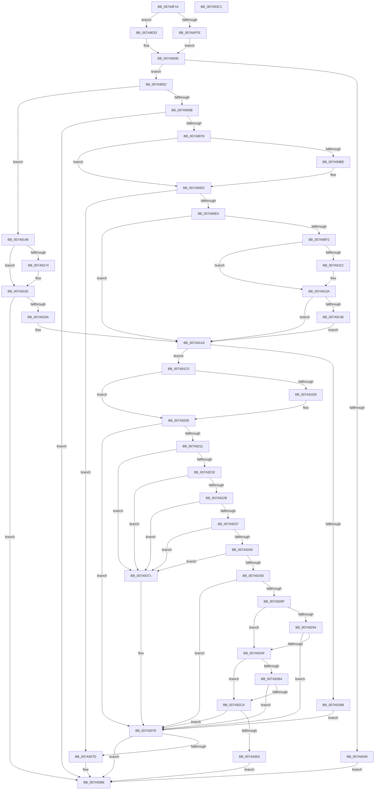

# SmKmStoreFileCreate

- RVA: `0x007A8F14`–`0x007A93C2` (길이 `1,198` bytes)
- VA: `0x00000001407A8F14`
- 실행 섹션: `PAGE`
- PDB 이름 있음: `예`; PDB Function 태그: `아니요`
- unwind 정보 RVA: `0x000D1F10`
- 디코드: `302`개 명령, `1,198/1,198` bytes 표시
- 미해석 바이트: `0` (있으면 어셈블리에 `.byte`로 보존)

> 이 문서는 커널 이미지의 기계어와 PDB 기호를 분석해 생성했습니다. 4번과 5번은 함수 원형과 자료형을 바이너리 사용 방식에서 추정한 C 해석이며 원본 소스 복구 결과는 아닙니다.

## 1. Dependencies

- 직접 호출 지점: **21**; 고유 호출 대상: **14**
- 직접 호출자로 확인된 함수: **1**
- RIP 상대 이미지 참조: **3**

### Outgoing calls
- `0x007A8FD6` → [memset](../../text/6C/memset_function_006C6C40.md) (function, `0x006C6C40`)
- `0x007A8FEF` → [IoSetThreadHardErrorMode](../../text/46/IoSetThreadHardErrorMode_function_00466BF0.md) (function, `0x00466BF0`)
- `0x007A9022` → [memset](../../text/6C/memset_function_006C6C40.md) (function, `0x006C6C40`)
- `0x007A9067` → [SmKmStoreFileCreateForIoType](SmKmStoreFileCreateForIoType_function_007A93C8.md) (function, `0x007A93C8`)
- `0x007A90A8` → [ZwSetInformationFile](../../text/6A/ZwSetInformationFile_function_006AD5B0.md) (function, `0x006AD5B0`)
- `0x007A90D3` → [KeWaitForSingleObject](../../text/20/KeWaitForSingleObject_function_0020E6B0.md) (function, `0x0020E6B0`)
- `0x007A9112` → [ZwSetInformationFile](../../text/6A/ZwSetInformationFile_function_006AD5B0.md) (function, `0x006AD5B0`)
- `0x007A9131` → [KeWaitForSingleObject](../../text/20/KeWaitForSingleObject_function_0020E6B0.md) (function, `0x0020E6B0`)
- `0x007A9162` → [ZwQueryInformationFile](../../text/6A/ZwQueryInformationFile_function_006AD2F0.md) (function, `0x006AD2F0`)
- `0x007A9189` → [KeWaitForSingleObject](../../text/20/KeWaitForSingleObject_function_0020E6B0.md) (function, `0x0020E6B0`)
- `0x007A91DF` → [ZwQueryVolumeInformationFile](../../text/6A/ZwQueryVolumeInformationFile_function_006AD9F0.md) (function, `0x006AD9F0`)
- `0x007A9200` → [KeWaitForSingleObject](../../text/20/KeWaitForSingleObject_function_0020E6B0.md) (function, `0x0020E6B0`)
- `0x007A9280` → [SmKmStoreFileGetExtents](SmKmStoreFileGetExtents_function_007A971C.md) (function, `0x007A971C`)
- `0x007A92A0` → [SmKmStoreFileOpenVolume](SmKmStoreFileOpenVolume_function_007A9C14.md) (function, `0x007A9C14`)
- `0x007A92BB` → [SmKmStoreFileWriteHeader](SmKmStoreFileWriteHeader_function_007A9DB4.md) (function, `0x007A9DB4`)
- `0x007A92F8` → [IoRegisterPlugPlayNotification](../95/IoRegisterPlugPlayNotification_function_009535A0.md) (function, `0x009535A0`)
- `0x007A9338` → [memset](../../text/6C/memset_function_006C6C40.md) (function, `0x006C6C40`)
- `0x007A9381` → [SmKmStoreFileDelete](SmKmStoreFileDelete_function_007A9680.md) (function, `0x007A9680`)
- `0x007A938A` → [SmKmFileInfoCleanup](../AC/SmKmFileInfoCleanup_function_00AC9A90.md) (function, `0x00AC9A90`)
- `0x007A9393` → [IoSetThreadHardErrorMode](../../text/46/IoSetThreadHardErrorMode_function_00466BF0.md) (function, `0x00466BF0`)
- `0x007A93A1` → [_security_check_cookie](../../text/6A/_security_check_cookie_function_006AC640.md) (function, `0x006AC640`)

### Direct callers
- [SmcCacheStart](SmcCacheStart_function_007ABC48.md) at `0x007ABD2C`

### Static image references
- `0x007A8F30` → RVA `0x00E0A740` (`.data`; read)
- `0x007A8F94` → RVA `0x00F8C440` (`.data`; read)
- `0x007A92E9` → RVA `0x007ACB10` (`SmcVolumePnpNotification`; read)

## 2. Other-region calls and transfers

- 다른 실행 섹션으로 향하는 call: **14**
  - `0x007A8FD6` → [memset](../../text/6C/memset_function_006C6C40.md) (`PAGE` → `.text`)
  - `0x007A8FEF` → [IoSetThreadHardErrorMode](../../text/46/IoSetThreadHardErrorMode_function_00466BF0.md) (`PAGE` → `.text`)
  - `0x007A9022` → [memset](../../text/6C/memset_function_006C6C40.md) (`PAGE` → `.text`)
  - `0x007A90A8` → [ZwSetInformationFile](../../text/6A/ZwSetInformationFile_function_006AD5B0.md) (`PAGE` → `.text`)
  - `0x007A90D3` → [KeWaitForSingleObject](../../text/20/KeWaitForSingleObject_function_0020E6B0.md) (`PAGE` → `.text`)
  - `0x007A9112` → [ZwSetInformationFile](../../text/6A/ZwSetInformationFile_function_006AD5B0.md) (`PAGE` → `.text`)
  - `0x007A9131` → [KeWaitForSingleObject](../../text/20/KeWaitForSingleObject_function_0020E6B0.md) (`PAGE` → `.text`)
  - `0x007A9162` → [ZwQueryInformationFile](../../text/6A/ZwQueryInformationFile_function_006AD2F0.md) (`PAGE` → `.text`)
  - `0x007A9189` → [KeWaitForSingleObject](../../text/20/KeWaitForSingleObject_function_0020E6B0.md) (`PAGE` → `.text`)
  - `0x007A91DF` → [ZwQueryVolumeInformationFile](../../text/6A/ZwQueryVolumeInformationFile_function_006AD9F0.md) (`PAGE` → `.text`)
  - `0x007A9200` → [KeWaitForSingleObject](../../text/20/KeWaitForSingleObject_function_0020E6B0.md) (`PAGE` → `.text`)
  - `0x007A9338` → [memset](../../text/6C/memset_function_006C6C40.md) (`PAGE` → `.text`)
  - `0x007A9393` → [IoSetThreadHardErrorMode](../../text/46/IoSetThreadHardErrorMode_function_00466BF0.md) (`PAGE` → `.text`)
  - `0x007A93A1` → [_security_check_cookie](../../text/6A/_security_check_cookie_function_006AC640.md) (`PAGE` → `.text`)
- 별도 외부 분기/꼬리 이동을 확인하지 못했습니다.

## 3. Assembly (complete function range)

```asm
007A8F14  48 89 5C 24 08                  mov qword ptr [rsp + 8], rbx
007A8F19  55                              push rbp
007A8F1A  56                              push rsi
007A8F1B  57                              push rdi
007A8F1C  41 54                           push r12
007A8F1E  41 55                           push r13
007A8F20  41 56                           push r14
007A8F22  41 57                           push r15
007A8F24  48 8D 6C 24 B0                  lea rbp, [rsp - 0x50]
007A8F29  48 81 EC 50 01 00 00            sub rsp, 0x150
007A8F30  48 8B 05 09 18 66 00            mov rax, qword ptr [rip + 0x661809]
007A8F37  48 33 C4                        xor rax, rsp
007A8F3A  48 89 45 48                     mov qword ptr [rbp + 0x48], rax
007A8F3E  48 8B 85 D0 00 00 00            mov rax, qword ptr [rbp + 0xd0]
007A8F45  48 8D 4D A0                     lea rcx, [rbp - 0x60]
007A8F49  48 8B B5 B0 00 00 00            mov rsi, qword ptr [rbp + 0xb0]
007A8F50  45 33 ED                        xor r13d, r13d
007A8F53  4C 8B B5 C8 00 00 00            mov r14, qword ptr [rbp + 0xc8]
007A8F5A  41 8B D8                        mov ebx, r8d
007A8F5D  48 89 45 E8                     mov qword ptr [rbp - 0x18], rax
007A8F61  0F 57 C0                        xorps xmm0, xmm0
007A8F64  48 8B 85 D8 00 00 00            mov rax, qword ptr [rbp + 0xd8]
007A8F6B  48 8B FA                        mov rdi, rdx
007A8F6E  48 89 45 F0                     mov qword ptr [rbp - 0x10], rax
007A8F72  45 8D 45 40                     lea r8d, [r13 + 0x40]
007A8F76  48 8B 85 E0 00 00 00            mov rax, qword ptr [rbp + 0xe0]
007A8F7D  0F 57 C9                        xorps xmm1, xmm1
007A8F80  48 89 45 F8                     mov qword ptr [rbp - 8], rax
007A8F84  33 D2                           xor edx, edx
007A8F86  48 8B 85 E8 00 00 00            mov rax, qword ptr [rbp + 0xe8]
007A8F8D  45 8B E1                        mov r12d, r9d
007A8F90  48 89 45 10                     mov qword ptr [rbp + 0x10], rax
007A8F94  48 8B 05 A5 34 7E 00            mov rax, qword ptr [rip + 0x7e34a5]
007A8F9B  48 89 45 E0                     mov qword ptr [rbp - 0x20], rax
007A8F9F  33 C0                           xor eax, eax
007A8FA1  48 89 45 40                     mov qword ptr [rbp + 0x40], rax
007A8FA5  48 89 45 28                     mov qword ptr [rbp + 0x28], rax
007A8FA9  44 89 4D 84                     mov dword ptr [rbp - 0x7c], r9d
007A8FAD  89 5D 80                        mov dword ptr [rbp - 0x80], ebx
007A8FB0  48 89 75 00                     mov qword ptr [rbp], rsi
007A8FB4  4C 89 75 08                     mov qword ptr [rbp + 8], r14
007A8FB8  0F 11 44 24 70                  movups xmmword ptr [rsp + 0x70], xmm0
007A8FBD  4C 89 6D 88                     mov qword ptr [rbp - 0x78], r13
007A8FC1  0F 11 45 30                     movups xmmword ptr [rbp + 0x30], xmm0
007A8FC5  4C 89 6D 90                     mov qword ptr [rbp - 0x70], r13
007A8FC9  0F 11 4D 18                     movups xmmword ptr [rbp + 0x18], xmm1
007A8FCD  44 89 6C 24 64                  mov dword ptr [rsp + 0x64], r13d
007A8FD2  4C 89 6D 98                     mov qword ptr [rbp - 0x68], r13
007A8FD6  E8 65 DC F1 FF                  call 0x1406c6c40
007A8FDB  45 8B 3E                        mov r15d, dword ptr [r14]
007A8FDE  33 C9                           xor ecx, ecx
007A8FE0  44 89 6C 24 6C                  mov dword ptr [rsp + 0x6c], r13d
007A8FE5  44 89 7C 24 60                  mov dword ptr [rsp + 0x60], r15d
007A8FEA  44 89 6C 24 68                  mov dword ptr [rsp + 0x68], r13d
007A8FEF  E8 FC DB CB FF                  call 0x140466bf0
007A8FF4  88 44 24 50                     mov byte ptr [rsp + 0x50], al
007A8FF8  40 F6 C7 01                     test dil, 1
007A8FFC  74 35                           je 0x1407a9033
007A8FFE  48 83 E7 FE                     and rdi, 0xfffffffffffffffe
007A9002  45 8D 45 40                     lea r8d, [r13 + 0x40]
007A9006  33 D2                           xor edx, edx
007A9008  48 8B 4F 28                     mov rcx, qword ptr [rdi + 0x28]
007A900C  4C 8B 37                        mov r14, qword ptr [rdi]
007A900F  48 8B 77 08                     mov rsi, qword ptr [rdi + 8]
007A9013  48 89 4D C8                     mov qword ptr [rbp - 0x38], rcx
007A9017  48 8B CF                        mov rcx, rdi
007A901A  4C 89 75 A0                     mov qword ptr [rbp - 0x60], r14
007A901E  48 89 75 A8                     mov qword ptr [rbp - 0x58], rsi
007A9022  E8 19 DC F1 FF                  call 0x1406c6c40
007A9027  41 8B FD                        mov edi, r13d
007A902A  48 83 C8 FF                     or rax, 0xffffffffffffffff
007A902E  4C 8B EE                        mov r13, rsi
007A9031  EB 0B                           jmp 0x1407a903e
007A9033  48 8B 06                        mov rax, qword ptr [rsi]
007A9036  48 8B 75 A8                     mov rsi, qword ptr [rbp - 0x58]
007A903A  4C 8B 75 A0                     mov r14, qword ptr [rbp - 0x60]
007A903E  48 89 44 24 58                  mov qword ptr [rsp + 0x58], rax
007A9043  44 3B E3                        cmp r12d, ebx
007A9046  76 0A                           jbe 0x1407a9052
007A9048  BB 0D 00 00 C0                  mov ebx, 0xc000000d
007A904D  E9 34 03 00 00                  jmp 0x1407a9386
007A9052  48 85 FF                        test rdi, rdi
007A9055  0F 84 ED 00 00 00               je 0x1407a9148
007A905B  4C 8D 44 24 60                  lea r8, [rsp + 0x60]
007A9060  48 8B D7                        mov rdx, rdi
007A9063  48 8D 4D A0                     lea rcx, [rbp - 0x60]
007A9067  E8 5C 03 00 00                  call 0x1407a93c8
007A906C  8B D8                           mov ebx, eax
007A906E  85 C0                           test eax, eax
007A9070  0F 88 10 03 00 00               js 0x1407a9386
007A9076  48 8B 44 24 58                  mov rax, qword ptr [rsp + 0x58]
007A907B  4C 8D 45 88                     lea r8, [rbp - 0x78]
007A907F  4C 8B 75 A0                     mov r14, qword ptr [rbp - 0x60]
007A9083  48 8D 54 24 70                  lea rdx, [rsp + 0x70]
007A9088  41 BD 08 00 00 00               mov r13d, 8
007A908E  C7 44 24 6C 01 00 00 00         mov dword ptr [rsp + 0x6c], 1
007A9096  45 8B CD                        mov r9d, r13d
007A9099  48 89 45 88                     mov qword ptr [rbp - 0x78], rax
007A909D  49 8B CE                        mov rcx, r14
007A90A0  C7 44 24 20 14 00 00 00         mov dword ptr [rsp + 0x20], 0x14
007A90A8  E8 03 45 F0 FF                  call 0x1406ad5b0
007A90AD  48 8B 75 A8                     mov rsi, qword ptr [rbp - 0x58]
007A90B1  41 BC 03 01 00 00               mov r12d, 0x103
007A90B7  8B D8                           mov ebx, eax
007A90B9  41 3B C4                        cmp eax, r12d
007A90BC  75 1E                           jne 0x1407a90dc
007A90BE  48 83 64 24 20 00               and qword ptr [rsp + 0x20], 0
007A90C4  48 8D 8E 98 00 00 00            lea rcx, [rsi + 0x98]
007A90CB  45 33 C9                        xor r9d, r9d
007A90CE  45 33 C0                        xor r8d, r8d
007A90D1  33 D2                           xor edx, edx
007A90D3  E8 D8 55 A6 FF                  call 0x14020e6b0
007A90D8  8B 5C 24 70                     mov ebx, dword ptr [rsp + 0x70]
007A90DC  85 DB                           test ebx, ebx
007A90DE  0F 88 99 02 00 00               js 0x1407a937d
007A90E4  44 8B 7C 24 60                  mov r15d, dword ptr [rsp + 0x60]
007A90E9  45 85 FF                        test r15d, r15d
007A90EC  0F 84 B1 00 00 00               je 0x1407a91a3
007A90F2  48 8B 44 24 58                  mov rax, qword ptr [rsp + 0x58]
007A90F7  4C 8D 45 90                     lea r8, [rbp - 0x70]
007A90FB  45 8B CD                        mov r9d, r13d
007A90FE  48 89 45 90                     mov qword ptr [rbp - 0x70], rax
007A9102  48 8D 54 24 70                  lea rdx, [rsp + 0x70]
007A9107  C7 44 24 20 27 00 00 00         mov dword ptr [rsp + 0x20], 0x27
007A910F  49 8B CE                        mov rcx, r14
007A9112  E8 99 44 F0 FF                  call 0x1406ad5b0
007A9117  41 3B C4                        cmp eax, r12d
007A911A  75 1E                           jne 0x1407a913a
007A911C  48 83 64 24 20 00               and qword ptr [rsp + 0x20], 0
007A9122  48 8D 8E 98 00 00 00            lea rcx, [rsi + 0x98]
007A9129  45 33 C9                        xor r9d, r9d
007A912C  45 33 C0                        xor r8d, r8d
007A912F  33 D2                           xor edx, edx
007A9131  E8 7A 55 A6 FF                  call 0x14020e6b0
007A9136  8B 44 24 70                     mov eax, dword ptr [rsp + 0x70]
007A913A  85 C0                           test eax, eax
007A913C  79 65                           jns 0x1407a91a3
007A913E  C7 44 24 68 01 00 00 00         mov dword ptr [rsp + 0x68], 1
007A9146  EB 5B                           jmp 0x1407a91a3
007A9148  41 B9 18 00 00 00               mov r9d, 0x18
007A914E  C7 44 24 20 05 00 00 00         mov dword ptr [rsp + 0x20], 5
007A9156  4C 8D 45 30                     lea r8, [rbp + 0x30]
007A915A  49 8B CE                        mov rcx, r14
007A915D  48 8D 54 24 70                  lea rdx, [rsp + 0x70]
007A9162  E8 89 41 F0 FF                  call 0x1406ad2f0
007A9167  41 BC 03 01 00 00               mov r12d, 0x103
007A916D  8B D8                           mov ebx, eax
007A916F  41 3B C4                        cmp eax, r12d
007A9172  75 1E                           jne 0x1407a9192
007A9174  48 83 64 24 20 00               and qword ptr [rsp + 0x20], 0
007A917A  49 8D 8D 98 00 00 00            lea rcx, [r13 + 0x98]
007A9181  45 33 C9                        xor r9d, r9d
007A9184  45 33 C0                        xor r8d, r8d
007A9187  33 D2                           xor edx, edx
007A9189  E8 22 55 A6 FF                  call 0x14020e6b0
007A918E  8B 5C 24 70                     mov ebx, dword ptr [rsp + 0x70]
007A9192  85 DB                           test ebx, ebx
007A9194  0F 88 EC 01 00 00               js 0x1407a9386
007A919A  48 8B 45 38                     mov rax, qword ptr [rbp + 0x38]
007A919E  48 89 44 24 58                  mov qword ptr [rsp + 0x58], rax
007A91A3  48 8B 44 24 58                  mov rax, qword ptr [rsp + 0x58]
007A91A8  B9 FF FF FF FF                  mov ecx, 0xffffffff
007A91AD  44 8B 6D 80                     mov r13d, dword ptr [rbp - 0x80]
007A91B1  48 99                           cqo
007A91B3  49 F7 FD                        idiv r13
007A91B6  48 3B C1                        cmp rax, rcx
007A91B9  7C 0A                           jl 0x1407a91c5
007A91BB  BB 0D 00 00 C0                  mov ebx, 0xc000000d
007A91C0  E9 B1 01 00 00                  jmp 0x1407a9376
007A91C5  41 B9 18 00 00 00               mov r9d, 0x18
007A91CB  C7 44 24 20 03 00 00 00         mov dword ptr [rsp + 0x20], 3
007A91D3  4C 8D 45 18                     lea r8, [rbp + 0x18]
007A91D7  49 8B CE                        mov rcx, r14
007A91DA  48 8D 54 24 70                  lea rdx, [rsp + 0x70]
007A91DF  E8 0C 48 F0 FF                  call 0x1406ad9f0
007A91E4  8B D8                           mov ebx, eax
007A91E6  41 3B C4                        cmp eax, r12d
007A91E9  75 1E                           jne 0x1407a9209
007A91EB  48 83 64 24 20 00               and qword ptr [rsp + 0x20], 0
007A91F1  48 8D 8E 98 00 00 00            lea rcx, [rsi + 0x98]
007A91F8  45 33 C9                        xor r9d, r9d
007A91FB  45 33 C0                        xor r8d, r8d
007A91FE  33 D2                           xor edx, edx
007A9200  E8 AB 54 A6 FF                  call 0x14020e6b0
007A9205  8B 5C 24 70                     mov ebx, dword ptr [rsp + 0x70]
007A9209  85 DB                           test ebx, ebx
007A920B  0F 88 65 01 00 00               js 0x1407a9376
007A9211  44 8B 45 2C                     mov r8d, dword ptr [rbp + 0x2c]
007A9215  45 85 C0                        test r8d, r8d
007A9218  0F 84 53 01 00 00               je 0x1407a9371
007A921E  41 8D 40 FF                     lea eax, [r8 - 1]
007A9222  41 85 C0                        test r8d, eax
007A9225  0F 85 46 01 00 00               jne 0x1407a9371
007A922B  8B 45 84                        mov eax, dword ptr [rbp - 0x7c]
007A922E  44 3B C0                        cmp r8d, eax
007A9231  0F 87 3A 01 00 00               ja 0x1407a9371
007A9237  45 3B C5                        cmp r8d, r13d
007A923A  0F 87 31 01 00 00               ja 0x1407a9371
007A9240  41 81 F8 00 10 00 00            cmp r8d, 0x1000
007A9247  0F 87 24 01 00 00               ja 0x1407a9371
007A924D  48 8D 4D D8                     lea rcx, [rbp - 0x28]
007A9251  45 8B CD                        mov r9d, r13d
007A9254  48 89 4C 24 48                  mov qword ptr [rsp + 0x48], rcx
007A9259  4C 8D 44 24 58                  lea r8, [rsp + 0x58]
007A925E  48 8D 4D D0                     lea rcx, [rbp - 0x30]
007A9262  48 8B D6                        mov rdx, rsi
007A9265  48 89 4C 24 40                  mov qword ptr [rsp + 0x40], rcx
007A926A  48 8D 4C 24 64                  lea rcx, [rsp + 0x64]
007A926F  48 89 4C 24 38                  mov qword ptr [rsp + 0x38], rcx
007A9274  49 8B CE                        mov rcx, r14
007A9277  44 89 7C 24 30                  mov dword ptr [rsp + 0x30], r15d
007A927C  89 44 24 20                     mov dword ptr [rsp + 0x20], eax
007A9280  E8 97 04 00 00                  call 0x1407a971c
007A9285  8B D8                           mov ebx, eax
007A9287  85 C0                           test eax, eax
007A9289  0F 88 E7 00 00 00               js 0x1407a9376
007A928F  45 85 FF                        test r15d, r15d
007A9292  75 1B                           jne 0x1407a92af
007A9294  48 8B 4D A8                     mov rcx, qword ptr [rbp - 0x58]
007A9298  4C 8D 45 B8                     lea r8, [rbp - 0x48]
007A929C  48 8D 55 B0                     lea rdx, [rbp - 0x50]
007A92A0  E8 6F 09 00 00                  call 0x1407a9c14
007A92A5  8B D8                           mov ebx, eax
007A92A7  85 C0                           test eax, eax
007A92A9  0F 88 C7 00 00 00               js 0x1407a9376
007A92AF  48 85 FF                        test rdi, rdi
007A92B2  74 16                           je 0x1407a92ca
007A92B4  41 8B D7                        mov edx, r15d
007A92B7  48 8D 4D A0                     lea rcx, [rbp - 0x60]
007A92BB  E8 F4 0A 00 00                  call 0x1407a9db4
007A92C0  8B D8                           mov ebx, eax
007A92C2  85 C0                           test eax, eax
007A92C4  0F 88 AC 00 00 00               js 0x1407a9376
007A92CA  4C 8B 4D E0                     mov r9, qword ptr [rbp - 0x20]
007A92CE  48 8D 45 98                     lea rax, [rbp - 0x68]
007A92D2  4C 8B 45 A8                     mov r8, qword ptr [rbp - 0x58]
007A92D6  33 D2                           xor edx, edx
007A92D8  48 89 44 24 30                  mov qword ptr [rsp + 0x30], rax
007A92DD  48 8B 85 C0 00 00 00            mov rax, qword ptr [rbp + 0xc0]
007A92E4  48 89 44 24 28                  mov qword ptr [rsp + 0x28], rax
007A92E9  48 8D 05 20 38 00 00            lea rax, [rip + 0x3820]
007A92F0  8D 4A 03                        lea ecx, [rdx + 3]
007A92F3  48 89 44 24 20                  mov qword ptr [rsp + 0x20], rax
007A92F8  E8 A3 A2 1A 00                  call 0x1409535a0
007A92FD  8B D8                           mov ebx, eax
007A92FF  85 C0                           test eax, eax
007A9301  78 73                           js 0x1407a9376
007A9303  0F 28 45 A0                     movaps xmm0, xmmword ptr [rbp - 0x60]
007A9307  48 8D 4D A0                     lea rcx, [rbp - 0x60]
007A930B  0F 28 4D B0                     movaps xmm1, xmmword ptr [rbp - 0x50]
007A930F  33 D2                           xor edx, edx
007A9311  48 8B 45 98                     mov rax, qword ptr [rbp - 0x68]
007A9315  48 89 45 C0                     mov qword ptr [rbp - 0x40], rax
007A9319  48 8B 45 E8                     mov rax, qword ptr [rbp - 0x18]
007A931D  44 8D 42 40                     lea r8d, [rdx + 0x40]
007A9321  0F 11 00                        movups xmmword ptr [rax], xmm0
007A9324  0F 28 45 C0                     movaps xmm0, xmmword ptr [rbp - 0x40]
007A9328  0F 11 48 10                     movups xmmword ptr [rax + 0x10], xmm1
007A932C  0F 28 4D D0                     movaps xmm1, xmmword ptr [rbp - 0x30]
007A9330  0F 11 40 20                     movups xmmword ptr [rax + 0x20], xmm0
007A9334  0F 11 48 30                     movups xmmword ptr [rax + 0x30], xmm1
007A9338  E8 03 D9 F1 FF                  call 0x1406c6c40
007A933D  8B 45 2C                        mov eax, dword ptr [rbp + 0x2c]
007A9340  33 DB                           xor ebx, ebx
007A9342  48 8B 4D F0                     mov rcx, qword ptr [rbp - 0x10]
007A9346  89 01                           mov dword ptr [rcx], eax
007A9348  48 8B 4D F8                     mov rcx, qword ptr [rbp - 8]
007A934C  8B 44 24 64                     mov eax, dword ptr [rsp + 0x64]
007A9350  89 01                           mov dword ptr [rcx], eax
007A9352  48 8B 4D 00                     mov rcx, qword ptr [rbp]
007A9356  48 8B 44 24 58                  mov rax, qword ptr [rsp + 0x58]
007A935B  48 89 01                        mov qword ptr [rcx], rax
007A935E  48 8B 45 08                     mov rax, qword ptr [rbp + 8]
007A9362  48 8B 4D 10                     mov rcx, qword ptr [rbp + 0x10]
007A9366  44 89 38                        mov dword ptr [rax], r15d
007A9369  8B 44 24 68                     mov eax, dword ptr [rsp + 0x68]
007A936D  89 01                           mov dword ptr [rcx], eax
007A936F  EB 15                           jmp 0x1407a9386
007A9371  BB 15 00 38 C0                  mov ebx, 0xc0380015
007A9376  83 7C 24 6C 00                  cmp dword ptr [rsp + 0x6c], 0
007A937B  74 09                           je 0x1407a9386
007A937D  48 8D 4D A0                     lea rcx, [rbp - 0x60]
007A9381  E8 FA 02 00 00                  call 0x1407a9680
007A9386  48 8D 4D A0                     lea rcx, [rbp - 0x60]
007A938A  E8 01 07 32 00                  call 0x140ac9a90
007A938F  8A 4C 24 50                     mov cl, byte ptr [rsp + 0x50]
007A9393  E8 58 D8 CB FF                  call 0x140466bf0
007A9398  8B C3                           mov eax, ebx
007A939A  48 8B 4D 48                     mov rcx, qword ptr [rbp + 0x48]
007A939E  48 33 CC                        xor rcx, rsp
007A93A1  E8 9A 32 F0 FF                  call 0x1406ac640
007A93A6  48 8B 9C 24 90 01 00 00         mov rbx, qword ptr [rsp + 0x190]
007A93AE  48 81 C4 50 01 00 00            add rsp, 0x150
007A93B5  41 5F                           pop r15
007A93B7  41 5E                           pop r14
007A93B9  41 5D                           pop r13
007A93BB  41 5C                           pop r12
007A93BD  5F                              pop rdi
007A93BE  5E                              pop rsi
007A93BF  5D                              pop rbp
007A93C0  C3                              ret
007A93C1  CC                              int3
```

## 4. C-style interpretation (structured pseudocode)

```c
__int64 __fastcall SmKmStoreFileCreate(__int64 a1, __int64 a2, int a3, int a4, __int64 a5, __int64 a6, __int64 a7, __int64 a8, __int64 a9, __int64 a10, __int64 a11, __int64 a12)
{
    __int64 result;
    __int64 v_r13;
    __int64 v_rbx;
    __int64 v_rdi;
    __int64 v_rsp;
    unsigned __int64 v_stack_m100;
    unsigned int v_stack_m104;
    unsigned int v_stack_m108;
    unsigned __int64 v_stack_m118;
    unsigned int v_stack_m11C;
    unsigned int v_stack_m120;
    unsigned int v_stack_m124;
    unsigned int v_stack_m128;
    unsigned __int64 v_stack_m130;
    unsigned __int8 v_stack_m138;
    unsigned __int64 v_stack_m140;
    unsigned __int64 v_stack_m148;
    unsigned __int64 v_stack_m150;
    unsigned int v_stack_m158;
    unsigned __int64 v_stack_m160;
    unsigned int v_stack_m168;
    unsigned __int64 v_stack_m40;
    unsigned __int64 v_stack_m48;
    unsigned __int64 v_stack_m50;
    unsigned __int64 v_stack_m58;
    unsigned int v_stack_m5C;
    unsigned __int64 v_stack_m60;
    unsigned __int64 v_stack_m70;
    unsigned __int64 v_stack_m78;
    unsigned __int64 v_stack_m80;
    unsigned __int64 v_stack_m88;
    unsigned __int64 v_stack_m90;
    unsigned __int64 v_stack_m98;
    unsigned __int64 v_stack_mA0;
    unsigned __int64 v_stack_mA8;
    unsigned __int64 v_stack_mB0;
    unsigned __int64 v_stack_mB8;
    unsigned __int64 v_stack_mC0;
    unsigned __int64 v_stack_mC8;
    unsigned __int64 v_stack_mD0;
    unsigned __int64 v_stack_mD8;
    unsigned __int64 v_stack_mE0;
    unsigned __int64 v_stack_mE8;
    unsigned __int64 v_stack_mF0;
    unsigned __int64 v_stack_mF8;
    unsigned __int64 v_stack_p8;

    v_stack_p8 = v_rbx;
    v_rsp = (v_rsp) - (336);
    result = (*(unsigned __int64 *)(v_rip + 6690825)) ^ (v_rsp);
    v_stack_m40 = result;
    v_r13 = 0;
    v_stack_mA0 = a9;
    v_stack_m98 = a10;
    v_stack_m90 = a11;
    a2 = 0;
    v_stack_m78 = a12;
    v_stack_mA8 = *(unsigned __int64 *)(v_rip + 8271013);
    result = 0;
    v_stack_m48 = 0;
    v_stack_m60 = 0;
    v_stack_m104 = a4;
    v_stack_m108 = (unsigned int)((unsigned int)(a3));
    v_stack_m88 = a5;
    v_stack_m80 = a8;
    v_stack_m118 = v_xmm0;
    v_stack_m100 = 0;
    v_stack_m58 = v_xmm0;
    v_stack_mF8 = 0;
    v_stack_m70 = v_xmm1;
    v_stack_m124 = 0;
    v_stack_mF0 = 0;
    result = memset(v_stack_mE8, a2, v_r13 + 64, a4);
    a1 = 0;
    v_stack_m11C = 0;
    v_stack_m128 = (unsigned int)((unsigned int)(*(unsigned int *)(a8)));
    v_stack_m120 = 0;
    result = IoSetThreadHardErrorMode(a1, a2, v_r13 + 64, a4);
    v_stack_m138 = (unsigned __int8)(result);
    if (((0) & (1)) == 0) goto loc_007A9033;
    v_rdi = (a2) & (-2);
    a2 = 0;
    v_stack_mC0 = *(unsigned __int64 *)(v_rdi + 40);
    v_stack_mE8 = *(unsigned __int64 *)(v_rdi);
    v_stack_mE0 = *(unsigned __int64 *)(v_rdi + 8);
    result = memset(v_rdi, a2, v_r13 + 64, a4);
    result = (result) | (-1);
    goto loc_007A903E;
loc_007A9033:
loc_007A903E:
    v_stack_m130 = *(unsigned __int64 *)(*(unsigned __int64 *)(v_rdi + 8));
    if (((unsigned int)((unsigned int)(a4))) <= ((unsigned int)((unsigned int)(a3)))) goto loc_007A9052;
    goto loc_007A9386;
loc_007A9052:
    if (0 == 0) goto loc_007A9148;
    result = SmKmStoreFileCreateForIoType(v_stack_mE8, 0, v_stack_m128, a4);
    if (sign_flag) goto loc_007A9386;
    v_stack_m11C = 1;
    v_stack_m100 = v_stack_m130;
    v_stack_m168 = 20;
    result = ZwSetInformationFile(v_stack_mE8, v_stack_m118, v_stack_m100, 8);
    v_rbx = (unsigned int)((unsigned int)(result));
    if (((unsigned int)(result)) == 259) {
        a1 = v_stack_mE0 + 152;
        a4 = 0;
        a3 = 0;
        a2 = 0;
        result = KeWaitForSingleObject(a1, a2, a3, a4);
        v_rbx = v_stack_m118;
    }
    if (sign_flag) goto loc_007A937D;
    if ((unsigned int)((unsigned int)(v_stack_m128)) == 0) goto loc_007A91A3;
    v_stack_mF8 = v_stack_m130;
    v_stack_m168 = 39;
    result = ZwSetInformationFile(v_stack_mE8, v_stack_m118, v_stack_mF8, 8);
    if (((unsigned int)(result)) == 259) {
        a1 = v_stack_mE0 + 152;
        a4 = 0;
        a3 = 0;
        a2 = 0;
        result = KeWaitForSingleObject(a1, a2, a3, a4);
        result = v_stack_m118;
    }
    if (!sign_flag) goto loc_007A91A3;
    v_stack_m120 = 1;
    goto loc_007A91A3;
loc_007A9148:
    v_stack_m168 = 5;
    result = ZwQueryInformationFile(v_stack_mE8, v_stack_m118, v_stack_m58, 24);
    v_rbx = (unsigned int)((unsigned int)(result));
    if (((unsigned int)(result)) == 259) {
        a1 = 8 + 152;
        a4 = 0;
        a3 = 0;
        a2 = 0;
        result = KeWaitForSingleObject(a1, a2, a3, a4);
        v_rbx = v_stack_m118;
    }
    if (sign_flag) goto loc_007A9386;
    v_stack_m130 = v_stack_m50;
loc_007A91A3:
    if (v_stack_m130 < ((unsigned int)(0xFFFFFFFFULL))) goto loc_007A91C5;
    goto loc_007A9376;
loc_007A91C5:
    v_stack_m168 = 3;
    result = ZwQueryVolumeInformationFile(v_stack_mE8, v_stack_m118, v_stack_m70, 24);
    v_rbx = (unsigned int)((unsigned int)(result));
    if (((unsigned int)(result)) == 259) {
        a1 = v_stack_mE0 + 152;
        a4 = 0;
        a3 = 0;
        a2 = 0;
        result = KeWaitForSingleObject(a1, a2, a3, a4);
        v_rbx = v_stack_m118;
    }
    if (sign_flag) goto loc_007A9376;
    if ((unsigned int)((unsigned int)(v_stack_m5C)) == 0) goto loc_007A9371;
    if ((((unsigned int)((unsigned int)(v_stack_m5C))) & ((unsigned int)((unsigned int)(v_stack_m5C) - 1))) != 0) goto loc_007A9371;
    if (((unsigned int)((unsigned int)(v_stack_m5C))) > ((unsigned int)((unsigned int)(v_stack_m104)))) goto loc_007A9371;
    if (((unsigned int)((unsigned int)(v_stack_m5C))) > ((unsigned int)((unsigned int)(v_stack_m108)))) goto loc_007A9371;
    if (((unsigned int)((unsigned int)(v_stack_m5C))) > 0x1000ULL) goto loc_007A9371;
    v_stack_m140 = v_stack_mB0;
    v_stack_m148 = v_stack_mB8;
    v_stack_m150 = v_stack_m124;
    v_stack_m158 = (unsigned int)((unsigned int)(v_stack_m128));
    v_stack_m168 = (unsigned int)((unsigned int)(v_stack_m104));
    result = SmKmStoreFileGetExtents(v_stack_mE8, v_stack_mE0, v_stack_m130, (unsigned int)((unsigned int)((unsigned int)(v_stack_m108))));
    if (sign_flag) goto loc_007A9376;
    if ((unsigned int)((unsigned int)(v_stack_m128)) != 0) goto loc_007A92AF;
    result = SmKmStoreFileOpenVolume(v_stack_mE0, v_stack_mD8, v_stack_mD0, (unsigned int)((unsigned int)((unsigned int)(v_stack_m108))));
    if (sign_flag) goto loc_007A9376;
loc_007A92AF:
    if (0 == 0) goto loc_007A92CA;
    result = SmKmStoreFileWriteHeader(v_stack_mE8, (unsigned int)((unsigned int)((unsigned int)(v_stack_m128))), v_stack_mD0, (unsigned int)((unsigned int)((unsigned int)(v_stack_m108))));
    if (sign_flag) goto loc_007A9376;
loc_007A92CA:
    a2 = 0;
    v_stack_m158 = v_stack_mF0;
    v_stack_m160 = a7;
    v_stack_m168 = v_rip + 14368;
    result = IoRegisterPlugPlayNotification(a2 + 3, a2, v_stack_mE0, v_stack_mA8);
    if (sign_flag) goto loc_007A9376;
    a2 = 0;
    v_stack_mC8 = v_stack_mF0;
    *(unsigned __int64 *)(v_stack_mA0) = v_xmm0;
    *(unsigned __int64 *)(v_stack_mA0 + 16) = v_xmm1;
    *(unsigned __int64 *)(v_stack_mA0 + 32) = v_xmm0;
    *(unsigned __int64 *)(v_stack_mA0 + 48) = v_xmm1;
    result = memset(v_stack_mE8, a2, a2 + 64, v_stack_mA8);
    v_rbx = 0;
    *(unsigned int *)(v_stack_m98) = (unsigned int)((unsigned int)(v_stack_m5C));
    *(unsigned int *)(v_stack_m90) = (unsigned int)((unsigned int)(v_stack_m124));
    *(unsigned __int64 *)(v_stack_m88) = v_stack_m130;
    *(unsigned int *)(v_stack_m80) = (unsigned int)((unsigned int)(v_stack_m128));
    *(unsigned int *)(v_stack_m78) = (unsigned int)((unsigned int)(v_stack_m120));
    goto loc_007A9386;
loc_007A9371:
loc_007A9376:
    result = (unsigned int)(v_stack_m120);
    if (v_stack_m11C != 0) {
        a1 = v_stack_mE8;
        result = SmKmStoreFileDelete(a1, a2, a2 + 64, v_stack_mA8);
    }
    result = SmKmFileInfoCleanup(v_stack_mE8, a2, a2 + 64, v_stack_mA8);
    result = IoSetThreadHardErrorMode(v_stack_m138, a2, a2 + 64, v_stack_mA8);
    a1 = (v_stack_m40) ^ (v_rsp);
    result = _security_check_cookie(a1, a2, a2 + 64, v_stack_mA8);
    v_rsp = (v_rsp) + (336);
    return result;
}
```

## 5. (Beta) C Style

```c
int64_t SmKmStoreFileCreate(int64_t Arg1, int64_t Arg2, int32_t Arg3, int32_t Arg4, void *Arg5, uint64_t Arg6, int64_t Arg7, void *Arg8, int64_t Arg9, int64_t Arg10, int64_t Arg11, int64_t Arg12)
{
    uint8_t *arg5 = (uint8_t *)Arg5;
    uint8_t *arg8 = (uint8_t *)Arg8;

    int64_t result;
    int64_t local_r13;
    int64_t local_rbx;
    int64_t local_rdi;
    int64_t local_rsp;
    uint64_t v_stack_m100;
    uint32_t v_stack_m104;
    uint32_t v_stack_m108;
    uint64_t v_stack_m118;
    uint32_t v_stack_m11C;
    uint32_t v_stack_m120;
    uint32_t v_stack_m124;
    uint32_t v_stack_m128;
    uint64_t v_stack_m130;
    uint8_t v_stack_m138;
    uint64_t v_stack_m140;
    uint64_t v_stack_m148;
    uint64_t v_stack_m150;
    uint32_t v_stack_m158;
    uint64_t v_stack_m160;
    uint32_t v_stack_m168;
    uint64_t v_stack_m40;
    uint64_t v_stack_m48;
    uint64_t v_stack_m50;
    uint64_t v_stack_m58;
    uint32_t v_stack_m5C;
    uint64_t v_stack_m60;
    uint64_t v_stack_m70;
    uint64_t v_stack_m78;
    uint64_t v_stack_m80;
    uint64_t v_stack_m88;
    uint64_t v_stack_m90;
    uint64_t v_stack_m98;
    uint64_t v_stack_mA0;
    uint64_t v_stack_mA8;
    uint64_t v_stack_mB0;
    uint64_t v_stack_mB8;
    uint64_t v_stack_mC0;
    uint64_t v_stack_mC8;
    uint64_t v_stack_mD0;
    uint64_t v_stack_mD8;
    uint64_t v_stack_mE0;
    uint64_t v_stack_mE8;
    uint64_t v_stack_mF0;
    uint64_t v_stack_mF8;
    uint64_t v_stack_p8;

    v_stack_p8 = local_rbx;
    local_rsp = (local_rsp) - (336);
    result = (*(uint64_t *)(v_rip + 0x661809)) ^ (local_rsp);
    v_stack_m40 = result;
    local_r13 = 0;
    v_stack_mA0 = Arg9;
    v_stack_m98 = Arg10;
    v_stack_m90 = Arg11;
    Arg2 = 0;
    v_stack_m78 = Arg12;
    v_stack_mA8 = *(uint64_t *)(v_rip + 0x7E34A5);
    result = 0;
    v_stack_m48 = 0;
    v_stack_m60 = 0;
    v_stack_m104 = Arg4;
    v_stack_m108 = (uint32_t)((uint32_t)(Arg3));
    v_stack_m88 = Arg5;
    v_stack_m80 = Arg8;
    v_stack_m118 = v_xmm0;
    v_stack_m100 = 0;
    v_stack_m58 = v_xmm0;
    v_stack_mF8 = 0;
    v_stack_m70 = v_xmm1;
    v_stack_m124 = 0;
    v_stack_mF0 = 0;
    result = memset(v_stack_mE8, Arg2, local_r13 + 64, Arg4);
    Arg1 = 0;
    v_stack_m11C = 0;
    v_stack_m128 = (uint32_t)((uint32_t)(*(uint32_t *)(arg8)));
    v_stack_m120 = 0;
    result = IoSetThreadHardErrorMode(Arg1, Arg2, local_r13 + 64, Arg4);
    v_stack_m138 = (uint8_t)(result);
    if (((0) & (1)) == 0) goto loc_007A9033;
    local_rdi = (Arg2) & (-2);
    Arg2 = 0;
    v_stack_mC0 = *(uint64_t *)(local_rdi + 0x28);
    v_stack_mE8 = *(uint64_t *)(local_rdi);
    v_stack_mE0 = *(uint64_t *)(local_rdi + 0x8);
    result = memset(local_rdi, Arg2, local_r13 + 64, Arg4);
    result = (result) | (-1);
    goto loc_007A903E;
loc_007A9033:
loc_007A903E:
    v_stack_m130 = *(uint64_t *)(*(uint64_t *)(local_rdi + 0x8));
    if (((uint32_t)((uint32_t)(Arg4))) <= ((uint32_t)((uint32_t)(Arg3)))) goto loc_007A9052;
    goto loc_007A9386;
loc_007A9052:
    if (0 == 0) goto loc_007A9148;
    result = SmKmStoreFileCreateForIoType(v_stack_mE8, 0, v_stack_m128, Arg4);
    if (sign_flag) goto loc_007A9386;
    v_stack_m11C = 1;
    v_stack_m100 = v_stack_m130;
    v_stack_m168 = 20;
    result = ZwSetInformationFile(v_stack_mE8, v_stack_m118, v_stack_m100, 8);
    local_rbx = (uint32_t)((uint32_t)(result));
    if (((uint32_t)(result)) == 259) {
        Arg1 = v_stack_mE0 + 152;
        Arg4 = 0;
        Arg3 = 0;
        Arg2 = 0;
        result = KeWaitForSingleObject(Arg1, Arg2, Arg3, Arg4);
        local_rbx = v_stack_m118;
    }
    if (sign_flag) goto loc_007A937D;
    if ((uint32_t)((uint32_t)(v_stack_m128)) == 0) goto loc_007A91A3;
    v_stack_mF8 = v_stack_m130;
    v_stack_m168 = 39;
    result = ZwSetInformationFile(v_stack_mE8, v_stack_m118, v_stack_mF8, 8);
    if (((uint32_t)(result)) == 259) {
        Arg1 = v_stack_mE0 + 152;
        Arg4 = 0;
        Arg3 = 0;
        Arg2 = 0;
        result = KeWaitForSingleObject(Arg1, Arg2, Arg3, Arg4);
        result = v_stack_m118;
    }
    if (!sign_flag) goto loc_007A91A3;
    v_stack_m120 = 1;
    goto loc_007A91A3;
loc_007A9148:
    v_stack_m168 = 5;
    result = ZwQueryInformationFile(v_stack_mE8, v_stack_m118, v_stack_m58, 24);
    local_rbx = (uint32_t)((uint32_t)(result));
    if (((uint32_t)(result)) == 259) {
        Arg1 = 8 + 152;
        Arg4 = 0;
        Arg3 = 0;
        Arg2 = 0;
        result = KeWaitForSingleObject(Arg1, Arg2, Arg3, Arg4);
        local_rbx = v_stack_m118;
    }
    if (sign_flag) goto loc_007A9386;
    v_stack_m130 = v_stack_m50;
loc_007A91A3:
    if (v_stack_m130 < ((uint32_t)(0xFFFFFFFFULL))) goto loc_007A91C5;
    goto loc_007A9376;
loc_007A91C5:
    v_stack_m168 = 3;
    result = ZwQueryVolumeInformationFile(v_stack_mE8, v_stack_m118, v_stack_m70, 24);
    local_rbx = (uint32_t)((uint32_t)(result));
    if (((uint32_t)(result)) == 259) {
        Arg1 = v_stack_mE0 + 152;
        Arg4 = 0;
        Arg3 = 0;
        Arg2 = 0;
        result = KeWaitForSingleObject(Arg1, Arg2, Arg3, Arg4);
        local_rbx = v_stack_m118;
    }
    if (sign_flag) goto loc_007A9376;
    if ((uint32_t)((uint32_t)(v_stack_m5C)) == 0) goto loc_007A9371;
    if ((((uint32_t)((uint32_t)(v_stack_m5C))) & ((uint32_t)((uint32_t)(v_stack_m5C) - 1))) != 0) goto loc_007A9371;
    if (((uint32_t)((uint32_t)(v_stack_m5C))) > ((uint32_t)((uint32_t)(v_stack_m104)))) goto loc_007A9371;
    if (((uint32_t)((uint32_t)(v_stack_m5C))) > ((uint32_t)((uint32_t)(v_stack_m108)))) goto loc_007A9371;
    if (((uint32_t)((uint32_t)(v_stack_m5C))) > 0x1000ULL) goto loc_007A9371;
    v_stack_m140 = v_stack_mB0;
    v_stack_m148 = v_stack_mB8;
    v_stack_m150 = v_stack_m124;
    v_stack_m158 = (uint32_t)((uint32_t)(v_stack_m128));
    v_stack_m168 = (uint32_t)((uint32_t)(v_stack_m104));
    result = SmKmStoreFileGetExtents(v_stack_mE8, v_stack_mE0, v_stack_m130, (uint32_t)((uint32_t)((uint32_t)(v_stack_m108))));
    if (sign_flag) goto loc_007A9376;
    if ((uint32_t)((uint32_t)(v_stack_m128)) != 0) goto loc_007A92AF;
    result = SmKmStoreFileOpenVolume(v_stack_mE0, v_stack_mD8, v_stack_mD0, (uint32_t)((uint32_t)((uint32_t)(v_stack_m108))));
    if (sign_flag) goto loc_007A9376;
loc_007A92AF:
    if (0 == 0) goto loc_007A92CA;
    result = SmKmStoreFileWriteHeader(v_stack_mE8, (uint32_t)((uint32_t)((uint32_t)(v_stack_m128))), v_stack_mD0, (uint32_t)((uint32_t)((uint32_t)(v_stack_m108))));
    if (sign_flag) goto loc_007A9376;
loc_007A92CA:
    Arg2 = 0;
    v_stack_m158 = v_stack_mF0;
    v_stack_m160 = Arg7;
    v_stack_m168 = v_rip + 14368;
    result = IoRegisterPlugPlayNotification(Arg2 + 3, Arg2, v_stack_mE0, v_stack_mA8);
    if (sign_flag) goto loc_007A9376;
    Arg2 = 0;
    v_stack_mC8 = v_stack_mF0;
    *(uint64_t *)(v_stack_mA0) = v_xmm0;
    *(uint64_t *)(v_stack_mA0 + 0x10) = v_xmm1;
    *(uint64_t *)(v_stack_mA0 + 0x20) = v_xmm0;
    *(uint64_t *)(v_stack_mA0 + 0x30) = v_xmm1;
    result = memset(v_stack_mE8, Arg2, Arg2 + 64, v_stack_mA8);
    local_rbx = 0;
    *(uint32_t *)(v_stack_m98) = (uint32_t)((uint32_t)(v_stack_m5C));
    *(uint32_t *)(v_stack_m90) = (uint32_t)((uint32_t)(v_stack_m124));
    *(uint64_t *)(v_stack_m88) = v_stack_m130;
    *(uint32_t *)(v_stack_m80) = (uint32_t)((uint32_t)(v_stack_m128));
    *(uint32_t *)(v_stack_m78) = (uint32_t)((uint32_t)(v_stack_m120));
    goto loc_007A9386;
loc_007A9371:
loc_007A9376:
    result = (uint32_t)(v_stack_m120);
    if (v_stack_m11C != 0) {
        Arg1 = v_stack_mE8;
        result = SmKmStoreFileDelete(Arg1, Arg2, Arg2 + 64, v_stack_mA8);
    }
    result = SmKmFileInfoCleanup(v_stack_mE8, Arg2, Arg2 + 64, v_stack_mA8);
    result = IoSetThreadHardErrorMode(v_stack_m138, Arg2, Arg2 + 64, v_stack_mA8);
    Arg1 = (v_stack_m40) ^ (local_rsp);
    result = _security_check_cookie(Arg1, Arg2, Arg2 + 64, v_stack_mA8);
    local_rsp = (local_rsp) + (336);
    return result;
}
```

### 관측된 메모리 오프셋

구조체 형식이 확인되지 않은 접근은 인자 기준의 오프셋으로만 기록했습니다.

| 기준 인자 | 오프셋 표현 | 폭 (bit) | 접근 |
|---|---:|---:|---|
| `Arg5` | `+ 0x0` | `64` | `R` |
| `Arg8` | `+ 0x0` | `32` | `R` |

## 6. Execution-region graph

[열기: 2D/3D 그래프와 함수 탐색 컨트롤 패널](../../../control-panel.html?section=page&rva=0x007A8F14&view=graph)

- 2D 그래프는 위에서 아래로 흐르고, 3D 그래프는 빈 공간을 드래그해 회전합니다. Shift+드래그는 이동, 휠은 확대·축소, 함수 노드 선택은 대상 보고서 이동입니다.

### Static fallback


