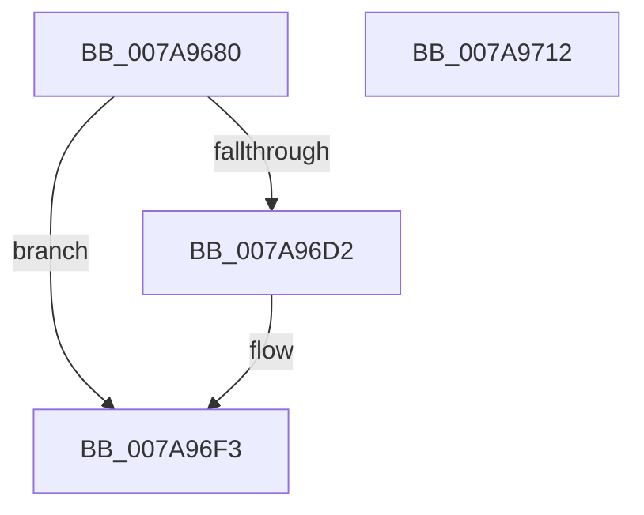

# SmKmStoreFileDelete

- RVA: `0x007A9680`–`0x007A9713` (길이 `147` bytes)
- VA: `0x00000001407A9680`
- 실행 섹션: `PAGE`
- PDB 이름 있음: `예`; PDB Function 태그: `아니요`
- unwind 정보 RVA: `0x000C91A4`
- 디코드: `39`개 명령, `147/147` bytes 표시
- 미해석 바이트: `0` (있으면 어셈블리에 `.byte`로 보존)

> 이 문서는 커널 이미지의 기계어와 PDB 기호를 분석해 생성했습니다. 4번과 5번은 함수 원형과 자료형을 바이너리 사용 방식에서 추정한 C 해석이며 원본 소스 복구 결과는 아닙니다.

## 1. Dependencies

- 직접 호출 지점: **4**; 고유 호출 대상: **3**
- 직접 호출자로 확인된 함수: **3**
- RIP 상대 이미지 참조: **0**

### Outgoing calls
- `0x007A969C` → [IoSetThreadHardErrorMode](../../text/46/IoSetThreadHardErrorMode_function_00466BF0.md) (function, `0x00466BF0`)
- `0x007A96C4` → [ZwSetInformationFile](../../text/6A/ZwSetInformationFile_function_006AD5B0.md) (function, `0x006AD5B0`)
- `0x007A96EA` → [KeWaitForSingleObject](../../text/20/KeWaitForSingleObject_function_0020E6B0.md) (function, `0x0020E6B0`)
- `0x007A96FB` → [IoSetThreadHardErrorMode](../../text/46/IoSetThreadHardErrorMode_function_00466BF0.md) (function, `0x00466BF0`)

### Direct callers
- [SmKmStoreFileCreate](SmKmStoreFileCreate_function_007A8F14.md) at `0x007A9381`
- [SmKmStoreFileCreateForIoType](SmKmStoreFileCreateForIoType_function_007A93C8.md) at `0x007A95CC`
- [SmKmStoreFileCreateForIoType](SmKmStoreFileCreateForIoType_function_007A93C8.md) at `0x007A95FE`
- [SmcCacheCleanup](SmcCacheCleanup_function_007AB7B4.md) at `0x007AB81A`

### Static image references
- 디코드된 RIP-relative 메모리 참조가 없습니다.

## 2. Other-region calls and transfers

- 다른 실행 섹션으로 향하는 call: **4**
  - `0x007A969C` → [IoSetThreadHardErrorMode](../../text/46/IoSetThreadHardErrorMode_function_00466BF0.md) (`PAGE` → `.text`)
  - `0x007A96C4` → [ZwSetInformationFile](../../text/6A/ZwSetInformationFile_function_006AD5B0.md) (`PAGE` → `.text`)
  - `0x007A96EA` → [KeWaitForSingleObject](../../text/20/KeWaitForSingleObject_function_0020E6B0.md) (`PAGE` → `.text`)
  - `0x007A96FB` → [IoSetThreadHardErrorMode](../../text/46/IoSetThreadHardErrorMode_function_00466BF0.md) (`PAGE` → `.text`)
- 별도 외부 분기/꼬리 이동을 확인하지 못했습니다.

## 3. Assembly (complete function range)

```asm
007A9680  48 89 5C 24 10                  mov qword ptr [rsp + 0x10], rbx
007A9685  48 89 74 24 18                  mov qword ptr [rsp + 0x18], rsi
007A968A  57                              push rdi
007A968B  48 83 EC 40                     sub rsp, 0x40
007A968F  48 8B F9                        mov rdi, rcx
007A9692  0F 57 C0                        xorps xmm0, xmm0
007A9695  33 C9                           xor ecx, ecx
007A9697  0F 11 44 24 30                  movups xmmword ptr [rsp + 0x30], xmm0
007A969C  E8 4F D5 CB FF                  call 0x140466bf0
007A96A1  48 8B 0F                        mov rcx, qword ptr [rdi]
007A96A4  4C 8D 44 24 50                  lea r8, [rsp + 0x50]
007A96A9  41 B9 01 00 00 00               mov r9d, 1
007A96AF  C6 44 24 50 01                  mov byte ptr [rsp + 0x50], 1
007A96B4  48 8D 54 24 30                  lea rdx, [rsp + 0x30]
007A96B9  C7 44 24 20 0D 00 00 00         mov dword ptr [rsp + 0x20], 0xd
007A96C1  40 8A F0                        mov sil, al
007A96C4  E8 E7 3E F0 FF                  call 0x1406ad5b0
007A96C9  33 DB                           xor ebx, ebx
007A96CB  3D 03 01 00 00                  cmp eax, 0x103
007A96D0  75 21                           jne 0x1407a96f3
007A96D2  48 8B 4F 08                     mov rcx, qword ptr [rdi + 8]
007A96D6  45 33 C9                        xor r9d, r9d
007A96D9  48 81 C1 98 00 00 00            add rcx, 0x98
007A96E0  48 89 5C 24 20                  mov qword ptr [rsp + 0x20], rbx
007A96E5  45 33 C0                        xor r8d, r8d
007A96E8  33 D2                           xor edx, edx
007A96EA  E8 C1 4F A6 FF                  call 0x14020e6b0
007A96EF  8B 44 24 30                     mov eax, dword ptr [rsp + 0x30]
007A96F3  85 C0                           test eax, eax
007A96F5  40 8A CE                        mov cl, sil
007A96F8  0F 48 D8                        cmovs ebx, eax
007A96FB  E8 F0 D4 CB FF                  call 0x140466bf0
007A9700  48 8B 74 24 60                  mov rsi, qword ptr [rsp + 0x60]
007A9705  8B C3                           mov eax, ebx
007A9707  48 8B 5C 24 58                  mov rbx, qword ptr [rsp + 0x58]
007A970C  48 83 C4 40                     add rsp, 0x40
007A9710  5F                              pop rdi
007A9711  C3                              ret
007A9712  CC                              int3
```

## 4. C-style interpretation (structured pseudocode)

```c
__int64 __fastcall SmKmStoreFileDelete(__int64 a1)
{
    __int64 result;
    __int64 v_rbx;
    __int64 v_rsp;
    unsigned __int64 v_stack_m18;
    unsigned int v_stack_m28;
    unsigned __int64 v_stack_p10;
    unsigned __int64 v_stack_p18;
    unsigned __int64 v_stack_p8;

    v_stack_p10 = v_rbx;
    v_stack_p18 = v_rsi;
    v_rsp = (v_rsp) - (64);
    a1 = 0;
    v_stack_m18 = v_xmm0;
    result = IoSetThreadHardErrorMode(a1, a2, a3, a4);
    v_stack_p8 = 1;
    v_stack_m28 = 13;
    result = ZwSetInformationFile(*(unsigned __int64 *)(a1), v_stack_m18, v_stack_p8, 1);
    v_rbx = 0;
    if (((unsigned int)(result)) == 259) {
        a1 = *(unsigned __int64 *)(a1 + 8);
        a4 = 0;
        a1 = (a1) + (152);
        v_stack_m28 = 0;
        a3 = 0;
        a2 = 0;
        result = KeWaitForSingleObject(a1, a2, a3, a4);
        result = v_stack_m18;
    }
    if (sign_flag) { v_rbx = (unsigned int)(result); }
    result = IoSetThreadHardErrorMode((unsigned __int8)((unsigned __int8)(result)), a2, a3, a4);
    v_rsp = (v_rsp) + (64);
    return (unsigned int)((unsigned int)(v_rbx));
}
```

## 5. (Beta) C Style

```c
int64_t SmKmStoreFileDelete(void *Arg1)
{
    uint8_t *arg1 = (uint8_t *)Arg1;

    int64_t result;
    int64_t local_rbx;
    int64_t local_rsp;
    uint64_t v_stack_m18;
    uint32_t v_stack_m28;
    uint64_t v_stack_p10;
    uint64_t v_stack_p18;
    uint64_t v_stack_p8;

    v_stack_p10 = local_rbx;
    v_stack_p18 = local_rsi;
    local_rsp = (local_rsp) - (64);
    Arg1 = 0;
    v_stack_m18 = v_xmm0;
    result = IoSetThreadHardErrorMode(Arg1, a2, a3, a4);
    v_stack_p8 = 1;
    v_stack_m28 = 13;
    result = ZwSetInformationFile(*(uint64_t *)(arg1), v_stack_m18, v_stack_p8, 1);
    local_rbx = 0;
    if (((uint32_t)(result)) == 259) {
        Arg1 = *(uint64_t *)(arg1 + 0x8);
        a4 = 0;
        Arg1 = (Arg1) + (152);
        v_stack_m28 = 0;
        a3 = 0;
        a2 = 0;
        result = KeWaitForSingleObject(Arg1, a2, a3, a4);
        result = v_stack_m18;
    }
    if (sign_flag) { local_rbx = (uint32_t)(result); }
    result = IoSetThreadHardErrorMode((uint8_t)((uint8_t)(result)), a2, a3, a4);
    local_rsp = (local_rsp) + (64);
    return (uint32_t)((uint32_t)(local_rbx));
}
```

### 관측된 메모리 오프셋

구조체 형식이 확인되지 않은 접근은 인자 기준의 오프셋으로만 기록했습니다.

| 기준 인자 | 오프셋 표현 | 폭 (bit) | 접근 |
|---|---:|---:|---|
| `Arg1` | `+ 0x0` | `64` | `R` |
| `Arg1` | `+ 0x8` | `64` | `R` |

## 6. Execution-region graph

[열기: 2D/3D 그래프와 함수 탐색 컨트롤 패널](../../../control-panel.html?section=page&rva=0x007A9680&view=graph)

- 2D 그래프는 위에서 아래로 흐르고, 3D 그래프는 빈 공간을 드래그해 회전합니다. Shift+드래그는 이동, 휠은 확대·축소, 함수 노드 선택은 대상 보고서 이동입니다.

### Static fallback


