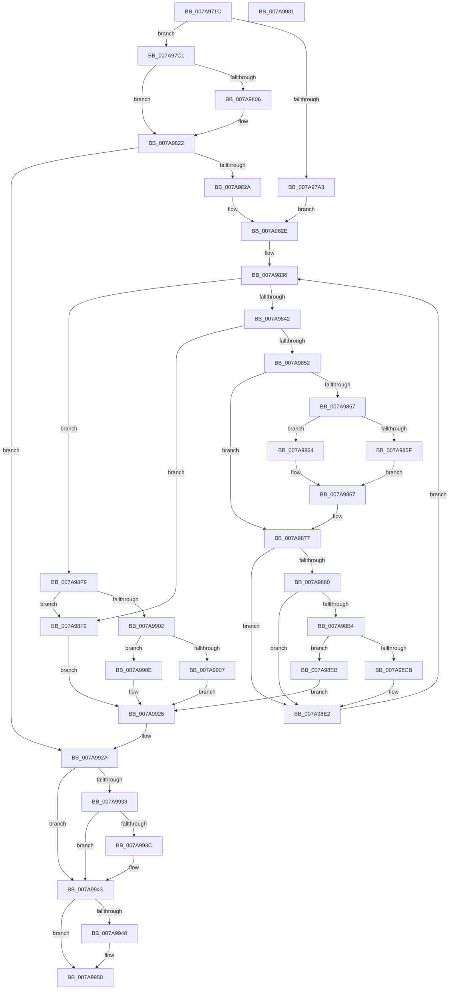

# SmKmStoreFileGetExtents

- RVA: `0x007A971C`–`0x007A9982` (길이 `614` bytes)
- VA: `0x00000001407A971C`
- 실행 섹션: `PAGE`
- PDB 이름 있음: `예`; PDB Function 태그: `아니요`
- unwind 정보 RVA: `0x000D1EE8`
- 디코드: `180`개 명령, `614/614` bytes 표시
- 미해석 바이트: `0` (있으면 어셈블리에 `.byte`로 보존)

> 이 문서는 커널 이미지의 기계어와 PDB 기호를 분석해 생성했습니다. 4번과 5번은 함수 원형과 자료형을 바이너리 사용 방식에서 추정한 C 해석이며 원본 소스 복구 결과는 아닙니다.

## 1. Dependencies

- 직접 호출 지점: **8**; 고유 호출 대상: **7**
- 직접 호출자로 확인된 함수: **1**
- RIP 상대 이미지 참조: **1**

### Outgoing calls
- `0x007A9792` → [IoSetThreadHardErrorMode](../../text/46/IoSetThreadHardErrorMode_function_00466BF0.md) (function, `0x00466BF0`)
- `0x007A97F8` → [ZwFsControlFile](../../text/6A/ZwFsControlFile_function_006AD7F0.md) (function, `0x006AD7F0`)
- `0x007A981A` → [KeWaitForSingleObject](../../text/20/KeWaitForSingleObject_function_0020E6B0.md) (function, `0x0020E6B0`)
- `0x007A98BE` → [SmArrayGrow](../../text/3A/SmArrayGrow_function_003AC6C8.md) (function, `0x003AC6C8`)
- `0x007A993E` → [ExFreePoolWithTag](../../poolcode/B8/ExFreePoolWithTag_function_00B82870.md) (function, `0x00B82870`)
- `0x007A994B` → [CmSiFreeMemory](../../text/47/CmSiFreeMemory_function_00475D80.md) (function, `0x00475D80`)
- `0x007A9953` → [IoSetThreadHardErrorMode](../../text/46/IoSetThreadHardErrorMode_function_00466BF0.md) (function, `0x00466BF0`)
- `0x007A9961` → [_security_check_cookie](../../text/6A/_security_check_cookie_function_006AC640.md) (function, `0x006AC640`)

### Direct callers
- [SmKmStoreFileCreate](SmKmStoreFileCreate_function_007A8F14.md) at `0x007A9280`

### Static image references
- `0x007A9738` → RVA `0x00E0A740` (`.data`; read)

## 2. Other-region calls and transfers

- 다른 실행 섹션으로 향하는 call: **8**
  - `0x007A9792` → [IoSetThreadHardErrorMode](../../text/46/IoSetThreadHardErrorMode_function_00466BF0.md) (`PAGE` → `.text`)
  - `0x007A97F8` → [ZwFsControlFile](../../text/6A/ZwFsControlFile_function_006AD7F0.md) (`PAGE` → `.text`)
  - `0x007A981A` → [KeWaitForSingleObject](../../text/20/KeWaitForSingleObject_function_0020E6B0.md) (`PAGE` → `.text`)
  - `0x007A98BE` → [SmArrayGrow](../../text/3A/SmArrayGrow_function_003AC6C8.md) (`PAGE` → `.text`)
  - `0x007A993E` → [ExFreePoolWithTag](../../poolcode/B8/ExFreePoolWithTag_function_00B82870.md) (`PAGE` → `POOLCODE`)
  - `0x007A994B` → [CmSiFreeMemory](../../text/47/CmSiFreeMemory_function_00475D80.md) (`PAGE` → `.text`)
  - `0x007A9953` → [IoSetThreadHardErrorMode](../../text/46/IoSetThreadHardErrorMode_function_00466BF0.md) (`PAGE` → `.text`)
  - `0x007A9961` → [_security_check_cookie](../../text/6A/_security_check_cookie_function_006AC640.md) (`PAGE` → `.text`)
- 별도 외부 분기/꼬리 이동을 확인하지 못했습니다.

## 3. Assembly (complete function range)

```asm
007A971C  48 89 5C 24 20                  mov qword ptr [rsp + 0x20], rbx
007A9721  55                              push rbp
007A9722  56                              push rsi
007A9723  57                              push rdi
007A9724  41 54                           push r12
007A9726  41 55                           push r13
007A9728  41 56                           push r14
007A972A  41 57                           push r15
007A972C  48 8D 6C 24 F9                  lea rbp, [rsp - 7]
007A9731  48 81 EC D0 00 00 00            sub rsp, 0xd0
007A9738  48 8B 05 01 10 66 00            mov rax, qword ptr [rip + 0x661001]
007A973F  48 33 C4                        xor rax, rsp
007A9742  48 89 45 FF                     mov qword ptr [rbp - 1], rax
007A9746  48 8B 45 7F                     mov rax, qword ptr [rbp + 0x7f]
007A974A  45 33 E4                        xor r12d, r12d
007A974D  48 89 45 B7                     mov qword ptr [rbp - 0x49], rax
007A9751  48 8B D9                        mov rbx, rcx
007A9754  48 8B 85 87 00 00 00            mov rax, qword ptr [rbp + 0x87]
007A975B  0F 57 C0                        xorps xmm0, xmm0
007A975E  48 89 45 BF                     mov qword ptr [rbp - 0x41], rax
007A9762  33 C9                           xor ecx, ecx
007A9764  48 8B 85 8F 00 00 00            mov rax, qword ptr [rbp + 0x8f]
007A976B  4D 8B E8                        mov r13, r8
007A976E  48 89 45 C7                     mov qword ptr [rbp - 0x39], rax
007A9772  48 8B F2                        mov rsi, rdx
007A9775  44 89 4D 97                     mov dword ptr [rbp - 0x69], r9d
007A9779  41 BF 00 00 01 00               mov r15d, 0x10000
007A977F  4C 89 45 AF                     mov qword ptr [rbp - 0x51], r8
007A9783  41 8B FC                        mov edi, r12d
007A9786  0F 11 45 CF                     movups xmmword ptr [rbp - 0x31], xmm0
007A978A  4C 89 65 8F                     mov qword ptr [rbp - 0x71], r12
007A978E  4C 89 65 9F                     mov qword ptr [rbp - 0x61], r12
007A9792  E8 59 D4 CB FF                  call 0x140466bf0
007A9797  44 8A F0                        mov r14b, al
007A979A  88 45 87                        mov byte ptr [rbp - 0x79], al
007A979D  44 39 65 77                     cmp dword ptr [rbp + 0x77], r12d
007A97A1  74 1E                           je 0x1407a97c1
007A97A3  49 8B 4D 00                     mov rcx, qword ptr [r13]
007A97A7  48 8D 5D DF                     lea rbx, [rbp - 0x21]
007A97AB  0F 57 C0                        xorps xmm0, xmm0
007A97AE  48 89 4D DF                     mov qword ptr [rbp - 0x21], rcx
007A97B2  F3 0F 7F 45 E7                  movdqu xmmword ptr [rbp - 0x19], xmm0
007A97B7  48 89 5D 8F                     mov qword ptr [rbp - 0x71], rbx
007A97BB  4C 89 65 F7                     mov qword ptr [rbp - 9], r12
007A97BF  EB 6D                           jmp 0x1407a982e
007A97C1  B9 08 00 00 00                  mov ecx, 8
007A97C6  48 8D 45 8F                     lea rax, [rbp - 0x71]
007A97CA  89 4C 24 48                     mov dword ptr [rsp + 0x48], ecx
007A97CE  45 33 C9                        xor r9d, r9d
007A97D1  48 89 44 24 40                  mov qword ptr [rsp + 0x40], rax
007A97D6  45 33 C0                        xor r8d, r8d
007A97D9  89 4C 24 38                     mov dword ptr [rsp + 0x38], ecx
007A97DD  48 8D 45 CF                     lea rax, [rbp - 0x31]
007A97E1  4C 89 6C 24 30                  mov qword ptr [rsp + 0x30], r13
007A97E6  33 D2                           xor edx, edx
007A97E8  C7 44 24 28 3B 00 09 00         mov dword ptr [rsp + 0x28], 0x9003b
007A97F0  48 8B CB                        mov rcx, rbx
007A97F3  48 89 44 24 20                  mov qword ptr [rsp + 0x20], rax
007A97F8  E8 F3 3F F0 FF                  call 0x1406ad7f0
007A97FD  8B D8                           mov ebx, eax
007A97FF  3D 03 01 00 00                  cmp eax, 0x103
007A9804  75 1C                           jne 0x1407a9822
007A9806  48 21 7C 24 20                  and qword ptr [rsp + 0x20], rdi
007A980B  48 8D 8E 98 00 00 00            lea rcx, [rsi + 0x98]
007A9812  45 33 C9                        xor r9d, r9d
007A9815  45 33 C0                        xor r8d, r8d
007A9818  33 D2                           xor edx, edx
007A981A  E8 91 4E A6 FF                  call 0x14020e6b0
007A981F  8B 5D CF                        mov ebx, dword ptr [rbp - 0x31]
007A9822  85 DB                           test ebx, ebx
007A9824  0F 88 00 01 00 00               js 0x1407a992a
007A982A  48 8B 5D 8F                     mov rbx, qword ptr [rbp - 0x71]
007A982E  45 33 F6                        xor r14d, r14d
007A9831  33 F6                           xor esi, esi
007A9833  21 75 9B                        and dword ptr [rbp - 0x65], esi
007A9836  4C 8B 13                        mov r10, qword ptr [rbx]
007A9839  4D 85 D2                        test r10, r10
007A983C  0F 84 B7 00 00 00               je 0x1407a98f9
007A9842  4C 8B 5B 08                     mov r11, qword ptr [rbx + 8]
007A9846  4D 03 E2                        add r12, r10
007A9849  4D 85 DB                        test r11, r11
007A984C  0F 88 A0 00 00 00               js 0x1407a98f2
007A9852  45 85 FF                        test r15d, r15d
007A9855  74 20                           je 0x1407a9877
007A9857  41 8B C7                        mov eax, r15d
007A985A  4C 3B D0                        cmp r10, rax
007A985D  7D 05                           jge 0x1407a9864
007A985F  41 8B C2                        mov eax, r10d
007A9862  EB 03                           jmp 0x1407a9867
007A9864  41 8B C7                        mov eax, r15d
007A9867  4C 03 D8                        add r11, rax
007A986A  44 2B F8                        sub r15d, eax
007A986D  4C 2B D0                        sub r10, rax
007A9870  4C 89 5B 08                     mov qword ptr [rbx + 8], r11
007A9874  4C 89 13                        mov qword ptr [rbx], r10
007A9877  44 8B 6D 97                     mov r13d, dword ptr [rbp - 0x69]
007A987B  4D 3B D5                        cmp r10, r13
007A987E  7C 62                           jl 0x1407a98e2
007A9880  8B 45 67                        mov eax, dword ptr [rbp + 0x67]
007A9883  44 8B C8                        mov r9d, eax
007A9886  8D 50 FF                        lea edx, [rax - 1]
007A9889  4C 8D 40 FF                     lea r8, [rax - 1]
007A988D  4D 03 C3                        add r8, r11
007A9890  4C 23 C2                        and r8, rdx
007A9893  33 D2                           xor edx, edx
007A9895  4D 2B C8                        sub r9, r8
007A9898  49 8D 41 FF                     lea rax, [r9 - 1]
007A989C  49 03 C3                        add rax, r11
007A989F  4C 2B D0                        sub r10, rax
007A98A2  48 89 45 A7                     mov qword ptr [rbp - 0x59], rax
007A98A6  4B 8D 04 13                     lea rax, [r11 + r10]
007A98AA  49 F7 F5                        div r13
007A98AD  4C 8B E8                        mov r13, rax
007A98B0  85 C0                           test eax, eax
007A98B2  74 2E                           je 0x1407a98e2
007A98B4  4C 8D 4D 9F                     lea r9, [rbp - 0x61]
007A98B8  8B CE                           mov ecx, esi
007A98BA  4C 8D 45 9B                     lea r8, [rbp - 0x65]
007A98BE  E8 05 2E C0 FF                  call 0x1403ac6c8
007A98C3  48 8B 7D 9F                     mov rdi, qword ptr [rbp - 0x61]
007A98C7  85 C0                           test eax, eax
007A98C9  74 20                           je 0x1407a98eb
007A98CB  48 8B 45 A7                     mov rax, qword ptr [rbp - 0x59]
007A98CF  45 03 F5                        add r14d, r13d
007A98D2  8B CE                           mov ecx, esi
007A98D4  48 03 C9                        add rcx, rcx
007A98D7  FF C6                           inc esi
007A98D9  48 89 44 CF 08                  mov qword ptr [rdi + rcx*8 + 8], rax
007A98DE  44 89 2C CF                     mov dword ptr [rdi + rcx*8], r13d
007A98E2  48 83 C3 10                     add rbx, 0x10
007A98E6  E9 4B FF FF FF                  jmp 0x1407a9836
007A98EB  BB 9A 00 00 C0                  mov ebx, 0xc000009a
007A98F0  EB 34                           jmp 0x1407a9926
007A98F2  BB 73 01 00 C0                  mov ebx, 0xc0000173
007A98F7  EB 2D                           jmp 0x1407a9926
007A98F9  48 8B 45 AF                     mov rax, qword ptr [rbp - 0x51]
007A98FD  4C 3B 20                        cmp r12, qword ptr [rax]
007A9900  7C F0                           jl 0x1407a98f2
007A9902  45 85 F6                        test r14d, r14d
007A9905  75 07                           jne 0x1407a990e
007A9907  BB 98 00 00 C0                  mov ebx, 0xc0000098
007A990C  EB 18                           jmp 0x1407a9926
007A990E  48 8B 45 B7                     mov rax, qword ptr [rbp - 0x49]
007A9912  44 89 30                        mov dword ptr [rax], r14d
007A9915  48 8B 45 BF                     mov rax, qword ptr [rbp - 0x41]
007A9919  48 89 38                        mov qword ptr [rax], rdi
007A991C  33 FF                           xor edi, edi
007A991E  48 8B 45 C7                     mov rax, qword ptr [rbp - 0x39]
007A9922  33 DB                           xor ebx, ebx
007A9924  89 30                           mov dword ptr [rax], esi
007A9926  44 8A 75 87                     mov r14b, byte ptr [rbp - 0x79]
007A992A  48 8B 4D 8F                     mov rcx, qword ptr [rbp - 0x71]
007A992E  48 85 C9                        test rcx, rcx
007A9931  74 10                           je 0x1407a9943
007A9933  48 8D 45 DF                     lea rax, [rbp - 0x21]
007A9937  48 3B C8                        cmp rcx, rax
007A993A  74 07                           je 0x1407a9943
007A993C  33 D2                           xor edx, edx
007A993E  E8 2D 8F 3D 00                  call 0x140b82870
007A9943  48 85 FF                        test rdi, rdi
007A9946  74 08                           je 0x1407a9950
007A9948  48 8B CF                        mov rcx, rdi
007A994B  E8 30 C4 CC FF                  call 0x140475d80
007A9950  41 8A CE                        mov cl, r14b
007A9953  E8 98 D2 CB FF                  call 0x140466bf0
007A9958  8B C3                           mov eax, ebx
007A995A  48 8B 4D FF                     mov rcx, qword ptr [rbp - 1]
007A995E  48 33 CC                        xor rcx, rsp
007A9961  E8 DA 2C F0 FF                  call 0x1406ac640
007A9966  48 8B 9C 24 28 01 00 00         mov rbx, qword ptr [rsp + 0x128]
007A996E  48 81 C4 D0 00 00 00            add rsp, 0xd0
007A9975  41 5F                           pop r15
007A9977  41 5E                           pop r14
007A9979  41 5D                           pop r13
007A997B  41 5C                           pop r12
007A997D  5F                              pop rdi
007A997E  5E                              pop rsi
007A997F  5D                              pop rbp
007A9980  C3                              ret
007A9981  CC                              int3
```

## 4. C-style interpretation (structured pseudocode)

```c
__int64 __fastcall SmKmStoreFileGetExtents(__int64 a1, __int64 a2, __int64 a3, int a4, unsigned int a5, __int64 a6, unsigned int a7, __int64 a8, __int64 a9, __int64 a10)
{
    __int64 result;
    __int64 v_r10;
    __int64 v_r11;
    __int64 v_r12;
    __int64 v_r14;
    __int64 v_r15;
    __int64 v_rbx;
    __int64 v_rdi;
    __int64 v_rsi;
    __int64 v_rsp;
    unsigned __int64 v_stack_m3F;
    unsigned __int64 v_stack_m40;
    unsigned __int64 v_stack_m48;
    unsigned __int64 v_stack_m58;
    unsigned __int64 v_stack_m60;
    unsigned __int64 v_stack_m70;
    unsigned __int64 v_stack_m78;
    unsigned __int64 v_stack_m80;
    unsigned __int64 v_stack_m88;
    unsigned __int64 v_stack_m90;
    unsigned __int64 v_stack_m98;
    unsigned __int64 v_stack_mA0;
    unsigned int v_stack_mA4;
    unsigned int v_stack_mA8;
    unsigned __int64 v_stack_mB0;
    unsigned __int8 v_stack_mB8;
    unsigned int v_stack_mC0;
    unsigned __int64 v_stack_mC8;
    unsigned int v_stack_mD0;
    unsigned __int64 v_stack_mD8;
    unsigned int v_stack_mE0;
    unsigned __int64 v_stack_mE8;
    unsigned __int64 v_stack_p20;

    v_stack_p20 = v_rbx;
    v_rsp = (v_rsp) - (208);
    result = (*(unsigned __int64 *)(v_rip + 6688769)) ^ (v_rsp);
    v_stack_m40 = result;
    v_r12 = 0;
    v_stack_m88 = a8;
    v_stack_m80 = a9;
    a1 = 0;
    v_stack_m78 = a10;
    v_stack_mA8 = a4;
    v_stack_m90 = a3;
    v_stack_m70 = v_xmm0;
    v_stack_mB0 = 0;
    v_stack_mA0 = 0;
    result = IoSetThreadHardErrorMode(a1, a2, a3, a4);
    v_stack_mB8 = (unsigned __int8)(result);
    if (a7 == 0) goto loc_007A97C1;
    v_stack_m60 = *(unsigned __int64 *)(a3);
    v_stack_m58 = v_xmm0;
    v_stack_mB0 = v_stack_m60;
    v_stack_m48 = 0;
    goto loc_007A982E;
loc_007A97C1:
    v_stack_mC0 = 8;
    a4 = 0;
    v_stack_mC8 = v_stack_mB0;
    a3 = 0;
    v_stack_mD0 = 8;
    v_stack_mD8 = 0;
    a2 = 0;
    v_stack_mE0 = 0x9003BULL;
    v_stack_mE8 = v_stack_m70;
    result = ZwFsControlFile(v_stack_m60, a2, a3, a4);
    v_rbx = (unsigned int)((unsigned int)(result));
    if (((unsigned int)(result)) == 259) {
        a1 = a2 + 152;
        a4 = 0;
        a3 = 0;
        a2 = 0;
        result = KeWaitForSingleObject(a1, a2, a3, a4);
        v_rbx = v_stack_m70;
    }
    if (sign_flag) goto loc_007A992A;
loc_007A982E:
    v_r14 = 0;
    v_rsi = 0;
loc_007A9836:
    if (*(unsigned __int64 *)(v_stack_mB0) == 0) goto loc_007A98F9;
    v_r12 = (v_r12) + (*(unsigned __int64 *)(v_stack_mB0));
    if (sign_flag) goto loc_007A98F2;
    if ((unsigned int)((unsigned int)(0x10000ULL)) == 0) goto loc_007A9877;
    if ((*(unsigned __int64 *)(v_stack_mB0)) >= ((unsigned int)((unsigned int)((unsigned int)(0x10000ULL))))) goto loc_007A9864;
    goto loc_007A9867;
loc_007A9864:
loc_007A9867:
    v_r11 = (*(unsigned __int64 *)(v_stack_mB0 + 8)) + ((unsigned int)((unsigned int)((unsigned int)(0x10000ULL))));
    v_r15 = (unsigned int)(((unsigned int)(0x10000ULL)) - ((unsigned int)((unsigned int)((unsigned int)((unsigned int)(0x10000ULL))))));
    v_r10 = (*(unsigned __int64 *)(v_stack_mB0)) - ((unsigned int)((unsigned int)((unsigned int)(0x10000ULL))));
    *(unsigned __int64 *)(v_stack_mB0 + 8) = v_r11;
    *(unsigned __int64 *)(v_stack_mB0) = v_r10;
loc_007A9877:
    if (v_r10 < ((unsigned int)(v_stack_mA8))) goto loc_007A98E2;
    a3 = ((unsigned int)(a5) - 1) + (v_r11);
    a3 = (a3) & ((unsigned int)(a5) - 1);
    a2 = 0;
    a4 = ((unsigned int)((unsigned int)((unsigned int)(a5)))) - (a3);
    result = (a4 - 1) + (v_r11);
    v_r10 = (v_r10) - (result);
    v_stack_m98 = result;
    if ((unsigned int)(v_r11 + v_r10 * 1) == 0) goto loc_007A98E2;
    result = SmArrayGrow(0, a2, v_stack_mA4, v_stack_mA0);
    if ((unsigned int)(result) == 0) goto loc_007A98EB;
    v_r14 = (unsigned int)((v_r14) + ((unsigned int)(v_r11 + v_r10 * 1)));
    a1 = (0) + (0);
    v_rsi = (unsigned int)((v_rsi) + 1);
    *(unsigned __int64 *)(v_stack_mA0 + a1 * 8 + 8) = v_stack_m98;
    *(unsigned int *)(v_stack_mA0 + a1 * 8) = (unsigned int)(v_r11 + v_r10 * 1);
loc_007A98E2:
    v_rbx = (v_stack_mB0) + (16);
    goto loc_007A9836;
loc_007A98EB:
    goto loc_007A9926;
loc_007A98F2:
    goto loc_007A9926;
loc_007A98F9:
    if (v_r12 < (*(unsigned __int64 *)(v_stack_m90))) goto loc_007A98F2;
    if ((unsigned int)(v_r14) != 0) goto loc_007A990E;
    goto loc_007A9926;
loc_007A990E:
    *(unsigned int *)(v_stack_m88) = (unsigned int)(v_r14);
    *(unsigned __int64 *)(v_stack_m80) = v_stack_mA0;
    v_rdi = 0;
    v_rbx = 0;
    *(unsigned int *)(v_stack_m78) = (unsigned int)(v_rsi);
loc_007A9926:
loc_007A992A:
    if (v_stack_mB0 == 0) goto loc_007A9943;
    result = v_stack_m60;
    if (v_stack_mB0 != v_stack_m60) {
        a2 = 0;
        result = ExFreePoolWithTag(v_stack_mB0, a2, v_stack_mA4, v_stack_mA0);
    }
    if (0 != 0) {
        a1 = 0;
        result = CmSiFreeMemory(a1, a2, v_stack_mA4, v_stack_mA0);
    }
    result = IoSetThreadHardErrorMode((unsigned __int8)(v_stack_mB8), a2, v_stack_mA4, v_stack_mA0);
    a1 = (v_stack_m40) ^ (v_rsp);
    result = _security_check_cookie(a1, a2, v_stack_mA4, v_stack_mA0);
    v_rsp = (v_rsp) + (208);
    return result;
}
```

## 5. (Beta) C Style

```c
int64_t SmKmStoreFileGetExtents(int64_t Arg1, void *Arg2, void *Arg3, int32_t Arg4, void *Arg5, uint64_t Arg6, uint32_t Arg7, int64_t Arg8, int64_t Arg9, int64_t Arg10)
{
    uint8_t *arg2 = (uint8_t *)Arg2;
    uint8_t *arg3 = (uint8_t *)Arg3;
    uint8_t *arg5 = (uint8_t *)Arg5;

    int64_t result;
    int64_t local_r10;
    int64_t local_r11;
    int64_t local_r12;
    int64_t local_r14;
    int64_t local_r15;
    int64_t local_rbx;
    int64_t local_rdi;
    int64_t local_rsi;
    int64_t local_rsp;
    uint64_t v_stack_m3F;
    uint64_t v_stack_m40;
    uint64_t v_stack_m48;
    uint64_t v_stack_m58;
    uint64_t v_stack_m60;
    uint64_t v_stack_m70;
    uint64_t v_stack_m78;
    uint64_t v_stack_m80;
    uint64_t v_stack_m88;
    uint64_t v_stack_m90;
    uint64_t v_stack_m98;
    uint64_t v_stack_mA0;
    uint32_t v_stack_mA4;
    uint32_t v_stack_mA8;
    uint64_t v_stack_mB0;
    uint8_t v_stack_mB8;
    uint32_t v_stack_mC0;
    uint64_t v_stack_mC8;
    uint32_t v_stack_mD0;
    uint64_t v_stack_mD8;
    uint32_t v_stack_mE0;
    uint64_t v_stack_mE8;
    uint64_t v_stack_p20;

    v_stack_p20 = local_rbx;
    local_rsp = (local_rsp) - (208);
    result = (*(uint64_t *)(v_rip + 0x661001)) ^ (local_rsp);
    v_stack_m40 = result;
    local_r12 = 0;
    v_stack_m88 = Arg8;
    v_stack_m80 = Arg9;
    Arg1 = 0;
    v_stack_m78 = Arg10;
    v_stack_mA8 = Arg4;
    v_stack_m90 = Arg3;
    v_stack_m70 = v_xmm0;
    v_stack_mB0 = 0;
    v_stack_mA0 = 0;
    result = IoSetThreadHardErrorMode(Arg1, Arg2, Arg3, Arg4);
    v_stack_mB8 = (uint8_t)(result);
    if (Arg7 == 0) goto loc_007A97C1;
    v_stack_m60 = *(uint64_t *)(arg3);
    v_stack_m58 = v_xmm0;
    v_stack_mB0 = v_stack_m60;
    v_stack_m48 = 0;
    goto loc_007A982E;
loc_007A97C1:
    v_stack_mC0 = 8;
    Arg4 = 0;
    v_stack_mC8 = v_stack_mB0;
    Arg3 = 0;
    v_stack_mD0 = 8;
    v_stack_mD8 = 0;
    Arg2 = 0;
    v_stack_mE0 = 0x9003BULL;
    v_stack_mE8 = v_stack_m70;
    result = ZwFsControlFile(v_stack_m60, Arg2, Arg3, Arg4);
    local_rbx = (uint32_t)((uint32_t)(result));
    if (((uint32_t)(result)) == 259) {
        Arg1 = Arg2 + 152;
        Arg4 = 0;
        Arg3 = 0;
        Arg2 = 0;
        result = KeWaitForSingleObject(Arg1, Arg2, Arg3, Arg4);
        local_rbx = v_stack_m70;
    }
    if (sign_flag) goto loc_007A992A;
loc_007A982E:
    local_r14 = 0;
    local_rsi = 0;
loc_007A9836:
    if (*(uint64_t *)(v_stack_mB0) == 0) goto loc_007A98F9;
    local_r12 = (local_r12) + (*(uint64_t *)(v_stack_mB0));
    if (sign_flag) goto loc_007A98F2;
    if ((uint32_t)((uint32_t)(0x10000ULL)) == 0) goto loc_007A9877;
    if ((*(uint64_t *)(v_stack_mB0)) >= ((uint32_t)((uint32_t)((uint32_t)(0x10000ULL))))) goto loc_007A9864;
    goto loc_007A9867;
loc_007A9864:
loc_007A9867:
    local_r11 = (*(uint64_t *)(v_stack_mB0 + 0x8)) + ((uint32_t)((uint32_t)((uint32_t)(0x10000ULL))));
    local_r15 = (uint32_t)(((uint32_t)(0x10000ULL)) - ((uint32_t)((uint32_t)((uint32_t)((uint32_t)(0x10000ULL))))));
    local_r10 = (*(uint64_t *)(v_stack_mB0)) - ((uint32_t)((uint32_t)((uint32_t)(0x10000ULL))));
    *(uint64_t *)(v_stack_mB0 + 0x8) = local_r11;
    *(uint64_t *)(v_stack_mB0) = local_r10;
loc_007A9877:
    if (local_r10 < ((uint32_t)(v_stack_mA8))) goto loc_007A98E2;
    Arg3 = ((uint32_t)(Arg5) - 1) + (local_r11);
    Arg3 = (Arg3) & ((uint32_t)(Arg5) - 1);
    Arg2 = 0;
    Arg4 = ((uint32_t)((uint32_t)((uint32_t)(Arg5)))) - (Arg3);
    result = (Arg4 - 1) + (local_r11);
    local_r10 = (local_r10) - (result);
    v_stack_m98 = result;
    if ((uint32_t)(local_r11 + local_r10 * 1) == 0) goto loc_007A98E2;
    result = SmArrayGrow(0, Arg2, v_stack_mA4, v_stack_mA0);
    if ((uint32_t)(result) == 0) goto loc_007A98EB;
    local_r14 = (uint32_t)((local_r14) + ((uint32_t)(local_r11 + local_r10 * 1)));
    Arg1 = (0) + (0);
    local_rsi = (uint32_t)((local_rsi) + 1);
    *(uint64_t *)(v_stack_mA0 + Arg1 * 8 + 0x8) = v_stack_m98;
    *(uint32_t *)(v_stack_mA0 + Arg1 * 8) = (uint32_t)(local_r11 + local_r10 * 1);
loc_007A98E2:
    local_rbx = (v_stack_mB0) + (16);
    goto loc_007A9836;
loc_007A98EB:
    goto loc_007A9926;
loc_007A98F2:
    goto loc_007A9926;
loc_007A98F9:
    if (local_r12 < (*(uint64_t *)(v_stack_m90))) goto loc_007A98F2;
    if ((uint32_t)(local_r14) != 0) goto loc_007A990E;
    goto loc_007A9926;
loc_007A990E:
    *(uint32_t *)(v_stack_m88) = (uint32_t)(local_r14);
    *(uint64_t *)(v_stack_m80) = v_stack_mA0;
    local_rdi = 0;
    local_rbx = 0;
    *(uint32_t *)(v_stack_m78) = (uint32_t)(local_rsi);
loc_007A9926:
loc_007A992A:
    if (v_stack_mB0 == 0) goto loc_007A9943;
    result = v_stack_m60;
    if (v_stack_mB0 != v_stack_m60) {
        Arg2 = 0;
        result = ExFreePoolWithTag(v_stack_mB0, Arg2, v_stack_mA4, v_stack_mA0);
    }
    if (0 != 0) {
        Arg1 = 0;
        result = CmSiFreeMemory(Arg1, Arg2, v_stack_mA4, v_stack_mA0);
    }
    result = IoSetThreadHardErrorMode((uint8_t)(v_stack_mB8), Arg2, v_stack_mA4, v_stack_mA0);
    Arg1 = (v_stack_m40) ^ (local_rsp);
    result = _security_check_cookie(Arg1, Arg2, v_stack_mA4, v_stack_mA0);
    local_rsp = (local_rsp) + (208);
    return result;
}
```

### 관측된 메모리 오프셋

구조체 형식이 확인되지 않은 접근은 인자 기준의 오프셋으로만 기록했습니다.

| 기준 인자 | 오프셋 표현 | 폭 (bit) | 접근 |
|---|---:|---:|---|
| `Arg2` | `+ 0x98` | `64` | `R` |
| `Arg3` | `+ 0x0` | `64` | `R` |
| `Arg5` | `- 0x1` | `32` | `R` |
| `Arg5` | `- 0x1` | `64` | `R` |

## 6. Execution-region graph

[열기: 2D/3D 그래프와 함수 탐색 컨트롤 패널](../../../control-panel.html?section=page&rva=0x007A971C&view=graph)

- 2D 그래프는 위에서 아래로 흐르고, 3D 그래프는 빈 공간을 드래그해 회전합니다. Shift+드래그는 이동, 휠은 확대·축소, 함수 노드 선택은 대상 보고서 이동입니다.

### Static fallback


