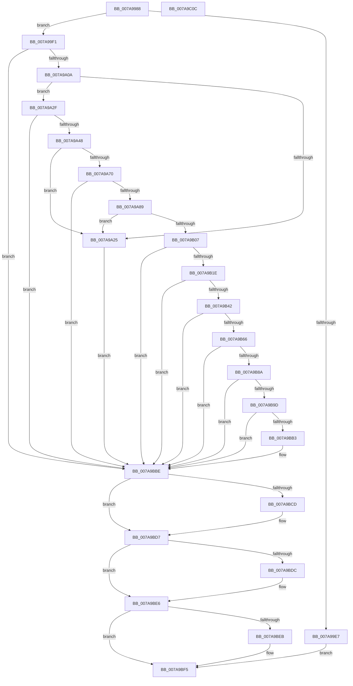

# SmKmStoreFileMakeSecurityDescriptor

- RVA: `0x007A9988`–`0x007A9C0D` (길이 `645` bytes)
- VA: `0x00000001407A9988`
- 실행 섹션: `PAGE`
- PDB 이름 있음: `예`; PDB Function 태그: `아니요`
- unwind 정보 RVA: `0x000C8AAC`
- 디코드: `190`개 명령, `645/645` bytes 표시
- 미해석 바이트: `0` (있으면 어셈블리에 `.byte`로 보존)

> 이 문서는 커널 이미지의 기계어와 PDB 기호를 분석해 생성했습니다. 4번과 5번은 함수 원형과 자료형을 바이너리 사용 방식에서 추정한 C 해석이며 원본 소스 복구 결과는 아닙니다.

## 1. Dependencies

- 직접 호출 지점: **26**; 고유 호출 대상: **10**
- 직접 호출자로 확인된 함수: **1**
- RIP 상대 이미지 참조: **0**

### Outgoing calls
- `0x007A99C5` → [RtlLengthRequiredSid](../9C/RtlLengthRequiredSid_function_009CA4D0.md) (function, `0x009CA4D0`)
- `0x007A99DA` → [ExAllocatePool2](../../poolcode/B8/ExAllocatePool2_function_00B820F0.md) (function, `0x00B820F0`)
- `0x007A99FB` → [RtlInitializeSid](../9E/RtlInitializeSid_function_009EB720.md) (function, `0x009EB720`)
- `0x007A9A18` → [ExAllocatePool2](../../poolcode/B8/ExAllocatePool2_function_00B820F0.md) (function, `0x00B820F0`)
- `0x007A9A39` → [RtlInitializeSid](../9E/RtlInitializeSid_function_009EB720.md) (function, `0x009EB720`)
- `0x007A9A51` → [RtlLengthRequiredSid](../9C/RtlLengthRequiredSid_function_009CA4D0.md) (function, `0x009CA4D0`)
- `0x007A9A63` → [ExAllocatePool2](../../poolcode/B8/ExAllocatePool2_function_00B820F0.md) (function, `0x00B820F0`)
- `0x007A9A7A` → [RtlInitializeSid](../9E/RtlInitializeSid_function_009EB720.md) (function, `0x009EB720`)
- `0x007A9A8E` → [RtlSubAuthoritySid](../../text/45/RtlSubAuthoritySid_function_00456D10.md) (function, `0x00456D10`)
- `0x007A9A9A` → [RtlSubAuthoritySid](../../text/45/RtlSubAuthoritySid_function_00456D10.md) (function, `0x00456D10`)
- `0x007A9AAA` → [RtlSubAuthoritySid](../../text/45/RtlSubAuthoritySid_function_00456D10.md) (function, `0x00456D10`)
- `0x007A9ABD` → [RtlSubAuthoritySid](../../text/45/RtlSubAuthoritySid_function_00456D10.md) (function, `0x00456D10`)
- `0x007A9ACB` → [RtlLengthSid](../../text/45/RtlLengthSid_function_0045D270.md) (function, `0x0045D270`)
- `0x007A9AD5` → [RtlLengthSid](../../text/45/RtlLengthSid_function_0045D270.md) (function, `0x0045D270`)
- `0x007A9ADF` → [RtlLengthSid](../../text/45/RtlLengthSid_function_0045D270.md) (function, `0x0045D270`)
- `0x007A9AF6` → [ExAllocatePool2](../../poolcode/B8/ExAllocatePool2_function_00B820F0.md) (function, `0x00B820F0`)
- `0x007A9B0F` → [RtlCreateAcl](../91/RtlCreateAcl_function_00916F00.md) (function, `0x00916F00`)
- `0x007A9B37` → [RtlpAddKnownAce](../92/RtlpAddKnownAce_function_00929A20.md) (function, `0x00929A20`)
- `0x007A9B5B` → [RtlpAddKnownAce](../92/RtlpAddKnownAce_function_00929A20.md) (function, `0x00929A20`)
- `0x007A9B7F` → [RtlpAddKnownAce](../92/RtlpAddKnownAce_function_00929A20.md) (function, `0x00929A20`)
- `0x007A9B92` → [RtlCreateSecurityDescriptor](../9F/RtlCreateSecurityDescriptor_function_009F1DF0.md) (function, `0x009F1DF0`)
- `0x007A9BA8` → [RtlSetDaclSecurityDescriptor](../9E/RtlSetDaclSecurityDescriptor_function_009EC210.md) (function, `0x009EC210`)
- `0x007A9BC3` → [ExFreePoolWithTag](../../poolcode/B8/ExFreePoolWithTag_function_00B82870.md) (function, `0x00B82870`)
- `0x007A9BD2` → [ExFreePoolWithTag](../../poolcode/B8/ExFreePoolWithTag_function_00B82870.md) (function, `0x00B82870`)
- `0x007A9BE1` → [ExFreePoolWithTag](../../poolcode/B8/ExFreePoolWithTag_function_00B82870.md) (function, `0x00B82870`)
- `0x007A9BF0` → [ExFreePoolWithTag](../../poolcode/B8/ExFreePoolWithTag_function_00B82870.md) (function, `0x00B82870`)

### Direct callers
- [SmKmStoreFileCreateForIoType](SmKmStoreFileCreateForIoType_function_007A93C8.md) at `0x007A9474`

### Static image references
- 디코드된 RIP-relative 메모리 참조가 없습니다.

## 2. Other-region calls and transfers

- 다른 실행 섹션으로 향하는 call: **15**
  - `0x007A99DA` → [ExAllocatePool2](../../poolcode/B8/ExAllocatePool2_function_00B820F0.md) (`PAGE` → `POOLCODE`)
  - `0x007A9A18` → [ExAllocatePool2](../../poolcode/B8/ExAllocatePool2_function_00B820F0.md) (`PAGE` → `POOLCODE`)
  - `0x007A9A63` → [ExAllocatePool2](../../poolcode/B8/ExAllocatePool2_function_00B820F0.md) (`PAGE` → `POOLCODE`)
  - `0x007A9A8E` → [RtlSubAuthoritySid](../../text/45/RtlSubAuthoritySid_function_00456D10.md) (`PAGE` → `.text`)
  - `0x007A9A9A` → [RtlSubAuthoritySid](../../text/45/RtlSubAuthoritySid_function_00456D10.md) (`PAGE` → `.text`)
  - `0x007A9AAA` → [RtlSubAuthoritySid](../../text/45/RtlSubAuthoritySid_function_00456D10.md) (`PAGE` → `.text`)
  - `0x007A9ABD` → [RtlSubAuthoritySid](../../text/45/RtlSubAuthoritySid_function_00456D10.md) (`PAGE` → `.text`)
  - `0x007A9ACB` → [RtlLengthSid](../../text/45/RtlLengthSid_function_0045D270.md) (`PAGE` → `.text`)
  - `0x007A9AD5` → [RtlLengthSid](../../text/45/RtlLengthSid_function_0045D270.md) (`PAGE` → `.text`)
  - `0x007A9ADF` → [RtlLengthSid](../../text/45/RtlLengthSid_function_0045D270.md) (`PAGE` → `.text`)
  - `0x007A9AF6` → [ExAllocatePool2](../../poolcode/B8/ExAllocatePool2_function_00B820F0.md) (`PAGE` → `POOLCODE`)
  - `0x007A9BC3` → [ExFreePoolWithTag](../../poolcode/B8/ExFreePoolWithTag_function_00B82870.md) (`PAGE` → `POOLCODE`)
  - `0x007A9BD2` → [ExFreePoolWithTag](../../poolcode/B8/ExFreePoolWithTag_function_00B82870.md) (`PAGE` → `POOLCODE`)
  - `0x007A9BE1` → [ExFreePoolWithTag](../../poolcode/B8/ExFreePoolWithTag_function_00B82870.md) (`PAGE` → `POOLCODE`)
  - `0x007A9BF0` → [ExFreePoolWithTag](../../poolcode/B8/ExFreePoolWithTag_function_00B82870.md) (`PAGE` → `POOLCODE`)
- 별도 외부 분기/꼬리 이동을 확인하지 못했습니다.

## 3. Assembly (complete function range)

```asm
007A9988  48 89 5C 24 08                  mov qword ptr [rsp + 8], rbx
007A998D  48 89 54 24 10                  mov qword ptr [rsp + 0x10], rdx
007A9992  55                              push rbp
007A9993  56                              push rsi
007A9994  57                              push rdi
007A9995  41 54                           push r12
007A9997  41 55                           push r13
007A9999  41 56                           push r14
007A999B  41 57                           push r15
007A999D  48 8B EC                        mov rbp, rsp
007A99A0  48 83 EC 30                     sub rsp, 0x30
007A99A4  33 DB                           xor ebx, ebx
007A99A6  66 C7 45 5C 00 01               mov word ptr [rbp + 0x5c], 0x100
007A99AC  4C 8B E9                        mov r13, rcx
007A99AF  89 5D 58                        mov dword ptr [rbp + 0x58], ebx
007A99B2  89 5D 50                        mov dword ptr [rbp + 0x50], ebx
007A99B5  44 8B F3                        mov r14d, ebx
007A99B8  66 C7 45 54 00 05               mov word ptr [rbp + 0x54], 0x500
007A99BE  8B F3                           mov esi, ebx
007A99C0  8D 4B 01                        lea ecx, [rbx + 1]
007A99C3  8B FB                           mov edi, ebx
007A99C5  E8 06 0B 22 00                  call 0x1409ca4d0
007A99CA  41 B8 73 6D 44 53               mov r8d, 0x53446d73
007A99D0  8B D0                           mov edx, eax
007A99D2  B9 00 01 00 00                  mov ecx, 0x100
007A99D7  44 8B E0                        mov r12d, eax
007A99DA  E8 11 87 3D 00                  call 0x140b820f0
007A99DF  4C 8B F8                        mov r15, rax
007A99E2  48 85 C0                        test rax, rax
007A99E5  75 0A                           jne 0x1407a99f1
007A99E7  BB 9A 00 00 C0                  mov ebx, 0xc000009a
007A99EC  E9 04 02 00 00                  jmp 0x1407a9bf5
007A99F1  41 B0 01                        mov r8b, 1
007A99F4  48 8D 55 58                     lea rdx, [rbp + 0x58]
007A99F8  49 8B CF                        mov rcx, r15
007A99FB  E8 20 1D 24 00                  call 0x1409eb720
007A9A00  8B D8                           mov ebx, eax
007A9A02  85 C0                           test eax, eax
007A9A04  0F 88 B4 01 00 00               js 0x1407a9bbe
007A9A0A  41 B8 73 6D 44 53               mov r8d, 0x53446d73
007A9A10  49 8B D4                        mov rdx, r12
007A9A13  B9 00 01 00 00                  mov ecx, 0x100
007A9A18  E8 D3 86 3D 00                  call 0x140b820f0
007A9A1D  4C 8B F0                        mov r14, rax
007A9A20  48 85 C0                        test rax, rax
007A9A23  75 0A                           jne 0x1407a9a2f
007A9A25  BB 9A 00 00 C0                  mov ebx, 0xc000009a
007A9A2A  E9 8F 01 00 00                  jmp 0x1407a9bbe
007A9A2F  41 B0 01                        mov r8b, 1
007A9A32  48 8D 55 50                     lea rdx, [rbp + 0x50]
007A9A36  49 8B CE                        mov rcx, r14
007A9A39  E8 E2 1C 24 00                  call 0x1409eb720
007A9A3E  8B D8                           mov ebx, eax
007A9A40  85 C0                           test eax, eax
007A9A42  0F 88 76 01 00 00               js 0x1407a9bbe
007A9A48  41 BC 02 00 00 00               mov r12d, 2
007A9A4E  41 8B CC                        mov ecx, r12d
007A9A51  E8 7A 0A 22 00                  call 0x1409ca4d0
007A9A56  8B D0                           mov edx, eax
007A9A58  B9 00 01 00 00                  mov ecx, 0x100
007A9A5D  41 B8 73 6D 44 53               mov r8d, 0x53446d73
007A9A63  E8 88 86 3D 00                  call 0x140b820f0
007A9A68  48 8B F0                        mov rsi, rax
007A9A6B  48 85 C0                        test rax, rax
007A9A6E  74 B5                           je 0x1407a9a25
007A9A70  45 8A C4                        mov r8b, r12b
007A9A73  48 8D 55 50                     lea rdx, [rbp + 0x50]
007A9A77  48 8B C8                        mov rcx, rax
007A9A7A  E8 A1 1C 24 00                  call 0x1409eb720
007A9A7F  8B D8                           mov ebx, eax
007A9A81  85 C0                           test eax, eax
007A9A83  0F 88 35 01 00 00               js 0x1407a9bbe
007A9A89  33 D2                           xor edx, edx
007A9A8B  49 8B CF                        mov rcx, r15
007A9A8E  E8 7D D2 CA FF                  call 0x140456d10
007A9A93  33 D2                           xor edx, edx
007A9A95  49 8B CE                        mov rcx, r14
007A9A98  21 38                           and dword ptr [rax], edi
007A9A9A  E8 71 D2 CA FF                  call 0x140456d10
007A9A9F  33 D2                           xor edx, edx
007A9AA1  48 8B CE                        mov rcx, rsi
007A9AA4  C7 00 12 00 00 00               mov dword ptr [rax], 0x12
007A9AAA  E8 61 D2 CA FF                  call 0x140456d10
007A9AAF  41 8D 54 24 FF                  lea edx, [r12 - 1]
007A9AB4  48 8B CE                        mov rcx, rsi
007A9AB7  C7 00 20 00 00 00               mov dword ptr [rax], 0x20
007A9ABD  E8 4E D2 CA FF                  call 0x140456d10
007A9AC2  48 8B CE                        mov rcx, rsi
007A9AC5  C7 00 20 02 00 00               mov dword ptr [rax], 0x220
007A9ACB  E8 A0 37 CB FF                  call 0x14045d270
007A9AD0  49 8B CE                        mov rcx, r14
007A9AD3  8B D8                           mov ebx, eax
007A9AD5  E8 96 37 CB FF                  call 0x14045d270
007A9ADA  49 8B CF                        mov rcx, r15
007A9ADD  03 D8                           add ebx, eax
007A9ADF  E8 8C 37 CB FF                  call 0x14045d270
007A9AE4  83 C0 20                        add eax, 0x20
007A9AE7  B9 00 01 00 00                  mov ecx, 0x100
007A9AEC  03 D8                           add ebx, eax
007A9AEE  41 B8 73 6D 44 61               mov r8d, 0x61446d73
007A9AF4  8B D3                           mov edx, ebx
007A9AF6  E8 F5 85 3D 00                  call 0x140b820f0
007A9AFB  48 8B F8                        mov rdi, rax
007A9AFE  48 85 C0                        test rax, rax
007A9B01  0F 84 1E FF FF FF               je 0x1407a9a25
007A9B07  45 8B C4                        mov r8d, r12d
007A9B0A  8B D3                           mov edx, ebx
007A9B0C  48 8B C8                        mov rcx, rax
007A9B0F  E8 EC D3 16 00                  call 0x140916f00
007A9B14  8B D8                           mov ebx, eax
007A9B16  85 C0                           test eax, eax
007A9B18  0F 88 A0 00 00 00               js 0x1407a9bbe
007A9B1E  C6 44 24 28 00                  mov byte ptr [rsp + 0x28], 0
007A9B23  41 B9 FF 01 1F 00               mov r9d, 0x1f01ff
007A9B29  45 33 C0                        xor r8d, r8d
007A9B2C  48 89 74 24 20                  mov qword ptr [rsp + 0x20], rsi
007A9B31  41 8B D4                        mov edx, r12d
007A9B34  48 8B CF                        mov rcx, rdi
007A9B37  E8 E4 FE 17 00                  call 0x140929a20
007A9B3C  8B D8                           mov ebx, eax
007A9B3E  85 C0                           test eax, eax
007A9B40  78 7C                           js 0x1407a9bbe
007A9B42  C6 44 24 28 00                  mov byte ptr [rsp + 0x28], 0
007A9B47  41 B9 FF 01 1F 00               mov r9d, 0x1f01ff
007A9B4D  45 33 C0                        xor r8d, r8d
007A9B50  4C 89 74 24 20                  mov qword ptr [rsp + 0x20], r14
007A9B55  41 8B D4                        mov edx, r12d
007A9B58  48 8B CF                        mov rcx, rdi
007A9B5B  E8 C0 FE 17 00                  call 0x140929a20
007A9B60  8B D8                           mov ebx, eax
007A9B62  85 C0                           test eax, eax
007A9B64  78 58                           js 0x1407a9bbe
007A9B66  C6 44 24 28 00                  mov byte ptr [rsp + 0x28], 0
007A9B6B  41 B9 00 00 01 00               mov r9d, 0x10000
007A9B71  45 33 C0                        xor r8d, r8d
007A9B74  4C 89 7C 24 20                  mov qword ptr [rsp + 0x20], r15
007A9B79  41 8B D4                        mov edx, r12d
007A9B7C  48 8B CF                        mov rcx, rdi
007A9B7F  E8 9C FE 17 00                  call 0x140929a20
007A9B84  8B D8                           mov ebx, eax
007A9B86  85 C0                           test eax, eax
007A9B88  78 34                           js 0x1407a9bbe
007A9B8A  41 8D 54 24 FF                  lea edx, [r12 - 1]
007A9B8F  49 8B CD                        mov rcx, r13
007A9B92  E8 59 82 24 00                  call 0x1409f1df0
007A9B97  8B D8                           mov ebx, eax
007A9B99  85 C0                           test eax, eax
007A9B9B  78 21                           js 0x1407a9bbe
007A9B9D  45 33 C9                        xor r9d, r9d
007A9BA0  4C 8B C7                        mov r8, rdi
007A9BA3  B2 01                           mov dl, 1
007A9BA5  49 8B CD                        mov rcx, r13
007A9BA8  E8 63 26 24 00                  call 0x1409ec210
007A9BAD  8B D8                           mov ebx, eax
007A9BAF  85 C0                           test eax, eax
007A9BB1  78 0B                           js 0x1407a9bbe
007A9BB3  48 8B 45 48                     mov rax, qword ptr [rbp + 0x48]
007A9BB7  48 89 38                        mov qword ptr [rax], rdi
007A9BBA  33 FF                           xor edi, edi
007A9BBC  33 DB                           xor ebx, ebx
007A9BBE  33 D2                           xor edx, edx
007A9BC0  49 8B CF                        mov rcx, r15
007A9BC3  E8 A8 8C 3D 00                  call 0x140b82870
007A9BC8  4D 85 F6                        test r14, r14
007A9BCB  74 0A                           je 0x1407a9bd7
007A9BCD  33 D2                           xor edx, edx
007A9BCF  49 8B CE                        mov rcx, r14
007A9BD2  E8 99 8C 3D 00                  call 0x140b82870
007A9BD7  48 85 F6                        test rsi, rsi
007A9BDA  74 0A                           je 0x1407a9be6
007A9BDC  33 D2                           xor edx, edx
007A9BDE  48 8B CE                        mov rcx, rsi
007A9BE1  E8 8A 8C 3D 00                  call 0x140b82870
007A9BE6  48 85 FF                        test rdi, rdi
007A9BE9  74 0A                           je 0x1407a9bf5
007A9BEB  33 D2                           xor edx, edx
007A9BED  48 8B CF                        mov rcx, rdi
007A9BF0  E8 7B 8C 3D 00                  call 0x140b82870
007A9BF5  8B C3                           mov eax, ebx
007A9BF7  48 8B 5C 24 70                  mov rbx, qword ptr [rsp + 0x70]
007A9BFC  48 83 C4 30                     add rsp, 0x30
007A9C00  41 5F                           pop r15
007A9C02  41 5E                           pop r14
007A9C04  41 5D                           pop r13
007A9C06  41 5C                           pop r12
007A9C08  5F                              pop rdi
007A9C09  5E                              pop rsi
007A9C0A  5D                              pop rbp
007A9C0B  C3                              ret
007A9C0C  CC                              int3
```

## 4. C-style interpretation (structured pseudocode)

```c
__int64 __fastcall SmKmStoreFileMakeSecurityDescriptor(__int64 a1, __int64 a2)
{
    __int64 result;
    __int64 v_rbx;
    __int64 v_rdi;
    __int64 v_rsp;
    unsigned __int8 v_stack_m40;
    unsigned __int64 v_stack_m48;
    unsigned __int64 v_stack_p10;
    unsigned int v_stack_p18;
    unsigned __int16 v_stack_p1C;
    unsigned int v_stack_p20;
    unsigned __int16 v_stack_p24;
    unsigned __int64 v_stack_p8;

    v_stack_p8 = v_rbx;
    v_stack_p10 = a2;
    v_rsp = (v_rsp) - (48);
    v_rbx = 0;
    v_stack_p24 = 256;
    v_stack_p20 = 0;
    v_stack_p18 = 0;
    v_stack_p1C = 0x500ULL;
    result = RtlLengthRequiredSid(v_rbx + 1, a2, a3, a4);
    result = ExAllocatePool2(256, (unsigned int)((unsigned int)(result)), (unsigned int)(0x53446D73ULL), a4);
    if (result != 0) goto loc_007A99F1;
    goto loc_007A9BF5;
loc_007A99F1:
    result = RtlInitializeSid(result, v_stack_p20, 1, a4);
    if (sign_flag) goto loc_007A9BBE;
    result = ExAllocatePool2(256, (unsigned int)((unsigned int)(result)), (unsigned int)(0x53446D73ULL), a4);
    if (result != 0) goto loc_007A9A2F;
loc_007A9A25:
    goto loc_007A9BBE;
loc_007A9A2F:
    result = RtlInitializeSid(result, v_stack_p18, 1, a4);
    if (sign_flag) goto loc_007A9BBE;
    result = RtlLengthRequiredSid(2, v_stack_p18, 1, a4);
    result = ExAllocatePool2(256, (unsigned int)((unsigned int)(result)), (unsigned int)(0x53446D73ULL), a4);
    if (result == 0) goto loc_007A9A25;
    result = RtlInitializeSid(result, v_stack_p18, 2, a4);
    if (sign_flag) goto loc_007A9BBE;
    a2 = 0;
    result = RtlSubAuthoritySid(result, a2, 2, a4);
    a2 = 0;
    result = RtlSubAuthoritySid(result, a2, 2, a4);
    a2 = 0;
    *(unsigned int *)(result) = 18;
    result = RtlSubAuthoritySid(result, a2, 2, a4);
    *(unsigned int *)(result) = 32;
    result = RtlSubAuthoritySid(result, 2 - 1, 2, a4);
    *(unsigned int *)(result) = 544;
    result = RtlLengthSid(result, 2 - 1, 2, a4);
    result = RtlLengthSid(result, 2 - 1, 2, a4);
    v_rbx = (unsigned int)(((unsigned int)((unsigned int)(result))) + ((unsigned int)(result)));
    result = RtlLengthSid(result, 2 - 1, 2, a4);
    result = (unsigned int)((result) + (32));
    v_rbx = (unsigned int)((v_rbx) + ((unsigned int)(result)));
    result = ExAllocatePool2(256, (unsigned int)((unsigned int)(v_rbx)), (unsigned int)(0x61446D73ULL), a4);
    if (result == 0) goto loc_007A9A25;
    result = RtlCreateAcl(result, (unsigned int)((unsigned int)(v_rbx)), 2, a4);
    if (sign_flag) goto loc_007A9BBE;
    v_stack_m40 = 0;
    a3 = 0;
    v_stack_m48 = result;
    result = RtlpAddKnownAce(result, 2, a3, (unsigned int)(0x1F01FFULL));
    if (sign_flag) goto loc_007A9BBE;
    v_stack_m40 = 0;
    a3 = 0;
    v_stack_m48 = result;
    result = RtlpAddKnownAce(result, 2, a3, (unsigned int)(0x1F01FFULL));
    if (sign_flag) goto loc_007A9BBE;
    v_stack_m40 = 0;
    a3 = 0;
    v_stack_m48 = result;
    result = RtlpAddKnownAce(result, 2, a3, (unsigned int)(0x10000ULL));
    if (sign_flag) goto loc_007A9BBE;
    result = RtlCreateSecurityDescriptor(a1, 2 - 1, a3, (unsigned int)(0x10000ULL));
    if (sign_flag) goto loc_007A9BBE;
    a4 = 0;
    result = RtlSetDaclSecurityDescriptor(a1, 1, result, a4);
    v_rbx = (unsigned int)((unsigned int)(result));
    v_rdi = result;
    if (!(sign_flag)) {
        result = v_stack_p10;
        *(unsigned __int64 *)(result) = result;
        v_rdi = 0;
        v_rbx = 0;
    }
    a2 = 0;
    result = ExFreePoolWithTag(result, a2, result, a4);
    if (result != 0) {
        a2 = 0;
        a1 = result;
        result = ExFreePoolWithTag(a1, a2, result, a4);
    }
    if (result != 0) {
        a2 = 0;
        a1 = result;
        result = ExFreePoolWithTag(a1, a2, result, a4);
    }
    if (0 != 0) {
        a2 = 0;
        a1 = 0;
        result = ExFreePoolWithTag(a1, a2, result, a4);
    }
    v_rsp = (v_rsp) + (48);
    return 0;
}
```

## 5. (Beta) C Style

```c
int64_t SmKmStoreFileMakeSecurityDescriptor(int64_t Arg1, int64_t Arg2)
{
    int64_t result;
    int64_t local_rbx;
    int64_t local_rdi;
    int64_t local_rsp;
    uint8_t v_stack_m40;
    uint64_t v_stack_m48;
    uint64_t v_stack_p10;
    uint32_t v_stack_p18;
    uint16_t v_stack_p1C;
    uint32_t v_stack_p20;
    uint16_t v_stack_p24;
    uint64_t v_stack_p8;

    v_stack_p8 = local_rbx;
    v_stack_p10 = Arg2;
    local_rsp = (local_rsp) - (48);
    local_rbx = 0;
    v_stack_p24 = 256;
    v_stack_p20 = 0;
    v_stack_p18 = 0;
    v_stack_p1C = 0x500ULL;
    result = RtlLengthRequiredSid(local_rbx + 1, Arg2, a3, a4);
    result = ExAllocatePool2(256, (uint32_t)((uint32_t)(result)), (uint32_t)(0x53446D73ULL), a4);
    if (result != 0) goto loc_007A99F1;
    goto loc_007A9BF5;
loc_007A99F1:
    result = RtlInitializeSid(result, v_stack_p20, 1, a4);
    if (sign_flag) goto loc_007A9BBE;
    result = ExAllocatePool2(256, (uint32_t)((uint32_t)(result)), (uint32_t)(0x53446D73ULL), a4);
    if (result != 0) goto loc_007A9A2F;
loc_007A9A25:
    goto loc_007A9BBE;
loc_007A9A2F:
    result = RtlInitializeSid(result, v_stack_p18, 1, a4);
    if (sign_flag) goto loc_007A9BBE;
    result = RtlLengthRequiredSid(2, v_stack_p18, 1, a4);
    result = ExAllocatePool2(256, (uint32_t)((uint32_t)(result)), (uint32_t)(0x53446D73ULL), a4);
    if (result == 0) goto loc_007A9A25;
    result = RtlInitializeSid(result, v_stack_p18, 2, a4);
    if (sign_flag) goto loc_007A9BBE;
    Arg2 = 0;
    result = RtlSubAuthoritySid(result, Arg2, 2, a4);
    Arg2 = 0;
    result = RtlSubAuthoritySid(result, Arg2, 2, a4);
    Arg2 = 0;
    *(uint32_t *)(result) = 18;
    result = RtlSubAuthoritySid(result, Arg2, 2, a4);
    *(uint32_t *)(result) = 32;
    result = RtlSubAuthoritySid(result, 2 - 1, 2, a4);
    *(uint32_t *)(result) = 544;
    result = RtlLengthSid(result, 2 - 1, 2, a4);
    result = RtlLengthSid(result, 2 - 1, 2, a4);
    local_rbx = (uint32_t)(((uint32_t)((uint32_t)(result))) + ((uint32_t)(result)));
    result = RtlLengthSid(result, 2 - 1, 2, a4);
    result = (uint32_t)((result) + (32));
    local_rbx = (uint32_t)((local_rbx) + ((uint32_t)(result)));
    result = ExAllocatePool2(256, (uint32_t)((uint32_t)(local_rbx)), (uint32_t)(0x61446D73ULL), a4);
    if (result == 0) goto loc_007A9A25;
    result = RtlCreateAcl(result, (uint32_t)((uint32_t)(local_rbx)), 2, a4);
    if (sign_flag) goto loc_007A9BBE;
    v_stack_m40 = 0;
    a3 = 0;
    v_stack_m48 = result;
    result = RtlpAddKnownAce(result, 2, a3, (uint32_t)(0x1F01FFULL));
    if (sign_flag) goto loc_007A9BBE;
    v_stack_m40 = 0;
    a3 = 0;
    v_stack_m48 = result;
    result = RtlpAddKnownAce(result, 2, a3, (uint32_t)(0x1F01FFULL));
    if (sign_flag) goto loc_007A9BBE;
    v_stack_m40 = 0;
    a3 = 0;
    v_stack_m48 = result;
    result = RtlpAddKnownAce(result, 2, a3, (uint32_t)(0x10000ULL));
    if (sign_flag) goto loc_007A9BBE;
    result = RtlCreateSecurityDescriptor(Arg1, 2 - 1, a3, (uint32_t)(0x10000ULL));
    if (sign_flag) goto loc_007A9BBE;
    a4 = 0;
    result = RtlSetDaclSecurityDescriptor(Arg1, 1, result, a4);
    local_rbx = (uint32_t)((uint32_t)(result));
    local_rdi = result;
    if (!(sign_flag)) {
        result = v_stack_p10;
        *(uint64_t *)(result) = result;
        local_rdi = 0;
        local_rbx = 0;
    }
    Arg2 = 0;
    result = ExFreePoolWithTag(result, Arg2, result, a4);
    if (result != 0) {
        Arg2 = 0;
        Arg1 = result;
        result = ExFreePoolWithTag(Arg1, Arg2, result, a4);
    }
    if (result != 0) {
        Arg2 = 0;
        Arg1 = result;
        result = ExFreePoolWithTag(Arg1, Arg2, result, a4);
    }
    if (0 != 0) {
        Arg2 = 0;
        Arg1 = 0;
        result = ExFreePoolWithTag(Arg1, Arg2, result, a4);
    }
    local_rsp = (local_rsp) + (48);
    return 0;
}
```

## 6. Execution-region graph

[열기: 2D/3D 그래프와 함수 탐색 컨트롤 패널](../../../control-panel.html?section=page&rva=0x007A9988&view=graph)

- 2D 그래프는 위에서 아래로 흐르고, 3D 그래프는 빈 공간을 드래그해 회전합니다. Shift+드래그는 이동, 휠은 확대·축소, 함수 노드 선택은 대상 보고서 이동입니다.

### Static fallback


