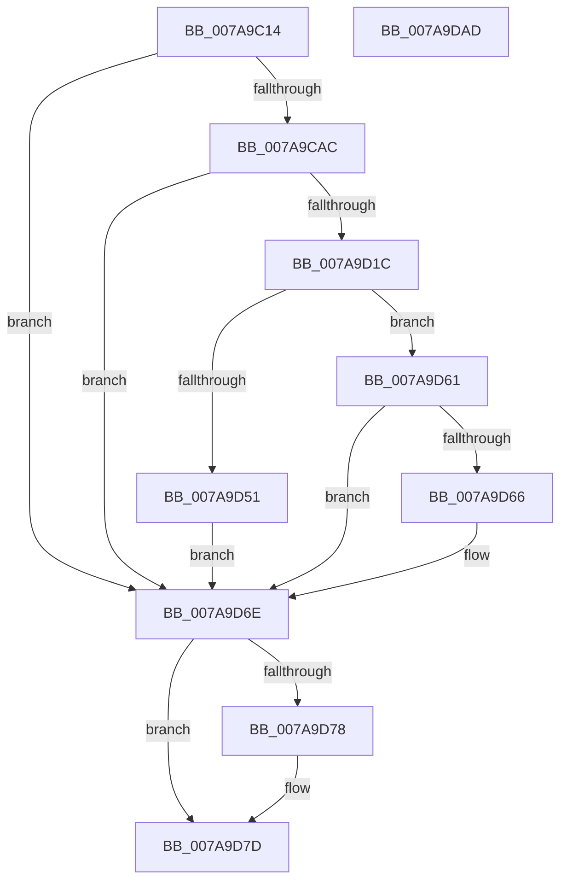

# SmKmStoreFileOpenVolume

- RVA: `0x007A9C14`–`0x007A9DAE` (길이 `410` bytes)
- VA: `0x00000001407A9C14`
- 실행 섹션: `PAGE`
- PDB 이름 있음: `예`; PDB Function 태그: `아니요`
- unwind 정보 RVA: `0x000D1EC4`
- 디코드: `102`개 명령, `410/410` bytes 표시
- 미해석 바이트: `0` (있으면 어셈블리에 `.byte`로 보존)

> 이 문서는 커널 이미지의 기계어와 PDB 기호를 분석해 생성했습니다. 4번과 5번은 함수 원형과 자료형을 바이너리 사용 방식에서 추정한 C 해석이며 원본 소스 복구 결과는 아닙니다.

## 1. Dependencies

- 직접 호출 지점: **10**; 고유 호출 대상: **9**
- 직접 호출자로 확인된 함수: **3**
- RIP 상대 이미지 참조: **1**

### Outgoing calls
- `0x007A9C73` → [memset](../../text/6C/memset_function_006C6C40.md) (function, `0x006C6C40`)
- `0x007A9C80` → [IoSetThreadHardErrorMode](../../text/46/IoSetThreadHardErrorMode_function_00466BF0.md) (function, `0x00466BF0`)
- `0x007A9C9D` → [ObQueryNameStringMode](../8A/ObQueryNameStringMode_function_008A7ED0.md) (function, `0x008A7ED0`)
- `0x007A9D11` → [ZwCreateFile](../../text/6A/ZwCreateFile_function_006ADB70.md) (function, `0x006ADB70`)
- `0x007A9D41` → [ObReferenceObjectByHandle](../86/ObReferenceObjectByHandle_function_00868DB0.md) (function, `0x00868DB0`)
- `0x007A9D54` → [IoGetRelatedDeviceObject](../../text/29/IoGetRelatedDeviceObject_function_0029B120.md) (function, `0x0029B120`)
- `0x007A9D69` → [ObfDereferenceObject](../../text/2F/ObfDereferenceObject_function_002F9350.md) (function, `0x002F9350`)
- `0x007A9D78` → [ZwClose](../../text/6A/ZwClose_function_006AD2B0.md) (function, `0x006AD2B0`)
- `0x007A9D80` → [IoSetThreadHardErrorMode](../../text/46/IoSetThreadHardErrorMode_function_00466BF0.md) (function, `0x00466BF0`)
- `0x007A9D91` → [_security_check_cookie](../../text/6A/_security_check_cookie_function_006AC640.md) (function, `0x006AC640`)

### Direct callers
- [SmKmEtwAppendProductName](../../text/60/SmKmEtwAppendProductName_function_0060F854.md) at `0x0060F893`
- [SmKmStoreFileCreate](SmKmStoreFileCreate_function_007A8F14.md) at `0x007A92A0`
- [SmcCacheStart](SmcCacheStart_function_007ABC48.md) at `0x007ABD91`

### Static image references
- `0x007A9C2F` → RVA `0x00E0A740` (`.data`; read)

## 2. Other-region calls and transfers

- 다른 실행 섹션으로 향하는 call: **8**
  - `0x007A9C73` → [memset](../../text/6C/memset_function_006C6C40.md) (`PAGE` → `.text`)
  - `0x007A9C80` → [IoSetThreadHardErrorMode](../../text/46/IoSetThreadHardErrorMode_function_00466BF0.md) (`PAGE` → `.text`)
  - `0x007A9D11` → [ZwCreateFile](../../text/6A/ZwCreateFile_function_006ADB70.md) (`PAGE` → `.text`)
  - `0x007A9D54` → [IoGetRelatedDeviceObject](../../text/29/IoGetRelatedDeviceObject_function_0029B120.md) (`PAGE` → `.text`)
  - `0x007A9D69` → [ObfDereferenceObject](../../text/2F/ObfDereferenceObject_function_002F9350.md) (`PAGE` → `.text`)
  - `0x007A9D78` → [ZwClose](../../text/6A/ZwClose_function_006AD2B0.md) (`PAGE` → `.text`)
  - `0x007A9D80` → [IoSetThreadHardErrorMode](../../text/46/IoSetThreadHardErrorMode_function_00466BF0.md) (`PAGE` → `.text`)
  - `0x007A9D91` → [_security_check_cookie](../../text/6A/_security_check_cookie_function_006AC640.md) (`PAGE` → `.text`)
- 별도 외부 분기/꼬리 이동을 확인하지 못했습니다.

## 3. Assembly (complete function range)

```asm
007A9C14  48 89 5C 24 20                  mov qword ptr [rsp + 0x20], rbx
007A9C19  55                              push rbp
007A9C1A  56                              push rsi
007A9C1B  57                              push rdi
007A9C1C  41 56                           push r14
007A9C1E  41 57                           push r15
007A9C20  48 8D AC 24 20 FE FF FF         lea rbp, [rsp - 0x1e0]
007A9C28  48 81 EC E0 02 00 00            sub rsp, 0x2e0
007A9C2F  48 8B 05 0A 0B 66 00            mov rax, qword ptr [rip + 0x660b0a]
007A9C36  48 33 C4                        xor rax, rsp
007A9C39  48 89 85 D0 01 00 00            mov qword ptr [rbp + 0x1d0], rax
007A9C40  83 64 24 60 00                  and dword ptr [rsp + 0x60], 0
007A9C45  0F 57 C9                        xorps xmm1, xmm1
007A9C48  4D 8B F8                        mov r15, r8
007A9C4B  4C 8B F2                        mov r14, rdx
007A9C4E  48 8B D9                        mov rbx, rcx
007A9C51  0F 57 C0                        xorps xmm0, xmm0
007A9C54  BF 08 02 00 00                  mov edi, 0x208
007A9C59  48 8D 4D C0                     lea rcx, [rbp - 0x40]
007A9C5D  44 8B C7                        mov r8d, edi
007A9C60  33 D2                           xor edx, edx
007A9C62  0F 11 45 A8                     movups xmmword ptr [rbp - 0x58], xmm0
007A9C66  0F 11 4C 24 78                  movups xmmword ptr [rsp + 0x78], xmm1
007A9C6B  0F 11 4D 88                     movups xmmword ptr [rbp - 0x78], xmm1
007A9C6F  0F 11 4D 98                     movups xmmword ptr [rbp - 0x68], xmm1
007A9C73  E8 C8 CF F1 FF                  call 0x1406c6c40
007A9C78  48 83 64 24 68 00               and qword ptr [rsp + 0x68], 0
007A9C7E  33 C9                           xor ecx, ecx
007A9C80  E8 6B CF CB FF                  call 0x140466bf0
007A9C85  48 8B 4B 08                     mov rcx, qword ptr [rbx + 8]
007A9C89  4C 8D 4C 24 60                  lea r9, [rsp + 0x60]
007A9C8E  44 8B C7                        mov r8d, edi
007A9C91  C6 44 24 20 00                  mov byte ptr [rsp + 0x20], 0
007A9C96  48 8D 55 C0                     lea rdx, [rbp - 0x40]
007A9C9A  40 8A F0                        mov sil, al
007A9C9D  E8 2E E2 0F 00                  call 0x1408a7ed0
007A9CA2  8B F8                           mov edi, eax
007A9CA4  85 C0                           test eax, eax
007A9CA6  0F 88 C2 00 00 00               js 0x1407a9d6e
007A9CAC  83 64 24 50 00                  and dword ptr [rsp + 0x50], 0
007A9CB1  48 8D 45 C0                     lea rax, [rbp - 0x40]
007A9CB5  48 83 64 24 48 00               and qword ptr [rsp + 0x48], 0
007A9CBB  4C 8D 4D A8                     lea r9, [rbp - 0x58]
007A9CBF  48 83 65 80 00                  and qword ptr [rbp - 0x80], 0
007A9CC4  4C 8D 44 24 78                  lea r8, [rsp + 0x78]
007A9CC9  C7 44 24 40 20 00 00 00         mov dword ptr [rsp + 0x40], 0x20
007A9CD1  48 8D 4C 24 68                  lea rcx, [rsp + 0x68]
007A9CD6  C7 44 24 38 01 00 00 00         mov dword ptr [rsp + 0x38], 1
007A9CDE  0F 57 C0                        xorps xmm0, xmm0
007A9CE1  C7 44 24 30 07 00 00 00         mov dword ptr [rsp + 0x30], 7
007A9CE9  BA 80 00 10 00                  mov edx, 0x100080
007A9CEE  83 64 24 28 00                  and dword ptr [rsp + 0x28], 0
007A9CF3  48 83 64 24 20 00               and qword ptr [rsp + 0x20], 0
007A9CF9  C7 44 24 78 30 00 00 00         mov dword ptr [rsp + 0x78], 0x30
007A9D01  C7 45 90 40 02 00 00            mov dword ptr [rbp - 0x70], 0x240
007A9D08  48 89 45 88                     mov qword ptr [rbp - 0x78], rax
007A9D0C  F3 0F 7F 45 98                  movdqu xmmword ptr [rbp - 0x68], xmm0
007A9D11  E8 5A 3E F0 FF                  call 0x1406adb70
007A9D16  8B F8                           mov edi, eax
007A9D18  85 C0                           test eax, eax
007A9D1A  78 52                           js 0x1407a9d6e
007A9D1C  48 83 64 24 28 00               and qword ptr [rsp + 0x28], 0
007A9D22  48 8D 44 24 70                  lea rax, [rsp + 0x70]
007A9D27  48 8B 4C 24 68                  mov rcx, qword ptr [rsp + 0x68]
007A9D2C  45 33 C9                        xor r9d, r9d
007A9D2F  48 83 64 24 70 00               and qword ptr [rsp + 0x70], 0
007A9D35  45 33 C0                        xor r8d, r8d
007A9D38  48 89 44 24 20                  mov qword ptr [rsp + 0x20], rax
007A9D3D  41 8D 51 03                     lea edx, [r9 + 3]
007A9D41  E8 6A F0 0B 00                  call 0x140868db0
007A9D46  48 8B 5C 24 70                  mov rbx, qword ptr [rsp + 0x70]
007A9D4B  8B F8                           mov edi, eax
007A9D4D  85 C0                           test eax, eax
007A9D4F  78 10                           js 0x1407a9d61
007A9D51  48 8B CB                        mov rcx, rbx
007A9D54  E8 C7 13 AF FF                  call 0x14029b120
007A9D59  49 89 1E                        mov qword ptr [r14], rbx
007A9D5C  49 89 07                        mov qword ptr [r15], rax
007A9D5F  EB 0D                           jmp 0x1407a9d6e
007A9D61  48 85 DB                        test rbx, rbx
007A9D64  74 08                           je 0x1407a9d6e
007A9D66  48 8B CB                        mov rcx, rbx
007A9D69  E8 E2 F5 B4 FF                  call 0x1402f9350
007A9D6E  48 8B 4C 24 68                  mov rcx, qword ptr [rsp + 0x68]
007A9D73  48 85 C9                        test rcx, rcx
007A9D76  74 05                           je 0x1407a9d7d
007A9D78  E8 33 35 F0 FF                  call 0x1406ad2b0
007A9D7D  40 8A CE                        mov cl, sil
007A9D80  E8 6B CE CB FF                  call 0x140466bf0
007A9D85  8B C7                           mov eax, edi
007A9D87  48 8B 8D D0 01 00 00            mov rcx, qword ptr [rbp + 0x1d0]
007A9D8E  48 33 CC                        xor rcx, rsp
007A9D91  E8 AA 28 F0 FF                  call 0x1406ac640
007A9D96  48 8B 9C 24 28 03 00 00         mov rbx, qword ptr [rsp + 0x328]
007A9D9E  48 81 C4 E0 02 00 00            add rsp, 0x2e0
007A9DA5  41 5F                           pop r15
007A9DA7  41 5E                           pop r14
007A9DA9  5F                              pop rdi
007A9DAA  5E                              pop rsi
007A9DAB  5D                              pop rbp
007A9DAC  C3                              ret
007A9DAD  CC                              int3
```

## 4. C-style interpretation (structured pseudocode)

```c
__int64 __fastcall SmKmStoreFileOpenVolume(__int64 a1, __int64 a2, __int64 a3)
{
    __int64 result;
    __int64 v_rsp;
    unsigned __int64 v_stack_m208;
    unsigned __int64 v_stack_m248;
    unsigned __int64 v_stack_m260;
    unsigned __int64 v_stack_m270;
    unsigned int v_stack_m278;
    unsigned __int64 v_stack_m280;
    unsigned __int64 v_stack_m288;
    unsigned __int64 v_stack_m290;
    unsigned __int64 v_stack_m298;
    unsigned __int64 v_stack_m2A0;
    unsigned int v_stack_m2A8;
    unsigned int v_stack_m2B8;
    unsigned __int64 v_stack_m2C0;
    unsigned int v_stack_m2C8;
    unsigned int v_stack_m2D0;
    unsigned int v_stack_m2D8;
    unsigned int v_stack_m2E0;
    unsigned __int8 v_stack_m2E8;
    unsigned __int64 v_stack_m38;
    unsigned __int64 v_stack_p20;

    v_stack_p20 = v_rbx;
    v_rsp = (v_rsp) - (736);
    result = (*(unsigned __int64 *)(v_rip + 6687498)) ^ (v_rsp);
    v_stack_m38 = result;
    a2 = 0;
    v_stack_m260 = v_xmm0;
    v_stack_m290 = v_xmm1;
    v_stack_m280 = v_xmm1;
    v_stack_m270 = v_xmm1;
    result = memset(v_stack_m248, a2, 520, a4);
    a1 = 0;
    result = IoSetThreadHardErrorMode(a1, a2, 520, a4);
    v_stack_m2E8 = 0;
    result = ObQueryNameStringMode(*(unsigned __int64 *)(a1 + 8), v_stack_m248, 520, v_stack_m2A8);
    if (sign_flag) goto loc_007A9D6E;
    v_stack_m2C8 = 32;
    v_stack_m2D0 = 1;
    v_stack_m2D8 = 7;
    v_stack_m290 = 48;
    v_stack_m278 = 576;
    v_stack_m280 = v_stack_m248;
    v_stack_m270 = v_xmm0;
    result = ZwCreateFile(v_stack_m2A0, (unsigned int)(0x100080ULL), v_stack_m290, v_stack_m260);
    if (sign_flag) goto loc_007A9D6E;
    a4 = 0;
    a3 = 0;
    v_stack_m2E8 = v_stack_m298;
    result = ObReferenceObjectByHandle(v_stack_m2A0, a4 + 3, a3, a4);
    if (sign_flag) goto loc_007A9D61;
    result = IoGetRelatedDeviceObject(v_stack_m298, a4 + 3, a3, a4);
    *(unsigned __int64 *)(a2) = v_stack_m298;
    *(unsigned __int64 *)(a3) = result;
    goto loc_007A9D6E;
loc_007A9D61:
    if (v_stack_m298 != 0) {
        a1 = v_stack_m298;
        result = ObfDereferenceObject(a1, a4 + 3, a3, a4);
    }
    if (v_stack_m2A0 != 0) {
        result = ZwClose(v_stack_m2A0, a4 + 3, a3, a4);
    }
    result = IoSetThreadHardErrorMode((unsigned __int8)((unsigned __int8)(result)), a4 + 3, a3, a4);
    a1 = (v_stack_m38) ^ (v_rsp);
    result = _security_check_cookie(a1, a4 + 3, a3, a4);
    v_rsp = (v_rsp) + (736);
    return result;
}
```

## 5. (Beta) C Style

```c
int64_t SmKmStoreFileOpenVolume(void *Arg1, void *Arg2, void *Arg3)
{
    uint8_t *arg1 = (uint8_t *)Arg1;
    uint8_t *arg2 = (uint8_t *)Arg2;
    uint8_t *arg3 = (uint8_t *)Arg3;

    int64_t result;
    int64_t local_rsp;
    uint64_t v_stack_m208;
    uint64_t v_stack_m248;
    uint64_t v_stack_m260;
    uint64_t v_stack_m270;
    uint32_t v_stack_m278;
    uint64_t v_stack_m280;
    uint64_t v_stack_m288;
    uint64_t v_stack_m290;
    uint64_t v_stack_m298;
    uint64_t v_stack_m2A0;
    uint32_t v_stack_m2A8;
    uint32_t v_stack_m2B8;
    uint64_t v_stack_m2C0;
    uint32_t v_stack_m2C8;
    uint32_t v_stack_m2D0;
    uint32_t v_stack_m2D8;
    uint32_t v_stack_m2E0;
    uint8_t v_stack_m2E8;
    uint64_t v_stack_m38;
    uint64_t v_stack_p20;

    v_stack_p20 = local_rbx;
    local_rsp = (local_rsp) - (736);
    result = (*(uint64_t *)(v_rip + 0x660B0A)) ^ (local_rsp);
    v_stack_m38 = result;
    Arg2 = 0;
    v_stack_m260 = v_xmm0;
    v_stack_m290 = v_xmm1;
    v_stack_m280 = v_xmm1;
    v_stack_m270 = v_xmm1;
    result = memset(v_stack_m248, Arg2, 520, a4);
    Arg1 = 0;
    result = IoSetThreadHardErrorMode(Arg1, Arg2, 520, a4);
    v_stack_m2E8 = 0;
    result = ObQueryNameStringMode(*(uint64_t *)(arg1 + 0x8), v_stack_m248, 520, v_stack_m2A8);
    if (sign_flag) goto loc_007A9D6E;
    v_stack_m2C8 = 32;
    v_stack_m2D0 = 1;
    v_stack_m2D8 = 7;
    v_stack_m290 = 48;
    v_stack_m278 = 576;
    v_stack_m280 = v_stack_m248;
    v_stack_m270 = v_xmm0;
    result = ZwCreateFile(v_stack_m2A0, (uint32_t)(0x100080ULL), v_stack_m290, v_stack_m260);
    if (sign_flag) goto loc_007A9D6E;
    a4 = 0;
    Arg3 = 0;
    v_stack_m2E8 = v_stack_m298;
    result = ObReferenceObjectByHandle(v_stack_m2A0, a4 + 3, Arg3, a4);
    if (sign_flag) goto loc_007A9D61;
    result = IoGetRelatedDeviceObject(v_stack_m298, a4 + 3, Arg3, a4);
    *(uint64_t *)(arg2) = v_stack_m298;
    *(uint64_t *)(arg3) = result;
    goto loc_007A9D6E;
loc_007A9D61:
    if (v_stack_m298 != 0) {
        Arg1 = v_stack_m298;
        result = ObfDereferenceObject(Arg1, a4 + 3, Arg3, a4);
    }
    if (v_stack_m2A0 != 0) {
        result = ZwClose(v_stack_m2A0, a4 + 3, Arg3, a4);
    }
    result = IoSetThreadHardErrorMode((uint8_t)((uint8_t)(result)), a4 + 3, Arg3, a4);
    Arg1 = (v_stack_m38) ^ (local_rsp);
    result = _security_check_cookie(Arg1, a4 + 3, Arg3, a4);
    local_rsp = (local_rsp) + (736);
    return result;
}
```

### 관측된 메모리 오프셋

구조체 형식이 확인되지 않은 접근은 인자 기준의 오프셋으로만 기록했습니다.

| 기준 인자 | 오프셋 표현 | 폭 (bit) | 접근 |
|---|---:|---:|---|
| `Arg1` | `+ 0x8` | `64` | `R` |
| `Arg2` | `+ 0x0` | `64` | `W` |
| `Arg3` | `+ 0x0` | `64` | `W` |

## 6. Execution-region graph

[열기: 2D/3D 그래프와 함수 탐색 컨트롤 패널](../../../control-panel.html?section=page&rva=0x007A9C14&view=graph)

- 2D 그래프는 위에서 아래로 흐르고, 3D 그래프는 빈 공간을 드래그해 회전합니다. Shift+드래그는 이동, 휠은 확대·축소, 함수 노드 선택은 대상 보고서 이동입니다.

### Static fallback


