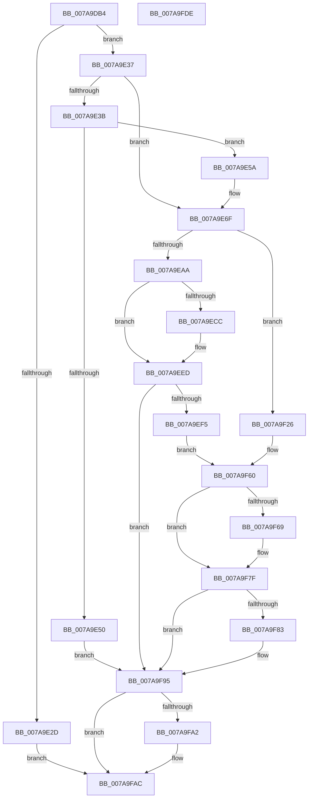

# SmKmStoreFileWriteHeader

- RVA: `0x007A9DB4`–`0x007A9FDF` (길이 `555` bytes)
- VA: `0x00000001407A9DB4`
- 실행 섹션: `PAGE`
- PDB 이름 있음: `예`; PDB Function 태그: `아니요`
- unwind 정보 RVA: `0x000D1F38`
- 디코드: `151`개 명령, `555/555` bytes 표시
- 미해석 바이트: `0` (있으면 어셈블리에 `.byte`로 보존)

> 이 문서는 커널 이미지의 기계어와 PDB 기호를 분석해 생성했습니다. 4번과 5번은 함수 원형과 자료형을 바이너리 사용 방식에서 추정한 C 해석이며 원본 소스 복구 결과는 아닙니다.

## 1. Dependencies

- 직접 호출 지점: **17**; 고유 호출 대상: **15**
- 직접 호출자로 확인된 함수: **1**
- RIP 상대 이미지 참조: **1**

### Outgoing calls
- `0x007A9E06` → [IoSetThreadHardErrorMode](../../text/46/IoSetThreadHardErrorMode_function_00466BF0.md) (function, `0x00466BF0`)
- `0x007A9E20` → [SmAllocEx](../../text/34/SmAllocEx_function_0034C794.md) (function, `0x0034C794`)
- `0x007A9E43` → [MmCreateMdl](../../text/46/MmCreateMdl_function_00463E20.md) (function, `0x00463E20`)
- `0x007A9E5D` → [MmBuildMdlForNonPagedPool](../../text/23/MmBuildMdlForNonPagedPool_function_0023A870.md) (function, `0x0023A870`)
- `0x007A9E6A` → [MmMdlPageContentsState](../../text/45/MmMdlPageContentsState_function_00452790.md) (function, `0x00452790`)
- `0x007A9E77` → [memset](../../text/6C/memset_function_006C6C40.md) (function, `0x006C6C40`)
- `0x007A9E9B` → [RtlComputeCrc32](../../text/46/RtlComputeCrc32_function_00468F40.md) (function, `0x00468F40`)
- `0x007A9EBE` → [ZwQueryInformationFile](../../text/6A/ZwQueryInformationFile_function_006AD2F0.md) (function, `0x006AD2F0`)
- `0x007A9EE5` → [KeWaitForSingleObject](../../text/20/KeWaitForSingleObject_function_0020E6B0.md) (function, `0x0020E6B0`)
- `0x007A9EFE` → [KeInitializeEvent](../../text/40/KeInitializeEvent_function_0040DD10.md) (function, `0x0040DD10`)
- `0x007A9F1B` → [IoSynchronousPageWrite](../../text/29/IoSynchronousPageWrite_function_00299E30.md) (function, `0x00299E30`)
- `0x007A9F50` → [ZwWriteFile](../../text/6A/ZwWriteFile_function_006AD1D0.md) (function, `0x006AD1D0`)
- `0x007A9F77` → [KeWaitForSingleObject](../../text/20/KeWaitForSingleObject_function_0020E6B0.md) (function, `0x0020E6B0`)
- `0x007A9F98` → [CmSiFreeMemory](../../text/47/CmSiFreeMemory_function_00475D80.md) (function, `0x00475D80`)
- `0x007A9FA7` → [ExFreePoolWithTag](../../poolcode/B8/ExFreePoolWithTag_function_00B82870.md) (function, `0x00B82870`)
- `0x007A9FAF` → [IoSetThreadHardErrorMode](../../text/46/IoSetThreadHardErrorMode_function_00466BF0.md) (function, `0x00466BF0`)
- `0x007A9FBD` → [_security_check_cookie](../../text/6A/_security_check_cookie_function_006AC640.md) (function, `0x006AC640`)

### Direct callers
- [SmKmStoreFileCreate](SmKmStoreFileCreate_function_007A8F14.md) at `0x007A92BB`

### Static image references
- `0x007A9DD2` → RVA `0x00E0A740` (`.data`; read)

## 2. Other-region calls and transfers

- 다른 실행 섹션으로 향하는 call: **17**
  - `0x007A9E06` → [IoSetThreadHardErrorMode](../../text/46/IoSetThreadHardErrorMode_function_00466BF0.md) (`PAGE` → `.text`)
  - `0x007A9E20` → [SmAllocEx](../../text/34/SmAllocEx_function_0034C794.md) (`PAGE` → `.text`)
  - `0x007A9E43` → [MmCreateMdl](../../text/46/MmCreateMdl_function_00463E20.md) (`PAGE` → `.text`)
  - `0x007A9E5D` → [MmBuildMdlForNonPagedPool](../../text/23/MmBuildMdlForNonPagedPool_function_0023A870.md) (`PAGE` → `.text`)
  - `0x007A9E6A` → [MmMdlPageContentsState](../../text/45/MmMdlPageContentsState_function_00452790.md) (`PAGE` → `.text`)
  - `0x007A9E77` → [memset](../../text/6C/memset_function_006C6C40.md) (`PAGE` → `.text`)
  - `0x007A9E9B` → [RtlComputeCrc32](../../text/46/RtlComputeCrc32_function_00468F40.md) (`PAGE` → `.text`)
  - `0x007A9EBE` → [ZwQueryInformationFile](../../text/6A/ZwQueryInformationFile_function_006AD2F0.md) (`PAGE` → `.text`)
  - `0x007A9EE5` → [KeWaitForSingleObject](../../text/20/KeWaitForSingleObject_function_0020E6B0.md) (`PAGE` → `.text`)
  - `0x007A9EFE` → [KeInitializeEvent](../../text/40/KeInitializeEvent_function_0040DD10.md) (`PAGE` → `.text`)
  - `0x007A9F1B` → [IoSynchronousPageWrite](../../text/29/IoSynchronousPageWrite_function_00299E30.md) (`PAGE` → `.text`)
  - `0x007A9F50` → [ZwWriteFile](../../text/6A/ZwWriteFile_function_006AD1D0.md) (`PAGE` → `.text`)
  - `0x007A9F77` → [KeWaitForSingleObject](../../text/20/KeWaitForSingleObject_function_0020E6B0.md) (`PAGE` → `.text`)
  - `0x007A9F98` → [CmSiFreeMemory](../../text/47/CmSiFreeMemory_function_00475D80.md) (`PAGE` → `.text`)
  - `0x007A9FA7` → [ExFreePoolWithTag](../../poolcode/B8/ExFreePoolWithTag_function_00B82870.md) (`PAGE` → `POOLCODE`)
  - `0x007A9FAF` → [IoSetThreadHardErrorMode](../../text/46/IoSetThreadHardErrorMode_function_00466BF0.md) (`PAGE` → `.text`)
  - `0x007A9FBD` → [_security_check_cookie](../../text/6A/_security_check_cookie_function_006AC640.md) (`PAGE` → `.text`)
- 별도 외부 분기/꼬리 이동을 확인하지 못했습니다.

## 3. Assembly (complete function range)

```asm
007A9DB4  48 89 5C 24 10                  mov qword ptr [rsp + 0x10], rbx
007A9DB9  48 89 74 24 18                  mov qword ptr [rsp + 0x18], rsi
007A9DBE  55                              push rbp
007A9DBF  57                              push rdi
007A9DC0  41 55                           push r13
007A9DC2  41 56                           push r14
007A9DC4  41 57                           push r15
007A9DC6  48 8D 6C 24 C9                  lea rbp, [rsp - 0x37]
007A9DCB  48 81 EC A0 00 00 00            sub rsp, 0xa0
007A9DD2  48 8B 05 67 09 66 00            mov rax, qword ptr [rip + 0x660967]
007A9DD9  48 33 C4                        xor rax, rsp
007A9DDC  48 89 45 2F                     mov qword ptr [rbp + 0x2f], rax
007A9DE0  0F 57 C0                        xorps xmm0, xmm0
007A9DE3  33 C0                           xor eax, eax
007A9DE5  48 21 45 F7                     and qword ptr [rbp - 9], rax
007A9DE9  4C 8B F1                        mov r14, rcx
007A9DEC  33 C9                           xor ecx, ecx
007A9DEE  48 89 45 0F                     mov qword ptr [rbp + 0xf], rax
007A9DF2  0F 11 45 FF                     movups xmmword ptr [rbp - 1], xmm0
007A9DF6  48 89 45 27                     mov qword ptr [rbp + 0x27], rax
007A9DFA  8B DA                           mov ebx, edx
007A9DFC  0F 11 45 E7                     movups xmmword ptr [rbp - 0x19], xmm0
007A9E00  33 FF                           xor edi, edi
007A9E02  0F 11 45 17                     movups xmmword ptr [rbp + 0x17], xmm0
007A9E06  E8 E5 CD CB FF                  call 0x140466bf0
007A9E0B  41 BD 00 00 01 00               mov r13d, 0x10000
007A9E11  41 83 C8 FF                     or r8d, 0xffffffff
007A9E15  41 8B CD                        mov ecx, r13d
007A9E18  BA 73 6D 46 68                  mov edx, 0x68466d73
007A9E1D  44 8A F8                        mov r15b, al
007A9E20  E8 6F 29 BA FF                  call 0x14034c794
007A9E25  48 8B F0                        mov rsi, rax
007A9E28  48 85 C0                        test rax, rax
007A9E2B  75 0A                           jne 0x1407a9e37
007A9E2D  BB 9A 00 00 C0                  mov ebx, 0xc000009a
007A9E32  E9 75 01 00 00                  jmp 0x1407a9fac
007A9E37  85 DB                           test ebx, ebx
007A9E39  75 34                           jne 0x1407a9e6f
007A9E3B  4D 8B C5                        mov r8, r13
007A9E3E  48 8B D6                        mov rdx, rsi
007A9E41  33 C9                           xor ecx, ecx
007A9E43  E8 D8 9F CB FF                  call 0x140463e20
007A9E48  48 8B F8                        mov rdi, rax
007A9E4B  48 85 C0                        test rax, rax
007A9E4E  75 0A                           jne 0x1407a9e5a
007A9E50  BB 9A 00 00 C0                  mov ebx, 0xc000009a
007A9E55  E9 3B 01 00 00                  jmp 0x1407a9f95
007A9E5A  48 8B CF                        mov rcx, rdi
007A9E5D  E8 0E 0A A9 FF                  call 0x14023a870
007A9E62  BA 01 00 00 00                  mov edx, 1
007A9E67  48 8B CF                        mov rcx, rdi
007A9E6A  E8 21 89 CA FF                  call 0x140452790
007A9E6F  4D 8B C5                        mov r8, r13
007A9E72  33 D2                           xor edx, edx
007A9E74  48 8B CE                        mov rcx, rsi
007A9E77  E8 C4 CD F1 FF                  call 0x1406c6c40
007A9E7C  41 B8 30 00 00 00               mov r8d, 0x30
007A9E82  C7 06 67 4D 63 45               mov dword ptr [rsi], 0x45634d67
007A9E88  48 8B D6                        mov rdx, rsi
007A9E8B  C7 46 04 03 00 00 00            mov dword ptr [rsi + 4], 3
007A9E92  33 C9                           xor ecx, ecx
007A9E94  C7 46 28 01 00 00 00            mov dword ptr [rsi + 0x28], 1
007A9E9B  E8 A0 F0 CB FF                  call 0x140468f40
007A9EA0  89 46 08                        mov dword ptr [rsi + 8], eax
007A9EA3  49 8B 0E                        mov rcx, qword ptr [r14]
007A9EA6  85 DB                           test ebx, ebx
007A9EA8  75 7C                           jne 0x1407a9f26
007A9EAA  44 8D 4B 18                     lea r9d, [rbx + 0x18]
007A9EAE  C7 44 24 20 05 00 00 00         mov dword ptr [rsp + 0x20], 5
007A9EB6  4C 8D 45 17                     lea r8, [rbp + 0x17]
007A9EBA  48 8D 55 E7                     lea rdx, [rbp - 0x19]
007A9EBE  E8 2D 34 F0 FF                  call 0x1406ad2f0
007A9EC3  8B D8                           mov ebx, eax
007A9EC5  3D 03 01 00 00                  cmp eax, 0x103
007A9ECA  75 21                           jne 0x1407a9eed
007A9ECC  49 8B 4E 08                     mov rcx, qword ptr [r14 + 8]
007A9ED0  45 33 C9                        xor r9d, r9d
007A9ED3  48 83 64 24 20 00               and qword ptr [rsp + 0x20], 0
007A9ED9  48 81 C1 98 00 00 00            add rcx, 0x98
007A9EE0  45 33 C0                        xor r8d, r8d
007A9EE3  33 D2                           xor edx, edx
007A9EE5  E8 C6 47 A6 FF                  call 0x14020e6b0
007A9EEA  8B 5D E7                        mov ebx, dword ptr [rbp - 0x19]
007A9EED  85 DB                           test ebx, ebx
007A9EEF  0F 88 A0 00 00 00               js 0x1407a9f95
007A9EF5  45 33 C0                        xor r8d, r8d
007A9EF8  48 8D 4D FF                     lea rcx, [rbp - 1]
007A9EFC  33 D2                           xor edx, edx
007A9EFE  E8 0D 3E C6 FF                  call 0x14040dd10
007A9F03  49 8B 4E 08                     mov rcx, qword ptr [r14 + 8]
007A9F07  48 8D 45 E7                     lea rax, [rbp - 0x19]
007A9F0B  4C 8D 4D FF                     lea r9, [rbp - 1]
007A9F0F  48 89 44 24 20                  mov qword ptr [rsp + 0x20], rax
007A9F14  4C 8D 45 F7                     lea r8, [rbp - 9]
007A9F18  48 8B D7                        mov rdx, rdi
007A9F1B  E8 10 FF AE FF                  call 0x140299e30
007A9F20  48 8D 4D FF                     lea rcx, [rbp - 1]
007A9F24  EB 3A                           jmp 0x1407a9f60
007A9F26  48 83 64 24 40 00               and qword ptr [rsp + 0x40], 0
007A9F2C  48 8D 45 F7                     lea rax, [rbp - 9]
007A9F30  48 89 44 24 38                  mov qword ptr [rsp + 0x38], rax
007A9F35  45 33 C9                        xor r9d, r9d
007A9F38  44 89 6C 24 30                  mov dword ptr [rsp + 0x30], r13d
007A9F3D  48 8D 45 E7                     lea rax, [rbp - 0x19]
007A9F41  48 89 74 24 28                  mov qword ptr [rsp + 0x28], rsi
007A9F46  45 33 C0                        xor r8d, r8d
007A9F49  33 D2                           xor edx, edx
007A9F4B  48 89 44 24 20                  mov qword ptr [rsp + 0x20], rax
007A9F50  E8 7B 32 F0 FF                  call 0x1406ad1d0
007A9F55  49 8B 4E 08                     mov rcx, qword ptr [r14 + 8]
007A9F59  48 81 C1 98 00 00 00            add rcx, 0x98
007A9F60  8B D8                           mov ebx, eax
007A9F62  3D 03 01 00 00                  cmp eax, 0x103
007A9F67  75 16                           jne 0x1407a9f7f
007A9F69  48 83 64 24 20 00               and qword ptr [rsp + 0x20], 0
007A9F6F  45 33 C9                        xor r9d, r9d
007A9F72  45 33 C0                        xor r8d, r8d
007A9F75  33 D2                           xor edx, edx
007A9F77  E8 34 47 A6 FF                  call 0x14020e6b0
007A9F7C  8B 5D E7                        mov ebx, dword ptr [rbp - 0x19]
007A9F7F  85 DB                           test ebx, ebx
007A9F81  78 12                           js 0x1407a9f95
007A9F83  48 8B 45 EF                     mov rax, qword ptr [rbp - 0x11]
007A9F87  49 2B C5                        sub rax, r13
007A9F8A  48 F7 D8                        neg rax
007A9F8D  1B DB                           sbb ebx, ebx
007A9F8F  81 E3 6A 01 00 C0               and ebx, 0xc000016a
007A9F95  48 8B CE                        mov rcx, rsi
007A9F98  E8 E3 BD CC FF                  call 0x140475d80
007A9F9D  48 85 FF                        test rdi, rdi
007A9FA0  74 0A                           je 0x1407a9fac
007A9FA2  33 D2                           xor edx, edx
007A9FA4  48 8B CF                        mov rcx, rdi
007A9FA7  E8 C4 88 3D 00                  call 0x140b82870
007A9FAC  41 8A CF                        mov cl, r15b
007A9FAF  E8 3C CC CB FF                  call 0x140466bf0
007A9FB4  8B C3                           mov eax, ebx
007A9FB6  48 8B 4D 2F                     mov rcx, qword ptr [rbp + 0x2f]
007A9FBA  48 33 CC                        xor rcx, rsp
007A9FBD  E8 7E 26 F0 FF                  call 0x1406ac640
007A9FC2  4C 8D 9C 24 A0 00 00 00         lea r11, [rsp + 0xa0]
007A9FCA  49 8B 5B 38                     mov rbx, qword ptr [r11 + 0x38]
007A9FCE  49 8B 73 40                     mov rsi, qword ptr [r11 + 0x40]
007A9FD2  49 8B E3                        mov rsp, r11
007A9FD5  41 5F                           pop r15
007A9FD7  41 5E                           pop r14
007A9FD9  41 5D                           pop r13
007A9FDB  5F                              pop rdi
007A9FDC  5D                              pop rbp
007A9FDD  C3                              ret
007A9FDE  CC                              int3
```

## 4. C-style interpretation (structured pseudocode)

```c
__int64 __fastcall SmKmStoreFileWriteHeader(__int64 a1, int a2, int a3)
{
    __int64 result;
    __int64 v_rbx;
    __int64 v_rdi;
    __int64 v_rsp;
    unsigned __int64 v_stack_m28;
    unsigned __int64 v_stack_m30;
    unsigned __int64 v_stack_m38;
    unsigned __int64 v_stack_m48;
    unsigned __int64 v_stack_m50;
    unsigned __int64 v_stack_m5F;
    unsigned __int64 v_stack_m60;
    unsigned __int64 v_stack_m68;
    unsigned __int64 v_stack_m70;
    unsigned __int64 v_stack_m78;
    unsigned __int64 v_stack_m88;
    unsigned __int64 v_stack_m90;
    unsigned int v_stack_m98;
    unsigned __int64 v_stack_mA0;
    unsigned int v_stack_mA8;
    unsigned __int64 v_stack_p10;
    unsigned __int64 v_stack_p18;

    v_stack_p10 = v_rbx;
    v_stack_p18 = v_rsi;
    v_rsp = (v_rsp) - (160);
    result = (*(unsigned __int64 *)(v_rip + 6687079)) ^ (v_rsp);
    v_stack_m30 = result;
    result = 0;
    a1 = 0;
    v_stack_m50 = 0;
    v_stack_m60 = v_xmm0;
    v_stack_m38 = 0;
    v_stack_m78 = v_xmm0;
    v_rdi = 0;
    v_stack_m48 = v_xmm0;
    result = IoSetThreadHardErrorMode(a1, a2, a3, a4);
    a3 = (unsigned int)((a3) | (0xFFFFFFFFULL));
    result = SmAllocEx((unsigned int)((unsigned int)((unsigned int)(0x10000ULL))), (unsigned int)(0x68466D73ULL), a3, a4);
    if (result != 0) goto loc_007A9E37;
    goto loc_007A9FAC;
loc_007A9E37:
    if ((unsigned int)((unsigned int)(0xC000009AULL)) != 0) goto loc_007A9E6F;
    a1 = 0;
    result = MmCreateMdl(a1, result, (unsigned int)(0x10000ULL), a4);
    if (result != 0) goto loc_007A9E5A;
    goto loc_007A9F95;
loc_007A9E5A:
    result = MmBuildMdlForNonPagedPool(result, result, (unsigned int)(0x10000ULL), a4);
    result = MmMdlPageContentsState(result, 1, (unsigned int)(0x10000ULL), a4);
loc_007A9E6F:
    a2 = 0;
    result = memset(result, a2, (unsigned int)(0x10000ULL), a4);
    *(unsigned int *)(result) = 0x45634D67ULL;
    *(unsigned int *)(result + 4) = 3;
    a1 = 0;
    *(unsigned int *)(result + 40) = 1;
    result = RtlComputeCrc32(a1, result, 48, a4);
    *(unsigned int *)(result + 8) = (unsigned int)(result);
    if ((unsigned int)((unsigned int)(0xC000009AULL)) != 0) goto loc_007A9F26;
    v_stack_mA8 = 5;
    result = ZwQueryInformationFile(*(unsigned __int64 *)(a1), v_stack_m78, v_stack_m48, (unsigned int)(0xC000009AULL) + 24);
    v_rbx = (unsigned int)((unsigned int)(result));
    if (((unsigned int)(result)) == 259) {
        a1 = *(unsigned __int64 *)(a1 + 8);
        a4 = 0;
        a1 = (a1) + (152);
        a3 = 0;
        a2 = 0;
        result = KeWaitForSingleObject(a1, a2, a3, a4);
        v_rbx = v_stack_m78;
    }
    if (sign_flag) goto loc_007A9F95;
    a3 = 0;
    a2 = 0;
    result = KeInitializeEvent(v_stack_m60, a2, a3, a4);
    v_stack_mA8 = v_stack_m78;
    result = IoSynchronousPageWrite(*(unsigned __int64 *)(a1 + 8), result, v_stack_m68, v_stack_m60);
    goto loc_007A9F60;
loc_007A9F26:
    v_stack_m90 = v_stack_m68;
    a4 = 0;
    v_stack_m98 = (unsigned int)((unsigned int)(0x10000ULL));
    v_stack_mA0 = result;
    a3 = 0;
    a2 = 0;
    v_stack_mA8 = v_stack_m78;
    result = ZwWriteFile(v_stack_m60, a2, a3, a4);
    a1 = (*(unsigned __int64 *)(a1 + 8)) + (152);
loc_007A9F60:
    v_rbx = (unsigned int)((unsigned int)(result));
    if (((unsigned int)(result)) == 259) {
        a4 = 0;
        a3 = 0;
        a2 = 0;
        result = KeWaitForSingleObject(a1, a2, a3, a4);
        v_rbx = v_stack_m78;
    }
    if (!(sign_flag)) {
        result = v_stack_m70;
        result = (result) - ((unsigned int)(0x10000ULL));
        result = -(result);
        v_rbx = (unsigned int)((v_rbx) & (0xC000016AULL));
    }
    result = CmSiFreeMemory(result, a2, a3, a4);
    if (result != 0) {
        a2 = 0;
        a1 = result;
        result = ExFreePoolWithTag(a1, a2, a3, a4);
    }
    result = IoSetThreadHardErrorMode((unsigned __int8)((unsigned __int8)(result)), a2, a3, a4);
    a1 = (v_stack_m30) ^ (v_rsp);
    result = _security_check_cookie(a1, a2, a3, a4);
    return result;
}
```

## 5. (Beta) C Style

```c
int64_t SmKmStoreFileWriteHeader(void *Arg1, int32_t Arg2, int32_t Arg3)
{
    uint8_t *arg1 = (uint8_t *)Arg1;

    int64_t result;
    int64_t local_rbx;
    int64_t local_rdi;
    int64_t local_rsp;
    uint64_t v_stack_m28;
    uint64_t v_stack_m30;
    uint64_t v_stack_m38;
    uint64_t v_stack_m48;
    uint64_t v_stack_m50;
    uint64_t v_stack_m5F;
    uint64_t v_stack_m60;
    uint64_t v_stack_m68;
    uint64_t v_stack_m70;
    uint64_t v_stack_m78;
    uint64_t v_stack_m88;
    uint64_t v_stack_m90;
    uint32_t v_stack_m98;
    uint64_t v_stack_mA0;
    uint32_t v_stack_mA8;
    uint64_t v_stack_p10;
    uint64_t v_stack_p18;

    v_stack_p10 = local_rbx;
    v_stack_p18 = local_rsi;
    local_rsp = (local_rsp) - (160);
    result = (*(uint64_t *)(v_rip + 0x660967)) ^ (local_rsp);
    v_stack_m30 = result;
    result = 0;
    Arg1 = 0;
    v_stack_m50 = 0;
    v_stack_m60 = v_xmm0;
    v_stack_m38 = 0;
    v_stack_m78 = v_xmm0;
    local_rdi = 0;
    v_stack_m48 = v_xmm0;
    result = IoSetThreadHardErrorMode(Arg1, Arg2, Arg3, a4);
    Arg3 = (uint32_t)((Arg3) | (0xFFFFFFFFULL));
    result = SmAllocEx((uint32_t)((uint32_t)((uint32_t)(0x10000ULL))), (uint32_t)(0x68466D73ULL), Arg3, a4);
    if (result != 0) goto loc_007A9E37;
    goto loc_007A9FAC;
loc_007A9E37:
    if ((uint32_t)((uint32_t)(0xC000009AULL)) != 0) goto loc_007A9E6F;
    Arg1 = 0;
    result = MmCreateMdl(Arg1, result, (uint32_t)(0x10000ULL), a4);
    if (result != 0) goto loc_007A9E5A;
    goto loc_007A9F95;
loc_007A9E5A:
    result = MmBuildMdlForNonPagedPool(result, result, (uint32_t)(0x10000ULL), a4);
    result = MmMdlPageContentsState(result, 1, (uint32_t)(0x10000ULL), a4);
loc_007A9E6F:
    Arg2 = 0;
    result = memset(result, Arg2, (uint32_t)(0x10000ULL), a4);
    *(uint32_t *)(result) = 0x45634D67ULL;
    *(uint32_t *)(result + 0x4) = 3;
    Arg1 = 0;
    *(uint32_t *)(result + 0x28) = 1;
    result = RtlComputeCrc32(Arg1, result, 48, a4);
    *(uint32_t *)(result + 0x8) = (uint32_t)(result);
    if ((uint32_t)((uint32_t)(0xC000009AULL)) != 0) goto loc_007A9F26;
    v_stack_mA8 = 5;
    result = ZwQueryInformationFile(*(uint64_t *)(arg1), v_stack_m78, v_stack_m48, (uint32_t)(0xC000009AULL) + 24);
    local_rbx = (uint32_t)((uint32_t)(result));
    if (((uint32_t)(result)) == 259) {
        Arg1 = *(uint64_t *)(arg1 + 0x8);
        a4 = 0;
        Arg1 = (Arg1) + (152);
        Arg3 = 0;
        Arg2 = 0;
        result = KeWaitForSingleObject(Arg1, Arg2, Arg3, a4);
        local_rbx = v_stack_m78;
    }
    if (sign_flag) goto loc_007A9F95;
    Arg3 = 0;
    Arg2 = 0;
    result = KeInitializeEvent(v_stack_m60, Arg2, Arg3, a4);
    v_stack_mA8 = v_stack_m78;
    result = IoSynchronousPageWrite(*(uint64_t *)(arg1 + 0x8), result, v_stack_m68, v_stack_m60);
    goto loc_007A9F60;
loc_007A9F26:
    v_stack_m90 = v_stack_m68;
    a4 = 0;
    v_stack_m98 = (uint32_t)((uint32_t)(0x10000ULL));
    v_stack_mA0 = result;
    Arg3 = 0;
    Arg2 = 0;
    v_stack_mA8 = v_stack_m78;
    result = ZwWriteFile(v_stack_m60, Arg2, Arg3, a4);
    Arg1 = (*(uint64_t *)(arg1 + 0x8)) + (152);
loc_007A9F60:
    local_rbx = (uint32_t)((uint32_t)(result));
    if (((uint32_t)(result)) == 259) {
        a4 = 0;
        Arg3 = 0;
        Arg2 = 0;
        result = KeWaitForSingleObject(Arg1, Arg2, Arg3, a4);
        local_rbx = v_stack_m78;
    }
    if (!(sign_flag)) {
        result = v_stack_m70;
        result = (result) - ((uint32_t)(0x10000ULL));
        result = -(result);
        local_rbx = (uint32_t)((local_rbx) & (0xC000016AULL));
    }
    result = CmSiFreeMemory(result, Arg2, Arg3, a4);
    if (result != 0) {
        Arg2 = 0;
        Arg1 = result;
        result = ExFreePoolWithTag(Arg1, Arg2, Arg3, a4);
    }
    result = IoSetThreadHardErrorMode((uint8_t)((uint8_t)(result)), Arg2, Arg3, a4);
    Arg1 = (v_stack_m30) ^ (local_rsp);
    result = _security_check_cookie(Arg1, Arg2, Arg3, a4);
    return result;
}
```

### 관측된 메모리 오프셋

구조체 형식이 확인되지 않은 접근은 인자 기준의 오프셋으로만 기록했습니다.

| 기준 인자 | 오프셋 표현 | 폭 (bit) | 접근 |
|---|---:|---:|---|
| `Arg1` | `+ 0x0` | `64` | `R` |
| `Arg1` | `+ 0x8` | `64` | `R` |

## 6. Execution-region graph

[열기: 2D/3D 그래프와 함수 탐색 컨트롤 패널](../../../control-panel.html?section=page&rva=0x007A9DB4&view=graph)

- 2D 그래프는 위에서 아래로 흐르고, 3D 그래프는 빈 공간을 드래그해 회전합니다. Shift+드래그는 이동, 휠은 확대·축소, 함수 노드 선택은 대상 보고서 이동입니다.

### Static fallback


