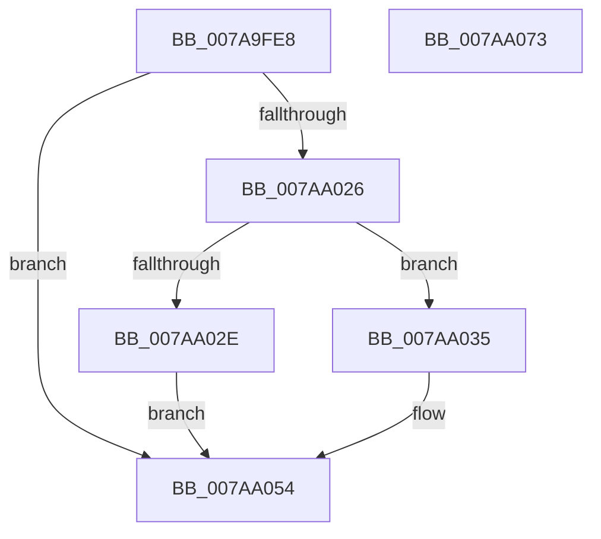

# SmKmVolumeQueryUniqueId

- RVA: `0x007A9FE8`–`0x007AA074` (길이 `140` bytes)
- VA: `0x00000001407A9FE8`
- 실행 섹션: `PAGE`
- PDB 이름 있음: `예`; PDB Function 태그: `아니요`
- unwind 정보 RVA: `0x0007D3C0`
- 디코드: `42`개 명령, `140/140` bytes 표시
- 미해석 바이트: `0` (있으면 어셈블리에 `.byte`로 보존)

> 이 문서는 커널 이미지의 기계어와 PDB 기호를 분석해 생성했습니다. 4번과 5번은 함수 원형과 자료형을 바이너리 사용 방식에서 추정한 C 해석이며 원본 소스 복구 결과는 아닙니다.

## 1. Dependencies

- 직접 호출 지점: **5**; 고유 호출 대상: **4**
- 직접 호출자로 확인된 함수: **2**
- RIP 상대 이미지 참조: **0**

### Outgoing calls
- `0x007AA007` → [IoSetThreadHardErrorMode](../../text/46/IoSetThreadHardErrorMode_function_00466BF0.md) (function, `0x00466BF0`)
- `0x007AA01B` → [SmKmSendDeviceControl](SmKmSendDeviceControl_function_007A8D84.md) (function, `0x007A8D84`)
- `0x007AA03F` → [memcpy](../../text/6C/memcpy_function_006C6840.md) (function, `0x006C6840`)
- `0x007AA04D` → [SmSanitizeString](../../text/60/SmSanitizeString_function_0060EC04.md) (function, `0x0060EC04`)
- `0x007AA057` → [IoSetThreadHardErrorMode](../../text/46/IoSetThreadHardErrorMode_function_00466BF0.md) (function, `0x00466BF0`)

### Direct callers
- [SmKmEtwAppendProductName](../../text/60/SmKmEtwAppendProductName_function_0060F854.md) at `0x0060F8D3`
- [SmcCacheStart](SmcCacheStart_function_007ABC48.md) at `0x007ABDB1`

### Static image references
- 디코드된 RIP-relative 메모리 참조가 없습니다.

## 2. Other-region calls and transfers

- 다른 실행 섹션으로 향하는 call: **4**
  - `0x007AA007` → [IoSetThreadHardErrorMode](../../text/46/IoSetThreadHardErrorMode_function_00466BF0.md) (`PAGE` → `.text`)
  - `0x007AA03F` → [memcpy](../../text/6C/memcpy_function_006C6840.md) (`PAGE` → `.text`)
  - `0x007AA04D` → [SmSanitizeString](../../text/60/SmSanitizeString_function_0060EC04.md) (`PAGE` → `.text`)
  - `0x007AA057` → [IoSetThreadHardErrorMode](../../text/46/IoSetThreadHardErrorMode_function_00466BF0.md) (`PAGE` → `.text`)
- 별도 외부 분기/꼬리 이동을 확인하지 못했습니다.

## 3. Assembly (complete function range)

```asm
007A9FE8  48 89 5C 24 08                  mov qword ptr [rsp + 8], rbx
007A9FED  48 89 6C 24 10                  mov qword ptr [rsp + 0x10], rbp
007A9FF2  48 89 74 24 18                  mov qword ptr [rsp + 0x18], rsi
007A9FF7  57                              push rdi
007A9FF8  48 83 EC 40                     sub rsp, 0x40
007A9FFC  48 8B F9                        mov rdi, rcx
007A9FFF  41 8B D8                        mov ebx, r8d
007AA002  33 C9                           xor ecx, ecx
007AA004  48 8B F2                        mov rsi, rdx
007AA007  E8 E4 CB CB FF                  call 0x140466bf0
007AA00C  48 8B D7                        mov rdx, rdi
007AA00F  89 5C 24 28                     mov dword ptr [rsp + 0x28], ebx
007AA013  40 8A E8                        mov bpl, al
007AA016  48 89 74 24 20                  mov qword ptr [rsp + 0x20], rsi
007AA01B  E8 64 ED FF FF                  call 0x1407a8d84
007AA020  8B D8                           mov ebx, eax
007AA022  85 C0                           test eax, eax
007AA024  78 2E                           js 0x1407aa054
007AA026  0F B7 1E                        movzx ebx, word ptr [rsi]
007AA029  83 FB 02                        cmp ebx, 2
007AA02C  73 07                           jae 0x1407aa035
007AA02E  BB 46 04 00 C0                  mov ebx, 0xc0000446
007AA033  EB 1F                           jmp 0x1407aa054
007AA035  4C 8B C3                        mov r8, rbx
007AA038  48 8D 56 02                     lea rdx, [rsi + 2]
007AA03C  48 8B CE                        mov rcx, rsi
007AA03F  E8 FC C7 F1 FF                  call 0x1406c6840
007AA044  83 E3 FE                        and ebx, 0xfffffffe
007AA047  48 8B CE                        mov rcx, rsi
007AA04A  8D 53 02                        lea edx, [rbx + 2]
007AA04D  E8 B2 4B E6 FF                  call 0x14060ec04
007AA052  33 DB                           xor ebx, ebx
007AA054  40 8A CD                        mov cl, bpl
007AA057  E8 94 CB CB FF                  call 0x140466bf0
007AA05C  48 8B 6C 24 58                  mov rbp, qword ptr [rsp + 0x58]
007AA061  8B C3                           mov eax, ebx
007AA063  48 8B 5C 24 50                  mov rbx, qword ptr [rsp + 0x50]
007AA068  48 8B 74 24 60                  mov rsi, qword ptr [rsp + 0x60]
007AA06D  48 83 C4 40                     add rsp, 0x40
007AA071  5F                              pop rdi
007AA072  C3                              ret
007AA073  CC                              int3
```

## 4. C-style interpretation (structured pseudocode)

```c
__int64 __fastcall SmKmVolumeQueryUniqueId(__int64 a1, __int64 a2, int a3)
{
    __int64 result;
    __int64 v_rbx;
    __int64 v_rsp;
    unsigned int v_stack_m20;
    unsigned __int64 v_stack_m28;
    unsigned __int64 v_stack_p10;
    unsigned __int64 v_stack_p18;
    unsigned __int64 v_stack_p8;

    v_stack_p8 = v_rbx;
    v_stack_p10 = v_rbp;
    v_stack_p18 = v_rsi;
    v_rsp = (v_rsp) - (64);
    a1 = 0;
    result = IoSetThreadHardErrorMode(a1, a2, a3, a4);
    v_stack_m20 = (unsigned int)((unsigned int)(a3));
    v_stack_m28 = a2;
    result = SmKmSendDeviceControl(a1, 0, a3, a4);
    if (sign_flag) goto loc_007AA054;
    if (((unsigned int)(*(unsigned __int16 *)(a2))) >= 2) goto loc_007AA035;
    goto loc_007AA054;
loc_007AA035:
    result = memcpy(a2, a2 + 2, (unsigned int)(0xC0000446ULL), a4);
    v_rbx = (unsigned int)(((unsigned int)(0xC0000446ULL)) & (0xFFFFFFFEULL));
    result = SmSanitizeString(a2, v_rbx + 2, (unsigned int)(0xC0000446ULL), a4);
    v_rbx = 0;
loc_007AA054:
    result = IoSetThreadHardErrorMode((unsigned __int8)((unsigned __int8)(result)), v_rbx + 2, (unsigned int)(0xC0000446ULL), a4);
    v_rsp = (v_rsp) + (64);
    return 0;
}
```

## 5. (Beta) C Style

```c
int64_t SmKmVolumeQueryUniqueId(int64_t Arg1, void *Arg2, int32_t Arg3)
{
    uint8_t *arg2 = (uint8_t *)Arg2;

    int64_t result;
    int64_t local_rbx;
    int64_t local_rsp;
    uint32_t v_stack_m20;
    uint64_t v_stack_m28;
    uint64_t v_stack_p10;
    uint64_t v_stack_p18;
    uint64_t v_stack_p8;

    v_stack_p8 = local_rbx;
    v_stack_p10 = local_rbp;
    v_stack_p18 = local_rsi;
    local_rsp = (local_rsp) - (64);
    Arg1 = 0;
    result = IoSetThreadHardErrorMode(Arg1, Arg2, Arg3, a4);
    v_stack_m20 = (uint32_t)((uint32_t)(Arg3));
    v_stack_m28 = Arg2;
    result = SmKmSendDeviceControl(Arg1, 0, Arg3, a4);
    if (sign_flag) goto loc_007AA054;
    if (((uint32_t)(*(uint16_t *)(arg2))) >= 2) goto loc_007AA035;
    goto loc_007AA054;
loc_007AA035:
    result = memcpy(Arg2, Arg2 + 2, (uint32_t)(0xC0000446ULL), a4);
    local_rbx = (uint32_t)(((uint32_t)(0xC0000446ULL)) & (0xFFFFFFFEULL));
    result = SmSanitizeString(Arg2, local_rbx + 2, (uint32_t)(0xC0000446ULL), a4);
    local_rbx = 0;
loc_007AA054:
    result = IoSetThreadHardErrorMode((uint8_t)((uint8_t)(result)), local_rbx + 2, (uint32_t)(0xC0000446ULL), a4);
    local_rsp = (local_rsp) + (64);
    return 0;
}
```

### 관측된 메모리 오프셋

구조체 형식이 확인되지 않은 접근은 인자 기준의 오프셋으로만 기록했습니다.

| 기준 인자 | 오프셋 표현 | 폭 (bit) | 접근 |
|---|---:|---:|---|
| `Arg2` | `+ 0x0` | `16` | `R` |
| `Arg2` | `+ 0x2` | `64` | `R` |

## 6. Execution-region graph

[열기: 2D/3D 그래프와 함수 탐색 컨트롤 패널](../../../control-panel.html?section=page&rva=0x007A9FE8&view=graph)

- 2D 그래프는 위에서 아래로 흐르고, 3D 그래프는 빈 공간을 드래그해 회전합니다. Shift+드래그는 이동, 휠은 확대·축소, 함수 노드 선택은 대상 보고서 이동입니다.

### Static fallback


