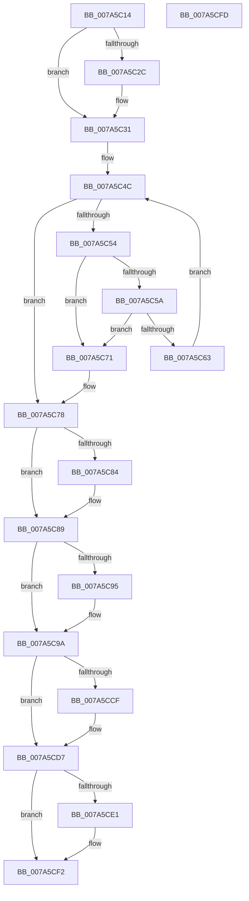

# SmPartitionCleanup

- RVA: `0x007A5C14`–`0x007A5CFE` (길이 `234` bytes)
- VA: `0x00000001407A5C14`
- 실행 섹션: `PAGE`
- PDB 이름 있음: `예`; PDB Function 태그: `아니요`
- unwind 정보 RVA: `0x0005CAAC`
- 디코드: `57`개 명령, `234/234` bytes 표시
- 미해석 바이트: `0` (있으면 어셈블리에 `.byte`로 보존)

> 이 문서는 커널 이미지의 기계어와 PDB 기호를 분석해 생성했습니다. 4번과 5번은 함수 원형과 자료형을 바이너리 사용 방식에서 추정한 C 해석이며 원본 소스 복구 결과는 아닙니다.

## 1. Dependencies

- 직접 호출 지점: **11**; 고유 호출 대상: **9**
- 직접 호출자로 확인된 함수: **2**
- RIP 상대 이미지 참조: **0**

### Outgoing calls
- `0x007A5C2C` → [SmKmStoreDereference](../../text/20/SmKmStoreDereference_function_00206574.md) (function, `0x00206574`)
- `0x007A5C34` → [SMKM_STORE_MGR<SM_TRAITS>::SmCleanup](../../text/60/SMKM_STORE_MGR_SM_TRAITS_SmCleanup_function_0060C214.md) (function, `0x0060C214`)
- `0x007A5C40` → [SmpKeyedStoreCtxCleanup](../../text/60/SmpKeyedStoreCtxCleanup_function_0060EBE4.md) (function, `0x0060EBE4`)
- `0x007A5C6A` → [CmSiFreeMemory](../../text/47/CmSiFreeMemory_function_00475D80.md) (function, `0x00475D80`)
- `0x007A5C84` → [CmSiFreeMemory](../../text/47/CmSiFreeMemory_function_00475D80.md) (function, `0x00475D80`)
- `0x007A5C95` → [ObfDereferenceObject](../../text/2F/ObfDereferenceObject_function_002F9350.md) (function, `0x002F9350`)
- `0x007A5CA1` → [SmFpCleanup](../../text/3B/SmFpCleanup_function_003B082C.md) (function, `0x003B082C`)
- `0x007A5CAD` → [SmFpCleanup](../../text/3B/SmFpCleanup_function_003B082C.md) (function, `0x003B082C`)
- `0x007A5CC0` → [SmHwAcceleratorPartitionMgrCleanup](SmHwAcceleratorPartitionMgrCleanup_function_007AB34C.md) (function, `0x007AB34C`)
- `0x007A5CD2` → [SmTerminateStoreProcess](../../text/60/SmTerminateStoreProcess_function_0060EB18.md) (function, `0x0060EB18`)
- `0x007A5CED` → [MmStoreReleaseResidentAvailableForRead](../../text/45/MmStoreReleaseResidentAvailableForRead_function_00456D24.md) (function, `0x00456D24`)

### Direct callers
- [SmDeletePartition](SmDeletePartition_function_007A59C0.md) at `0x007A5A89`
- [sub_00B3B882](../B3/Unknown_function_00B3B882.md) at `0x00B3B9D7`

### Static image references
- 디코드된 RIP-relative 메모리 참조가 없습니다.

## 2. Other-region calls and transfers

- 다른 실행 섹션으로 향하는 call: **10**
  - `0x007A5C2C` → [SmKmStoreDereference](../../text/20/SmKmStoreDereference_function_00206574.md) (`PAGE` → `.text`)
  - `0x007A5C34` → [SMKM_STORE_MGR<SM_TRAITS>::SmCleanup](../../text/60/SMKM_STORE_MGR_SM_TRAITS_SmCleanup_function_0060C214.md) (`PAGE` → `.text`)
  - `0x007A5C40` → [SmpKeyedStoreCtxCleanup](../../text/60/SmpKeyedStoreCtxCleanup_function_0060EBE4.md) (`PAGE` → `.text`)
  - `0x007A5C6A` → [CmSiFreeMemory](../../text/47/CmSiFreeMemory_function_00475D80.md) (`PAGE` → `.text`)
  - `0x007A5C84` → [CmSiFreeMemory](../../text/47/CmSiFreeMemory_function_00475D80.md) (`PAGE` → `.text`)
  - `0x007A5C95` → [ObfDereferenceObject](../../text/2F/ObfDereferenceObject_function_002F9350.md) (`PAGE` → `.text`)
  - `0x007A5CA1` → [SmFpCleanup](../../text/3B/SmFpCleanup_function_003B082C.md) (`PAGE` → `.text`)
  - `0x007A5CAD` → [SmFpCleanup](../../text/3B/SmFpCleanup_function_003B082C.md) (`PAGE` → `.text`)
  - `0x007A5CD2` → [SmTerminateStoreProcess](../../text/60/SmTerminateStoreProcess_function_0060EB18.md) (`PAGE` → `.text`)
  - `0x007A5CED` → [MmStoreReleaseResidentAvailableForRead](../../text/45/MmStoreReleaseResidentAvailableForRead_function_00456D24.md) (`PAGE` → `.text`)
- 별도 외부 분기/꼬리 이동을 확인하지 못했습니다.

## 3. Assembly (complete function range)

```asm
007A5C14  48 89 5C 24 08                  mov qword ptr [rsp + 8], rbx
007A5C19  57                              push rdi
007A5C1A  48 83 EC 20                     sub rsp, 0x20
007A5C1E  8B 91 E0 08 00 00               mov edx, dword ptr [rcx + 0x8e0]
007A5C24  48 8B D9                        mov rbx, rcx
007A5C27  83 FA FF                        cmp edx, -1
007A5C2A  74 05                           je 0x1407a5c31
007A5C2C  E8 43 09 A6 FF                  call 0x140206574
007A5C31  48 8B CB                        mov rcx, rbx
007A5C34  E8 DB 65 E6 FF                  call 0x14060c214
007A5C39  48 8D 8B B8 08 00 00            lea rcx, [rbx + 0x8b8]
007A5C40  E8 9F 8F E6 FF                  call 0x14060ebe4
007A5C45  48 8D BB F8 0A 00 00            lea rdi, [rbx + 0xaf8]
007A5C4C  48 8B 0F                        mov rcx, qword ptr [rdi]
007A5C4F  48 3B CF                        cmp rcx, rdi
007A5C52  74 24                           je 0x1407a5c78
007A5C54  48 39 79 08                     cmp qword ptr [rcx + 8], rdi
007A5C58  75 17                           jne 0x1407a5c71
007A5C5A  48 8B 01                        mov rax, qword ptr [rcx]
007A5C5D  48 39 48 08                     cmp qword ptr [rax + 8], rcx
007A5C61  75 0E                           jne 0x1407a5c71
007A5C63  48 89 07                        mov qword ptr [rdi], rax
007A5C66  48 89 78 08                     mov qword ptr [rax + 8], rdi
007A5C6A  E8 11 01 CD FF                  call 0x140475d80
007A5C6F  EB DB                           jmp 0x1407a5c4c
007A5C71  B9 03 00 00 00                  mov ecx, 3
007A5C76  CD 29                           int 0x29
007A5C78  48 8B 8B 10 0B 00 00            mov rcx, qword ptr [rbx + 0xb10]
007A5C7F  48 85 C9                        test rcx, rcx
007A5C82  74 05                           je 0x1407a5c89
007A5C84  E8 F7 00 CD FF                  call 0x140475d80
007A5C89  48 8B 8B 20 0B 00 00            mov rcx, qword ptr [rbx + 0xb20]
007A5C90  48 85 C9                        test rcx, rcx
007A5C93  74 05                           je 0x1407a5c9a
007A5C95  E8 B6 36 B5 FF                  call 0x1402f9350
007A5C9A  48 8D 8B 40 0B 00 00            lea rcx, [rbx + 0xb40]
007A5CA1  E8 86 AB C0 FF                  call 0x1403b082c
007A5CA6  48 8D 8B B8 0B 00 00            lea rcx, [rbx + 0xbb8]
007A5CAD  E8 7A AB C0 FF                  call 0x1403b082c
007A5CB2  48 8B 93 78 08 00 00            mov rdx, qword ptr [rbx + 0x878]
007A5CB9  48 8D 8B 30 0C 00 00            lea rcx, [rbx + 0xc30]
007A5CC0  E8 87 56 00 00                  call 0x1407ab34c
007A5CC5  48 83 BB 70 08 00 00 00         cmp qword ptr [rbx + 0x870], 0
007A5CCD  74 08                           je 0x1407a5cd7
007A5CCF  48 8B CB                        mov rcx, rbx
007A5CD2  E8 41 8E E6 FF                  call 0x14060eb18
007A5CD7  8B 83 58 08 00 00               mov eax, dword ptr [rbx + 0x858]
007A5CDD  A8 10                           test al, 0x10
007A5CDF  74 11                           je 0x1407a5cf2
007A5CE1  48 8B 8B 30 08 00 00            mov rcx, qword ptr [rbx + 0x830]
007A5CE8  BA 01 00 00 00                  mov edx, 1
007A5CED  E8 32 10 CB FF                  call 0x140456d24
007A5CF2  48 8B 5C 24 30                  mov rbx, qword ptr [rsp + 0x30]
007A5CF7  48 83 C4 20                     add rsp, 0x20
007A5CFB  5F                              pop rdi
007A5CFC  C3                              ret
007A5CFD  CC                              int3
```

## 4. C-style interpretation (structured pseudocode)

```c
__int64 __fastcall SmPartitionCleanup(__int64 a1)
{
    __int64 result;
    __int64 v_rsp;
    unsigned __int64 v_stack_p8;

    v_stack_p8 = v_rbx;
    v_rsp = (v_rsp) - (32);
    if (((unsigned int)((unsigned int)(*(unsigned int *)(a1 + 2272)))) != -1) {
        result = SmKmStoreDereference(a1, (unsigned int)(*(unsigned int *)(a1 + 2272)), a3, a4);
    }
    result = SMKM_STORE_MGR_SM_TRAITS___SmCleanup(a1, (unsigned int)(*(unsigned int *)(a1 + 2272)), a3, a4);
    result = SmpKeyedStoreCtxCleanup(a1 + 2232, (unsigned int)(*(unsigned int *)(a1 + 2272)), a3, a4);
loc_007A5C4C:
    if ((*(unsigned __int64 *)(a1 + 2808)) == (a1 + 2808)) goto loc_007A5C78;
    if ((*(unsigned __int64 *)(*(unsigned __int64 *)(a1 + 2808) + 8)) != (a1 + 2808)) goto loc_007A5C71;
    if ((*(unsigned __int64 *)(*(unsigned __int64 *)(*(unsigned __int64 *)(a1 + 2808)) + 8)) != (*(unsigned __int64 *)(a1 + 2808))) goto loc_007A5C71;
    *(unsigned __int64 *)(a1 + 2808) = *(unsigned __int64 *)(*(unsigned __int64 *)(a1 + 2808));
    *(unsigned __int64 *)(*(unsigned __int64 *)(*(unsigned __int64 *)(a1 + 2808)) + 8) = a1 + 2808;
    result = CmSiFreeMemory(*(unsigned __int64 *)(a1 + 2808), (unsigned int)(*(unsigned int *)(a1 + 2272)), a3, a4);
    goto loc_007A5C4C;
loc_007A5C71:
loc_007A5C78:
    if (*(unsigned __int64 *)(a1 + 2832) != 0) {
        result = CmSiFreeMemory(*(unsigned __int64 *)(a1 + 2832), (unsigned int)(*(unsigned int *)(a1 + 2272)), a3, a4);
    }
    if (*(unsigned __int64 *)(a1 + 2848) != 0) {
        result = ObfDereferenceObject(*(unsigned __int64 *)(a1 + 2848), (unsigned int)(*(unsigned int *)(a1 + 2272)), a3, a4);
    }
    result = SmFpCleanup(a1 + 2880, (unsigned int)(*(unsigned int *)(a1 + 2272)), a3, a4);
    result = SmFpCleanup(a1 + 3000, (unsigned int)(*(unsigned int *)(a1 + 2272)), a3, a4);
    result = SmHwAcceleratorPartitionMgrCleanup(a1 + 3120, *(unsigned __int64 *)(a1 + 2168), a3, a4);
    if ((*(unsigned __int64 *)(a1 + 2160)) != 0) {
        a1 = a1;
        result = SmTerminateStoreProcess(a1, *(unsigned __int64 *)(a1 + 2168), a3, a4);
    }
    result = (unsigned int)(*(unsigned int *)(a1 + 2136));
    if ((((unsigned __int8)((unsigned int)(*(unsigned int *)(a1 + 2136)))) & (16)) != 0) {
        a1 = *(unsigned __int64 *)(a1 + 2096);
        a2 = 1;
        result = MmStoreReleaseResidentAvailableForRead(a1, a2, a3, a4);
    }
    v_rsp = (v_rsp) + (32);
    return result;
}
```

## 5. (Beta) C Style

```c
int64_t SmPartitionCleanup(void *Arg1)
{
    uint8_t *arg1 = (uint8_t *)Arg1;

    int64_t result;
    int64_t local_rsp;
    uint64_t v_stack_p8;

    v_stack_p8 = local_rbx;
    local_rsp = (local_rsp) - (32);
    if (((uint32_t)((uint32_t)(*(uint32_t *)(arg1 + 0x8E0)))) != -1) {
        result = SmKmStoreDereference(Arg1, (uint32_t)(*(uint32_t *)(arg1 + 0x8E0)), a3, a4);
    }
    result = SMKM_STORE_MGR_SM_TRAITS___SmCleanup(Arg1, (uint32_t)(*(uint32_t *)(arg1 + 0x8E0)), a3, a4);
    result = SmpKeyedStoreCtxCleanup(Arg1 + 2232, (uint32_t)(*(uint32_t *)(arg1 + 0x8E0)), a3, a4);
loc_007A5C4C:
    if ((*(uint64_t *)(arg1 + 0xAF8)) == (Arg1 + 2808)) goto loc_007A5C78;
    if ((*(uint64_t *)(*(uint64_t *)(arg1 + 0xAF8) + 0x8)) != (Arg1 + 2808)) goto loc_007A5C71;
    if ((*(uint64_t *)(*(uint64_t *)(*(uint64_t *)(arg1 + 0xAF8)) + 0x8)) != (*(uint64_t *)(arg1 + 0xAF8))) goto loc_007A5C71;
    *(uint64_t *)(arg1 + 0xAF8) = *(uint64_t *)(*(uint64_t *)(arg1 + 0xAF8));
    *(void **)(*(uint64_t *)(*(uint64_t *)(arg1 + 0xAF8)) + 0x8) = Arg1 + 2808;
    result = CmSiFreeMemory(*(uint64_t *)(arg1 + 0xAF8), (uint32_t)(*(uint32_t *)(arg1 + 0x8E0)), a3, a4);
    goto loc_007A5C4C;
loc_007A5C71:
loc_007A5C78:
    if (*(uint64_t *)(arg1 + 0xB10) != 0) {
        result = CmSiFreeMemory(*(uint64_t *)(arg1 + 0xB10), (uint32_t)(*(uint32_t *)(arg1 + 0x8E0)), a3, a4);
    }
    if (*(uint64_t *)(arg1 + 0xB20) != 0) {
        result = ObfDereferenceObject(*(uint64_t *)(arg1 + 0xB20), (uint32_t)(*(uint32_t *)(arg1 + 0x8E0)), a3, a4);
    }
    result = SmFpCleanup(Arg1 + 2880, (uint32_t)(*(uint32_t *)(arg1 + 0x8E0)), a3, a4);
    result = SmFpCleanup(Arg1 + 3000, (uint32_t)(*(uint32_t *)(arg1 + 0x8E0)), a3, a4);
    result = SmHwAcceleratorPartitionMgrCleanup(Arg1 + 3120, *(uint64_t *)(arg1 + 0x878), a3, a4);
    if ((*(uint64_t *)(arg1 + 0x870)) != 0) {
        Arg1 = Arg1;
        result = SmTerminateStoreProcess(Arg1, *(uint64_t *)(arg1 + 0x878), a3, a4);
    }
    result = (uint32_t)(*(uint32_t *)(arg1 + 0x858));
    if ((((uint8_t)((uint32_t)(*(uint32_t *)(arg1 + 0x858)))) & (16)) != 0) {
        Arg1 = *(uint64_t *)(arg1 + 0x830);
        a2 = 1;
        result = MmStoreReleaseResidentAvailableForRead(Arg1, a2, a3, a4);
    }
    local_rsp = (local_rsp) + (32);
    return result;
}
```

### 관측된 메모리 오프셋

구조체 형식이 확인되지 않은 접근은 인자 기준의 오프셋으로만 기록했습니다.

| 기준 인자 | 오프셋 표현 | 폭 (bit) | 접근 |
|---|---:|---:|---|
| `Arg1` | `+ 0x0` | `64` | `R` |
| `Arg1` | `+ 0x0` | `64` | `W` |
| `Arg1` | `+ 0x830` | `64` | `R` |
| `Arg1` | `+ 0x858` | `32` | `R` |
| `Arg1` | `+ 0x870` | `64` | `R` |
| `Arg1` | `+ 0x878` | `64` | `R` |
| `Arg1` | `+ 0x8B8` | `64` | `R` |
| `Arg1` | `+ 0x8E0` | `32` | `R` |
| `Arg1` | `+ 0xAF8` | `64` | `R` |
| `Arg1` | `+ 0xB10` | `64` | `R` |
| `Arg1` | `+ 0xB20` | `64` | `R` |
| `Arg1` | `+ 0xB40` | `64` | `R` |
| `Arg1` | `+ 0xBB8` | `64` | `R` |
| `Arg1` | `+ 0xC30` | `64` | `R` |

## 6. Execution-region graph

[열기: 2D/3D 그래프와 함수 탐색 컨트롤 패널](../../../control-panel.html?section=page&rva=0x007A5C14&view=graph)

- 2D 그래프는 위에서 아래로 흐르고, 3D 그래프는 빈 공간을 드래그해 회전합니다. Shift+드래그는 이동, 휠은 확대·축소, 함수 노드 선택은 대상 보고서 이동입니다.

### Static fallback


