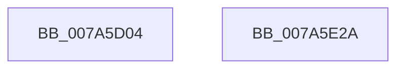

# SmPartitionInitialize

- RVA: `0x007A5D04`–`0x007A5E2B` (길이 `295` bytes)
- VA: `0x00000001407A5D04`
- 실행 섹션: `PAGE`
- PDB 이름 있음: `예`; PDB Function 태그: `아니요`
- unwind 정보 RVA: `0x00065960`
- 디코드: `56`개 명령, `295/295` bytes 표시
- 미해석 바이트: `0` (있으면 어셈블리에 `.byte`로 보존)

> 이 문서는 커널 이미지의 기계어와 PDB 기호를 분석해 생성했습니다. 4번과 5번은 함수 원형과 자료형을 바이너리 사용 방식에서 추정한 C 해석이며 원본 소스 복구 결과는 아닙니다.

## 1. Dependencies

- 직접 호출 지점: **8**; 고유 호출 대상: **6**
- 직접 호출자로 확인된 함수: **1**
- RIP 상대 이미지 참조: **2**

### Outgoing calls
- `0x007A5D19` → [memset](../../text/6C/memset_function_006C6C40.md) (function, `0x006C6C40`)
- `0x007A5D51` → [SMKM_STORE_MGR<SM_TRAITS>::SmInitialize](../../text/60/SMKM_STORE_MGR_SM_TRAITS_SmInitialize_function_0060C8CC.md) (function, `0x0060C8CC`)
- `0x007A5D6A` → [KeInitializeEvent](../../text/40/KeInitializeEvent_function_0040DD10.md) (function, `0x0040DD10`)
- `0x007A5DCA` → [SmcCacheManagerInitialize](SmcCacheManagerInitialize_function_007AB8CC.md) (function, `0x007AB8CC`)
- `0x007A5DDF` → [SmKmVirtualLockCtxInitialize](../../text/60/SmKmVirtualLockCtxInitialize_function_0060FFF4.md) (function, `0x0060FFF4`)
- `0x007A5DEE` → [SmFpInitialize](../../text/4A/SmFpInitialize_function_004AE41C.md) (function, `0x004AE41C`)
- `0x007A5DFD` → [SmFpInitialize](../../text/4A/SmFpInitialize_function_004AE41C.md) (function, `0x004AE41C`)
- `0x007A5E0B` → [memset](../../text/6C/memset_function_006C6C40.md) (function, `0x006C6C40`)

### Direct callers
- [sub_00B3B882](../B3/Unknown_function_00B3B882.md) at `0x00B3B8F8`

### Static image references
- `0x007A5D1E` → RVA `0x003173D0` (`SmpStoreMgrCallback`; read)
- `0x007A5D39` → RVA `0x00FC5000` (`ALMOSTRO`; read)

## 2. Other-region calls and transfers

- 다른 실행 섹션으로 향하는 call: **7**
  - `0x007A5D19` → [memset](../../text/6C/memset_function_006C6C40.md) (`PAGE` → `.text`)
  - `0x007A5D51` → [SMKM_STORE_MGR<SM_TRAITS>::SmInitialize](../../text/60/SMKM_STORE_MGR_SM_TRAITS_SmInitialize_function_0060C8CC.md) (`PAGE` → `.text`)
  - `0x007A5D6A` → [KeInitializeEvent](../../text/40/KeInitializeEvent_function_0040DD10.md) (`PAGE` → `.text`)
  - `0x007A5DDF` → [SmKmVirtualLockCtxInitialize](../../text/60/SmKmVirtualLockCtxInitialize_function_0060FFF4.md) (`PAGE` → `.text`)
  - `0x007A5DEE` → [SmFpInitialize](../../text/4A/SmFpInitialize_function_004AE41C.md) (`PAGE` → `.text`)
  - `0x007A5DFD` → [SmFpInitialize](../../text/4A/SmFpInitialize_function_004AE41C.md) (`PAGE` → `.text`)
  - `0x007A5E0B` → [memset](../../text/6C/memset_function_006C6C40.md) (`PAGE` → `.text`)
- 별도 외부 분기/꼬리 이동을 확인하지 못했습니다.

## 3. Assembly (complete function range)

```asm
007A5D04  48 89 5C 24 08                  mov qword ptr [rsp + 8], rbx
007A5D09  57                              push rdi
007A5D0A  48 83 EC 40                     sub rsp, 0x40
007A5D0E  33 D2                           xor edx, edx
007A5D10  41 B8 40 0D 00 00               mov r8d, 0xd40
007A5D16  48 8B F9                        mov rdi, rcx
007A5D19  E8 22 0F F2 FF                  call 0x1406c6c40
007A5D1E  48 8D 05 AB 16 B7 FF            lea rax, [rip - 0x48e955]
007A5D25  C7 44 24 20 7B 00 00 00         mov dword ptr [rsp + 0x20], 0x7b
007A5D2D  48 89 44 24 28                  mov qword ptr [rsp + 0x28], rax
007A5D32  48 8D 9F 30 0C 00 00            lea rbx, [rdi + 0xc30]
007A5D39  0F B7 05 C0 F2 81 00            movzx eax, word ptr [rip + 0x81f2c0]
007A5D40  48 8D 54 24 20                  lea rdx, [rsp + 0x20]
007A5D45  48 8B CF                        mov rcx, rdi
007A5D48  89 44 24 24                     mov dword ptr [rsp + 0x24], eax
007A5D4C  48 89 5C 24 30                  mov qword ptr [rsp + 0x30], rbx
007A5D51  E8 76 6B E6 FF                  call 0x14060c8cc
007A5D56  48 83 A7 68 08 00 00 00         and qword ptr [rdi + 0x868], 0
007A5D5E  48 8D 8F 80 08 00 00            lea rcx, [rdi + 0x880]
007A5D65  45 33 C0                        xor r8d, r8d
007A5D68  33 D2                           xor edx, edx
007A5D6A  E8 A1 7F C6 FF                  call 0x14040dd10
007A5D6F  48 83 A7 C0 08 00 00 00         and qword ptr [rdi + 0x8c0], 0
007A5D77  48 8D 8F F0 08 00 00            lea rcx, [rdi + 0x8f0]
007A5D7E  48 83 A7 C8 08 00 00 00         and qword ptr [rdi + 0x8c8], 0
007A5D86  48 83 A7 D0 08 00 00 00         and qword ptr [rdi + 0x8d0], 0
007A5D8E  48 83 A7 D8 08 00 00 00         and qword ptr [rdi + 0x8d8], 0
007A5D96  48 83 A7 B8 08 00 00 00         and qword ptr [rdi + 0x8b8], 0
007A5D9E  83 A7 C0 08 00 00 00            and dword ptr [rdi + 0x8c0], 0
007A5DA5  48 83 A7 C8 08 00 00 00         and qword ptr [rdi + 0x8c8], 0
007A5DAD  83 A7 C4 08 00 00 00            and dword ptr [rdi + 0x8c4], 0
007A5DB4  83 8F E0 08 00 00 FF            or dword ptr [rdi + 0x8e0], 0xffffffff
007A5DBB  48 83 A7 E8 08 00 00 00         and qword ptr [rdi + 0x8e8], 0
007A5DC3  C6 87 98 08 00 00 05            mov byte ptr [rdi + 0x898], 5
007A5DCA  E8 FD 5A 00 00                  call 0x1407ab8cc
007A5DCF  33 C0                           xor eax, eax
007A5DD1  48 8D 8F 28 0B 00 00            lea rcx, [rdi + 0xb28]
007A5DD8  48 89 87 20 0B 00 00            mov qword ptr [rdi + 0xb20], rax
007A5DDF  E8 10 A2 E6 FF                  call 0x14060fff4
007A5DE4  48 8D 8F 40 0B 00 00            lea rcx, [rdi + 0xb40]
007A5DEB  48 8B D7                        mov rdx, rdi
007A5DEE  E8 29 86 D0 FF                  call 0x1404ae41c
007A5DF3  48 8D 8F B8 0B 00 00            lea rcx, [rdi + 0xbb8]
007A5DFA  48 8B D7                        mov rdx, rdi
007A5DFD  E8 1A 86 D0 FF                  call 0x1404ae41c
007A5E02  33 D2                           xor edx, edx
007A5E04  48 8B CB                        mov rcx, rbx
007A5E07  44 8D 42 50                     lea r8d, [rdx + 0x50]
007A5E0B  E8 30 0E F2 FF                  call 0x1406c6c40
007A5E10  48 83 63 18 00                  and qword ptr [rbx + 0x18], 0
007A5E15  48 8B 5C 24 50                  mov rbx, qword ptr [rsp + 0x50]
007A5E1A  C7 87 60 08 00 00 03 00 00 00   mov dword ptr [rdi + 0x860], 3
007A5E24  48 83 C4 40                     add rsp, 0x40
007A5E28  5F                              pop rdi
007A5E29  C3                              ret
007A5E2A  CC                              int3
```

## 4. C-style interpretation (structured pseudocode)

```c
__int64 __fastcall SmPartitionInitialize(__int64 a1, int a2)
{
    __int64 result;
    __int64 v_rsp;
    unsigned __int64 v_stack_m18;
    unsigned __int64 v_stack_m20;
    unsigned int v_stack_m24;
    unsigned int v_stack_m28;
    unsigned __int64 v_stack_p8;

    v_stack_p8 = v_rbx;
    v_rsp = (v_rsp) - (64);
    a2 = 0;
    result = memset(a1, a2, (unsigned int)(0xD40ULL), a4);
    v_stack_m28 = 123;
    v_stack_m20 = v_rip - 4778325;
    v_stack_m24 = (unsigned int)(*(unsigned __int16 *)(v_rip + 8516288));
    v_stack_m18 = a1 + 3120;
    result = SMKM_STORE_MGR_SM_TRAITS___SmInitialize(a1, v_stack_m28, (unsigned int)(0xD40ULL), a4);
    a3 = 0;
    a2 = 0;
    result = KeInitializeEvent(a1 + 2176, a2, a3, a4);
    *(unsigned __int8 *)(a1 + 2200) = 5;
    result = SmcCacheManagerInitialize(a1 + 2288, a2, a3, a4);
    result = 0;
    *(unsigned __int64 *)(a1 + 2848) = 0;
    result = SmKmVirtualLockCtxInitialize(a1 + 2856, a2, a3, a4);
    result = SmFpInitialize(a1 + 2880, a1, a3, a4);
    result = SmFpInitialize(a1 + 3000, a1, a3, a4);
    a2 = 0;
    result = memset(a1 + 3120, a2, a2 + 80, a4);
    *(unsigned int *)(a1 + 2144) = 3;
    v_rsp = (v_rsp) + (64);
    return result;
}
```

## 5. (Beta) C Style

```c
int64_t SmPartitionInitialize(void *Arg1, int32_t Arg2)
{
    uint8_t *arg1 = (uint8_t *)Arg1;

    int64_t result;
    int64_t local_rsp;
    uint64_t v_stack_m18;
    uint64_t v_stack_m20;
    uint32_t v_stack_m24;
    uint32_t v_stack_m28;
    uint64_t v_stack_p8;

    v_stack_p8 = local_rbx;
    local_rsp = (local_rsp) - (64);
    Arg2 = 0;
    result = memset(Arg1, Arg2, (uint32_t)(0xD40ULL), a4);
    v_stack_m28 = 123;
    v_stack_m20 = v_rip - 4778325;
    v_stack_m24 = (uint32_t)(*(uint16_t *)(v_rip + 0x81F2C0));
    v_stack_m18 = Arg1 + 3120;
    result = SMKM_STORE_MGR_SM_TRAITS___SmInitialize(Arg1, v_stack_m28, (uint32_t)(0xD40ULL), a4);
    a3 = 0;
    Arg2 = 0;
    result = KeInitializeEvent(Arg1 + 2176, Arg2, a3, a4);
    *(uint8_t *)(arg1 + 0x898) = 5;
    result = SmcCacheManagerInitialize(Arg1 + 2288, Arg2, a3, a4);
    result = 0;
    *(uint64_t *)(arg1 + 0xB20) = 0;
    result = SmKmVirtualLockCtxInitialize(Arg1 + 2856, Arg2, a3, a4);
    result = SmFpInitialize(Arg1 + 2880, Arg1, a3, a4);
    result = SmFpInitialize(Arg1 + 3000, Arg1, a3, a4);
    Arg2 = 0;
    result = memset(Arg1 + 3120, Arg2, Arg2 + 80, a4);
    *(uint32_t *)(arg1 + 0x860) = 3;
    local_rsp = (local_rsp) + (64);
    return result;
}
```

### 관측된 메모리 오프셋

구조체 형식이 확인되지 않은 접근은 인자 기준의 오프셋으로만 기록했습니다.

| 기준 인자 | 오프셋 표현 | 폭 (bit) | 접근 |
|---|---:|---:|---|
| `Arg1` | `+ 0x18` | `64` | `R/W` |
| `Arg1` | `+ 0x860` | `32` | `W` |
| `Arg1` | `+ 0x868` | `64` | `R/W` |
| `Arg1` | `+ 0x880` | `64` | `R` |
| `Arg1` | `+ 0x898` | `8` | `W` |
| `Arg1` | `+ 0x8B8` | `64` | `R/W` |
| `Arg1` | `+ 0x8C0` | `32` | `R/W` |
| `Arg1` | `+ 0x8C0` | `64` | `R/W` |
| `Arg1` | `+ 0x8C4` | `32` | `R/W` |
| `Arg1` | `+ 0x8C8` | `64` | `R/W` |
| `Arg1` | `+ 0x8D0` | `64` | `R/W` |
| `Arg1` | `+ 0x8D8` | `64` | `R/W` |
| `Arg1` | `+ 0x8E0` | `32` | `R/W` |
| `Arg1` | `+ 0x8E8` | `64` | `R/W` |
| `Arg1` | `+ 0x8F0` | `64` | `R` |
| `Arg1` | `+ 0xB20` | `64` | `W` |
| `Arg1` | `+ 0xB28` | `64` | `R` |
| `Arg1` | `+ 0xB40` | `64` | `R` |
| `Arg1` | `+ 0xBB8` | `64` | `R` |
| `Arg1` | `+ 0xC30` | `64` | `R` |

## 6. Execution-region graph

[열기: 2D/3D 그래프와 함수 탐색 컨트롤 패널](../../../control-panel.html?section=page&rva=0x007A5D04&view=graph)

- 2D 그래프는 위에서 아래로 흐르고, 3D 그래프는 빈 공간을 드래그해 회전합니다. Shift+드래그는 이동, 휠은 확대·축소, 함수 노드 선택은 대상 보고서 이동입니다.

### Static fallback


