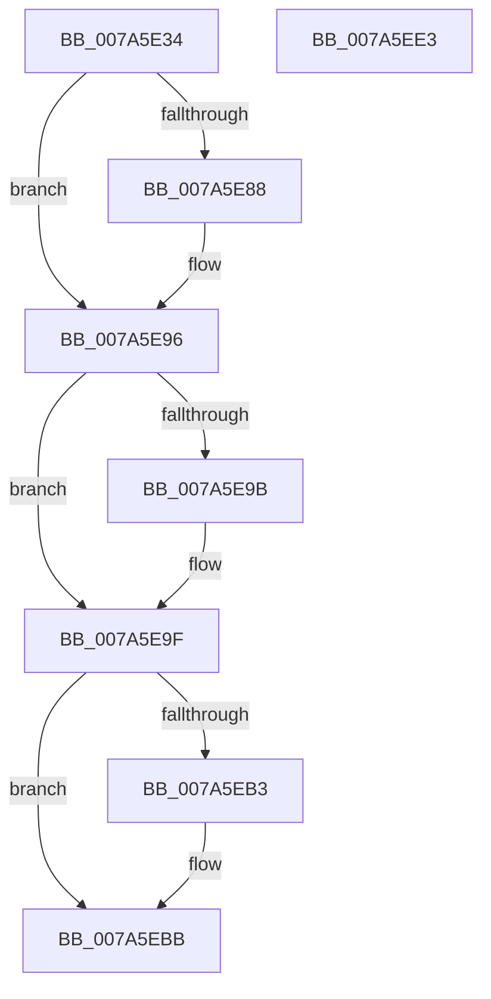

# SmPartitionJobPaired

- RVA: `0x007A5E34`–`0x007A5EE4` (길이 `176` bytes)
- VA: `0x00000001407A5E34`
- 실행 섹션: `PAGE`
- PDB 이름 있음: `예`; PDB Function 태그: `아니요`
- unwind 정보 RVA: `0x0005E6B4`
- 디코드: `46`개 명령, `176/176` bytes 표시
- 미해석 바이트: `0` (있으면 어셈블리에 `.byte`로 보존)

> 이 문서는 커널 이미지의 기계어와 PDB 기호를 분석해 생성했습니다. 4번과 5번은 함수 원형과 자료형을 바이너리 사용 방식에서 추정한 C 해석이며 원본 소스 복구 결과는 아닙니다.

## 1. Dependencies

- 직접 호출 지점: **5**; 고유 호출 대상: **5**
- 직접 호출자로 확인된 함수: **1**
- RIP 상대 이미지 참조: **0**

### Outgoing calls
- `0x007A5E78` → [KeAbPreAcquire](../../text/21/KeAbPreAcquire_function_00210230.md) (function, `0x00210230`)
- `0x007A5E91` → [ExfAcquirePushLockExclusiveEx](../../text/20/ExfAcquirePushLockExclusiveEx_function_0020FC90.md) (function, `0x0020FC90`)
- `0x007A5EB6` → [ExfTryToWakePushLock](../../text/26/ExfTryToWakePushLock_function_00265DD0.md) (function, `0x00265DD0`)
- `0x007A5EBE` → [KeAbPostRelease](../../text/2E/KeAbPostRelease_function_002E1600.md) (function, `0x002E1600`)
- `0x007A5EC3` → [KeLeaveCriticalRegion](../../text/25/KeLeaveCriticalRegion_function_0025D8B0.md) (function, `0x0025D8B0`)

### Direct callers
- [PspSetJobMemoryPartition](../78/PspSetJobMemoryPartition_function_00785574.md) at `0x007856A0`

### Static image references
- 디코드된 RIP-relative 메모리 참조가 없습니다.

## 2. Other-region calls and transfers

- 다른 실행 섹션으로 향하는 call: **5**
  - `0x007A5E78` → [KeAbPreAcquire](../../text/21/KeAbPreAcquire_function_00210230.md) (`PAGE` → `.text`)
  - `0x007A5E91` → [ExfAcquirePushLockExclusiveEx](../../text/20/ExfAcquirePushLockExclusiveEx_function_0020FC90.md) (`PAGE` → `.text`)
  - `0x007A5EB6` → [ExfTryToWakePushLock](../../text/26/ExfTryToWakePushLock_function_00265DD0.md) (`PAGE` → `.text`)
  - `0x007A5EBE` → [KeAbPostRelease](../../text/2E/KeAbPostRelease_function_002E1600.md) (`PAGE` → `.text`)
  - `0x007A5EC3` → [KeLeaveCriticalRegion](../../text/25/KeLeaveCriticalRegion_function_0025D8B0.md) (`PAGE` → `.text`)
- 별도 외부 분기/꼬리 이동을 확인하지 못했습니다.

## 3. Assembly (complete function range)

```asm
007A5E34  48 8B C4                        mov rax, rsp
007A5E37  48 89 58 08                     mov qword ptr [rax + 8], rbx
007A5E3B  48 89 68 10                     mov qword ptr [rax + 0x10], rbp
007A5E3F  48 89 70 18                     mov qword ptr [rax + 0x18], rsi
007A5E43  48 89 78 20                     mov qword ptr [rax + 0x20], rdi
007A5E47  41 56                           push r14
007A5E49  48 83 EC 20                     sub rsp, 0x20
007A5E4D  48 8B 69 18                     mov rbp, qword ptr [rcx + 0x18]
007A5E51  4C 8B F2                        mov r14, rdx
007A5E54  65 48 8B 04 25 88 01 00 00      mov rax, qword ptr gs:[0x188]
007A5E5D  48 83 CB FF                     or rbx, 0xffffffffffffffff
007A5E61  45 33 C0                        xor r8d, r8d
007A5E64  33 D2                           xor edx, edx
007A5E66  48 8D BD 68 08 00 00            lea rdi, [rbp + 0x868]
007A5E6D  66 01 98 E4 01 00 00            add word ptr [rax + 0x1e4], bx
007A5E74  48 8B CF                        mov rcx, rdi
007A5E77  90                              nop
007A5E78  E8 B3 A3 A6 FF                  call 0x140210230
007A5E7D  F0 48 0F BA 2F 00               lock bts qword ptr [rdi], 0
007A5E83  48 8B F0                        mov rsi, rax
007A5E86  73 0E                           jae 0x1407a5e96
007A5E88  4C 8B C7                        mov r8, rdi
007A5E8B  48 8B D0                        mov rdx, rax
007A5E8E  48 8B CF                        mov rcx, rdi
007A5E91  E8 FA 9D A6 FF                  call 0x14020fc90
007A5E96  48 85 F6                        test rsi, rsi
007A5E99  74 04                           je 0x1407a5e9f
007A5E9B  C6 46 0A 01                     mov byte ptr [rsi + 0xa], 1
007A5E9F  4C 89 B5 38 08 00 00            mov qword ptr [rbp + 0x838], r14
007A5EA6  F0 48 0F C1 1F                  lock xadd qword ptr [rdi], rbx
007A5EAB  80 E3 06                        and bl, 6
007A5EAE  80 FB 02                        cmp bl, 2
007A5EB1  75 08                           jne 0x1407a5ebb
007A5EB3  48 8B CF                        mov rcx, rdi
007A5EB6  E8 15 FF AB FF                  call 0x140265dd0
007A5EBB  48 8B CF                        mov rcx, rdi
007A5EBE  E8 3D B7 B3 FF                  call 0x1402e1600
007A5EC3  E8 E8 79 AB FF                  call 0x14025d8b0
007A5EC8  48 8B 5C 24 30                  mov rbx, qword ptr [rsp + 0x30]
007A5ECD  48 8B 6C 24 38                  mov rbp, qword ptr [rsp + 0x38]
007A5ED2  48 8B 74 24 40                  mov rsi, qword ptr [rsp + 0x40]
007A5ED7  48 8B 7C 24 48                  mov rdi, qword ptr [rsp + 0x48]
007A5EDC  48 83 C4 20                     add rsp, 0x20
007A5EE0  41 5E                           pop r14
007A5EE2  C3                              ret
007A5EE3  CC                              int3
```

## 4. C-style interpretation (structured pseudocode)

```c
__int64 __fastcall SmPartitionJobPaired(__int64 a1, __int64 a2, int a3)
{
    __int64 result;
    __int64 v_rbx;
    __int64 v_rsp;
    unsigned __int64 v_stack_p10;
    unsigned __int64 v_stack_p18;
    unsigned __int64 v_stack_p20;
    unsigned __int64 v_stack_p8;

    *(unsigned __int64 *)(v_rsp + 8) = v_rbx;
    *(unsigned __int64 *)(v_rsp + 16) = v_rbp;
    *(unsigned __int64 *)(v_rsp + 24) = v_rsi;
    *(unsigned __int64 *)(v_rsp + 32) = v_rdi;
    v_rsp = (v_rsp) - (32);
    v_rbx = (v_rbx) | (-1);
    a3 = 0;
    a2 = 0;
    result = KeAbPreAcquire(*(unsigned __int64 *)(a1 + 24) + 2152, a2, a3, a4);
    if (!(condition_is_above_or_equal)) {
        a3 = *(unsigned __int64 *)(a1 + 24) + 2152;
        a2 = result;
        a1 = *(unsigned __int64 *)(a1 + 24) + 2152;
        result = ExfAcquirePushLockExclusiveEx(a1, a2, a3, a4);
    }
    if (result != 0) {
        *(unsigned __int8 *)(result + 10) = 1;
    }
    *(unsigned __int64 *)(*(unsigned __int64 *)(a1 + 24) + 2104) = a2;
    v_rbx = (unsigned __int8)((v_rbx) & (6));
    if (((unsigned __int8)(v_rbx)) == 2) {
        a1 = *(unsigned __int64 *)(a1 + 24) + 2152;
        result = ExfTryToWakePushLock(a1, a2, a3, a4);
    }
    result = KeAbPostRelease(*(unsigned __int64 *)(a1 + 24) + 2152, a2, a3, a4);
    result = KeLeaveCriticalRegion(*(unsigned __int64 *)(a1 + 24) + 2152, a2, a3, a4);
    v_rsp = (v_rsp) + (32);
    return result;
}
```

## 5. (Beta) C Style

```c
int64_t SmPartitionJobPaired(void *Arg1, int64_t Arg2, int32_t Arg3)
{
    uint8_t *arg1 = (uint8_t *)Arg1;

    int64_t result;
    int64_t local_rbx;
    int64_t local_rsp;
    uint64_t v_stack_p10;
    uint64_t v_stack_p18;
    uint64_t v_stack_p20;
    uint64_t v_stack_p8;

    *(uint64_t *)(local_rsp + 0x8) = local_rbx;
    *(uint64_t *)(local_rsp + 0x10) = local_rbp;
    *(uint64_t *)(local_rsp + 0x18) = local_rsi;
    *(uint64_t *)(local_rsp + 0x20) = local_rdi;
    local_rsp = (local_rsp) - (32);
    local_rbx = (local_rbx) | (-1);
    Arg3 = 0;
    Arg2 = 0;
    result = KeAbPreAcquire(*(uint64_t *)(arg1 + 0x18) + 2152, Arg2, Arg3, a4);
    if (!(condition_is_above_or_equal)) {
        Arg3 = *(uint64_t *)(arg1 + 0x18) + 2152;
        Arg2 = result;
        Arg1 = *(uint64_t *)(arg1 + 0x18) + 2152;
        result = ExfAcquirePushLockExclusiveEx(Arg1, Arg2, Arg3, a4);
    }
    if (result != 0) {
        *(uint8_t *)(result + 0xA) = 1;
    }
    *(uint64_t *)(*(uint64_t *)(arg1 + 0x18) + 0x838) = Arg2;
    local_rbx = (uint8_t)((local_rbx) & (6));
    if (((uint8_t)(local_rbx)) == 2) {
        Arg1 = *(uint64_t *)(arg1 + 0x18) + 2152;
        result = ExfTryToWakePushLock(Arg1, Arg2, Arg3, a4);
    }
    result = KeAbPostRelease(*(uint64_t *)(arg1 + 0x18) + 2152, Arg2, Arg3, a4);
    result = KeLeaveCriticalRegion(*(uint64_t *)(arg1 + 0x18) + 2152, Arg2, Arg3, a4);
    local_rsp = (local_rsp) + (32);
    return result;
}
```

### 관측된 메모리 오프셋

구조체 형식이 확인되지 않은 접근은 인자 기준의 오프셋으로만 기록했습니다.

| 기준 인자 | 오프셋 표현 | 폭 (bit) | 접근 |
|---|---:|---:|---|
| `Arg1` | `+ 0x18` | `64` | `R` |

## 6. Execution-region graph

[열기: 2D/3D 그래프와 함수 탐색 컨트롤 패널](../../../control-panel.html?section=page&rva=0x007A5E34&view=graph)

- 2D 그래프는 위에서 아래로 흐르고, 3D 그래프는 빈 공간을 드래그해 회전합니다. Shift+드래그는 이동, 휠은 확대·축소, 함수 노드 선택은 대상 보고서 이동입니다.

### Static fallback


