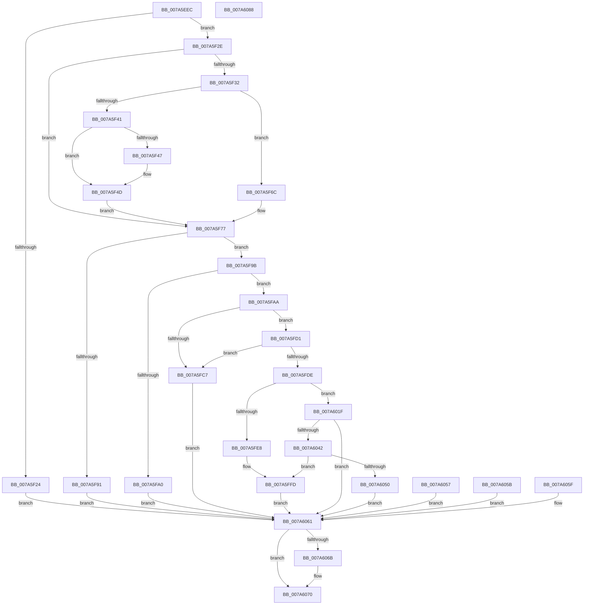

# SmProcessCompressionAcceleratorRequest

- RVA: `0x007A5EEC`–`0x007A6089` (길이 `413` bytes)
- VA: `0x00000001407A5EEC`
- 실행 섹션: `PAGE`
- PDB 이름 있음: `예`; PDB Function 태그: `아니요`
- unwind 정보 RVA: `0x000D1988`
- 디코드: `112`개 명령, `413/413` bytes 표시
- 미해석 바이트: `0` (있으면 어셈블리에 `.byte`로 보존)

> 이 문서는 커널 이미지의 기계어와 PDB 기호를 분석해 생성했습니다. 4번과 5번은 함수 원형과 자료형을 바이너리 사용 방식에서 추정한 C 해석이며 원본 소스 복구 결과는 아닙니다.

## 1. Dependencies

- 직접 호출 지점: **7**; 고유 호출 대상: **6**
- 직접 호출자로 확인된 함수: **1**
- RIP 상대 이미지 참조: **0**

### Outgoing calls
- `0x007A5F47` → [ExRaiseDatatypeMisalignment](../89/ExRaiseDatatypeMisalignment_function_00899FD0.md) (function, `0x00899FD0`)
- `0x007A5F72` → [ProbeForWrite](../8E/ProbeForWrite_function_008E91C0.md) (function, `0x008E91C0`)
- `0x007A5FB7` → [memcpy](../../text/6C/memcpy_function_006C6840.md) (function, `0x006C6840`)
- `0x007A5FF8` → [SmpGetProcessPartition](../../text/4A/SmpGetProcessPartition_function_004A3CCC.md) (function, `0x004A3CCC`)
- `0x007A6014` → [memcpy](../../text/6C/memcpy_function_006C6840.md) (function, `0x006C6840`)
- `0x007A6037` → [PsReferencePartitionByHandle](../90/PsReferencePartitionByHandle_function_0090337C.md) (function, `0x0090337C`)
- `0x007A606B` → [PsDereferencePartition](../../text/34/PsDereferencePartition_function_00342E70.md) (function, `0x00342E70`)

### Direct callers
- [SmQueryStoreInformation](../A0/SmQueryStoreInformation_function_00A0E7BC.md) at `0x00A0E8A7`

### Static image references
- 디코드된 RIP-relative 메모리 참조가 없습니다.

## 2. Other-region calls and transfers

- 다른 실행 섹션으로 향하는 call: **4**
  - `0x007A5FB7` → [memcpy](../../text/6C/memcpy_function_006C6840.md) (`PAGE` → `.text`)
  - `0x007A5FF8` → [SmpGetProcessPartition](../../text/4A/SmpGetProcessPartition_function_004A3CCC.md) (`PAGE` → `.text`)
  - `0x007A6014` → [memcpy](../../text/6C/memcpy_function_006C6840.md) (`PAGE` → `.text`)
  - `0x007A606B` → [PsDereferencePartition](../../text/34/PsDereferencePartition_function_00342E70.md) (`PAGE` → `.text`)
- 별도 외부 분기/꼬리 이동을 확인하지 못했습니다.

## 3. Assembly (complete function range)

```asm
007A5EEC  4C 8B DC                        mov r11, rsp
007A5EEF  49 89 5B 08                     mov qword ptr [r11 + 8], rbx
007A5EF3  49 89 73 10                     mov qword ptr [r11 + 0x10], rsi
007A5EF7  49 89 7B 18                     mov qword ptr [r11 + 0x18], rdi
007A5EFB  41 56                           push r14
007A5EFD  48 83 EC 50                     sub rsp, 0x50
007A5F01  41 8A D9                        mov bl, r9b
007A5F04  4D 8B F0                        mov r14, r8
007A5F07  8B F2                           mov esi, edx
007A5F09  48 8B F9                        mov rdi, rcx
007A5F0C  49 83 63 D8 00                  and qword ptr [r11 - 0x28], 0
007A5F11  0F 57 C0                        xorps xmm0, xmm0
007A5F14  33 C0                           xor eax, eax
007A5F16  0F 11 44 24 38                  movups xmmword ptr [rsp + 0x38], xmm0
007A5F1B  49 89 43 F0                     mov qword ptr [r11 - 0x10], rax
007A5F1F  83 FA 18                        cmp edx, 0x18
007A5F22  73 0A                           jae 0x1407a5f2e
007A5F24  BB 06 02 00 C0                  mov ebx, 0xc0000206
007A5F29  E9 33 01 00 00                  jmp 0x1407a6061
007A5F2E  84 DB                           test bl, bl
007A5F30  74 45                           je 0x1407a5f77
007A5F32  48 8B D6                        mov rdx, rsi
007A5F35  48 8D 46 FF                     lea rax, [rsi - 1]
007A5F39  48 3D FE 0F 00 00               cmp rax, 0xffe
007A5F3F  77 2B                           ja 0x1407a5f6c
007A5F41  40 F6 C7 07                     test dil, 7
007A5F45  74 06                           je 0x1407a5f4d
007A5F47  E8 84 40 0F 00                  call 0x140899fd0
007A5F4C  CC                              int3
007A5F4D  48 B9 00 00 FF FF FF 7F 00 00   movabs rcx, 0x7fffffff0000
007A5F57  48 3B F9                        cmp rdi, rcx
007A5F5A  48 0F 42 CF                     cmovb rcx, rdi
007A5F5E  8A 01                           mov al, byte ptr [rcx]
007A5F60  88 01                           mov byte ptr [rcx], al
007A5F62  8A 44 31 FF                     mov al, byte ptr [rcx + rsi - 1]
007A5F66  88 44 31 FF                     mov byte ptr [rcx + rsi - 1], al
007A5F6A  EB 0B                           jmp 0x1407a5f77
007A5F6C  41 B8 08 00 00 00               mov r8d, 8
007A5F72  E8 49 32 14 00                  call 0x1408e91c0
007A5F77  0F 10 07                        movups xmm0, xmmword ptr [rdi]
007A5F7A  0F 11 44 24 38                  movups xmmword ptr [rsp + 0x38], xmm0
007A5F7F  F2 0F 10 4F 10                  movsd xmm1, qword ptr [rdi + 0x10]
007A5F84  F2 0F 11 4C 24 48               movsd qword ptr [rsp + 0x48], xmm1
007A5F8A  80 7C 24 38 01                  cmp byte ptr [rsp + 0x38], 1
007A5F8F  74 0A                           je 0x1407a5f9b
007A5F91  BB 59 00 00 C0                  mov ebx, 0xc0000059
007A5F96  E9 C6 00 00 00                  jmp 0x1407a6061
007A5F9B  83 FE 18                        cmp esi, 0x18
007A5F9E  74 0A                           je 0x1407a5faa
007A5FA0  BB 04 00 00 C0                  mov ebx, 0xc0000004
007A5FA5  E9 B7 00 00 00                  jmp 0x1407a6061
007A5FAA  44 8D 46 E8                     lea r8d, [rsi - 0x18]
007A5FAE  48 8D 57 18                     lea rdx, [rdi + 0x18]
007A5FB2  48 8D 4C 24 50                  lea rcx, [rsp + 0x50]
007A5FB7  E8 84 08 F2 FF                  call 0x1406c6840
007A5FBC  90                              nop
007A5FBD  F7 44 24 38 00 FF FF FF         test dword ptr [rsp + 0x38], 0xffffff00
007A5FC5  74 0A                           je 0x1407a5fd1
007A5FC7  BB 0D 00 00 C0                  mov ebx, 0xc000000d
007A5FCC  E9 90 00 00 00                  jmp 0x1407a6061
007A5FD1  48 8B 44 24 38                  mov rax, qword ptr [rsp + 0x38]
007A5FD6  48 C1 E8 20                     shr rax, 0x20
007A5FDA  85 C0                           test eax, eax
007A5FDC  75 E9                           jne 0x1407a5fc7
007A5FDE  48 8B 4C 24 40                  mov rcx, qword ptr [rsp + 0x40]
007A5FE3  48 85 C9                        test rcx, rcx
007A5FE6  75 37                           jne 0x1407a601f
007A5FE8  65 48 8B 04 25 88 01 00 00      mov rax, qword ptr gs:[0x188]
007A5FF1  48 8B 88 B8 00 00 00            mov rcx, qword ptr [rax + 0xb8]
007A5FF8  E8 CF DC CF FF                  call 0x1404a3ccc
007A5FFD  8B 80 60 0C 00 00               mov eax, dword ptr [rax + 0xc60]
007A6003  89 44 24 48                     mov dword ptr [rsp + 0x48], eax
007A6007  33 DB                           xor ebx, ebx
007A6009  4C 8B C6                        mov r8, rsi
007A600C  48 8D 54 24 38                  lea rdx, [rsp + 0x38]
007A6011  48 8B CF                        mov rcx, rdi
007A6014  E8 27 08 F2 FF                  call 0x1406c6840
007A6019  90                              nop
007A601A  41 89 36                        mov dword ptr [r14], esi
007A601D  EB 42                           jmp 0x1407a6061
007A601F  48 8D 44 24 30                  lea rax, [rsp + 0x30]
007A6024  48 89 44 24 20                  mov qword ptr [rsp + 0x20], rax
007A6029  41 B9 53 6D 51 52               mov r9d, 0x52516d53
007A602F  44 8A C3                        mov r8b, bl
007A6032  BA 01 00 00 00                  mov edx, 1
007A6037  E8 40 D3 15 00                  call 0x14090337c
007A603C  8B D8                           mov ebx, eax
007A603E  85 C0                           test eax, eax
007A6040  78 1F                           js 0x1407a6061
007A6042  48 8B 44 24 30                  mov rax, qword ptr [rsp + 0x30]
007A6047  48 8B 40 18                     mov rax, qword ptr [rax + 0x18]
007A604B  48 85 C0                        test rax, rax
007A604E  75 AD                           jne 0x1407a5ffd
007A6050  BB A9 01 00 C0                  mov ebx, 0xc00001a9
007A6055  EB 0A                           jmp 0x1407a6061
007A6057  8B D8                           mov ebx, eax
007A6059  EB 06                           jmp 0x1407a6061
007A605B  8B D8                           mov ebx, eax
007A605D  EB 02                           jmp 0x1407a6061
007A605F  8B D8                           mov ebx, eax
007A6061  48 8B 4C 24 30                  mov rcx, qword ptr [rsp + 0x30]
007A6066  48 85 C9                        test rcx, rcx
007A6069  74 05                           je 0x1407a6070
007A606B  E8 00 CE B9 FF                  call 0x140342e70
007A6070  8B C3                           mov eax, ebx
007A6072  48 8B 5C 24 60                  mov rbx, qword ptr [rsp + 0x60]
007A6077  48 8B 74 24 68                  mov rsi, qword ptr [rsp + 0x68]
007A607C  48 8B 7C 24 70                  mov rdi, qword ptr [rsp + 0x70]
007A6081  48 83 C4 50                     add rsp, 0x50
007A6085  41 5E                           pop r14
007A6087  C3                              ret
007A6088  CC                              int3
```

## 4. C-style interpretation (structured pseudocode)

```c
__int64 __fastcall SmProcessCompressionAcceleratorRequest(__int64 a1, int a2, __int64 a3, unsigned __int8 a4)
{
    __int64 result;
    __int64 v_rbx;
    __int64 v_rsp;
    unsigned __int64 v_stack_m10;
    unsigned __int64 v_stack_m18;
    unsigned __int64 v_stack_m20;
    unsigned __int64 v_stack_m28;
    unsigned __int64 v_stack_m38;
    unsigned __int64 v_stack_m8;
    unsigned __int64 v_stack_p10;
    unsigned __int64 v_stack_p18;
    unsigned __int64 v_stack_p8;

    *(unsigned __int64 *)(v_rsp + 8) = v_rbx;
    *(unsigned __int64 *)(v_rsp + 16) = v_rsi;
    *(unsigned __int64 *)(v_rsp + 24) = v_rdi;
    v_rsp = (v_rsp) - (80);
    result = 0;
    v_stack_m20 = v_xmm0;
    *(unsigned __int64 *)(v_rsp - 16) = 0;
    if (a2 >= 24) goto loc_007A5F2E;
    goto loc_007A6061;
loc_007A5F2E:
    if ((unsigned __int8)((unsigned int)(0xC0000206ULL)) == 0) goto loc_007A5F77;
    if (((unsigned int)(a2) - 1) > 0xFFEULL) goto loc_007A5F6C;
    result = (unsigned int)(a2) - 1;
    if ((((unsigned __int8)(a1)) & (7)) != 0) {
        result = ExRaiseDatatypeMisalignment(a1, (unsigned int)(a2), a3, a4);
    }
    if (a1 < a1) { a1 = a1; }
    *(unsigned __int8 *)(a1) = (unsigned __int8)(*(unsigned __int8 *)(a1));
    *(unsigned __int8 *)(a1 + (unsigned int)(a2) * 1 - 1) = (unsigned __int8)(*(unsigned __int8 *)(a1 + (unsigned int)(a2) * 1 - 1));
    goto loc_007A5F77;
loc_007A5F6C:
    result = ProbeForWrite(a1, (unsigned int)(a2), 8, a4);
loc_007A5F77:
    v_stack_m20 = v_xmm0;
    v_stack_m10 = v_xmm1;
    if (v_stack_m20 == 1) goto loc_007A5F9B;
    goto loc_007A6061;
loc_007A5F9B:
    if (((unsigned int)((unsigned int)(a2))) == 24) goto loc_007A5FAA;
    goto loc_007A6061;
loc_007A5FAA:
    result = memcpy(v_stack_m8, a1 + 24, (unsigned int)(a2) - 24, a4);
    if (((v_stack_m20) & (0xFFFFFF00ULL)) == 0) goto loc_007A5FD1;
loc_007A5FC7:
    goto loc_007A6061;
loc_007A5FD1:
    result = (v_stack_m20) >> (32);
    if ((unsigned int)(result) != 0) goto loc_007A5FC7;
    if (v_stack_m18 != 0) goto loc_007A601F;
    result = SmpGetProcessPartition(*(unsigned __int64 *)(*(unsigned __int64 *)(gs_base + (0 + 392)) + 184), a1 + 24, (unsigned int)(a2) - 24, a4);
loc_007A5FFD:
    v_stack_m10 = (unsigned int)((unsigned int)(*(unsigned int *)(result + 3168)));
    v_rbx = 0;
    result = memcpy(a1, v_stack_m20, (unsigned int)(a2), a4);
    *(unsigned int *)(a3) = (unsigned int)((unsigned int)(a2));
    goto loc_007A6061;
loc_007A601F:
    v_stack_m38 = v_stack_m28;
    result = PsReferencePartitionByHandle(a1, 1, 0, (unsigned int)(0x52516D53ULL));
    if (sign_flag) goto loc_007A6061;
    if (*(unsigned __int64 *)(v_stack_m28 + 24) != 0) goto loc_007A5FFD;
    goto loc_007A6061;
loc_007A6061:
    result = *(unsigned __int64 *)(v_stack_m28 + 24);
    if (v_stack_m28 != 0) {
        result = PsDereferencePartition(v_stack_m28, 1, 0, (unsigned int)(0x52516D53ULL));
    }
    v_rsp = (v_rsp) + (80);
    return (unsigned int)((unsigned int)((unsigned int)(0xC00001A9ULL)));
}
```

## 5. (Beta) C Style

```c
int64_t SmProcessCompressionAcceleratorRequest(int64_t Arg1, void *Arg2, void *Arg3, uint8_t Arg4)
{
    uint8_t *arg2 = (uint8_t *)Arg2;
    uint8_t *arg3 = (uint8_t *)Arg3;

    int64_t result;
    int64_t local_rbx;
    int64_t local_rsp;
    uint64_t v_stack_m10;
    uint64_t v_stack_m18;
    uint64_t v_stack_m20;
    uint64_t v_stack_m28;
    uint64_t v_stack_m38;
    uint64_t v_stack_m8;
    uint64_t v_stack_p10;
    uint64_t v_stack_p18;
    uint64_t v_stack_p8;

    *(uint64_t *)(local_rsp + 0x8) = local_rbx;
    *(uint64_t *)(local_rsp + 0x10) = local_rsi;
    *(uint64_t *)(local_rsp + 0x18) = local_rdi;
    local_rsp = (local_rsp) - (80);
    result = 0;
    v_stack_m20 = v_xmm0;
    *(uint64_t *)(local_rsp - 0x10) = 0;
    if (Arg2 >= 24) goto loc_007A5F2E;
    goto loc_007A6061;
loc_007A5F2E:
    if ((uint8_t)((uint32_t)(0xC0000206ULL)) == 0) goto loc_007A5F77;
    if (((uint32_t)(Arg2) - 1) > 0xFFEULL) goto loc_007A5F6C;
    result = (uint32_t)(Arg2) - 1;
    if ((((uint8_t)(Arg1)) & (7)) != 0) {
        result = ExRaiseDatatypeMisalignment(Arg1, (uint32_t)(Arg2), Arg3, Arg4);
    }
    if (Arg1 < Arg1) { Arg1 = Arg1; }
    *(uint8_t *)(Arg1) = (uint8_t)(*(uint8_t *)(Arg1));
    *(uint8_t *)(Arg1 + (uint32_t)(arg2) * 1 - 0x1) = (uint8_t)(*(uint8_t *)(Arg1 + (uint32_t)(arg2) * 1 - 0x1));
    goto loc_007A5F77;
loc_007A5F6C:
    result = ProbeForWrite(Arg1, (uint32_t)(Arg2), 8, Arg4);
loc_007A5F77:
    v_stack_m20 = v_xmm0;
    v_stack_m10 = v_xmm1;
    if (v_stack_m20 == 1) goto loc_007A5F9B;
    goto loc_007A6061;
loc_007A5F9B:
    if (((uint32_t)((uint32_t)(Arg2))) == 24) goto loc_007A5FAA;
    goto loc_007A6061;
loc_007A5FAA:
    result = memcpy(v_stack_m8, Arg1 + 24, (uint32_t)(Arg2) - 24, Arg4);
    if (((v_stack_m20) & (0xFFFFFF00ULL)) == 0) goto loc_007A5FD1;
loc_007A5FC7:
    goto loc_007A6061;
loc_007A5FD1:
    result = (v_stack_m20) >> (32);
    if ((uint32_t)(result) != 0) goto loc_007A5FC7;
    if (v_stack_m18 != 0) goto loc_007A601F;
    result = SmpGetProcessPartition(*(uint64_t *)(*(uint64_t *)(gs_base + (0 + 0x188)) + 0xB8), Arg1 + 24, (uint32_t)(Arg2) - 24, Arg4);
loc_007A5FFD:
    v_stack_m10 = (uint32_t)((uint32_t)(*(uint32_t *)(result + 0xC60)));
    local_rbx = 0;
    result = memcpy(Arg1, v_stack_m20, (uint32_t)(Arg2), Arg4);
    *(uint32_t *)(arg3) = (uint32_t)((uint32_t)(Arg2));
    goto loc_007A6061;
loc_007A601F:
    v_stack_m38 = v_stack_m28;
    result = PsReferencePartitionByHandle(Arg1, 1, 0, (uint32_t)(0x52516D53ULL));
    if (sign_flag) goto loc_007A6061;
    if (*(uint64_t *)(v_stack_m28 + 0x18) != 0) goto loc_007A5FFD;
    goto loc_007A6061;
loc_007A6061:
    result = *(uint64_t *)(v_stack_m28 + 0x18);
    if (v_stack_m28 != 0) {
        result = PsDereferencePartition(v_stack_m28, 1, 0, (uint32_t)(0x52516D53ULL));
    }
    local_rsp = (local_rsp) + (80);
    return (uint32_t)((uint32_t)((uint32_t)(0xC00001A9ULL)));
}
```

### 관측된 메모리 오프셋

구조체 형식이 확인되지 않은 접근은 인자 기준의 오프셋으로만 기록했습니다.

| 기준 인자 | 오프셋 표현 | 폭 (bit) | 접근 |
|---|---:|---:|---|
| `Arg2` | `- 0x1` | `64` | `R` |
| `Arg3` | `+ 0x0` | `32` | `W` |

## 6. Execution-region graph

[열기: 2D/3D 그래프와 함수 탐색 컨트롤 패널](../../../control-panel.html?section=page&rva=0x007A5EEC&view=graph)

- 2D 그래프는 위에서 아래로 흐르고, 3D 그래프는 빈 공간을 드래그해 회전합니다. Shift+드래그는 이동, 휠은 확대·축소, 함수 노드 선택은 대상 보고서 이동입니다.

### Static fallback


