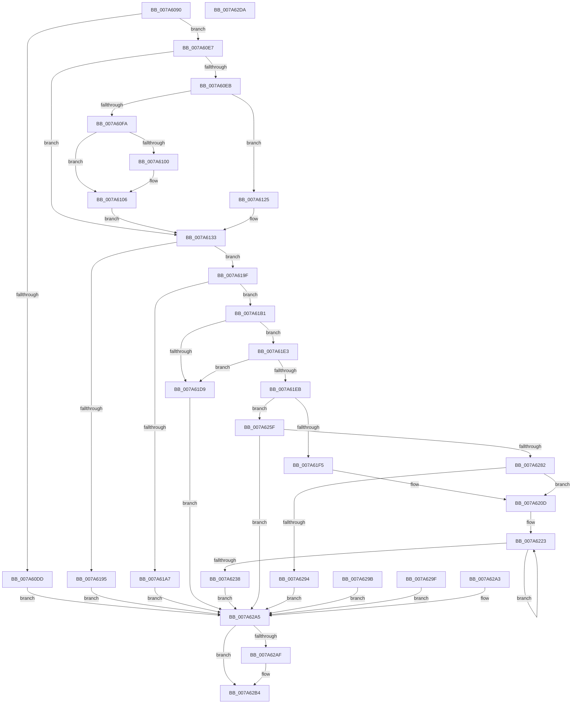

# SmProcessCompressionReadStatsRequest

- RVA: `0x007A6090`–`0x007A62DB` (길이 `587` bytes)
- VA: `0x00000001407A6090`
- 실행 섹션: `PAGE`
- PDB 이름 있음: `예`; PDB Function 태그: `아니요`
- unwind 정보 RVA: `0x000D19D8`
- 디코드: `147`개 명령, `587/587` bytes 표시
- 미해석 바이트: `0` (있으면 어셈블리에 `.byte`로 보존)

> 이 문서는 커널 이미지의 기계어와 PDB 기호를 분석해 생성했습니다. 4번과 5번은 함수 원형과 자료형을 바이너리 사용 방식에서 추정한 C 해석이며 원본 소스 복구 결과는 아닙니다.

## 1. Dependencies

- 직접 호출 지점: **9**; 고유 호출 대상: **8**
- 직접 호출자로 확인된 함수: **1**
- RIP 상대 이미지 참조: **1**

### Outgoing calls
- `0x007A60D0` → [memset](../../text/6C/memset_function_006C6C40.md) (function, `0x006C6C40`)
- `0x007A6100` → [ExRaiseDatatypeMisalignment](../89/ExRaiseDatatypeMisalignment_function_00899FD0.md) (function, `0x00899FD0`)
- `0x007A612E` → [ProbeForWrite](../8E/ProbeForWrite_function_008E91C0.md) (function, `0x008E91C0`)
- `0x007A61C7` → [memcpy](../../text/6C/memcpy_function_006C6840.md) (function, `0x006C6840`)
- `0x007A6205` → [SmpGetProcessPartition](../../text/4A/SmpGetProcessPartition_function_004A3CCC.md) (function, `0x004A3CCC`)
- `0x007A6254` → [memcpy](../../text/6C/memcpy_function_006C6840.md) (function, `0x006C6840`)
- `0x007A6277` → [PsReferencePartitionByHandle](../90/PsReferencePartitionByHandle_function_0090337C.md) (function, `0x0090337C`)
- `0x007A62AF` → [PsDereferencePartition](../../text/34/PsDereferencePartition_function_00342E70.md) (function, `0x00342E70`)
- `0x007A62C1` → [_security_check_cookie](../../text/6A/_security_check_cookie_function_006AC640.md) (function, `0x006AC640`)

### Direct callers
- [SmQueryStoreInformation](../A0/SmQueryStoreInformation_function_00A0E7BC.md) at `0x00A0E8C2`

### Static image references
- `0x007A60A0` → RVA `0x00E0A740` (`.data`; read)

## 2. Other-region calls and transfers

- 다른 실행 섹션으로 향하는 call: **6**
  - `0x007A60D0` → [memset](../../text/6C/memset_function_006C6C40.md) (`PAGE` → `.text`)
  - `0x007A61C7` → [memcpy](../../text/6C/memcpy_function_006C6840.md) (`PAGE` → `.text`)
  - `0x007A6205` → [SmpGetProcessPartition](../../text/4A/SmpGetProcessPartition_function_004A3CCC.md) (`PAGE` → `.text`)
  - `0x007A6254` → [memcpy](../../text/6C/memcpy_function_006C6840.md) (`PAGE` → `.text`)
  - `0x007A62AF` → [PsDereferencePartition](../../text/34/PsDereferencePartition_function_00342E70.md) (`PAGE` → `.text`)
  - `0x007A62C1` → [_security_check_cookie](../../text/6A/_security_check_cookie_function_006AC640.md) (`PAGE` → `.text`)
- 별도 외부 분기/꼬리 이동을 확인하지 못했습니다.

## 3. Assembly (complete function range)

```asm
007A6090  48 89 5C 24 20                  mov qword ptr [rsp + 0x20], rbx
007A6095  56                              push rsi
007A6096  57                              push rdi
007A6097  41 56                           push r14
007A6099  48 81 EC F0 00 00 00            sub rsp, 0xf0
007A60A0  48 8B 05 99 46 66 00            mov rax, qword ptr [rip + 0x664699]
007A60A7  48 33 C4                        xor rax, rsp
007A60AA  48 89 84 24 E0 00 00 00         mov qword ptr [rsp + 0xe0], rax
007A60B2  41 8A D9                        mov bl, r9b
007A60B5  4D 8B F0                        mov r14, r8
007A60B8  8B FA                           mov edi, edx
007A60BA  48 8B F1                        mov rsi, rcx
007A60BD  48 83 64 24 30 00               and qword ptr [rsp + 0x30], 0
007A60C3  33 D2                           xor edx, edx
007A60C5  41 B8 98 00 00 00               mov r8d, 0x98
007A60CB  48 8D 4C 24 40                  lea rcx, [rsp + 0x40]
007A60D0  E8 6B 0B F2 FF                  call 0x1406c6c40
007A60D5  81 FF A0 00 00 00               cmp edi, 0xa0
007A60DB  73 0A                           jae 0x1407a60e7
007A60DD  BB 06 02 00 C0                  mov ebx, 0xc0000206
007A60E2  E9 BE 01 00 00                  jmp 0x1407a62a5
007A60E7  84 DB                           test bl, bl
007A60E9  74 48                           je 0x1407a6133
007A60EB  48 8B D7                        mov rdx, rdi
007A60EE  48 8D 47 FF                     lea rax, [rdi - 1]
007A60F2  48 3D FE 0F 00 00               cmp rax, 0xffe
007A60F8  77 2B                           ja 0x1407a6125
007A60FA  40 F6 C6 07                     test sil, 7
007A60FE  74 06                           je 0x1407a6106
007A6100  E8 CB 3E 0F 00                  call 0x140899fd0
007A6105  CC                              int3
007A6106  48 B9 00 00 FF FF FF 7F 00 00   movabs rcx, 0x7fffffff0000
007A6110  48 3B F1                        cmp rsi, rcx
007A6113  48 0F 42 CE                     cmovb rcx, rsi
007A6117  8A 01                           mov al, byte ptr [rcx]
007A6119  88 01                           mov byte ptr [rcx], al
007A611B  8A 44 39 FF                     mov al, byte ptr [rcx + rdi - 1]
007A611F  88 44 39 FF                     mov byte ptr [rcx + rdi - 1], al
007A6123  EB 0E                           jmp 0x1407a6133
007A6125  41 B8 08 00 00 00               mov r8d, 8
007A612B  48 8B CE                        mov rcx, rsi
007A612E  E8 8D 30 14 00                  call 0x1408e91c0
007A6133  48 8D 4C 24 40                  lea rcx, [rsp + 0x40]
007A6138  0F 10 06                        movups xmm0, xmmword ptr [rsi]
007A613B  0F 11 01                        movups xmmword ptr [rcx], xmm0
007A613E  0F 10 4E 10                     movups xmm1, xmmword ptr [rsi + 0x10]
007A6142  0F 11 49 10                     movups xmmword ptr [rcx + 0x10], xmm1
007A6146  0F 10 46 20                     movups xmm0, xmmword ptr [rsi + 0x20]
007A614A  0F 11 41 20                     movups xmmword ptr [rcx + 0x20], xmm0
007A614E  0F 10 4E 30                     movups xmm1, xmmword ptr [rsi + 0x30]
007A6152  0F 11 49 30                     movups xmmword ptr [rcx + 0x30], xmm1
007A6156  0F 10 46 40                     movups xmm0, xmmword ptr [rsi + 0x40]
007A615A  0F 11 41 40                     movups xmmword ptr [rcx + 0x40], xmm0
007A615E  0F 10 4E 50                     movups xmm1, xmmword ptr [rsi + 0x50]
007A6162  0F 11 49 50                     movups xmmword ptr [rcx + 0x50], xmm1
007A6166  0F 10 46 60                     movups xmm0, xmmword ptr [rsi + 0x60]
007A616A  0F 11 41 60                     movups xmmword ptr [rcx + 0x60], xmm0
007A616E  BA 80 00 00 00                  mov edx, 0x80
007A6173  0F 10 46 70                     movups xmm0, xmmword ptr [rsi + 0x70]
007A6177  0F 11 44 11 F0                  movups xmmword ptr [rcx + rdx - 0x10], xmm0
007A617C  0F 10 0C 16                     movups xmm1, xmmword ptr [rsi + rdx]
007A6180  0F 11 0C 11                     movups xmmword ptr [rcx + rdx], xmm1
007A6184  0F 10 44 16 10                  movups xmm0, xmmword ptr [rsi + rdx + 0x10]
007A6189  0F 11 44 11 10                  movups xmmword ptr [rcx + rdx + 0x10], xmm0
007A618E  80 7C 24 40 01                  cmp byte ptr [rsp + 0x40], 1
007A6193  74 0A                           je 0x1407a619f
007A6195  BB 59 00 00 C0                  mov ebx, 0xc0000059
007A619A  E9 06 01 00 00                  jmp 0x1407a62a5
007A619F  81 FF A0 00 00 00               cmp edi, 0xa0
007A61A5  74 0A                           je 0x1407a61b1
007A61A7  BB 04 00 00 C0                  mov ebx, 0xc0000004
007A61AC  E9 F4 00 00 00                  jmp 0x1407a62a5
007A61B1  44 8D 87 60 FF FF FF            lea r8d, [rdi - 0xa0]
007A61B8  48 8D 96 A0 00 00 00            lea rdx, [rsi + 0xa0]
007A61BF  48 8D 8C 24 E0 00 00 00         lea rcx, [rsp + 0xe0]
007A61C7  E8 74 06 F2 FF                  call 0x1406c6840
007A61CC  90                              nop
007A61CD  48 8B 44 24 40                  mov rax, qword ptr [rsp + 0x40]
007A61D2  A9 00 FF FF FF                  test eax, 0xffffff00
007A61D7  74 0A                           je 0x1407a61e3
007A61D9  BB 0D 00 00 C0                  mov ebx, 0xc000000d
007A61DE  E9 C2 00 00 00                  jmp 0x1407a62a5
007A61E3  48 C1 E8 20                     shr rax, 0x20
007A61E7  85 C0                           test eax, eax
007A61E9  75 EE                           jne 0x1407a61d9
007A61EB  48 8B 4C 24 48                  mov rcx, qword ptr [rsp + 0x48]
007A61F0  48 85 C9                        test rcx, rcx
007A61F3  75 6A                           jne 0x1407a625f
007A61F5  65 48 8B 04 25 88 01 00 00      mov rax, qword ptr gs:[0x188]
007A61FE  48 8B 88 B8 00 00 00            mov rcx, qword ptr [rax + 0xb8]
007A6205  E8 C2 DA CF FF                  call 0x1404a3ccc
007A620A  48 8B C8                        mov rcx, rax
007A620D  48 8D 54 24 50                  lea rdx, [rsp + 0x50]
007A6212  48 8D 44 24 50                  lea rax, [rsp + 0x50]
007A6217  4C 8B C1                        mov r8, rcx
007A621A  4C 2B C0                        sub r8, rax
007A621D  41 B9 11 00 00 00               mov r9d, 0x11
007A6223  49 8B 84 10 80 0C 00 00         mov rax, qword ptr [r8 + rdx + 0xc80]
007A622B  48 89 02                        mov qword ptr [rdx], rax
007A622E  48 8D 52 08                     lea rdx, [rdx + 8]
007A6232  49 83 E9 01                     sub r9, 1
007A6236  75 EB                           jne 0x1407a6223
007A6238  48 8B 81 10 0D 00 00            mov rax, qword ptr [rcx + 0xd10]
007A623F  48 89 84 24 D8 00 00 00         mov qword ptr [rsp + 0xd8], rax
007A6247  33 DB                           xor ebx, ebx
007A6249  4C 8B C7                        mov r8, rdi
007A624C  48 8D 54 24 40                  lea rdx, [rsp + 0x40]
007A6251  48 8B CE                        mov rcx, rsi
007A6254  E8 E7 05 F2 FF                  call 0x1406c6840
007A6259  90                              nop
007A625A  41 89 3E                        mov dword ptr [r14], edi
007A625D  EB 46                           jmp 0x1407a62a5
007A625F  48 8D 44 24 30                  lea rax, [rsp + 0x30]
007A6264  48 89 44 24 20                  mov qword ptr [rsp + 0x20], rax
007A6269  41 B9 53 6D 51 52               mov r9d, 0x52516d53
007A626F  44 8A C3                        mov r8b, bl
007A6272  BA 01 00 00 00                  mov edx, 1
007A6277  E8 00 D1 15 00                  call 0x14090337c
007A627C  8B D8                           mov ebx, eax
007A627E  85 C0                           test eax, eax
007A6280  78 23                           js 0x1407a62a5
007A6282  48 8B 44 24 30                  mov rax, qword ptr [rsp + 0x30]
007A6287  48 8B 48 18                     mov rcx, qword ptr [rax + 0x18]
007A628B  48 85 C9                        test rcx, rcx
007A628E  0F 85 79 FF FF FF               jne 0x1407a620d
007A6294  BB A9 01 00 C0                  mov ebx, 0xc00001a9
007A6299  EB 0A                           jmp 0x1407a62a5
007A629B  8B D8                           mov ebx, eax
007A629D  EB 06                           jmp 0x1407a62a5
007A629F  8B D8                           mov ebx, eax
007A62A1  EB 02                           jmp 0x1407a62a5
007A62A3  8B D8                           mov ebx, eax
007A62A5  48 8B 4C 24 30                  mov rcx, qword ptr [rsp + 0x30]
007A62AA  48 85 C9                        test rcx, rcx
007A62AD  74 05                           je 0x1407a62b4
007A62AF  E8 BC CB B9 FF                  call 0x140342e70
007A62B4  8B C3                           mov eax, ebx
007A62B6  48 8B 8C 24 E0 00 00 00         mov rcx, qword ptr [rsp + 0xe0]
007A62BE  48 33 CC                        xor rcx, rsp
007A62C1  E8 7A 63 F0 FF                  call 0x1406ac640
007A62C6  48 8B 9C 24 28 01 00 00         mov rbx, qword ptr [rsp + 0x128]
007A62CE  48 81 C4 F0 00 00 00            add rsp, 0xf0
007A62D5  41 5E                           pop r14
007A62D7  5F                              pop rdi
007A62D8  5E                              pop rsi
007A62D9  C3                              ret
007A62DA  CC                              int3
```

## 4. C-style interpretation (structured pseudocode)

```c
__int64 __fastcall SmProcessCompressionReadStatsRequest(__int64 a1, int a2, __int64 a3, unsigned __int8 a4)
{
    __int64 result;
    __int64 v_rbx;
    __int64 v_rsp;
    unsigned __int64 v_stack_m28;
    unsigned __int64 v_stack_m30;
    unsigned __int64 v_stack_mB8;
    unsigned __int64 v_stack_mC0;
    unsigned __int64 v_stack_mC8;
    unsigned __int64 v_stack_mD8;
    unsigned __int64 v_stack_mE8;
    unsigned __int64 v_stack_p20;

    v_stack_p20 = v_rbx;
    v_rsp = (v_rsp) - (240);
    result = (*(unsigned __int64 *)(v_rip + 6702745)) ^ (v_rsp);
    v_stack_m28 = result;
    a2 = 0;
    result = memset(v_stack_mC8, a2, 152, a4);
    if (((unsigned int)((unsigned int)(a2))) >= 160) goto loc_007A60E7;
    goto loc_007A62A5;
loc_007A60E7:
    if ((unsigned __int8)((unsigned int)(0xC0000206ULL)) == 0) goto loc_007A6133;
    if (((unsigned int)(a2) - 1) > 0xFFEULL) goto loc_007A6125;
    result = (unsigned int)(a2) - 1;
    if ((((unsigned __int8)(a1)) & (7)) != 0) {
        result = ExRaiseDatatypeMisalignment(v_stack_mC8, (unsigned int)(a2), 152, a4);
    }
    a1 = v_stack_mC8;
    if (a1 < v_stack_mC8) { a1 = a1; }
    *(unsigned __int8 *)(a1) = (unsigned __int8)(*(unsigned __int8 *)(a1));
    *(unsigned __int8 *)(a1 + (unsigned int)(a2) * 1 - 1) = (unsigned __int8)(*(unsigned __int8 *)(a1 + (unsigned int)(a2) * 1 - 1));
    goto loc_007A6133;
loc_007A6125:
    result = ProbeForWrite(a1, (unsigned int)(a2), 8, a4);
loc_007A6133:
    *(unsigned __int64 *)(v_stack_mC8) = v_xmm0;
    *(unsigned __int64 *)(v_stack_mC8 + 16) = v_xmm1;
    *(unsigned __int64 *)(v_stack_mC8 + 32) = v_xmm0;
    *(unsigned __int64 *)(v_stack_mC8 + 48) = v_xmm1;
    *(unsigned __int64 *)(v_stack_mC8 + 64) = v_xmm0;
    *(unsigned __int64 *)(v_stack_mC8 + 80) = v_xmm1;
    *(unsigned __int64 *)(v_stack_mC8 + 96) = v_xmm0;
    *(unsigned __int64 *)(v_stack_mC8 + 128 * 1 - 16) = v_xmm0;
    *(unsigned __int64 *)(v_stack_mC8 + 128 * 1) = v_xmm1;
    *(unsigned __int64 *)(v_stack_mC8 + 128 * 1 + 16) = v_xmm0;
    if (v_stack_mC8 == 1) goto loc_007A619F;
    goto loc_007A62A5;
loc_007A619F:
    if (((unsigned int)((unsigned int)(a2))) == 160) goto loc_007A61B1;
    goto loc_007A62A5;
loc_007A61B1:
    result = memcpy(v_stack_m28, a1 + 160, (unsigned int)(a2) - 160, a4);
    if ((((unsigned int)(v_stack_mC8)) & (0xFFFFFF00ULL)) == 0) goto loc_007A61E3;
loc_007A61D9:
    goto loc_007A62A5;
loc_007A61E3:
    result = (v_stack_mC8) >> (32);
    if ((unsigned int)(result) != 0) goto loc_007A61D9;
    if (v_stack_mC0 != 0) goto loc_007A625F;
    result = SmpGetProcessPartition(*(unsigned __int64 *)(*(unsigned __int64 *)(gs_base + (0 + 392)) + 184), a1 + 160, (unsigned int)(a2) - 160, a4);
loc_007A620D:
    a3 = (result) - (v_stack_mB8);
loc_007A6223:
    *(unsigned __int64 *)(v_stack_mB8) = *(unsigned __int64 *)(a3 + v_stack_mB8 * 1 + 3200);
    a4 = (17) - (1);
    if (condition_is_not_equal) goto loc_007A6223;
    v_stack_m30 = *(unsigned __int64 *)(result + 3344);
    v_rbx = 0;
    result = memcpy(a1, v_stack_mC8, (unsigned int)(a2), a4);
    *(unsigned int *)(a3) = (unsigned int)((unsigned int)(a2));
    goto loc_007A62A5;
loc_007A625F:
    v_stack_mE8 = v_stack_mD8;
    result = PsReferencePartitionByHandle(a1, 1, 0, (unsigned int)(0x52516D53ULL));
    if (sign_flag) goto loc_007A62A5;
    if (*(unsigned __int64 *)(v_stack_mD8 + 24) != 0) goto loc_007A620D;
    goto loc_007A62A5;
loc_007A62A5:
    result = v_stack_mD8;
    if (v_stack_mD8 != 0) {
        result = PsDereferencePartition(v_stack_mD8, 1, 0, (unsigned int)(0x52516D53ULL));
    }
    a1 = (v_stack_m28) ^ (v_rsp);
    result = _security_check_cookie(a1, 1, 0, (unsigned int)(0x52516D53ULL));
    v_rsp = (v_rsp) + (240);
    return result;
}
```

## 5. (Beta) C Style

```c
int64_t SmProcessCompressionReadStatsRequest(int64_t Arg1, int32_t Arg2, void *Arg3, uint8_t Arg4)
{
    uint8_t *arg3 = (uint8_t *)Arg3;

    int64_t result;
    int64_t local_rbx;
    int64_t local_rsp;
    uint64_t v_stack_m28;
    uint64_t v_stack_m30;
    uint64_t v_stack_mB8;
    uint64_t v_stack_mC0;
    uint64_t v_stack_mC8;
    uint64_t v_stack_mD8;
    uint64_t v_stack_mE8;
    uint64_t v_stack_p20;

    v_stack_p20 = local_rbx;
    local_rsp = (local_rsp) - (240);
    result = (*(uint64_t *)(v_rip + 0x664699)) ^ (local_rsp);
    v_stack_m28 = result;
    Arg2 = 0;
    result = memset(v_stack_mC8, Arg2, 152, Arg4);
    if (((uint32_t)((uint32_t)(Arg2))) >= 160) goto loc_007A60E7;
    goto loc_007A62A5;
loc_007A60E7:
    if ((uint8_t)((uint32_t)(0xC0000206ULL)) == 0) goto loc_007A6133;
    if (((uint32_t)(Arg2) - 1) > 0xFFEULL) goto loc_007A6125;
    result = (uint32_t)(Arg2) - 1;
    if ((((uint8_t)(Arg1)) & (7)) != 0) {
        result = ExRaiseDatatypeMisalignment(v_stack_mC8, (uint32_t)(Arg2), 152, Arg4);
    }
    Arg1 = v_stack_mC8;
    if (Arg1 < v_stack_mC8) { Arg1 = Arg1; }
    *(uint8_t *)(Arg1) = (uint8_t)(*(uint8_t *)(Arg1));
    *(uint8_t *)(Arg1 + (uint32_t)(Arg2) * 1 - 0x1) = (uint8_t)(*(uint8_t *)(Arg1 + (uint32_t)(Arg2) * 1 - 0x1));
    goto loc_007A6133;
loc_007A6125:
    result = ProbeForWrite(Arg1, (uint32_t)(Arg2), 8, Arg4);
loc_007A6133:
    *(uint64_t *)(v_stack_mC8) = v_xmm0;
    *(uint64_t *)(v_stack_mC8 + 0x10) = v_xmm1;
    *(uint64_t *)(v_stack_mC8 + 0x20) = v_xmm0;
    *(uint64_t *)(v_stack_mC8 + 0x30) = v_xmm1;
    *(uint64_t *)(v_stack_mC8 + 0x40) = v_xmm0;
    *(uint64_t *)(v_stack_mC8 + 0x50) = v_xmm1;
    *(uint64_t *)(v_stack_mC8 + 0x60) = v_xmm0;
    *(uint64_t *)(v_stack_mC8 + 0x80 * 1 - 0x10) = v_xmm0;
    *(uint64_t *)(v_stack_mC8 + 0x80 * 1) = v_xmm1;
    *(uint64_t *)(v_stack_mC8 + 0x80 * 1 + 0x10) = v_xmm0;
    if (v_stack_mC8 == 1) goto loc_007A619F;
    goto loc_007A62A5;
loc_007A619F:
    if (((uint32_t)((uint32_t)(Arg2))) == 160) goto loc_007A61B1;
    goto loc_007A62A5;
loc_007A61B1:
    result = memcpy(v_stack_m28, Arg1 + 160, (uint32_t)(Arg2) - 160, Arg4);
    if ((((uint32_t)(v_stack_mC8)) & (0xFFFFFF00ULL)) == 0) goto loc_007A61E3;
loc_007A61D9:
    goto loc_007A62A5;
loc_007A61E3:
    result = (v_stack_mC8) >> (32);
    if ((uint32_t)(result) != 0) goto loc_007A61D9;
    if (v_stack_mC0 != 0) goto loc_007A625F;
    result = SmpGetProcessPartition(*(uint64_t *)(*(uint64_t *)(gs_base + (0 + 0x188)) + 0xB8), Arg1 + 160, (uint32_t)(Arg2) - 160, Arg4);
loc_007A620D:
    Arg3 = (result) - (v_stack_mB8);
loc_007A6223:
    *(uint64_t *)(v_stack_mB8) = *(uint64_t *)(arg3 + v_stack_mB8 * 1 + 0xC80);
    Arg4 = (17) - (1);
    if (condition_is_not_equal) goto loc_007A6223;
    v_stack_m30 = *(uint64_t *)(result + 0xD10);
    local_rbx = 0;
    result = memcpy(Arg1, v_stack_mC8, (uint32_t)(Arg2), Arg4);
    *(uint32_t *)(arg3) = (uint32_t)((uint32_t)(Arg2));
    goto loc_007A62A5;
loc_007A625F:
    v_stack_mE8 = v_stack_mD8;
    result = PsReferencePartitionByHandle(Arg1, 1, 0, (uint32_t)(0x52516D53ULL));
    if (sign_flag) goto loc_007A62A5;
    if (*(uint64_t *)(v_stack_mD8 + 0x18) != 0) goto loc_007A620D;
    goto loc_007A62A5;
loc_007A62A5:
    result = v_stack_mD8;
    if (v_stack_mD8 != 0) {
        result = PsDereferencePartition(v_stack_mD8, 1, 0, (uint32_t)(0x52516D53ULL));
    }
    Arg1 = (v_stack_m28) ^ (local_rsp);
    result = _security_check_cookie(Arg1, 1, 0, (uint32_t)(0x52516D53ULL));
    local_rsp = (local_rsp) + (240);
    return result;
}
```

### 관측된 메모리 오프셋

구조체 형식이 확인되지 않은 접근은 인자 기준의 오프셋으로만 기록했습니다.

| 기준 인자 | 오프셋 표현 | 폭 (bit) | 접근 |
|---|---:|---:|---|
| `Arg3` | `+ 0x0` | `32` | `W` |

## 6. Execution-region graph

[열기: 2D/3D 그래프와 함수 탐색 컨트롤 패널](../../../control-panel.html?section=page&rva=0x007A6090&view=graph)

- 2D 그래프는 위에서 아래로 흐르고, 3D 그래프는 빈 공간을 드래그해 회전합니다. Shift+드래그는 이동, 휠은 확대·축소, 함수 노드 선택은 대상 보고서 이동입니다.

### Static fallback


