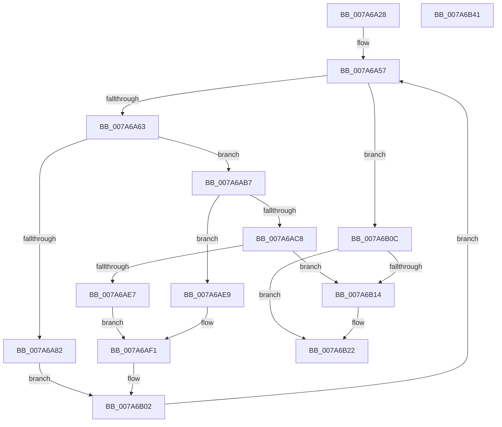

# SmProcessListRequestExtended

- RVA: `0x007A6A28`–`0x007A6B42` (길이 `282` bytes)
- VA: `0x00000001407A6A28`
- 실행 섹션: `PAGE`
- PDB 이름 있음: `예`; PDB Function 태그: `아니요`
- unwind 정보 RVA: `0x000B0E24`
- 디코드: `78`개 명령, `282/282` bytes 표시
- 미해석 바이트: `0` (있으면 어셈블리에 `.byte`로 보존)

> 이 문서는 커널 이미지의 기계어와 PDB 기호를 분석해 생성했습니다. 4번과 5번은 함수 원형과 자료형을 바이너리 사용 방식에서 추정한 C 해석이며 원본 소스 복구 결과는 아닙니다.

## 1. Dependencies

- 직접 호출 지점: **5**; 고유 호출 대상: **4**
- 직접 호출자로 확인된 함수: **1**
- RIP 상대 이미지 참조: **0**

### Outgoing calls
- `0x007A6A75` → [SmKmStoreReference](../../text/34/SmKmStoreReference_function_0034BFB0.md) (function, `0x0034BFB0`)
- `0x007A6AA5` → [memcpy](../../text/6C/memcpy_function_006C6840.md) (function, `0x006C6840`)
- `0x007A6ADC` → [SmKmFileInfoGetPath](SmKmFileInfoGetPath_function_007A83AC.md) (function, `0x007A83AC`)
- `0x007A6AFA` → [SmKmStoreDereference](../../text/20/SmKmStoreDereference_function_00206574.md) (function, `0x00206574`)
- `0x007A6B1D` → [SmKmStoreDereference](../../text/20/SmKmStoreDereference_function_00206574.md) (function, `0x00206574`)

### Direct callers
- [SmProcessListRequest](SmProcessListRequest_function_007A67A8.md) at `0x007A6971`

### Static image references
- 디코드된 RIP-relative 메모리 참조가 없습니다.

## 2. Other-region calls and transfers

- 다른 실행 섹션으로 향하는 call: **4**
  - `0x007A6A75` → [SmKmStoreReference](../../text/34/SmKmStoreReference_function_0034BFB0.md) (`PAGE` → `.text`)
  - `0x007A6AA5` → [memcpy](../../text/6C/memcpy_function_006C6840.md) (`PAGE` → `.text`)
  - `0x007A6AFA` → [SmKmStoreDereference](../../text/20/SmKmStoreDereference_function_00206574.md) (`PAGE` → `.text`)
  - `0x007A6B1D` → [SmKmStoreDereference](../../text/20/SmKmStoreDereference_function_00206574.md) (`PAGE` → `.text`)
- 별도 외부 분기/꼬리 이동을 확인하지 못했습니다.

## 3. Assembly (complete function range)

```asm
007A6A28  48 89 5C 24 08                  mov qword ptr [rsp + 8], rbx
007A6A2D  48 89 6C 24 18                  mov qword ptr [rsp + 0x18], rbp
007A6A32  48 89 74 24 20                  mov qword ptr [rsp + 0x20], rsi
007A6A37  57                              push rdi
007A6A38  41 54                           push r12
007A6A3A  41 55                           push r13
007A6A3C  41 56                           push r14
007A6A3E  41 57                           push r15
007A6A40  48 83 EC 20                     sub rsp, 0x20
007A6A44  45 33 ED                        xor r13d, r13d
007A6A47  48 8B EA                        mov rbp, rdx
007A6A4A  4C 8B F9                        mov r15, rcx
007A6A4D  41 8B DD                        mov ebx, r13d
007A6A50  41 8B FD                        mov edi, r13d
007A6A53  45 8D 75 01                     lea r14d, [r13 + 1]
007A6A57  0F B6 45 01                     movzx eax, byte ptr [rbp + 1]
007A6A5B  3B F8                           cmp edi, eax
007A6A5D  0F 83 A9 00 00 00               jae 0x1407a6b0c
007A6A63  8B F7                           mov esi, edi
007A6A65  49 8B CF                        mov rcx, r15
007A6A68  4C 8D 24 B5 00 00 00 00         lea r12, [rsi*4]
007A6A70  41 8B 54 2C 10                  mov edx, dword ptr [r12 + rbp + 0x10]
007A6A75  E8 36 55 BA FF                  call 0x14034bfb0
007A6A7A  48 8B D8                        mov rbx, rax
007A6A7D  48 85 C0                        test rax, rax
007A6A80  75 35                           jne 0x1407a6ab7
007A6A82  0F B6 55 01                     movzx edx, byte ptr [rbp + 1]
007A6A86  48 8D 4D 10                     lea rcx, [rbp + 0x10]
007A6A8A  2B D7                           sub edx, edi
007A6A8C  49 03 CC                        add rcx, r12
007A6A8F  44 8D 04 95 FC FF FF FF         lea r8d, [rdx*4 - 4]
007A6A97  41 8B D6                        mov edx, r14d
007A6A9A  48 8D 14 95 10 00 00 00         lea rdx, [rdx*4 + 0x10]
007A6AA2  48 03 D5                        add rdx, rbp
007A6AA5  E8 96 FD F1 FF                  call 0x1406c6840
007A6AAA  83 C9 FF                        or ecx, 0xffffffff
007A6AAD  03 F9                           add edi, ecx
007A6AAF  44 03 F1                        add r14d, ecx
007A6AB2  FE 4D 01                        dec byte ptr [rbp + 1]
007A6AB5  EB 4B                           jmp 0x1407a6b02
007A6AB7  48 C1 E6 07                     shl rsi, 7
007A6ABB  80 BB 94 1A 00 00 01            cmp byte ptr [rbx + 0x1a94], 1
007A6AC2  48 8D 04 2E                     lea rax, [rsi + rbp]
007A6AC6  75 21                           jne 0x1407a6ae9
007A6AC8  48 8D 8B 68 1B 00 00            lea rcx, [rbx + 0x1b68]
007A6ACF  41 B8 80 00 00 00               mov r8d, 0x80
007A6AD5  48 8D 90 90 00 00 00            lea rdx, [rax + 0x90]
007A6ADC  E8 CB 18 00 00                  call 0x1407a83ac
007A6AE1  8B F0                           mov esi, eax
007A6AE3  85 C0                           test eax, eax
007A6AE5  78 2D                           js 0x1407a6b14
007A6AE7  EB 08                           jmp 0x1407a6af1
007A6AE9  66 44 89 A8 90 00 00 00         mov word ptr [rax + 0x90], r13w
007A6AF1  8B 93 90 1A 00 00               mov edx, dword ptr [rbx + 0x1a90]
007A6AF7  49 8B CF                        mov rcx, r15
007A6AFA  E8 75 FA A5 FF                  call 0x140206574
007A6AFF  49 8B DD                        mov rbx, r13
007A6B02  FF C7                           inc edi
007A6B04  41 FF C6                        inc r14d
007A6B07  E9 4B FF FF FF                  jmp 0x1407a6a57
007A6B0C  41 8B F5                        mov esi, r13d
007A6B0F  48 85 DB                        test rbx, rbx
007A6B12  74 0E                           je 0x1407a6b22
007A6B14  8B 93 90 1A 00 00               mov edx, dword ptr [rbx + 0x1a90]
007A6B1A  49 8B CF                        mov rcx, r15
007A6B1D  E8 52 FA A5 FF                  call 0x140206574
007A6B22  48 8B 5C 24 50                  mov rbx, qword ptr [rsp + 0x50]
007A6B27  8B C6                           mov eax, esi
007A6B29  48 8B 74 24 68                  mov rsi, qword ptr [rsp + 0x68]
007A6B2E  48 8B 6C 24 60                  mov rbp, qword ptr [rsp + 0x60]
007A6B33  48 83 C4 20                     add rsp, 0x20
007A6B37  41 5F                           pop r15
007A6B39  41 5E                           pop r14
007A6B3B  41 5D                           pop r13
007A6B3D  41 5C                           pop r12
007A6B3F  5F                              pop rdi
007A6B40  C3                              ret
007A6B41  CC                              int3
```

## 4. C-style interpretation (structured pseudocode)

```c
__int64 __fastcall SmProcessListRequestExtended(__int64 a1, __int64 a2)
{
    __int64 result;
    __int64 v_r13;
    __int64 v_r14;
    __int64 v_rdi;
    __int64 v_rsi;
    __int64 v_rsp;
    unsigned __int64 v_stack_p18;
    unsigned __int64 v_stack_p20;
    unsigned __int64 v_stack_p8;

    v_stack_p8 = v_rbx;
    v_stack_p18 = v_rbp;
    v_stack_p20 = v_rsi;
    v_rsp = (v_rsp) - (32);
    v_r13 = 0;
loc_007A6A57:
    if (0 >= ((unsigned int)(*(unsigned __int8 *)(a2 + 1)))) goto loc_007A6B0C;
    result = SmKmStoreReference(a1, (unsigned int)(*(unsigned int *)(0 * 4 + a2 * 1 + 16)), a3, a4);
    if (result != 0) goto loc_007A6AB7;
    a2 = (unsigned int)((*(unsigned __int8 *)(a2 + 1)) - (0));
    a1 = (a2 + 16) + (0 * 4);
    a2 = ((unsigned int)((unsigned int)(v_r13 + 1)) * 4 + 16) + (a2);
    result = memcpy(a1, a2, a2 * 4 - 4, a4);
    a1 = (unsigned int)((a1) | (0xFFFFFFFFULL));
    v_rdi = (unsigned int)((0) + ((unsigned int)(a1)));
    v_r14 = (unsigned int)((v_r13 + 1) + ((unsigned int)(a1)));
    goto loc_007A6B02;
loc_007A6AB7:
    v_rsi = (0) << (7);
    if ((*(unsigned __int8 *)(result + 6804)) != 1) goto loc_007A6AE9;
    result = SmKmFileInfoGetPath(result + 7016, v_rsi + a2 * 1 + 144, 128, a4);
    if (sign_flag) goto loc_007A6B14;
    goto loc_007A6AF1;
loc_007A6AE9:
    *(unsigned __int16 *)(result + 144) = 0;
loc_007A6AF1:
    result = SmKmStoreDereference(a1, (unsigned int)(*(unsigned int *)(result + 6800)), 128, a4);
loc_007A6B02:
    v_rdi = (unsigned int)((v_rdi) + 1);
    v_r14 = (unsigned int)((v_r14) + 1);
    goto loc_007A6A57;
loc_007A6B0C:
    if (0 != 0) {
        a2 = *(unsigned int *)(0 + 6800);
        a1 = a1;
        result = SmKmStoreDereference(a1, a2, 128, a4);
    }
    v_rsp = (v_rsp) + (32);
    return 0;
}
```

## 5. (Beta) C Style

```c
int64_t SmProcessListRequestExtended(int64_t Arg1, void *Arg2)
{
    uint8_t *arg2 = (uint8_t *)Arg2;

    int64_t result;
    int64_t local_r13;
    int64_t local_r14;
    int64_t local_rdi;
    int64_t local_rsi;
    int64_t local_rsp;
    uint64_t v_stack_p18;
    uint64_t v_stack_p20;
    uint64_t v_stack_p8;

    v_stack_p8 = local_rbx;
    v_stack_p18 = local_rbp;
    v_stack_p20 = local_rsi;
    local_rsp = (local_rsp) - (32);
    local_r13 = 0;
loc_007A6A57:
    if (0 >= ((uint32_t)(*(uint8_t *)(arg2 + 0x1)))) goto loc_007A6B0C;
    result = SmKmStoreReference(Arg1, (uint32_t)(*(uint32_t *)(0 * 4 + arg2 * 1 + 0x10)), a3, a4);
    if (result != 0) goto loc_007A6AB7;
    Arg2 = (uint32_t)((*(uint8_t *)(arg2 + 0x1)) - (0));
    Arg1 = (Arg2 + 16) + (0 * 4);
    Arg2 = ((uint32_t)((uint32_t)(local_r13 + 1)) * 4 + 16) + (Arg2);
    result = memcpy(Arg1, Arg2, Arg2 * 4 - 4, a4);
    Arg1 = (uint32_t)((Arg1) | (0xFFFFFFFFULL));
    local_rdi = (uint32_t)((0) + ((uint32_t)(Arg1)));
    local_r14 = (uint32_t)((local_r13 + 1) + ((uint32_t)(Arg1)));
    goto loc_007A6B02;
loc_007A6AB7:
    local_rsi = (0) << (7);
    if ((*(uint8_t *)(result + 0x1A94)) != 1) goto loc_007A6AE9;
    result = SmKmFileInfoGetPath(result + 7016, local_rsi + Arg2 * 1 + 144, 128, a4);
    if (sign_flag) goto loc_007A6B14;
    goto loc_007A6AF1;
loc_007A6AE9:
    *(uint16_t *)(result + 0x90) = 0;
loc_007A6AF1:
    result = SmKmStoreDereference(Arg1, (uint32_t)(*(uint32_t *)(result + 0x1A90)), 128, a4);
loc_007A6B02:
    local_rdi = (uint32_t)((local_rdi) + 1);
    local_r14 = (uint32_t)((local_r14) + 1);
    goto loc_007A6A57;
loc_007A6B0C:
    if (0 != 0) {
        Arg2 = *(uint32_t *)(0 + 0x1A90);
        Arg1 = Arg1;
        result = SmKmStoreDereference(Arg1, Arg2, 128, a4);
    }
    local_rsp = (local_rsp) + (32);
    return 0;
}
```

### 관측된 메모리 오프셋

구조체 형식이 확인되지 않은 접근은 인자 기준의 오프셋으로만 기록했습니다.

| 기준 인자 | 오프셋 표현 | 폭 (bit) | 접근 |
|---|---:|---:|---|
| `Arg2` | `+ 0x1` | `8` | `R` |
| `Arg2` | `+ 0x1` | `8` | `R/W` |
| `Arg2` | `+ 0x10` | `64` | `R` |

## 6. Execution-region graph

[열기: 2D/3D 그래프와 함수 탐색 컨트롤 패널](../../../control-panel.html?section=page&rva=0x007A6A28&view=graph)

- 2D 그래프는 위에서 아래로 흐르고, 3D 그래프는 빈 공간을 드래그해 회전합니다. Shift+드래그는 이동, 휠은 확대·축소, 함수 노드 선택은 대상 보고서 이동입니다.

### Static fallback


