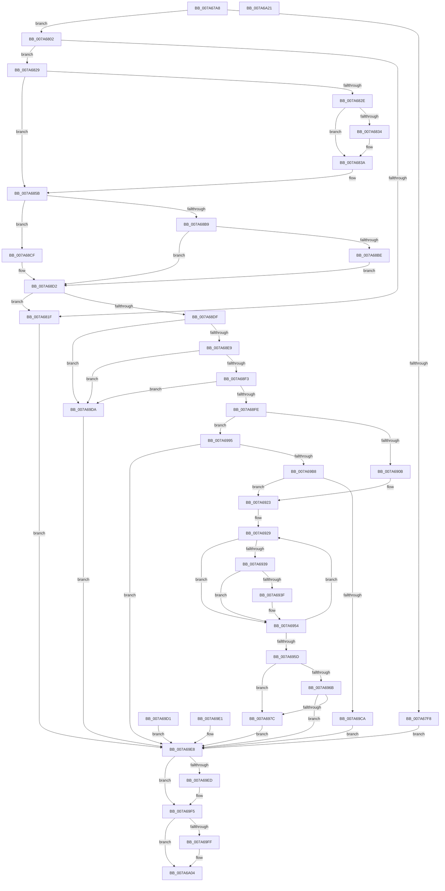

# SmProcessListRequest

- RVA: `0x007A67A8`–`0x007A6A22` (길이 `634` bytes)
- VA: `0x00000001407A67A8`
- 실행 섹션: `PAGE`
- PDB 이름 있음: `예`; PDB Function 태그: `아니요`
- unwind 정보 RVA: `0x000D1C90`
- 디코드: `172`개 명령, `634/634` bytes 표시
- 미해석 바이트: `0` (있으면 어셈블리에 `.byte`로 보존)

> 이 문서는 커널 이미지의 기계어와 PDB 기호를 분석해 생성했습니다. 4번과 5번은 함수 원형과 자료형을 바이너리 사용 방식에서 추정한 C 해석이며 원본 소스 복구 결과는 아닙니다.

## 1. Dependencies

- 직접 호출 지점: **11**; 고유 호출 대상: **11**
- 직접 호출자로 확인된 함수: **1**
- RIP 상대 이미지 참조: **0**

### Outgoing calls
- `0x007A67E6` → [SmAllocEx](../../text/34/SmAllocEx_function_0034C794.md) (function, `0x0034C794`)
- `0x007A680F` → [memset](../../text/6C/memset_function_006C6C40.md) (function, `0x006C6C40`)
- `0x007A6834` → [ExRaiseDatatypeMisalignment](../89/ExRaiseDatatypeMisalignment_function_00899FD0.md) (function, `0x00899FD0`)
- `0x007A68C8` → [ProbeForWrite](../8E/ProbeForWrite_function_008E91C0.md) (function, `0x008E91C0`)
- `0x007A691B` → [SmpGetProcessPartition](../../text/4A/SmpGetProcessPartition_function_004A3CCC.md) (function, `0x004A3CCC`)
- `0x007A692F` → [SmKmStoreRefFromStoreIndex](../../text/43/SmKmStoreRefFromStoreIndex_function_004341A0.md) (function, `0x004341A0`)
- `0x007A6971` → [SmProcessListRequestExtended](SmProcessListRequestExtended_function_007A6A28.md) (function, `0x007A6A28`)
- `0x007A6989` → [memcpy](../../text/6C/memcpy_function_006C6840.md) (function, `0x006C6840`)
- `0x007A69AD` → [PsReferencePartitionByHandle](../90/PsReferencePartitionByHandle_function_0090337C.md) (function, `0x0090337C`)
- `0x007A69F0` → [CmSiFreeMemory](../../text/47/CmSiFreeMemory_function_00475D80.md) (function, `0x00475D80`)
- `0x007A69FF` → [PsDereferencePartition](../../text/34/PsDereferencePartition_function_00342E70.md) (function, `0x00342E70`)

### Direct callers
- [SmQueryStoreInformation](../A0/SmQueryStoreInformation_function_00A0E7BC.md) at `0x00A0E953`

### Static image references
- 디코드된 RIP-relative 메모리 참조가 없습니다.

## 2. Other-region calls and transfers

- 다른 실행 섹션으로 향하는 call: **7**
  - `0x007A67E6` → [SmAllocEx](../../text/34/SmAllocEx_function_0034C794.md) (`PAGE` → `.text`)
  - `0x007A680F` → [memset](../../text/6C/memset_function_006C6C40.md) (`PAGE` → `.text`)
  - `0x007A691B` → [SmpGetProcessPartition](../../text/4A/SmpGetProcessPartition_function_004A3CCC.md) (`PAGE` → `.text`)
  - `0x007A692F` → [SmKmStoreRefFromStoreIndex](../../text/43/SmKmStoreRefFromStoreIndex_function_004341A0.md) (`PAGE` → `.text`)
  - `0x007A6989` → [memcpy](../../text/6C/memcpy_function_006C6840.md) (`PAGE` → `.text`)
  - `0x007A69F0` → [CmSiFreeMemory](../../text/47/CmSiFreeMemory_function_00475D80.md) (`PAGE` → `.text`)
  - `0x007A69FF` → [PsDereferencePartition](../../text/34/PsDereferencePartition_function_00342E70.md) (`PAGE` → `.text`)
- 별도 외부 분기/꼬리 이동을 확인하지 못했습니다.

## 3. Assembly (complete function range)

```asm
007A67A8  48 8B C4                        mov rax, rsp
007A67AB  48 89 58 08                     mov qword ptr [rax + 8], rbx
007A67AF  48 89 70 10                     mov qword ptr [rax + 0x10], rsi
007A67B3  48 89 78 18                     mov qword ptr [rax + 0x18], rdi
007A67B7  41 54                           push r12
007A67B9  41 56                           push r14
007A67BB  41 57                           push r15
007A67BD  48 83 EC 50                     sub rsp, 0x50
007A67C1  41 8A F1                        mov sil, r9b
007A67C4  4D 8B E0                        mov r12, r8
007A67C7  44 8B FA                        mov r15d, edx
007A67CA  4C 8B F1                        mov r14, rcx
007A67CD  83 60 C8 00                     and dword ptr [rax - 0x38], 0
007A67D1  48 83 60 D0 00                  and qword ptr [rax - 0x30], 0
007A67D6  41 83 C8 FF                     or r8d, 0xffffffff
007A67DA  BA 73 6D 4C 52                  mov edx, 0x524c6d73
007A67DF  BB 90 10 00 00                  mov ebx, 0x1090
007A67E4  8B CB                           mov ecx, ebx
007A67E6  E8 A9 5F BA FF                  call 0x14034c794
007A67EB  48 8B F8                        mov rdi, rax
007A67EE  48 89 44 24 40                  mov qword ptr [rsp + 0x40], rax
007A67F3  48 85 C0                        test rax, rax
007A67F6  75 0A                           jne 0x1407a6802
007A67F8  BB 54 04 00 C0                  mov ebx, 0xc0000454
007A67FD  E9 E6 01 00 00                  jmp 0x1407a69e8
007A6802  83 64 24 30 00                  and dword ptr [rsp + 0x30], 0
007A6807  4C 8B C3                        mov r8, rbx
007A680A  33 D2                           xor edx, edx
007A680C  48 8B CF                        mov rcx, rdi
007A680F  E8 2C 04 F2 FF                  call 0x1406c6c40
007A6814  41 B8 90 00 00 00               mov r8d, 0x90
007A681A  45 3B F8                        cmp r15d, r8d
007A681D  73 0A                           jae 0x1407a6829
007A681F  BB 06 02 00 C0                  mov ebx, 0xc0000206
007A6824  E9 BF 01 00 00                  jmp 0x1407a69e8
007A6829  40 84 F6                        test sil, sil
007A682C  74 2D                           je 0x1407a685b
007A682E  41 F6 C6 07                     test r14b, 7
007A6832  74 06                           je 0x1407a683a
007A6834  E8 97 37 0F 00                  call 0x140899fd0
007A6839  CC                              int3
007A683A  48 B9 00 00 FF FF FF 7F 00 00   movabs rcx, 0x7fffffff0000
007A6844  4C 3B F1                        cmp r14, rcx
007A6847  49 0F 42 CE                     cmovb rcx, r14
007A684B  8A 01                           mov al, byte ptr [rcx]
007A684D  88 01                           mov byte ptr [rcx], al
007A684F  8A 81 8F 00 00 00               mov al, byte ptr [rcx + 0x8f]
007A6855  88 81 8F 00 00 00               mov byte ptr [rcx + 0x8f], al
007A685B  41 0F 10 06                     movups xmm0, xmmword ptr [r14]
007A685F  0F 11 07                        movups xmmword ptr [rdi], xmm0
007A6862  41 0F 10 4E 10                  movups xmm1, xmmword ptr [r14 + 0x10]
007A6867  0F 11 4F 10                     movups xmmword ptr [rdi + 0x10], xmm1
007A686B  41 0F 10 46 20                  movups xmm0, xmmword ptr [r14 + 0x20]
007A6870  0F 11 47 20                     movups xmmword ptr [rdi + 0x20], xmm0
007A6874  41 0F 10 4E 30                  movups xmm1, xmmword ptr [r14 + 0x30]
007A6879  0F 11 4F 30                     movups xmmword ptr [rdi + 0x30], xmm1
007A687D  41 0F 10 46 40                  movups xmm0, xmmword ptr [r14 + 0x40]
007A6882  0F 11 47 40                     movups xmmword ptr [rdi + 0x40], xmm0
007A6886  41 0F 10 4E 50                  movups xmm1, xmmword ptr [r14 + 0x50]
007A688B  0F 11 4F 50                     movups xmmword ptr [rdi + 0x50], xmm1
007A688F  41 0F 10 46 60                  movups xmm0, xmmword ptr [r14 + 0x60]
007A6894  0F 11 47 60                     movups xmmword ptr [rdi + 0x60], xmm0
007A6898  BA 80 00 00 00                  mov edx, 0x80
007A689D  41 0F 10 46 70                  movups xmm0, xmmword ptr [r14 + 0x70]
007A68A2  0F 11 44 17 F0                  movups xmmword ptr [rdi + rdx - 0x10], xmm0
007A68A7  41 0F 10 0C 16                  movups xmm1, xmmword ptr [r14 + rdx]
007A68AC  0F 11 0C 17                     movups xmmword ptr [rdi + rdx], xmm1
007A68B0  90                              nop
007A68B1  F7 07 00 00 01 00               test dword ptr [rdi], 0x10000
007A68B7  74 16                           je 0x1407a68cf
007A68B9  40 84 F6                        test sil, sil
007A68BC  74 14                           je 0x1407a68d2
007A68BE  44 8D 42 88                     lea r8d, [rdx - 0x78]
007A68C2  48 8B D3                        mov rdx, rbx
007A68C5  49 8B CE                        mov rcx, r14
007A68C8  E8 F3 28 14 00                  call 0x1408e91c0
007A68CD  EB 03                           jmp 0x1407a68d2
007A68CF  41 8B D8                        mov ebx, r8d
007A68D2  89 5C 24 30                     mov dword ptr [rsp + 0x30], ebx
007A68D6  44 3B FB                        cmp r15d, ebx
007A68D9  0F 85 40 FF FF FF               jne 0x1407a681f
007A68DF  8B 07                           mov eax, dword ptr [rdi]
007A68E1  3C 03                           cmp al, 3
007A68E3  0F 85 F1 00 00 00               jne 0x1407a69da
007A68E9  80 7F 01 00                     cmp byte ptr [rdi + 1], 0
007A68ED  0F 85 E7 00 00 00               jne 0x1407a69da
007A68F3  3D 00 00 02 00                  cmp eax, 0x20000
007A68F8  0F 83 DC 00 00 00               jae 0x1407a69da
007A68FE  48 8B 4F 08                     mov rcx, qword ptr [rdi + 8]
007A6902  48 85 C9                        test rcx, rcx
007A6905  0F 85 8A 00 00 00               jne 0x1407a6995
007A690B  65 48 8B 04 25 88 01 00 00      mov rax, qword ptr gs:[0x188]
007A6914  48 8B 88 B8 00 00 00            mov rcx, qword ptr [rax + 0xb8]
007A691B  E8 AC D3 CF FF                  call 0x1404a3ccc
007A6920  4C 8B D0                        mov r10, rax
007A6923  45 33 DB                        xor r11d, r11d
007A6926  45 33 C9                        xor r9d, r9d
007A6929  41 8B D1                        mov edx, r9d
007A692C  49 8B CA                        mov rcx, r10
007A692F  E8 6C D8 C8 FF                  call 0x1404341a0
007A6934  48 85 C0                        test rax, rax
007A6937  74 1B                           je 0x1407a6954
007A6939  48 83 38 00                     cmp qword ptr [rax], 0
007A693D  74 15                           je 0x1407a6954
007A693F  0F B7 48 20                     movzx ecx, word ptr [rax + 0x20]
007A6943  83 E1 3F                        and ecx, 0x3f
007A6946  C1 E1 0A                        shl ecx, 0xa
007A6949  41 0B C9                        or ecx, r9d
007A694C  42 89 4C 9F 10                  mov dword ptr [rdi + r11*4 + 0x10], ecx
007A6951  41 FF C3                        inc r11d
007A6954  41 FF C1                        inc r9d
007A6957  41 83 F9 20                     cmp r9d, 0x20
007A695B  72 CC                           jb 0x1407a6929
007A695D  44 88 5F 01                     mov byte ptr [rdi + 1], r11b
007A6961  33 DB                           xor ebx, ebx
007A6963  F7 07 00 00 01 00               test dword ptr [rdi], 0x10000
007A6969  74 11                           je 0x1407a697c
007A696B  48 8B D7                        mov rdx, rdi
007A696E  49 8B CA                        mov rcx, r10
007A6971  E8 B2 00 00 00                  call 0x1407a6a28
007A6976  8B D8                           mov ebx, eax
007A6978  85 C0                           test eax, eax
007A697A  78 6C                           js 0x1407a69e8
007A697C  8B 74 24 30                     mov esi, dword ptr [rsp + 0x30]
007A6980  44 8B C6                        mov r8d, esi
007A6983  48 8B D7                        mov rdx, rdi
007A6986  49 8B CE                        mov rcx, r14
007A6989  E8 B2 FE F1 FF                  call 0x1406c6840
007A698E  90                              nop
007A698F  41 89 34 24                     mov dword ptr [r12], esi
007A6993  EB 53                           jmp 0x1407a69e8
007A6995  48 8D 44 24 38                  lea rax, [rsp + 0x38]
007A699A  48 89 44 24 20                  mov qword ptr [rsp + 0x20], rax
007A699F  41 B9 53 6D 51 4C               mov r9d, 0x4c516d53
007A69A5  44 8A C6                        mov r8b, sil
007A69A8  BA 01 00 00 00                  mov edx, 1
007A69AD  E8 CA C9 15 00                  call 0x14090337c
007A69B2  8B D8                           mov ebx, eax
007A69B4  85 C0                           test eax, eax
007A69B6  78 30                           js 0x1407a69e8
007A69B8  48 8B 44 24 38                  mov rax, qword ptr [rsp + 0x38]
007A69BD  4C 8B 50 18                     mov r10, qword ptr [rax + 0x18]
007A69C1  4D 85 D2                        test r10, r10
007A69C4  0F 85 59 FF FF FF               jne 0x1407a6923
007A69CA  BB A9 01 00 C0                  mov ebx, 0xc00001a9
007A69CF  EB 17                           jmp 0x1407a69e8
007A69D1  8B D8                           mov ebx, eax
007A69D3  48 8B 7C 24 40                  mov rdi, qword ptr [rsp + 0x40]
007A69D8  EB 0E                           jmp 0x1407a69e8
007A69DA  BB 0D 00 00 C0                  mov ebx, 0xc000000d
007A69DF  EB 07                           jmp 0x1407a69e8
007A69E1  8B D8                           mov ebx, eax
007A69E3  48 8B 7C 24 40                  mov rdi, qword ptr [rsp + 0x40]
007A69E8  48 85 FF                        test rdi, rdi
007A69EB  74 08                           je 0x1407a69f5
007A69ED  48 8B CF                        mov rcx, rdi
007A69F0  E8 8B F3 CC FF                  call 0x140475d80
007A69F5  48 8B 4C 24 38                  mov rcx, qword ptr [rsp + 0x38]
007A69FA  48 85 C9                        test rcx, rcx
007A69FD  74 05                           je 0x1407a6a04
007A69FF  E8 6C C4 B9 FF                  call 0x140342e70
007A6A04  8B C3                           mov eax, ebx
007A6A06  4C 8D 5C 24 50                  lea r11, [rsp + 0x50]
007A6A0B  49 8B 5B 20                     mov rbx, qword ptr [r11 + 0x20]
007A6A0F  49 8B 73 28                     mov rsi, qword ptr [r11 + 0x28]
007A6A13  49 8B 7B 30                     mov rdi, qword ptr [r11 + 0x30]
007A6A17  49 8B E3                        mov rsp, r11
007A6A1A  41 5F                           pop r15
007A6A1C  41 5E                           pop r14
007A6A1E  41 5C                           pop r12
007A6A20  C3                              ret
007A6A21  CC                              int3
```

## 4. C-style interpretation (structured pseudocode)

```c
__int64 __fastcall SmProcessListRequest(__int64 a1, int a2, __int64 a3, int a4)
{
    __int64 result;
    __int64 v_r11;
    __int64 v_rbx;
    __int64 v_rsp;
    unsigned __int64 v_stack_m18;
    unsigned __int64 v_stack_m28;
    unsigned __int64 v_stack_m30;
    unsigned int v_stack_m38;
    unsigned __int64 v_stack_m48;

    *(unsigned __int64 *)(v_rsp + 8) = v_rbx;
    *(unsigned __int64 *)(v_rsp + 16) = v_rsi;
    *(unsigned __int64 *)(v_rsp + 24) = v_rdi;
    v_rsp = (v_rsp) - (80);
    a3 = (unsigned int)((a3) | (0xFFFFFFFFULL));
    result = SmAllocEx((unsigned int)((unsigned int)((unsigned int)(0x1090ULL))), (unsigned int)(0x524C6D73ULL), a3, a4);
    v_stack_m28 = result;
    if (result != 0) goto loc_007A6802;
    goto loc_007A69E8;
loc_007A6802:
    a2 = 0;
    result = memset(result, a2, (unsigned int)(0xC0000454ULL), a4);
    if (((unsigned int)((unsigned int)(a2))) >= 144) goto loc_007A6829;
loc_007A681F:
    goto loc_007A69E8;
loc_007A6829:
    if ((unsigned __int8)((unsigned __int8)(a4)) == 0) goto loc_007A685B;
    if ((((unsigned __int8)(a1)) & (7)) != 0) {
        result = ExRaiseDatatypeMisalignment(result, a2, 144, a4);
    }
    a1 = result;
    if (a1 < result) { a1 = a1; }
    *(unsigned __int8 *)(a1) = (unsigned __int8)(*(unsigned __int8 *)(a1));
    *(unsigned __int8 *)(a1 + 143) = (unsigned __int8)(*(unsigned __int8 *)(a1 + 143));
loc_007A685B:
    *(unsigned __int64 *)(result) = v_xmm0;
    *(unsigned __int64 *)(result + 16) = v_xmm1;
    *(unsigned __int64 *)(result + 32) = v_xmm0;
    *(unsigned __int64 *)(result + 48) = v_xmm1;
    *(unsigned __int64 *)(result + 64) = v_xmm0;
    *(unsigned __int64 *)(result + 80) = v_xmm1;
    *(unsigned __int64 *)(result + 96) = v_xmm0;
    *(unsigned __int64 *)(result + 128 * 1 - 16) = v_xmm0;
    *(unsigned __int64 *)(result + 128 * 1) = v_xmm1;
    if (((*(unsigned int *)(result)) & (0x10000ULL)) == 0) goto loc_007A68CF;
    if ((unsigned __int8)((unsigned __int8)(a4)) == 0) goto loc_007A68D2;
    result = ProbeForWrite(a1, (unsigned int)(0xC0000206ULL), 128 - 120, a4);
    goto loc_007A68D2;
loc_007A68CF:
loc_007A68D2:
    v_stack_m38 = (unsigned int)((unsigned int)((unsigned int)(128 - 120)));
    if (((unsigned int)((unsigned int)(a2))) != ((unsigned int)((unsigned int)((unsigned int)(128 - 120))))) goto loc_007A681F;
    if (((unsigned __int8)((unsigned int)(*(unsigned int *)(result)))) != 3) goto loc_007A69DA;
    if ((*(unsigned __int8 *)(result + 1)) != 0) goto loc_007A69DA;
    if (((unsigned int)((unsigned int)(*(unsigned int *)(result)))) >= 0x20000ULL) goto loc_007A69DA;
    if (*(unsigned __int64 *)(result + 8) != 0) goto loc_007A6995;
    result = SmpGetProcessPartition(*(unsigned __int64 *)(*(unsigned __int64 *)(gs_base + (0 + 392)) + 184), (unsigned int)(0xC0000206ULL), 128 - 120, a4);
loc_007A6923:
    v_r11 = 0;
    a4 = 0;
loc_007A6929:
    result = SmKmStoreRefFromStoreIndex(result, 0, 128 - 120, a4);
    if (result == 0) goto loc_007A6954;
    if ((*(unsigned __int64 *)(result)) != 0) {
        a1 = *(unsigned __int16 *)(result + 32);
        a1 = (unsigned int)((a1) & (63));
        a1 = (unsigned int)((a1) << (10));
        a1 = (unsigned int)((a1) | (0));
        *(unsigned int *)(result + v_r11 * 4 + 16) = (unsigned int)(a1);
        v_r11 = (unsigned int)((v_r11) + 1);
    }
    a4 = (unsigned int)((a4) + 1);
    if (a4 < 32) goto loc_007A6929;
    *(unsigned __int8 *)(result + 1) = (unsigned __int8)(v_r11);
    v_rbx = 0;
    if (((*(unsigned int *)(result)) & (0x10000ULL)) == 0) goto loc_007A697C;
    result = SmProcessListRequestExtended(result, result, 128 - 120, a4);
    if (sign_flag) goto loc_007A69E8;
loc_007A697C:
    result = memcpy(a1, result, (unsigned int)((unsigned int)((unsigned int)(v_stack_m38))), a4);
    *(unsigned int *)(a3) = (unsigned int)((unsigned int)(v_stack_m38));
    goto loc_007A69E8;
loc_007A6995:
    v_stack_m48 = v_stack_m30;
    result = PsReferencePartitionByHandle(a1, 1, (unsigned __int8)((unsigned int)(v_stack_m38)), (unsigned int)(0x4C516D53ULL));
    if (sign_flag) goto loc_007A69E8;
    if (*(unsigned __int64 *)(v_stack_m30 + 24) != 0) goto loc_007A6923;
    goto loc_007A69E8;
loc_007A69DA:
    goto loc_007A69E8;
loc_007A69E8:
    result = v_stack_m30;
    if (result != 0) {
        a1 = result;
        result = CmSiFreeMemory(a1, 1, (unsigned __int8)((unsigned int)(v_stack_m38)), (unsigned int)(0x4C516D53ULL));
    }
    if (v_stack_m30 != 0) {
        result = PsDereferencePartition(v_stack_m30, 1, (unsigned __int8)((unsigned int)(v_stack_m38)), (unsigned int)(0x4C516D53ULL));
    }
    return (unsigned int)((unsigned int)((unsigned int)(0xC000000DULL)));
}
```

## 5. (Beta) C Style

```c
int64_t SmProcessListRequest(int64_t Arg1, int32_t Arg2, void *Arg3, int32_t Arg4)
{
    uint8_t *arg3 = (uint8_t *)Arg3;

    int64_t result;
    int64_t local_r11;
    int64_t local_rbx;
    int64_t local_rsp;
    uint64_t v_stack_m18;
    uint64_t v_stack_m28;
    uint64_t v_stack_m30;
    uint32_t v_stack_m38;
    uint64_t v_stack_m48;

    *(uint64_t *)(local_rsp + 0x8) = local_rbx;
    *(uint64_t *)(local_rsp + 0x10) = local_rsi;
    *(uint64_t *)(local_rsp + 0x18) = local_rdi;
    local_rsp = (local_rsp) - (80);
    Arg3 = (uint32_t)((Arg3) | (0xFFFFFFFFULL));
    result = SmAllocEx((uint32_t)((uint32_t)((uint32_t)(0x1090ULL))), (uint32_t)(0x524C6D73ULL), Arg3, Arg4);
    v_stack_m28 = result;
    if (result != 0) goto loc_007A6802;
    goto loc_007A69E8;
loc_007A6802:
    Arg2 = 0;
    result = memset(result, Arg2, (uint32_t)(0xC0000454ULL), Arg4);
    if (((uint32_t)((uint32_t)(Arg2))) >= 144) goto loc_007A6829;
loc_007A681F:
    goto loc_007A69E8;
loc_007A6829:
    if ((uint8_t)((uint8_t)(Arg4)) == 0) goto loc_007A685B;
    if ((((uint8_t)(Arg1)) & (7)) != 0) {
        result = ExRaiseDatatypeMisalignment(result, Arg2, 144, Arg4);
    }
    Arg1 = result;
    if (Arg1 < result) { Arg1 = Arg1; }
    *(uint8_t *)(Arg1) = (uint8_t)(*(uint8_t *)(Arg1));
    *(uint8_t *)(Arg1 + 0x8F) = (uint8_t)(*(uint8_t *)(Arg1 + 0x8F));
loc_007A685B:
    *(uint64_t *)(result) = v_xmm0;
    *(uint64_t *)(result + 0x10) = v_xmm1;
    *(uint64_t *)(result + 0x20) = v_xmm0;
    *(uint64_t *)(result + 0x30) = v_xmm1;
    *(uint64_t *)(result + 0x40) = v_xmm0;
    *(uint64_t *)(result + 0x50) = v_xmm1;
    *(uint64_t *)(result + 0x60) = v_xmm0;
    *(uint64_t *)(result + 0x80 * 1 - 0x10) = v_xmm0;
    *(uint64_t *)(result + 0x80 * 1) = v_xmm1;
    if (((*(uint32_t *)(result)) & (0x10000ULL)) == 0) goto loc_007A68CF;
    if ((uint8_t)((uint8_t)(Arg4)) == 0) goto loc_007A68D2;
    result = ProbeForWrite(Arg1, (uint32_t)(0xC0000206ULL), 128 - 120, Arg4);
    goto loc_007A68D2;
loc_007A68CF:
loc_007A68D2:
    v_stack_m38 = (uint32_t)((uint32_t)((uint32_t)(128 - 120)));
    if (((uint32_t)((uint32_t)(Arg2))) != ((uint32_t)((uint32_t)((uint32_t)(128 - 120))))) goto loc_007A681F;
    if (((uint8_t)((uint32_t)(*(uint32_t *)(result)))) != 3) goto loc_007A69DA;
    if ((*(uint8_t *)(result + 0x1)) != 0) goto loc_007A69DA;
    if (((uint32_t)((uint32_t)(*(uint32_t *)(result)))) >= 0x20000ULL) goto loc_007A69DA;
    if (*(uint64_t *)(result + 0x8) != 0) goto loc_007A6995;
    result = SmpGetProcessPartition(*(uint64_t *)(*(uint64_t *)(gs_base + (0 + 0x188)) + 0xB8), (uint32_t)(0xC0000206ULL), 128 - 120, Arg4);
loc_007A6923:
    local_r11 = 0;
    Arg4 = 0;
loc_007A6929:
    result = SmKmStoreRefFromStoreIndex(result, 0, 128 - 120, Arg4);
    if (result == 0) goto loc_007A6954;
    if ((*(uint64_t *)(result)) != 0) {
        Arg1 = *(uint16_t *)(result + 0x20);
        Arg1 = (uint32_t)((Arg1) & (63));
        Arg1 = (uint32_t)((Arg1) << (10));
        Arg1 = (uint32_t)((Arg1) | (0));
        *(uint32_t *)(result + local_r11 * 4 + 0x10) = (uint32_t)(Arg1);
        local_r11 = (uint32_t)((local_r11) + 1);
    }
    Arg4 = (uint32_t)((Arg4) + 1);
    if (Arg4 < 32) goto loc_007A6929;
    *(uint8_t *)(result + 0x1) = (uint8_t)(local_r11);
    local_rbx = 0;
    if (((*(uint32_t *)(result)) & (0x10000ULL)) == 0) goto loc_007A697C;
    result = SmProcessListRequestExtended(result, result, 128 - 120, Arg4);
    if (sign_flag) goto loc_007A69E8;
loc_007A697C:
    result = memcpy(Arg1, result, (uint32_t)((uint32_t)((uint32_t)(v_stack_m38))), Arg4);
    *(uint32_t *)(arg3) = (uint32_t)((uint32_t)(v_stack_m38));
    goto loc_007A69E8;
loc_007A6995:
    v_stack_m48 = v_stack_m30;
    result = PsReferencePartitionByHandle(Arg1, 1, (uint8_t)((uint32_t)(v_stack_m38)), (uint32_t)(0x4C516D53ULL));
    if (sign_flag) goto loc_007A69E8;
    if (*(uint64_t *)(v_stack_m30 + 0x18) != 0) goto loc_007A6923;
    goto loc_007A69E8;
loc_007A69DA:
    goto loc_007A69E8;
loc_007A69E8:
    result = v_stack_m30;
    if (result != 0) {
        Arg1 = result;
        result = CmSiFreeMemory(Arg1, 1, (uint8_t)((uint32_t)(v_stack_m38)), (uint32_t)(0x4C516D53ULL));
    }
    if (v_stack_m30 != 0) {
        result = PsDereferencePartition(v_stack_m30, 1, (uint8_t)((uint32_t)(v_stack_m38)), (uint32_t)(0x4C516D53ULL));
    }
    return (uint32_t)((uint32_t)((uint32_t)(0xC000000DULL)));
}
```

### 관측된 메모리 오프셋

구조체 형식이 확인되지 않은 접근은 인자 기준의 오프셋으로만 기록했습니다.

| 기준 인자 | 오프셋 표현 | 폭 (bit) | 접근 |
|---|---:|---:|---|
| `Arg3` | `+ 0x0` | `32` | `W` |

## 6. Execution-region graph

[열기: 2D/3D 그래프와 함수 탐색 컨트롤 패널](../../../control-panel.html?section=page&rva=0x007A67A8&view=graph)

- 2D 그래프는 위에서 아래로 흐르고, 3D 그래프는 빈 공간을 드래그해 회전합니다. Shift+드래그는 이동, 휠은 확대·축소, 함수 노드 선택은 대상 보고서 이동입니다.

### Static fallback


