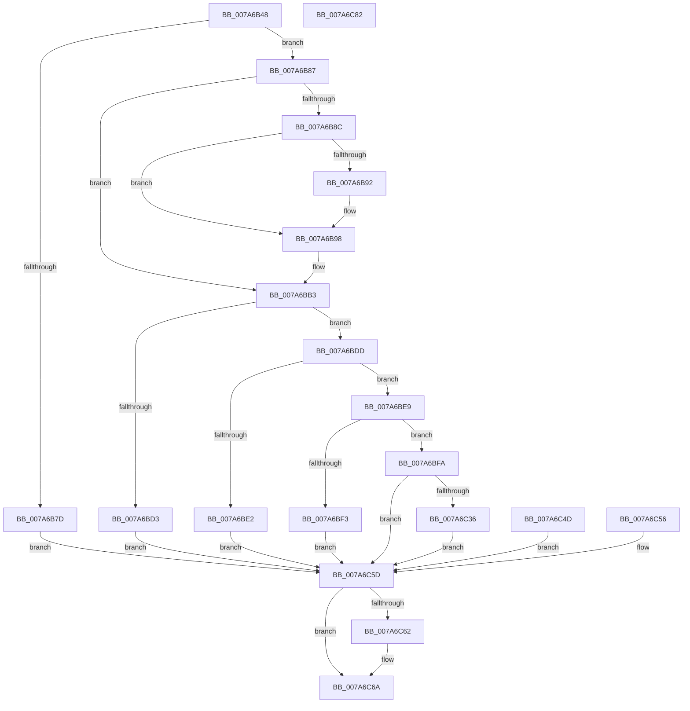

# SmProcessProcessStoreInfoRequest

- RVA: `0x007A6B48`–`0x007A6C83` (길이 `315` bytes)
- VA: `0x00000001407A6B48`
- 실행 섹션: `PAGE`
- PDB 이름 있음: `예`; PDB Function 태그: `아니요`
- unwind 정보 RVA: `0x000D1A2C`
- 디코드: `86`개 명령, `315/315` bytes 표시
- 미해석 바이트: `0` (있으면 어셈블리에 `.byte`로 보존)

> 이 문서는 커널 이미지의 기계어와 PDB 기호를 분석해 생성했습니다. 4번과 5번은 함수 원형과 자료형을 바이너리 사용 방식에서 추정한 C 해석이며 원본 소스 복구 결과는 아닙니다.

## 1. Dependencies

- 직접 호출 지점: **4**; 고유 호출 대상: **4**
- 직접 호출자로 확인된 함수: **1**
- RIP 상대 이미지 참조: **1**

### Outgoing calls
- `0x007A6B92` → [ExRaiseDatatypeMisalignment](../89/ExRaiseDatatypeMisalignment_function_00899FD0.md) (function, `0x00899FD0`)
- `0x007A6C21` → [ObReferenceObjectByHandle](../86/ObReferenceObjectByHandle_function_00868DB0.md) (function, `0x00868DB0`)
- `0x007A6C39` → [SmStoreExistsForProcess](../../text/34/SmStoreExistsForProcess_function_00349F54.md) (function, `0x00349F54`)
- `0x007A6C65` → [ObfDereferenceObject](../../text/2F/ObfDereferenceObject_function_002F9350.md) (function, `0x002F9350`)

### Direct callers
- [SmQueryStoreInformation](../A0/SmQueryStoreInformation_function_00A0E7BC.md) at `0x00A0E8D8`

### Static image references
- `0x007A6BFA` → RVA `0x00FC6A98` (`ALMOSTRO`; read)

## 2. Other-region calls and transfers

- 다른 실행 섹션으로 향하는 call: **2**
  - `0x007A6C39` → [SmStoreExistsForProcess](../../text/34/SmStoreExistsForProcess_function_00349F54.md) (`PAGE` → `.text`)
  - `0x007A6C65` → [ObfDereferenceObject](../../text/2F/ObfDereferenceObject_function_002F9350.md) (`PAGE` → `.text`)
- 별도 외부 분기/꼬리 이동을 확인하지 못했습니다.

## 3. Assembly (complete function range)

```asm
007A6B48  4C 8B DC                        mov r11, rsp
007A6B4B  49 89 5B 08                     mov qword ptr [r11 + 8], rbx
007A6B4F  49 89 73 10                     mov qword ptr [r11 + 0x10], rsi
007A6B53  49 89 7B 18                     mov qword ptr [r11 + 0x18], rdi
007A6B57  41 56                           push r14
007A6B59  48 83 EC 50                     sub rsp, 0x50
007A6B5D  45 8A C8                        mov r9b, r8b
007A6B60  48 8B F1                        mov rsi, rcx
007A6B63  0F 57 C0                        xorps xmm0, xmm0
007A6B66  33 C0                           xor eax, eax
007A6B68  0F 11 44 24 30                  movups xmmword ptr [rsp + 0x30], xmm0
007A6B6D  49 89 43 E8                     mov qword ptr [r11 - 0x18], rax
007A6B71  33 FF                           xor edi, edi
007A6B73  48 89 7C 24 78                  mov qword ptr [rsp + 0x78], rdi
007A6B78  83 FA 18                        cmp edx, 0x18
007A6B7B  73 0A                           jae 0x1407a6b87
007A6B7D  BB 06 02 00 C0                  mov ebx, 0xc0000206
007A6B82  E9 D6 00 00 00                  jmp 0x1407a6c5d
007A6B87  45 84 C9                        test r9b, r9b
007A6B8A  74 27                           je 0x1407a6bb3
007A6B8C  40 F6 C6 07                     test sil, 7
007A6B90  74 06                           je 0x1407a6b98
007A6B92  E8 39 34 0F 00                  call 0x140899fd0
007A6B97  CC                              int3
007A6B98  48 B9 00 00 FF FF FF 7F 00 00   movabs rcx, 0x7fffffff0000
007A6BA2  48 3B F1                        cmp rsi, rcx
007A6BA5  48 0F 42 CE                     cmovb rcx, rsi
007A6BA9  8A 01                           mov al, byte ptr [rcx]
007A6BAB  88 01                           mov byte ptr [rcx], al
007A6BAD  8A 41 17                        mov al, byte ptr [rcx + 0x17]
007A6BB0  88 41 17                        mov byte ptr [rcx + 0x17], al
007A6BB3  0F 10 06                        movups xmm0, xmmword ptr [rsi]
007A6BB6  0F 11 44 24 30                  movups xmmword ptr [rsp + 0x30], xmm0
007A6BBB  F2 0F 10 4E 10                  movsd xmm1, qword ptr [rsi + 0x10]
007A6BC0  F2 0F 11 4C 24 40               movsd qword ptr [rsp + 0x40], xmm1
007A6BC6  41 BE 01 00 00 00               mov r14d, 1
007A6BCC  44 38 74 24 30                  cmp byte ptr [rsp + 0x30], r14b
007A6BD1  74 0A                           je 0x1407a6bdd
007A6BD3  BB 59 00 00 C0                  mov ebx, 0xc0000059
007A6BD8  E9 80 00 00 00                  jmp 0x1407a6c5d
007A6BDD  83 FA 18                        cmp edx, 0x18
007A6BE0  74 07                           je 0x1407a6be9
007A6BE2  BB 04 00 00 C0                  mov ebx, 0xc0000004
007A6BE7  EB 74                           jmp 0x1407a6c5d
007A6BE9  F7 44 24 30 00 FF FF FF         test dword ptr [rsp + 0x30], 0xffffff00
007A6BF1  74 07                           je 0x1407a6bfa
007A6BF3  BB 0D 00 00 C0                  mov ebx, 0xc000000d
007A6BF8  EB 63                           jmp 0x1407a6c5d
007A6BFA  4C 8B 05 97 FE 81 00            mov r8, qword ptr [rip + 0x81fe97]
007A6C01  48 83 64 24 78 00               and qword ptr [rsp + 0x78], 0
007A6C07  48 83 64 24 28 00               and qword ptr [rsp + 0x28], 0
007A6C0D  48 8D 44 24 78                  lea rax, [rsp + 0x78]
007A6C12  48 89 44 24 20                  mov qword ptr [rsp + 0x20], rax
007A6C17  BA 00 10 00 00                  mov edx, 0x1000
007A6C1C  48 8B 4C 24 38                  mov rcx, qword ptr [rsp + 0x38]
007A6C21  E8 8A 21 0C 00                  call 0x140868db0
007A6C26  8B D8                           mov ebx, eax
007A6C28  48 8B 7C 24 78                  mov rdi, qword ptr [rsp + 0x78]
007A6C2D  48 89 7C 24 78                  mov qword ptr [rsp + 0x78], rdi
007A6C32  85 C0                           test eax, eax
007A6C34  78 27                           js 0x1407a6c5d
007A6C36  48 8B CF                        mov rcx, rdi
007A6C39  E8 16 33 BA FF                  call 0x140349f54
007A6C3E  33 C9                           xor ecx, ecx
007A6C40  85 C0                           test eax, eax
007A6C42  41 0F 45 CE                     cmovne ecx, r14d
007A6C46  89 4E 10                        mov dword ptr [rsi + 0x10], ecx
007A6C49  33 DB                           xor ebx, ebx
007A6C4B  EB 10                           jmp 0x1407a6c5d
007A6C4D  8B D8                           mov ebx, eax
007A6C4F  48 8B 7C 24 78                  mov rdi, qword ptr [rsp + 0x78]
007A6C54  EB 07                           jmp 0x1407a6c5d
007A6C56  8B D8                           mov ebx, eax
007A6C58  48 8B 7C 24 78                  mov rdi, qword ptr [rsp + 0x78]
007A6C5D  48 85 FF                        test rdi, rdi
007A6C60  74 08                           je 0x1407a6c6a
007A6C62  48 8B CF                        mov rcx, rdi
007A6C65  E8 E6 26 B5 FF                  call 0x1402f9350
007A6C6A  8B C3                           mov eax, ebx
007A6C6C  48 8B 5C 24 60                  mov rbx, qword ptr [rsp + 0x60]
007A6C71  48 8B 74 24 68                  mov rsi, qword ptr [rsp + 0x68]
007A6C76  48 8B 7C 24 70                  mov rdi, qword ptr [rsp + 0x70]
007A6C7B  48 83 C4 50                     add rsp, 0x50
007A6C7F  41 5E                           pop r14
007A6C81  C3                              ret
007A6C82  CC                              int3
```

## 4. C-style interpretation (structured pseudocode)

```c
__int64 __fastcall SmProcessProcessStoreInfoRequest(__int64 a1, int a2, unsigned __int8 a3)
{
    __int64 result;
    __int64 v_rbx;
    __int64 v_rdi;
    __int64 v_rsp;
    unsigned __int64 v_stack_m18;
    unsigned __int64 v_stack_m20;
    unsigned __int64 v_stack_m28;
    unsigned __int64 v_stack_m30;
    unsigned __int64 v_stack_m38;
    unsigned __int64 v_stack_p10;
    unsigned __int64 v_stack_p18;
    unsigned __int64 v_stack_p20;
    unsigned __int64 v_stack_p8;

    *(unsigned __int64 *)(v_rsp + 8) = v_rbx;
    *(unsigned __int64 *)(v_rsp + 16) = v_rsi;
    *(unsigned __int64 *)(v_rsp + 24) = v_rdi;
    v_rsp = (v_rsp) - (80);
    result = 0;
    v_stack_m28 = v_xmm0;
    *(unsigned __int64 *)(v_rsp - 24) = 0;
    v_rdi = 0;
    v_stack_p20 = 0;
    if (a2 >= 24) goto loc_007A6B87;
    goto loc_007A6C5D;
loc_007A6B87:
    if (a3 == 0) goto loc_007A6BB3;
    if ((((unsigned __int8)(a1)) & (7)) != 0) {
        result = ExRaiseDatatypeMisalignment(a1, a2, a3, a3);
    }
    if (a1 < a1) { a1 = a1; }
    *(unsigned __int8 *)(a1) = (unsigned __int8)(*(unsigned __int8 *)(a1));
    *(unsigned __int8 *)(a1 + 23) = (unsigned __int8)(*(unsigned __int8 *)(a1 + 23));
loc_007A6BB3:
    v_stack_m28 = v_xmm0;
    v_stack_m18 = v_xmm1;
    if (v_stack_m28 == 1) goto loc_007A6BDD;
    goto loc_007A6C5D;
loc_007A6BDD:
    if (a2 == 24) goto loc_007A6BE9;
    goto loc_007A6C5D;
loc_007A6BE9:
    if (((v_stack_m28) & (0xFFFFFF00ULL)) == 0) goto loc_007A6BFA;
    goto loc_007A6C5D;
loc_007A6BFA:
    v_stack_m38 = v_stack_p20;
    result = ObReferenceObjectByHandle(v_stack_m20, (unsigned int)(0x1000ULL), *(unsigned __int64 *)(v_rip + 8519319), a3);
    v_stack_p20 = v_stack_p20;
    if (sign_flag) goto loc_007A6C5D;
    result = SmStoreExistsForProcess(v_stack_p20, (unsigned int)(0x1000ULL), *(unsigned __int64 *)(v_rip + 8519319), a3);
    a1 = 0;
    if ((unsigned int)(result) != 0) { a1 = 1; }
    *(unsigned int *)(a1 + 16) = (unsigned int)(a1);
    v_rbx = 0;
    goto loc_007A6C5D;
loc_007A6C5D:
    if (v_stack_p20 != 0) {
        a1 = v_stack_p20;
        result = ObfDereferenceObject(a1, (unsigned int)(0x1000ULL), *(unsigned __int64 *)(v_rip + 8519319), a3);
    }
    v_rsp = (v_rsp) + (80);
    return 0;
}
```

## 5. (Beta) C Style

```c
int64_t SmProcessProcessStoreInfoRequest(int64_t Arg1, int32_t Arg2, uint8_t Arg3)
{
    int64_t result;
    int64_t local_rbx;
    int64_t local_rdi;
    int64_t local_rsp;
    uint64_t v_stack_m18;
    uint64_t v_stack_m20;
    uint64_t v_stack_m28;
    uint64_t v_stack_m30;
    uint64_t v_stack_m38;
    uint64_t v_stack_p10;
    uint64_t v_stack_p18;
    uint64_t v_stack_p20;
    uint64_t v_stack_p8;

    *(uint64_t *)(local_rsp + 0x8) = local_rbx;
    *(uint64_t *)(local_rsp + 0x10) = local_rsi;
    *(uint64_t *)(local_rsp + 0x18) = local_rdi;
    local_rsp = (local_rsp) - (80);
    result = 0;
    v_stack_m28 = v_xmm0;
    *(uint64_t *)(local_rsp - 0x18) = 0;
    local_rdi = 0;
    v_stack_p20 = 0;
    if (Arg2 >= 24) goto loc_007A6B87;
    goto loc_007A6C5D;
loc_007A6B87:
    if (Arg3 == 0) goto loc_007A6BB3;
    if ((((uint8_t)(Arg1)) & (7)) != 0) {
        result = ExRaiseDatatypeMisalignment(Arg1, Arg2, Arg3, Arg3);
    }
    if (Arg1 < Arg1) { Arg1 = Arg1; }
    *(uint8_t *)(Arg1) = (uint8_t)(*(uint8_t *)(Arg1));
    *(uint8_t *)(Arg1 + 0x17) = (uint8_t)(*(uint8_t *)(Arg1 + 0x17));
loc_007A6BB3:
    v_stack_m28 = v_xmm0;
    v_stack_m18 = v_xmm1;
    if (v_stack_m28 == 1) goto loc_007A6BDD;
    goto loc_007A6C5D;
loc_007A6BDD:
    if (Arg2 == 24) goto loc_007A6BE9;
    goto loc_007A6C5D;
loc_007A6BE9:
    if (((v_stack_m28) & (0xFFFFFF00ULL)) == 0) goto loc_007A6BFA;
    goto loc_007A6C5D;
loc_007A6BFA:
    v_stack_m38 = v_stack_p20;
    result = ObReferenceObjectByHandle(v_stack_m20, (uint32_t)(0x1000ULL), *(uint64_t *)(v_rip + 0x81FE97), Arg3);
    v_stack_p20 = v_stack_p20;
    if (sign_flag) goto loc_007A6C5D;
    result = SmStoreExistsForProcess(v_stack_p20, (uint32_t)(0x1000ULL), *(uint64_t *)(v_rip + 0x81FE97), Arg3);
    Arg1 = 0;
    if ((uint32_t)(result) != 0) { Arg1 = 1; }
    *(uint32_t *)(Arg1 + 0x10) = (uint32_t)(Arg1);
    local_rbx = 0;
    goto loc_007A6C5D;
loc_007A6C5D:
    if (v_stack_p20 != 0) {
        Arg1 = v_stack_p20;
        result = ObfDereferenceObject(Arg1, (uint32_t)(0x1000ULL), *(uint64_t *)(v_rip + 0x81FE97), Arg3);
    }
    local_rsp = (local_rsp) + (80);
    return 0;
}
```

## 6. Execution-region graph

[열기: 2D/3D 그래프와 함수 탐색 컨트롤 패널](../../../control-panel.html?section=page&rva=0x007A6B48&view=graph)

- 2D 그래프는 위에서 아래로 흐르고, 3D 그래프는 빈 공간을 드래그해 회전합니다. Shift+드래그는 이동, 휠은 확대·축소, 함수 노드 선택은 대상 보고서 이동입니다.

### Static fallback


