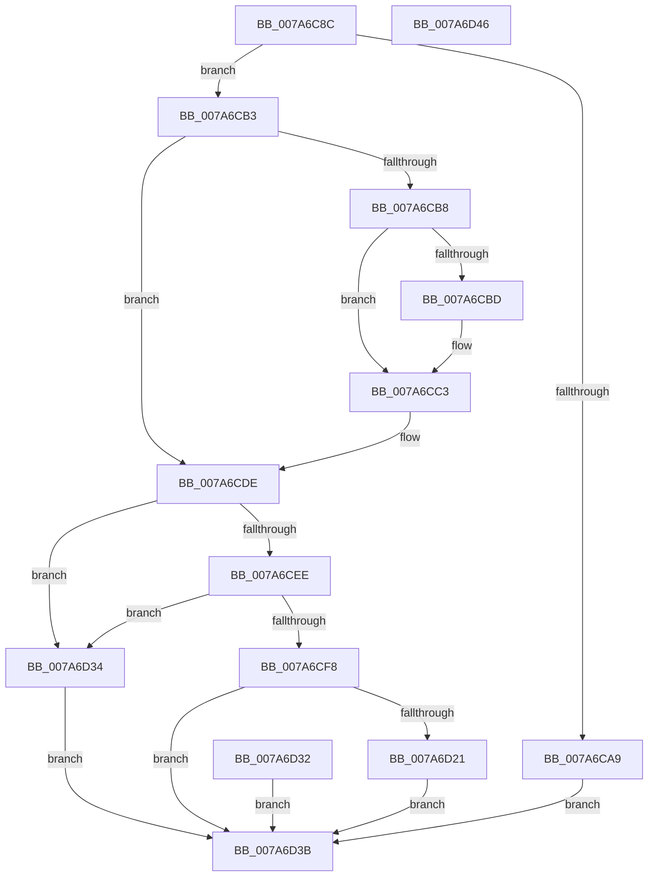

# SmProcessRegistrationRequest

- RVA: `0x007A6C8C`–`0x007A6D47` (길이 `187` bytes)
- VA: `0x00000001407A6C8C`
- 실행 섹션: `PAGE`
- PDB 이름 있음: `예`; PDB Function 태그: `아니요`
- unwind 정보 RVA: `0x000D1C58`
- 디코드: `51`개 명령, `187/187` bytes 표시
- 미해석 바이트: `0` (있으면 어셈블리에 `.byte`로 보존)

> 이 문서는 커널 이미지의 기계어와 PDB 기호를 분석해 생성했습니다. 4번과 5번은 함수 원형과 자료형을 바이너리 사용 방식에서 추정한 C 해석이며 원본 소스 복구 결과는 아닙니다.

## 1. Dependencies

- 직접 호출 지점: **3**; 고유 호출 대상: **3**
- 직접 호출자로 확인된 함수: **1**
- RIP 상대 이미지 참조: **0**

### Outgoing calls
- `0x007A6CBD` → [ExRaiseDatatypeMisalignment](../89/ExRaiseDatatypeMisalignment_function_00899FD0.md) (function, `0x00899FD0`)
- `0x007A6D08` → [SmpGetProcessPartition](../../text/4A/SmpGetProcessPartition_function_004A3CCC.md) (function, `0x004A3CCC`)
- `0x007A6D18` → [SmGetRegistrationInfo](SmGetRegistrationInfo_function_007A5AC4.md) (function, `0x007A5AC4`)

### Direct callers
- [SmQueryStoreInformation](../A0/SmQueryStoreInformation_function_00A0E7BC.md) at `0x00A0E90B`

### Static image references
- 디코드된 RIP-relative 메모리 참조가 없습니다.

## 2. Other-region calls and transfers

- 다른 실행 섹션으로 향하는 call: **1**
  - `0x007A6D08` → [SmpGetProcessPartition](../../text/4A/SmpGetProcessPartition_function_004A3CCC.md) (`PAGE` → `.text`)
- 별도 외부 분기/꼬리 이동을 확인하지 못했습니다.

## 3. Assembly (complete function range)

```asm
007A6C8C  48 89 5C 24 08                  mov qword ptr [rsp + 8], rbx
007A6C91  57                              push rdi
007A6C92  48 83 EC 30                     sub rsp, 0x30
007A6C96  49 8B F8                        mov rdi, r8
007A6C99  48 8B D9                        mov rbx, rcx
007A6C9C  0F 57 C0                        xorps xmm0, xmm0
007A6C9F  0F 11 44 24 20                  movups xmmword ptr [rsp + 0x20], xmm0
007A6CA4  83 FA 10                        cmp edx, 0x10
007A6CA7  74 0A                           je 0x1407a6cb3
007A6CA9  B8 06 02 00 C0                  mov eax, 0xc0000206
007A6CAE  E9 88 00 00 00                  jmp 0x1407a6d3b
007A6CB3  45 84 C9                        test r9b, r9b
007A6CB6  74 26                           je 0x1407a6cde
007A6CB8  F6 C3 07                        test bl, 7
007A6CBB  74 06                           je 0x1407a6cc3
007A6CBD  E8 0E 33 0F 00                  call 0x140899fd0
007A6CC2  CC                              int3
007A6CC3  48 B9 00 00 FF FF FF 7F 00 00   movabs rcx, 0x7fffffff0000
007A6CCD  48 3B D9                        cmp rbx, rcx
007A6CD0  48 0F 42 CB                     cmovb rcx, rbx
007A6CD4  8A 01                           mov al, byte ptr [rcx]
007A6CD6  88 01                           mov byte ptr [rcx], al
007A6CD8  8A 41 0F                        mov al, byte ptr [rcx + 0xf]
007A6CDB  88 41 0F                        mov byte ptr [rcx + 0xf], al
007A6CDE  0F 10 03                        movups xmm0, xmmword ptr [rbx]
007A6CE1  F3 0F 7F 44 24 20               movdqu xmmword ptr [rsp + 0x20], xmm0
007A6CE7  80 7C 24 20 02                  cmp byte ptr [rsp + 0x20], 2
007A6CEC  75 46                           jne 0x1407a6d34
007A6CEE  F7 44 24 20 00 FF FF FF         test dword ptr [rsp + 0x20], 0xffffff00
007A6CF6  75 3C                           jne 0x1407a6d34
007A6CF8  65 48 8B 04 25 88 01 00 00      mov rax, qword ptr gs:[0x188]
007A6D01  48 8B 88 B8 00 00 00            mov rcx, qword ptr [rax + 0xb8]
007A6D08  E8 BF CF CF FF                  call 0x1404a3ccc
007A6D0D  4C 8D 44 24 20                  lea r8, [rsp + 0x20]
007A6D12  41 8A D1                        mov dl, r9b
007A6D15  48 8B C8                        mov rcx, rax
007A6D18  E8 A7 ED FF FF                  call 0x1407a5ac4
007A6D1D  85 C0                           test eax, eax
007A6D1F  78 1A                           js 0x1407a6d3b
007A6D21  0F 10 44 24 20                  movups xmm0, xmmword ptr [rsp + 0x20]
007A6D26  F3 0F 7F 03                     movdqu xmmword ptr [rbx], xmm0
007A6D2A  C7 07 10 00 00 00               mov dword ptr [rdi], 0x10
007A6D30  EB 09                           jmp 0x1407a6d3b
007A6D32  EB 07                           jmp 0x1407a6d3b
007A6D34  B8 0D 00 00 C0                  mov eax, 0xc000000d
007A6D39  EB 00                           jmp 0x1407a6d3b
007A6D3B  48 8B 5C 24 40                  mov rbx, qword ptr [rsp + 0x40]
007A6D40  48 83 C4 30                     add rsp, 0x30
007A6D44  5F                              pop rdi
007A6D45  C3                              ret
007A6D46  CC                              int3
```

## 4. C-style interpretation (structured pseudocode)

```c
__int64 __fastcall SmProcessRegistrationRequest(__int64 a1, int a2, __int64 a3, unsigned __int8 a4)
{
    __int64 result;
    __int64 v_rsp;
    unsigned __int64 v_stack_m18;
    unsigned __int64 v_stack_p8;

    v_stack_p8 = v_rbx;
    v_rsp = (v_rsp) - (48);
    v_stack_m18 = v_xmm0;
    if (a2 == 16) goto loc_007A6CB3;
    goto loc_007A6D3B;
loc_007A6CB3:
    if (a4 == 0) goto loc_007A6CDE;
    result = (unsigned int)(0xC0000206ULL);
    if ((((unsigned __int8)(a1)) & (7)) != 0) {
        result = ExRaiseDatatypeMisalignment(a1, a2, a3, a4);
    }
    if (a1 < a1) { a1 = a1; }
    *(unsigned __int8 *)(a1) = (unsigned __int8)(*(unsigned __int8 *)(a1));
    *(unsigned __int8 *)(a1 + 15) = (unsigned __int8)(*(unsigned __int8 *)(a1 + 15));
loc_007A6CDE:
    v_stack_m18 = v_xmm0;
    if (v_stack_m18 != 2) goto loc_007A6D34;
    if (((v_stack_m18) & (0xFFFFFF00ULL)) != 0) goto loc_007A6D34;
    result = SmpGetProcessPartition(*(unsigned __int64 *)(*(unsigned __int64 *)(gs_base + (0 + 392)) + 184), a2, a3, a4);
    result = SmGetRegistrationInfo(result, a4, v_stack_m18, a4);
    if (sign_flag) goto loc_007A6D3B;
    *(unsigned __int64 *)(a1) = v_xmm0;
    *(unsigned int *)(a3) = 16;
    goto loc_007A6D3B;
loc_007A6D34:
    goto loc_007A6D3B;
loc_007A6D3B:
    v_rsp = (v_rsp) + (48);
    return (unsigned int)(0xC000000DULL);
}
```

## 5. (Beta) C Style

```c
int64_t SmProcessRegistrationRequest(int64_t Arg1, int32_t Arg2, void *Arg3, uint8_t Arg4)
{
    uint8_t *arg3 = (uint8_t *)Arg3;

    int64_t result;
    int64_t local_rsp;
    uint64_t v_stack_m18;
    uint64_t v_stack_p8;

    v_stack_p8 = local_rbx;
    local_rsp = (local_rsp) - (48);
    v_stack_m18 = v_xmm0;
    if (Arg2 == 16) goto loc_007A6CB3;
    goto loc_007A6D3B;
loc_007A6CB3:
    if (Arg4 == 0) goto loc_007A6CDE;
    result = (uint32_t)(0xC0000206ULL);
    if ((((uint8_t)(Arg1)) & (7)) != 0) {
        result = ExRaiseDatatypeMisalignment(Arg1, Arg2, Arg3, Arg4);
    }
    if (Arg1 < Arg1) { Arg1 = Arg1; }
    *(uint8_t *)(Arg1) = (uint8_t)(*(uint8_t *)(Arg1));
    *(uint8_t *)(Arg1 + 0xF) = (uint8_t)(*(uint8_t *)(Arg1 + 0xF));
loc_007A6CDE:
    v_stack_m18 = v_xmm0;
    if (v_stack_m18 != 2) goto loc_007A6D34;
    if (((v_stack_m18) & (0xFFFFFF00ULL)) != 0) goto loc_007A6D34;
    result = SmpGetProcessPartition(*(uint64_t *)(*(uint64_t *)(gs_base + (0 + 0x188)) + 0xB8), Arg2, Arg3, Arg4);
    result = SmGetRegistrationInfo(result, Arg4, v_stack_m18, Arg4);
    if (sign_flag) goto loc_007A6D3B;
    *(uint64_t *)(Arg1) = v_xmm0;
    *(uint32_t *)(arg3) = 16;
    goto loc_007A6D3B;
loc_007A6D34:
    goto loc_007A6D3B;
loc_007A6D3B:
    local_rsp = (local_rsp) + (48);
    return (uint32_t)(0xC000000DULL);
}
```

### 관측된 메모리 오프셋

구조체 형식이 확인되지 않은 접근은 인자 기준의 오프셋으로만 기록했습니다.

| 기준 인자 | 오프셋 표현 | 폭 (bit) | 접근 |
|---|---:|---:|---|
| `Arg3` | `+ 0x0` | `32` | `W` |

## 6. Execution-region graph

[열기: 2D/3D 그래프와 함수 탐색 컨트롤 패널](../../../control-panel.html?section=page&rva=0x007A6C8C&view=graph)

- 2D 그래프는 위에서 아래로 흐르고, 3D 그래프는 빈 공간을 드래그해 회전합니다. Shift+드래그는 이동, 휠은 확대·축소, 함수 노드 선택은 대상 보고서 이동입니다.

### Static fallback


