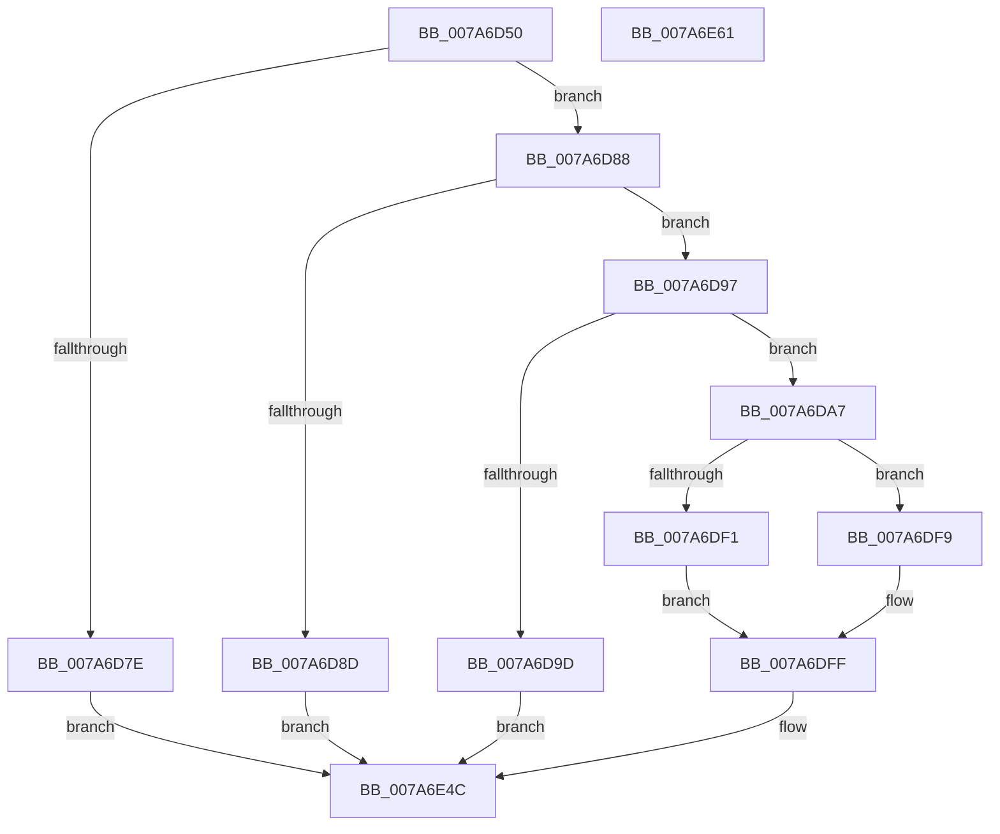

# SmProcessResizeRequest

- RVA: `0x007A6D50`–`0x007A6E62` (길이 `274` bytes)
- VA: `0x00000001407A6D50`
- 실행 섹션: `PAGE`
- PDB 이름 있음: `예`; PDB Function 태그: `아니요`
- unwind 정보 RVA: `0x000749E8`
- 디코드: `73`개 명령, `274/274` bytes 표시
- 미해석 바이트: `0` (있으면 어셈블리에 `.byte`로 보존)

> 이 문서는 커널 이미지의 기계어와 PDB 기호를 분석해 생성했습니다. 4번과 5번은 함수 원형과 자료형을 바이너리 사용 방식에서 추정한 C 해석이며 원본 소스 복구 결과는 아닙니다.

## 1. Dependencies

- 직접 호출 지점: **4**; 고유 호출 대상: **4**
- 직접 호출자로 확인된 함수: **1**
- RIP 상대 이미지 참조: **0**

### Outgoing calls
- `0x007A6DB7` → [SmpGetProcessPartition](../../text/4A/SmpGetProcessPartition_function_004A3CCC.md) (function, `0x004A3CCC`)
- `0x007A6DC8` → [KeInitializeEvent](../../text/40/KeInitializeEvent_function_0040DD10.md) (function, `0x0040DD10`)
- `0x007A6E27` → [SMKM_STORE_MGR<SM_TRAITS>::SmStoreRequest](../../text/4A/SMKM_STORE_MGR_SM_TRAITS_SmStoreRequest_function_004A2160.md) (function, `0x004A2160`)
- `0x007A6E3E` → [KeWaitForSingleObject](../../text/20/KeWaitForSingleObject_function_0020E6B0.md) (function, `0x0020E6B0`)

### Direct callers
- [SmSetStoreInformation](../A7/SmSetStoreInformation_function_00A781B8.md) at `0x00A782FA`

### Static image references
- 디코드된 RIP-relative 메모리 참조가 없습니다.

## 2. Other-region calls and transfers

- 다른 실행 섹션으로 향하는 call: **4**
  - `0x007A6DB7` → [SmpGetProcessPartition](../../text/4A/SmpGetProcessPartition_function_004A3CCC.md) (`PAGE` → `.text`)
  - `0x007A6DC8` → [KeInitializeEvent](../../text/40/KeInitializeEvent_function_0040DD10.md) (`PAGE` → `.text`)
  - `0x007A6E27` → [SMKM_STORE_MGR<SM_TRAITS>::SmStoreRequest](../../text/4A/SMKM_STORE_MGR_SM_TRAITS_SmStoreRequest_function_004A2160.md) (`PAGE` → `.text`)
  - `0x007A6E3E` → [KeWaitForSingleObject](../../text/20/KeWaitForSingleObject_function_0020E6B0.md) (`PAGE` → `.text`)
- 별도 외부 분기/꼬리 이동을 확인하지 못했습니다.

## 3. Assembly (complete function range)

```asm
007A6D50  48 89 5C 24 08                  mov qword ptr [rsp + 8], rbx
007A6D55  48 89 7C 24 10                  mov qword ptr [rsp + 0x10], rdi
007A6D5A  55                              push rbp
007A6D5B  48 8B EC                        mov rbp, rsp
007A6D5E  48 81 EC 80 00 00 00            sub rsp, 0x80
007A6D65  33 C0                           xor eax, eax
007A6D67  0F 57 C0                        xorps xmm0, xmm0
007A6D6A  48 89 45 D0                     mov qword ptr [rbp - 0x30], rax
007A6D6E  48 8B D9                        mov rbx, rcx
007A6D71  0F 11 45 C0                     movups xmmword ptr [rbp - 0x40], xmm0
007A6D75  0F 11 45 B0                     movups xmmword ptr [rbp - 0x50], xmm0
007A6D79  83 FA 18                        cmp edx, 0x18
007A6D7C  74 0A                           je 0x1407a6d88
007A6D7E  B8 06 02 00 C0                  mov eax, 0xc0000206
007A6D83  E9 C4 00 00 00                  jmp 0x1407a6e4c
007A6D88  45 84 C0                        test r8b, r8b
007A6D8B  74 0A                           je 0x1407a6d97
007A6D8D  B8 0D 00 00 C0                  mov eax, 0xc000000d
007A6D92  E9 B5 00 00 00                  jmp 0x1407a6e4c
007A6D97  8B 01                           mov eax, dword ptr [rcx]
007A6D99  3C 06                           cmp al, 6
007A6D9B  74 0A                           je 0x1407a6da7
007A6D9D  B8 59 00 00 C0                  mov eax, 0xc0000059
007A6DA2  E9 A5 00 00 00                  jmp 0x1407a6e4c
007A6DA7  65 48 8B 0C 25 88 01 00 00      mov rcx, qword ptr gs:[0x188]
007A6DB0  48 8B 89 B8 00 00 00            mov rcx, qword ptr [rcx + 0xb8]
007A6DB7  E8 10 CF CF FF                  call 0x1404a3ccc
007A6DBC  45 33 C0                        xor r8d, r8d
007A6DBF  48 8D 4D C0                     lea rcx, [rbp - 0x40]
007A6DC3  33 D2                           xor edx, edx
007A6DC5  48 8B F8                        mov rdi, rax
007A6DC8  E8 43 6F C6 FF                  call 0x14040dd10
007A6DCD  48 83 65 DC 00                  and qword ptr [rbp - 0x24], 0
007A6DD2  83 65 E4 00                     and dword ptr [rbp - 0x1c], 0
007A6DD6  48 83 65 F4 00                  and qword ptr [rbp - 0xc], 0
007A6DDB  83 65 FC 00                     and dword ptr [rbp - 4], 0
007A6DDF  F7 03 00 01 00 00               test dword ptr [rbx], 0x100
007A6DE5  8B 45 E0                        mov eax, dword ptr [rbp - 0x20]
007A6DE8  C7 45 D8 04 00 00 00            mov dword ptr [rbp - 0x28], 4
007A6DEF  74 08                           je 0x1407a6df9
007A6DF1  83 E0 FC                        and eax, 0xfffffffc
007A6DF4  83 C8 04                        or eax, 4
007A6DF7  EB 06                           jmp 0x1407a6dff
007A6DF9  83 E0 FD                        and eax, 0xfffffffd
007A6DFC  83 C8 05                        or eax, 5
007A6DFF  8B 53 04                        mov edx, dword ptr [rbx + 4]
007A6E02  4C 8D 4D C0                     lea r9, [rbp - 0x40]
007A6E06  89 45 E0                        mov dword ptr [rbp - 0x20], eax
007A6E09  4C 8D 45 D8                     lea r8, [rbp - 0x28]
007A6E0D  8B 43 08                        mov eax, dword ptr [rbx + 8]
007A6E10  48 8B CF                        mov rcx, rdi
007A6E13  89 45 F0                        mov dword ptr [rbp - 0x10], eax
007A6E16  48 8B 43 10                     mov rax, qword ptr [rbx + 0x10]
007A6E1A  48 89 45 E8                     mov qword ptr [rbp - 0x18], rax
007A6E1E  48 8D 45 B0                     lea rax, [rbp - 0x50]
007A6E22  48 89 44 24 20                  mov qword ptr [rsp + 0x20], rax
007A6E27  E8 34 B3 CF FF                  call 0x1404a2160
007A6E2C  48 83 64 24 20 00               and qword ptr [rsp + 0x20], 0
007A6E32  48 8D 4D C0                     lea rcx, [rbp - 0x40]
007A6E36  45 33 C9                        xor r9d, r9d
007A6E39  45 33 C0                        xor r8d, r8d
007A6E3C  33 D2                           xor edx, edx
007A6E3E  E8 6D 78 A6 FF                  call 0x14020e6b0
007A6E43  8B 4D F0                        mov ecx, dword ptr [rbp - 0x10]
007A6E46  8B 45 B0                        mov eax, dword ptr [rbp - 0x50]
007A6E49  89 4B 08                        mov dword ptr [rbx + 8], ecx
007A6E4C  4C 8D 9C 24 80 00 00 00         lea r11, [rsp + 0x80]
007A6E54  49 8B 5B 10                     mov rbx, qword ptr [r11 + 0x10]
007A6E58  49 8B 7B 18                     mov rdi, qword ptr [r11 + 0x18]
007A6E5C  49 8B E3                        mov rsp, r11
007A6E5F  5D                              pop rbp
007A6E60  C3                              ret
007A6E61  CC                              int3
```

## 4. C-style interpretation (structured pseudocode)

```c
__int64 __fastcall SmProcessResizeRequest(__int64 a1, int a2, int a3)
{
    __int64 result;
    __int64 v_rsp;
    unsigned __int64 v_stack_m14;
    unsigned int v_stack_m18;
    unsigned __int64 v_stack_m20;
    unsigned int v_stack_m24;
    unsigned int v_stack_m28;
    unsigned __int64 v_stack_m2C;
    unsigned int v_stack_m30;
    unsigned __int64 v_stack_m38;
    unsigned __int64 v_stack_m48;
    unsigned __int64 v_stack_m58;
    unsigned __int64 v_stack_m68;
    unsigned __int64 v_stack_m8;
    unsigned int v_stack_mC;
    unsigned __int64 v_stack_p10;
    unsigned __int64 v_stack_p8;

    v_stack_p8 = v_rbx;
    v_stack_p10 = v_rdi;
    v_rsp = (v_rsp) - (128);
    result = 0;
    v_stack_m38 = 0;
    v_stack_m48 = v_xmm0;
    v_stack_m58 = v_xmm0;
    if (a2 == 24) goto loc_007A6D88;
    goto loc_007A6E4C;
loc_007A6D88:
    if ((unsigned __int8)(a3) == 0) goto loc_007A6D97;
    goto loc_007A6E4C;
loc_007A6D97:
    if (((unsigned __int8)((unsigned int)(*(unsigned int *)(a1)))) == 6) goto loc_007A6DA7;
    goto loc_007A6E4C;
loc_007A6DA7:
    result = SmpGetProcessPartition(*(unsigned __int64 *)(*(unsigned __int64 *)(gs_base + (0 + 392)) + 184), a2, a3, a4);
    a3 = 0;
    a2 = 0;
    result = KeInitializeEvent(v_stack_m48, a2, a3, a4);
    v_stack_m30 = 4;
    if (((*(unsigned int *)(a1)) & (256)) == 0) goto loc_007A6DF9;
    result = (unsigned int)(((unsigned int)(v_stack_m28)) & (0xFFFFFFFCULL));
    result = (unsigned int)((result) | (4));
    goto loc_007A6DFF;
loc_007A6DF9:
    result = (unsigned int)((result) & (0xFFFFFFFDULL));
    result = (unsigned int)((result) | (5));
loc_007A6DFF:
    v_stack_m28 = (unsigned int)(result);
    v_stack_m18 = (unsigned int)((unsigned int)(*(unsigned int *)(a1 + 8)));
    v_stack_m20 = *(unsigned __int64 *)(a1 + 16);
    v_stack_m68 = v_stack_m58;
    result = SMKM_STORE_MGR_SM_TRAITS___SmStoreRequest(result, (unsigned int)(*(unsigned int *)(a1 + 4)), v_stack_m30, v_stack_m48);
    a4 = 0;
    a3 = 0;
    a2 = 0;
    result = KeWaitForSingleObject(v_stack_m48, a2, a3, a4);
    *(unsigned int *)(a1 + 8) = (unsigned int)((unsigned int)(v_stack_m18));
loc_007A6E4C:
    return (unsigned int)(v_stack_m58);
}
```

## 5. (Beta) C Style

```c
int64_t SmProcessResizeRequest(void *Arg1, int32_t Arg2, int32_t Arg3)
{
    uint8_t *arg1 = (uint8_t *)Arg1;

    int64_t result;
    int64_t local_rsp;
    uint64_t v_stack_m14;
    uint32_t v_stack_m18;
    uint64_t v_stack_m20;
    uint32_t v_stack_m24;
    uint32_t v_stack_m28;
    uint64_t v_stack_m2C;
    uint32_t v_stack_m30;
    uint64_t v_stack_m38;
    uint64_t v_stack_m48;
    uint64_t v_stack_m58;
    uint64_t v_stack_m68;
    uint64_t v_stack_m8;
    uint32_t v_stack_mC;
    uint64_t v_stack_p10;
    uint64_t v_stack_p8;

    v_stack_p8 = local_rbx;
    v_stack_p10 = local_rdi;
    local_rsp = (local_rsp) - (128);
    result = 0;
    v_stack_m38 = 0;
    v_stack_m48 = v_xmm0;
    v_stack_m58 = v_xmm0;
    if (Arg2 == 24) goto loc_007A6D88;
    goto loc_007A6E4C;
loc_007A6D88:
    if ((uint8_t)(Arg3) == 0) goto loc_007A6D97;
    goto loc_007A6E4C;
loc_007A6D97:
    if (((uint8_t)((uint32_t)(*(uint32_t *)(arg1)))) == 6) goto loc_007A6DA7;
    goto loc_007A6E4C;
loc_007A6DA7:
    result = SmpGetProcessPartition(*(uint64_t *)(*(uint64_t *)(gs_base + (0 + 0x188)) + 0xB8), Arg2, Arg3, a4);
    Arg3 = 0;
    Arg2 = 0;
    result = KeInitializeEvent(v_stack_m48, Arg2, Arg3, a4);
    v_stack_m30 = 4;
    if (((*(uint32_t *)(arg1)) & (256)) == 0) goto loc_007A6DF9;
    result = (uint32_t)(((uint32_t)(v_stack_m28)) & (0xFFFFFFFCULL));
    result = (uint32_t)((result) | (4));
    goto loc_007A6DFF;
loc_007A6DF9:
    result = (uint32_t)((result) & (0xFFFFFFFDULL));
    result = (uint32_t)((result) | (5));
loc_007A6DFF:
    v_stack_m28 = (uint32_t)(result);
    v_stack_m18 = (uint32_t)((uint32_t)(*(uint32_t *)(arg1 + 0x8)));
    v_stack_m20 = *(uint64_t *)(arg1 + 0x10);
    v_stack_m68 = v_stack_m58;
    result = SMKM_STORE_MGR_SM_TRAITS___SmStoreRequest(result, (uint32_t)(*(uint32_t *)(arg1 + 0x4)), v_stack_m30, v_stack_m48);
    a4 = 0;
    Arg3 = 0;
    Arg2 = 0;
    result = KeWaitForSingleObject(v_stack_m48, Arg2, Arg3, a4);
    *(uint32_t *)(arg1 + 0x8) = (uint32_t)((uint32_t)(v_stack_m18));
loc_007A6E4C:
    return (uint32_t)(v_stack_m58);
}
```

### 관측된 메모리 오프셋

구조체 형식이 확인되지 않은 접근은 인자 기준의 오프셋으로만 기록했습니다.

| 기준 인자 | 오프셋 표현 | 폭 (bit) | 접근 |
|---|---:|---:|---|
| `Arg1` | `+ 0x0` | `32` | `R` |
| `Arg1` | `+ 0x4` | `32` | `R` |
| `Arg1` | `+ 0x8` | `32` | `R` |
| `Arg1` | `+ 0x8` | `32` | `W` |
| `Arg1` | `+ 0x10` | `64` | `R` |

## 6. Execution-region graph

[열기: 2D/3D 그래프와 함수 탐색 컨트롤 패널](../../../control-panel.html?section=page&rva=0x007A6D50&view=graph)

- 2D 그래프는 위에서 아래로 흐르고, 3D 그래프는 빈 공간을 드래그해 회전합니다. Shift+드래그는 이동, 휠은 확대·축소, 함수 노드 선택은 대상 보고서 이동입니다.

### Static fallback


