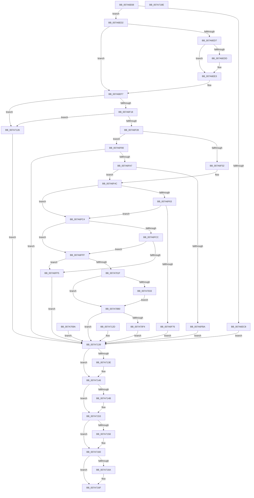

# SmProcessStatsRequest

- RVA: `0x007A6E68`–`0x007A718F` (길이 `807` bytes)
- VA: `0x00000001407A6E68`
- 실행 섹션: `PAGE`
- PDB 이름 있음: `예`; PDB Function 태그: `아니요`
- unwind 정보 RVA: `0x000D1D20`
- 디코드: `218`개 명령, `807/807` bytes 표시
- 미해석 바이트: `0` (있으면 어셈블리에 `.byte`로 보존)

> 이 문서는 커널 이미지의 기계어와 PDB 기호를 분석해 생성했습니다. 4번과 5번은 함수 원형과 자료형을 바이너리 사용 방식에서 추정한 C 해석이며 원본 소스 복구 결과는 아닙니다.

## 1. Dependencies

- 직접 호출 지점: **15**; 고유 호출 대상: **13**
- 직접 호출자로 확인된 함수: **1**
- RIP 상대 이미지 참조: **1**

### Outgoing calls
- `0x007A6EBE` → [KeInitializeEvent](../../text/40/KeInitializeEvent_function_0040DD10.md) (function, `0x0040DD10`)
- `0x007A6EDD` → [ExRaiseDatatypeMisalignment](../89/ExRaiseDatatypeMisalignment_function_00899FD0.md) (function, `0x00899FD0`)
- `0x007A6F42` → [SmpGetProcessPartition](../../text/4A/SmpGetProcessPartition_function_004A3CCC.md) (function, `0x004A3CCC`)
- `0x007A6F6D` → [SeSinglePrivilegeCheck](../87/SeSinglePrivilegeCheck_function_00871E20.md) (function, `0x00871E20`)
- `0x007A6F98` → [PsReferencePartitionByHandle](../90/PsReferencePartitionByHandle_function_0090337C.md) (function, `0x0090337C`)
- `0x007A6FD3` → [MmSizeOfMdl](../../text/46/MmSizeOfMdl_function_00460A10.md) (function, `0x00460A10`)
- `0x007A6FE3` → [SmAllocEx](../../text/34/SmAllocEx_function_0034C794.md) (function, `0x0034C794`)
- `0x007A700D` → [SmAllocEx](../../text/34/SmAllocEx_function_0034C794.md) (function, `0x0034C794`)
- `0x007A708C` → [MmProbeAndLockPages](../../text/23/MmProbeAndLockPages_function_0023B990.md) (function, `0x0023B990`)
- `0x007A70E9` → [SMKM_STORE_MGR<SM_TRAITS>::SmStoreRequest](../../text/4A/SMKM_STORE_MGR_SM_TRAITS_SmStoreRequest_function_004A2160.md) (function, `0x004A2160`)
- `0x007A710C` → [KeWaitForSingleObject](../../text/20/KeWaitForSingleObject_function_0020E6B0.md) (function, `0x0020E6B0`)
- `0x007A7141` → [CmSiFreeMemory](../../text/47/CmSiFreeMemory_function_00475D80.md) (function, `0x00475D80`)
- `0x007A714E` → [MmUnlockPages](../../text/29/MmUnlockPages_function_0029EEE0.md) (function, `0x0029EEE0`)
- `0x007A715B` → [CmSiFreeMemory](../../text/47/CmSiFreeMemory_function_00475D80.md) (function, `0x00475D80`)
- `0x007A716A` → [PsDereferencePartition](../../text/34/PsDereferencePartition_function_00342E70.md) (function, `0x00342E70`)

### Direct callers
- [SmQueryStoreInformation](../A0/SmQueryStoreInformation_function_00A0E7BC.md) at `0x00A0E96B`

### Static image references
- `0x007A6F66` → RVA `0x00FD9B08` (`PAGEDATA`; read)

## 2. Other-region calls and transfers

- 다른 실행 섹션으로 향하는 call: **12**
  - `0x007A6EBE` → [KeInitializeEvent](../../text/40/KeInitializeEvent_function_0040DD10.md) (`PAGE` → `.text`)
  - `0x007A6F42` → [SmpGetProcessPartition](../../text/4A/SmpGetProcessPartition_function_004A3CCC.md) (`PAGE` → `.text`)
  - `0x007A6FD3` → [MmSizeOfMdl](../../text/46/MmSizeOfMdl_function_00460A10.md) (`PAGE` → `.text`)
  - `0x007A6FE3` → [SmAllocEx](../../text/34/SmAllocEx_function_0034C794.md) (`PAGE` → `.text`)
  - `0x007A700D` → [SmAllocEx](../../text/34/SmAllocEx_function_0034C794.md) (`PAGE` → `.text`)
  - `0x007A708C` → [MmProbeAndLockPages](../../text/23/MmProbeAndLockPages_function_0023B990.md) (`PAGE` → `.text`)
  - `0x007A70E9` → [SMKM_STORE_MGR<SM_TRAITS>::SmStoreRequest](../../text/4A/SMKM_STORE_MGR_SM_TRAITS_SmStoreRequest_function_004A2160.md) (`PAGE` → `.text`)
  - `0x007A710C` → [KeWaitForSingleObject](../../text/20/KeWaitForSingleObject_function_0020E6B0.md) (`PAGE` → `.text`)
  - `0x007A7141` → [CmSiFreeMemory](../../text/47/CmSiFreeMemory_function_00475D80.md) (`PAGE` → `.text`)
  - `0x007A714E` → [MmUnlockPages](../../text/29/MmUnlockPages_function_0029EEE0.md) (`PAGE` → `.text`)
  - `0x007A715B` → [CmSiFreeMemory](../../text/47/CmSiFreeMemory_function_00475D80.md) (`PAGE` → `.text`)
  - `0x007A716A` → [PsDereferencePartition](../../text/34/PsDereferencePartition_function_00342E70.md) (`PAGE` → `.text`)
- 별도 외부 분기/꼬리 이동을 확인하지 못했습니다.

## 3. Assembly (complete function range)

```asm
007A6E68  4C 8B DC                        mov r11, rsp
007A6E6B  49 89 5B 08                     mov qword ptr [r11 + 8], rbx
007A6E6F  49 89 73 20                     mov qword ptr [r11 + 0x20], rsi
007A6E73  4D 89 43 18                     mov qword ptr [r11 + 0x18], r8
007A6E77  57                              push rdi
007A6E78  41 54                           push r12
007A6E7A  41 55                           push r13
007A6E7C  41 56                           push r14
007A6E7E  41 57                           push r15
007A6E80  48 81 EC A0 00 00 00            sub rsp, 0xa0
007A6E87  45 8A E9                        mov r13b, r9b
007A6E8A  8B DA                           mov ebx, edx
007A6E8C  4C 8B F9                        mov r15, rcx
007A6E8F  0F 57 C0                        xorps xmm0, xmm0
007A6E92  33 C0                           xor eax, eax
007A6E94  41 0F 11 43 B8                  movups xmmword ptr [r11 - 0x48], xmm0
007A6E99  49 89 43 C8                     mov qword ptr [r11 - 0x38], rax
007A6E9D  0F 11 44 24 70                  movups xmmword ptr [rsp + 0x70], xmm0
007A6EA2  33 FF                           xor edi, edi
007A6EA4  49 89 7B 80                     mov qword ptr [r11 - 0x80], rdi
007A6EA8  44 8B F7                        mov r14d, edi
007A6EAB  48 89 7C 24 40                  mov qword ptr [rsp + 0x40], rdi
007A6EB0  8B F7                           mov esi, edi
007A6EB2  44 8B E7                        mov r12d, edi
007A6EB5  45 33 C0                        xor r8d, r8d
007A6EB8  33 D2                           xor edx, edx
007A6EBA  49 8D 4B B8                     lea rcx, [r11 - 0x48]
007A6EBE  E8 4D 6E C6 FF                  call 0x14040dd10
007A6EC3  83 FB 18                        cmp ebx, 0x18
007A6EC6  74 0A                           je 0x1407a6ed2
007A6EC8  BB 06 02 00 C0                  mov ebx, 0xc0000206
007A6ECD  E9 67 02 00 00                  jmp 0x1407a7139
007A6ED2  45 84 ED                        test r13b, r13b
007A6ED5  74 20                           je 0x1407a6ef7
007A6ED7  41 F6 C7 07                     test r15b, 7
007A6EDB  74 06                           je 0x1407a6ee3
007A6EDD  E8 EE 30 0F 00                  call 0x140899fd0
007A6EE2  CC                              int3
007A6EE3  48 B8 00 00 FF FF FF 7F 00 00   movabs rax, 0x7fffffff0000
007A6EED  4C 3B F8                        cmp r15, rax
007A6EF0  49 0F 42 C7                     cmovb rax, r15
007A6EF4  90                              nop
007A6EF5  8A 00                           mov al, byte ptr [rax]
007A6EF7  41 0F 10 07                     movups xmm0, xmmword ptr [r15]
007A6EFB  0F 11 44 24 58                  movups xmmword ptr [rsp + 0x58], xmm0
007A6F00  F2 41 0F 10 4F 10               movsd xmm1, qword ptr [r15 + 0x10]
007A6F06  F2 0F 11 4C 24 68               movsd qword ptr [rsp + 0x68], xmm1
007A6F0C  8B 44 24 58                     mov eax, dword ptr [rsp + 0x58]
007A6F10  3C 03                           cmp al, 3
007A6F12  0F 85 0E 02 00 00               jne 0x1407a7126
007A6F18  25 00 FF 00 00                  and eax, 0xff00
007A6F1D  3D 00 04 00 00                  cmp eax, 0x400
007A6F22  0F 83 FE 01 00 00               jae 0x1407a7126
007A6F28  48 8B 4C 24 68                  mov rcx, qword ptr [rsp + 0x68]
007A6F2D  48 85 C9                        test rcx, rcx
007A6F30  75 4E                           jne 0x1407a6f80
007A6F32  65 48 8B 04 25 88 01 00 00      mov rax, qword ptr gs:[0x188]
007A6F3B  48 8B 88 B8 00 00 00            mov rcx, qword ptr [rax + 0xb8]
007A6F42  E8 85 CD CF FF                  call 0x1404a3ccc
007A6F47  48 89 44 24 50                  mov qword ptr [rsp + 0x50], rax
007A6F4C  44 8B 7C 24 58                  mov r15d, dword ptr [rsp + 0x58]
007A6F51  41 8B C7                        mov eax, r15d
007A6F54  C1 E8 08                        shr eax, 8
007A6F57  0F B6 C0                        movzx eax, al
007A6F5A  89 44 24 30                     mov dword ptr [rsp + 0x30], eax
007A6F5E  83 F8 01                        cmp eax, 1
007A6F61  76 61                           jbe 0x1407a6fc4
007A6F63  41 8A D5                        mov dl, r13b
007A6F66  48 8B 0D 9B 2B 83 00            mov rcx, qword ptr [rip + 0x832b9b]
007A6F6D  E8 AE AE 0C 00                  call 0x140871e20
007A6F72  84 C0                           test al, al
007A6F74  75 4E                           jne 0x1407a6fc4
007A6F76  BB 22 00 00 C0                  mov ebx, 0xc0000022
007A6F7B  E9 B9 01 00 00                  jmp 0x1407a7139
007A6F80  48 8D 44 24 48                  lea rax, [rsp + 0x48]
007A6F85  48 89 44 24 20                  mov qword ptr [rsp + 0x20], rax
007A6F8A  41 B9 53 6D 51 53               mov r9d, 0x53516d53
007A6F90  45 8A C5                        mov r8b, r13b
007A6F93  BA 01 00 00 00                  mov edx, 1
007A6F98  E8 DF C3 15 00                  call 0x14090337c
007A6F9D  8B D8                           mov ebx, eax
007A6F9F  85 C0                           test eax, eax
007A6FA1  0F 88 92 01 00 00               js 0x1407a7139
007A6FA7  48 8B 44 24 48                  mov rax, qword ptr [rsp + 0x48]
007A6FAC  48 8B 48 18                     mov rcx, qword ptr [rax + 0x18]
007A6FB0  48 89 4C 24 50                  mov qword ptr [rsp + 0x50], rcx
007A6FB5  48 85 C9                        test rcx, rcx
007A6FB8  75 92                           jne 0x1407a6f4c
007A6FBA  BB A9 01 00 C0                  mov ebx, 0xc00001a9
007A6FBF  E9 75 01 00 00                  jmp 0x1407a7139
007A6FC4  8B 5C 24 5C                     mov ebx, dword ptr [rsp + 0x5c]
007A6FC8  85 DB                           test ebx, ebx
007A6FCA  74 33                           je 0x1407a6fff
007A6FCC  8B D3                           mov edx, ebx
007A6FCE  48 8B 4C 24 60                  mov rcx, qword ptr [rsp + 0x60]
007A6FD3  E8 38 9A CB FF                  call 0x140460a10
007A6FD8  8B C8                           mov ecx, eax
007A6FDA  41 83 C8 FF                     or r8d, 0xffffffff
007A6FDE  BA 73 6D 4D 44                  mov edx, 0x444d6d73
007A6FE3  E8 AC 57 BA FF                  call 0x14034c794
007A6FE8  4C 8B F0                        mov r14, rax
007A6FEB  48 89 44 24 40                  mov qword ptr [rsp + 0x40], rax
007A6FF0  48 85 C0                        test rax, rax
007A6FF3  75 0A                           jne 0x1407a6fff
007A6FF5  BB 9A 00 00 C0                  mov ebx, 0xc000009a
007A6FFA  E9 3A 01 00 00                  jmp 0x1407a7139
007A6FFF  41 83 C8 FF                     or r8d, 0xffffffff
007A7003  BA 73 6D 57 69                  mov edx, 0x69576d73
007A7008  B9 28 00 00 00                  mov ecx, 0x28
007A700D  E8 82 57 BA FF                  call 0x14034c794
007A7012  48 8B F0                        mov rsi, rax
007A7015  48 89 44 24 38                  mov qword ptr [rsp + 0x38], rax
007A701A  48 85 C0                        test rax, rax
007A701D  74 D6                           je 0x1407a6ff5
007A701F  0F 57 C0                        xorps xmm0, xmm0
007A7022  33 C0                           xor eax, eax
007A7024  0F 11 06                        movups xmmword ptr [rsi], xmm0
007A7027  0F 11 46 10                     movups xmmword ptr [rsi + 0x10], xmm0
007A702B  48 89 46 20                     mov qword ptr [rsi + 0x20], rax
007A702F  85 DB                           test ebx, ebx
007A7031  74 7D                           je 0x1407a70b0
007A7033  49 89 3E                        mov qword ptr [r14], rdi
007A7036  48 8B 54 24 60                  mov rdx, qword ptr [rsp + 0x60]
007A703B  44 8B C2                        mov r8d, edx
007A703E  41 8B C0                        mov eax, r8d
007A7041  41 BA FF 0F 00 00               mov r10d, 0xfff
007A7047  49 23 C2                        and rax, r10
007A704A  48 8D 8B FF 0F 00 00            lea rcx, [rbx + 0xfff]
007A7051  48 03 C8                        add rcx, rax
007A7054  48 C1 E9 0C                     shr rcx, 0xc
007A7058  66 83 C1 06                     add cx, 6
007A705C  66 C1 E1 03                     shl cx, 3
007A7060  66 41 89 4E 08                  mov word ptr [r14 + 8], cx
007A7065  66 41 89 7E 0A                  mov word ptr [r14 + 0xa], di
007A706A  48 81 E2 00 F0 FF FF            and rdx, 0xfffffffffffff000
007A7071  49 89 56 20                     mov qword ptr [r14 + 0x20], rdx
007A7075  45 23 C2                        and r8d, r10d
007A7078  45 89 46 2C                     mov dword ptr [r14 + 0x2c], r8d
007A707C  41 89 5E 28                     mov dword ptr [r14 + 0x28], ebx
007A7080  41 B8 01 00 00 00               mov r8d, 1
007A7086  41 8A D5                        mov dl, r13b
007A7089  49 8B CE                        mov rcx, r14
007A708C  E8 FF 48 A9 FF                  call 0x14023b990
007A7091  90                              nop
007A7092  41 BC 01 00 00 00               mov r12d, 1
007A7098  EB 16                           jmp 0x1407a70b0
007A709A  8B D8                           mov ebx, eax
007A709C  33 FF                           xor edi, edi
007A709E  48 8B 74 24 38                  mov rsi, qword ptr [rsp + 0x38]
007A70A3  4C 8B 74 24 40                  mov r14, qword ptr [rsp + 0x40]
007A70A8  44 8B E7                        mov r12d, edi
007A70AB  E9 89 00 00 00                  jmp 0x1407a7139
007A70B0  8B 06                           mov eax, dword ptr [rsi]
007A70B2  83 E0 FB                        and eax, 0xfffffffb
007A70B5  83 C8 03                        or eax, 3
007A70B8  89 06                           mov dword ptr [rsi], eax
007A70BA  8B 44 24 30                     mov eax, dword ptr [rsp + 0x30]
007A70BE  89 46 08                        mov dword ptr [rsi + 8], eax
007A70C1  89 5E 0C                        mov dword ptr [rsi + 0xc], ebx
007A70C4  4C 89 76 10                     mov qword ptr [rsi + 0x10], r14
007A70C8  41 C1 EF 10                     shr r15d, 0x10
007A70CC  48 8D 44 24 70                  lea rax, [rsp + 0x70]
007A70D1  48 89 44 24 20                  mov qword ptr [rsp + 0x20], rax
007A70D6  4C 8D 8C 24 80 00 00 00         lea r9, [rsp + 0x80]
007A70DE  4C 8B C6                        mov r8, rsi
007A70E1  41 8B D7                        mov edx, r15d
007A70E4  48 8B 4C 24 50                  mov rcx, qword ptr [rsp + 0x50]
007A70E9  E8 72 B0 CF FF                  call 0x1404a2160
007A70EE  8B D8                           mov ebx, eax
007A70F0  85 C0                           test eax, eax
007A70F2  78 45                           js 0x1407a7139
007A70F4  48 8B F7                        mov rsi, rdi
007A70F7  48 89 7C 24 20                  mov qword ptr [rsp + 0x20], rdi
007A70FC  45 33 C9                        xor r9d, r9d
007A70FF  45 33 C0                        xor r8d, r8d
007A7102  33 D2                           xor edx, edx
007A7104  48 8D 8C 24 80 00 00 00         lea rcx, [rsp + 0x80]
007A710C  E8 9F 75 A6 FF                  call 0x14020e6b0
007A7111  8B 5C 24 70                     mov ebx, dword ptr [rsp + 0x70]
007A7115  48 8B 44 24 78                  mov rax, qword ptr [rsp + 0x78]
007A711A  48 8B 8C 24 E0 00 00 00         mov rcx, qword ptr [rsp + 0xe0]
007A7122  89 01                           mov dword ptr [rcx], eax
007A7124  EB 13                           jmp 0x1407a7139
007A7126  BB 0D 00 00 C0                  mov ebx, 0xc000000d
007A712B  EB 0C                           jmp 0x1407a7139
007A712D  8B D8                           mov ebx, eax
007A712F  33 FF                           xor edi, edi
007A7131  8B F7                           mov esi, edi
007A7133  44 8B F7                        mov r14d, edi
007A7136  44 8B E7                        mov r12d, edi
007A7139  48 85 F6                        test rsi, rsi
007A713C  74 08                           je 0x1407a7146
007A713E  48 8B CE                        mov rcx, rsi
007A7141  E8 3A EC CC FF                  call 0x140475d80
007A7146  45 85 E4                        test r12d, r12d
007A7149  74 08                           je 0x1407a7153
007A714B  49 8B CE                        mov rcx, r14
007A714E  E8 8D 7D AF FF                  call 0x14029eee0
007A7153  4D 85 F6                        test r14, r14
007A7156  74 08                           je 0x1407a7160
007A7158  49 8B CE                        mov rcx, r14
007A715B  E8 20 EC CC FF                  call 0x140475d80
007A7160  48 8B 4C 24 48                  mov rcx, qword ptr [rsp + 0x48]
007A7165  48 85 C9                        test rcx, rcx
007A7168  74 05                           je 0x1407a716f
007A716A  E8 01 BD B9 FF                  call 0x140342e70
007A716F  8B C3                           mov eax, ebx
007A7171  4C 8D 9C 24 A0 00 00 00         lea r11, [rsp + 0xa0]
007A7179  49 8B 5B 30                     mov rbx, qword ptr [r11 + 0x30]
007A717D  49 8B 73 48                     mov rsi, qword ptr [r11 + 0x48]
007A7181  49 8B E3                        mov rsp, r11
007A7184  41 5F                           pop r15
007A7186  41 5E                           pop r14
007A7188  41 5D                           pop r13
007A718A  41 5C                           pop r12
007A718C  5F                              pop rdi
007A718D  C3                              ret
007A718E  CC                              int3
```

## 4. C-style interpretation (structured pseudocode)

```c
__int64 __fastcall SmProcessStatsRequest(__int64 a1, int a2, __int64 a3, unsigned __int8 a4)
{
    __int64 result;
    __int64 v_r15;
    __int64 v_rdi;
    __int64 v_rsp;
    unsigned __int64 v_stack_m28;
    unsigned __int64 v_stack_m48;
    unsigned __int64 v_stack_m50;
    unsigned __int64 v_stack_m58;
    unsigned __int64 v_stack_m60;
    unsigned __int64 v_stack_m68;
    unsigned int v_stack_m6C;
    unsigned __int64 v_stack_m70;
    unsigned __int64 v_stack_m78;
    unsigned __int64 v_stack_m80;
    unsigned __int64 v_stack_m88;
    unsigned __int64 v_stack_m90;
    unsigned int v_stack_m98;
    unsigned __int64 v_stack_mA8;
    unsigned __int64 v_stack_p18;

    *(unsigned __int64 *)(v_rsp + 8) = v_rbx;
    *(unsigned __int64 *)(v_rsp + 32) = v_rsi;
    *(unsigned __int64 *)(v_rsp + 24) = a3;
    v_rsp = (v_rsp) - (160);
    result = 0;
    *(unsigned __int64 *)(v_rsp - 72) = v_xmm0;
    *(unsigned __int64 *)(v_rsp - 56) = 0;
    v_stack_m58 = v_xmm0;
    v_rdi = 0;
    *(unsigned __int64 *)(v_rsp - 128) = 0;
    v_stack_m88 = 0;
    a3 = 0;
    a2 = 0;
    result = KeInitializeEvent(v_rsp - 72, a2, a3, a4);
    if (((unsigned int)((unsigned int)(a2))) == 24) goto loc_007A6ED2;
    goto loc_007A7139;
loc_007A6ED2:
    if (a4 == 0) goto loc_007A6EF7;
    if ((((unsigned __int8)(a1)) & (7)) != 0) {
        result = ExRaiseDatatypeMisalignment(v_rsp - 72, a2, a3, a4);
    }
    if (a1 < result) { result = a1; }
loc_007A6EF7:
    v_stack_m70 = v_xmm0;
    v_stack_m60 = v_xmm1;
    if (((unsigned __int8)((unsigned int)(v_stack_m70))) != 3) goto loc_007A7126;
    result = (unsigned int)(((unsigned int)(v_stack_m70)) & (0xFF00ULL));
    if (((unsigned int)(result)) >= 0x400ULL) goto loc_007A7126;
    if (v_stack_m60 != 0) goto loc_007A6F80;
    result = SmpGetProcessPartition(*(unsigned __int64 *)(*(unsigned __int64 *)(gs_base + (0 + 392)) + 184), a2, a3, a4);
    v_stack_m78 = result;
loc_007A6F4C:
    result = (unsigned int)(((unsigned int)((unsigned int)((unsigned int)(v_stack_m70)))) >> (8));
    v_stack_m98 = (unsigned int)((unsigned __int8)(result));
    if (((unsigned int)((unsigned __int8)(result))) <= 1) goto loc_007A6FC4;
    result = SeSinglePrivilegeCheck(*(unsigned __int64 *)(v_rip + 8596379), a4, a3, a4);
    if ((unsigned __int8)(result) != 0) goto loc_007A6FC4;
    goto loc_007A7139;
loc_007A6F80:
    v_stack_mA8 = v_stack_m80;
    result = PsReferencePartitionByHandle(*(unsigned __int64 *)(v_rip + 8596379), 1, a4, (unsigned int)(0x53516D53ULL));
    if (sign_flag) goto loc_007A7139;
    v_stack_m78 = *(unsigned __int64 *)(v_stack_m80 + 24);
    if (*(unsigned __int64 *)(v_stack_m80 + 24) != 0) goto loc_007A6F4C;
    goto loc_007A7139;
loc_007A6FC4:
    if ((unsigned int)((unsigned int)(v_stack_m6C)) == 0) goto loc_007A6FFF;
    result = MmSizeOfMdl(v_stack_m68, (unsigned int)((unsigned int)((unsigned int)(v_stack_m6C))), a4, (unsigned int)(0x53516D53ULL));
    a3 = (unsigned int)((a4) | (0xFFFFFFFFULL));
    result = SmAllocEx((unsigned int)((unsigned int)(result)), (unsigned int)(0x444D6D73ULL), a3, (unsigned int)(0x53516D53ULL));
    v_stack_m88 = result;
    if (result != 0) goto loc_007A6FFF;
loc_007A6FF5:
    goto loc_007A7139;
loc_007A6FFF:
    a3 = (unsigned int)((a3) | (0xFFFFFFFFULL));
    result = SmAllocEx(40, (unsigned int)(0x69576D73ULL), a3, (unsigned int)(0x53516D53ULL));
    v_stack_m90 = result;
    if (result == 0) goto loc_007A6FF5;
    result = 0;
    *(unsigned __int64 *)(result) = v_xmm0;
    *(unsigned __int64 *)(result + 16) = v_xmm0;
    *(unsigned __int64 *)(result + 32) = 0;
    if ((unsigned int)((unsigned int)(0xC000009AULL)) == 0) goto loc_007A70B0;
    *(unsigned __int64 *)(result) = 0;
    result = ((unsigned int)((unsigned int)((unsigned int)((unsigned int)(v_stack_m68))))) & ((unsigned int)(0xFFFULL));
    a1 = ((unsigned int)(0xC000009AULL) + 4095) + (result);
    a1 = (a1) >> (12);
    a1 = (unsigned __int16)((a1) + (6));
    a1 = (unsigned __int16)((a1) << (3));
    *(unsigned __int16 *)(result + 8) = (unsigned __int16)(a1);
    *(unsigned __int16 *)(result + 10) = 0;
    a2 = (v_stack_m68) & (0xFFFFFFFFFFFFF000ULL);
    *(unsigned __int64 *)(result + 32) = a2;
    a3 = (unsigned int)(((unsigned int)((unsigned int)(v_stack_m68))) & ((unsigned int)((unsigned int)(0xFFFULL))));
    *(unsigned int *)(result + 44) = (unsigned int)(a3);
    *(unsigned int *)(result + 40) = (unsigned int)((unsigned int)(0xC000009AULL));
    result = MmProbeAndLockPages(result, a4, 1, (unsigned int)(0x53516D53ULL));
    goto loc_007A70B0;
loc_007A70B0:
    result = (unsigned int)(((unsigned int)(*(unsigned int *)(result))) & (0xFFFFFFFBULL));
    result = (unsigned int)((result) | (3));
    *(unsigned int *)(result) = (unsigned int)(result);
    *(unsigned int *)(result + 8) = (unsigned int)((unsigned int)(v_stack_m98));
    *(unsigned int *)(result + 12) = (unsigned int)((unsigned int)(0xC000009AULL));
    *(unsigned __int64 *)(result + 16) = result;
    v_r15 = (unsigned int)(((unsigned int)(v_stack_m70)) >> (16));
    v_stack_mA8 = v_stack_m58;
    result = SMKM_STORE_MGR_SM_TRAITS___SmStoreRequest(v_stack_m78, (unsigned int)((unsigned int)(v_r15)), result, v_stack_m48);
    if (sign_flag) goto loc_007A7139;
    v_stack_mA8 = 0;
    a4 = 0;
    a3 = 0;
    a2 = 0;
    result = KeWaitForSingleObject(v_stack_m48, a2, a3, a4);
    *(unsigned int *)(v_stack_p18) = (unsigned int)(v_stack_m50);
    goto loc_007A7139;
loc_007A7126:
    goto loc_007A7139;
loc_007A7139:
    result = v_stack_m50;
    if (0 != 0) {
        a1 = 0;
        result = CmSiFreeMemory(a1, a2, a3, a4);
    }
    if (1 != 0) {
        a1 = result;
        result = MmUnlockPages(a1, a2, a3, a4);
    }
    if (result != 0) {
        a1 = result;
        result = CmSiFreeMemory(a1, a2, a3, a4);
    }
    if (v_stack_m80 != 0) {
        result = PsDereferencePartition(v_stack_m80, a2, a3, a4);
    }
    return (unsigned int)((unsigned int)((unsigned int)(0xC000000DULL)));
}
```

## 5. (Beta) C Style

```c
int64_t SmProcessStatsRequest(int64_t Arg1, int32_t Arg2, int64_t Arg3, uint8_t Arg4)
{
    int64_t result;
    int64_t local_r15;
    int64_t local_rdi;
    int64_t local_rsp;
    uint64_t v_stack_m28;
    uint64_t v_stack_m48;
    uint64_t v_stack_m50;
    uint64_t v_stack_m58;
    uint64_t v_stack_m60;
    uint64_t v_stack_m68;
    uint32_t v_stack_m6C;
    uint64_t v_stack_m70;
    uint64_t v_stack_m78;
    uint64_t v_stack_m80;
    uint64_t v_stack_m88;
    uint64_t v_stack_m90;
    uint32_t v_stack_m98;
    uint64_t v_stack_mA8;
    uint64_t v_stack_p18;

    *(uint64_t *)(local_rsp + 0x8) = local_rbx;
    *(uint64_t *)(local_rsp + 0x20) = local_rsi;
    *(uint64_t *)(local_rsp + 0x18) = Arg3;
    local_rsp = (local_rsp) - (160);
    result = 0;
    *(uint64_t *)(local_rsp - 0x48) = v_xmm0;
    *(uint64_t *)(local_rsp - 0x38) = 0;
    v_stack_m58 = v_xmm0;
    local_rdi = 0;
    *(uint64_t *)(local_rsp - 0x80) = 0;
    v_stack_m88 = 0;
    Arg3 = 0;
    Arg2 = 0;
    result = KeInitializeEvent(local_rsp - 72, Arg2, Arg3, Arg4);
    if (((uint32_t)((uint32_t)(Arg2))) == 24) goto loc_007A6ED2;
    goto loc_007A7139;
loc_007A6ED2:
    if (Arg4 == 0) goto loc_007A6EF7;
    if ((((uint8_t)(Arg1)) & (7)) != 0) {
        result = ExRaiseDatatypeMisalignment(local_rsp - 72, Arg2, Arg3, Arg4);
    }
    if (Arg1 < result) { result = Arg1; }
loc_007A6EF7:
    v_stack_m70 = v_xmm0;
    v_stack_m60 = v_xmm1;
    if (((uint8_t)((uint32_t)(v_stack_m70))) != 3) goto loc_007A7126;
    result = (uint32_t)(((uint32_t)(v_stack_m70)) & (0xFF00ULL));
    if (((uint32_t)(result)) >= 0x400ULL) goto loc_007A7126;
    if (v_stack_m60 != 0) goto loc_007A6F80;
    result = SmpGetProcessPartition(*(uint64_t *)(*(uint64_t *)(gs_base + (0 + 0x188)) + 0xB8), Arg2, Arg3, Arg4);
    v_stack_m78 = result;
loc_007A6F4C:
    result = (uint32_t)(((uint32_t)((uint32_t)((uint32_t)(v_stack_m70)))) >> (8));
    v_stack_m98 = (uint32_t)((uint8_t)(result));
    if (((uint32_t)((uint8_t)(result))) <= 1) goto loc_007A6FC4;
    result = SeSinglePrivilegeCheck(*(uint64_t *)(v_rip + 0x832B9B), Arg4, Arg3, Arg4);
    if ((uint8_t)(result) != 0) goto loc_007A6FC4;
    goto loc_007A7139;
loc_007A6F80:
    v_stack_mA8 = v_stack_m80;
    result = PsReferencePartitionByHandle(*(uint64_t *)(v_rip + 0x832B9B), 1, Arg4, (uint32_t)(0x53516D53ULL));
    if (sign_flag) goto loc_007A7139;
    v_stack_m78 = *(uint64_t *)(v_stack_m80 + 0x18);
    if (*(uint64_t *)(v_stack_m80 + 0x18) != 0) goto loc_007A6F4C;
    goto loc_007A7139;
loc_007A6FC4:
    if ((uint32_t)((uint32_t)(v_stack_m6C)) == 0) goto loc_007A6FFF;
    result = MmSizeOfMdl(v_stack_m68, (uint32_t)((uint32_t)((uint32_t)(v_stack_m6C))), Arg4, (uint32_t)(0x53516D53ULL));
    Arg3 = (uint32_t)((Arg4) | (0xFFFFFFFFULL));
    result = SmAllocEx((uint32_t)((uint32_t)(result)), (uint32_t)(0x444D6D73ULL), Arg3, (uint32_t)(0x53516D53ULL));
    v_stack_m88 = result;
    if (result != 0) goto loc_007A6FFF;
loc_007A6FF5:
    goto loc_007A7139;
loc_007A6FFF:
    Arg3 = (uint32_t)((Arg3) | (0xFFFFFFFFULL));
    result = SmAllocEx(40, (uint32_t)(0x69576D73ULL), Arg3, (uint32_t)(0x53516D53ULL));
    v_stack_m90 = result;
    if (result == 0) goto loc_007A6FF5;
    result = 0;
    *(uint64_t *)(result) = v_xmm0;
    *(uint64_t *)(result + 0x10) = v_xmm0;
    *(uint64_t *)(result + 0x20) = 0;
    if ((uint32_t)((uint32_t)(0xC000009AULL)) == 0) goto loc_007A70B0;
    *(uint64_t *)(result) = 0;
    result = ((uint32_t)((uint32_t)((uint32_t)((uint32_t)(v_stack_m68))))) & ((uint32_t)(0xFFFULL));
    Arg1 = ((uint32_t)(0xC000009AULL) + 4095) + (result);
    Arg1 = (Arg1) >> (12);
    Arg1 = (uint16_t)((Arg1) + (6));
    Arg1 = (uint16_t)((Arg1) << (3));
    *(uint16_t *)(result + 0x8) = (uint16_t)(Arg1);
    *(uint16_t *)(result + 0xA) = 0;
    Arg2 = (v_stack_m68) & (0xFFFFFFFFFFFFF000ULL);
    *(uint64_t *)(result + 0x20) = Arg2;
    Arg3 = (uint32_t)(((uint32_t)((uint32_t)(v_stack_m68))) & ((uint32_t)((uint32_t)(0xFFFULL))));
    *(uint32_t *)(result + 0x2C) = (uint32_t)(Arg3);
    *(uint32_t *)(result + 0x28) = (uint32_t)((uint32_t)(0xC000009AULL));
    result = MmProbeAndLockPages(result, Arg4, 1, (uint32_t)(0x53516D53ULL));
    goto loc_007A70B0;
loc_007A70B0:
    result = (uint32_t)(((uint32_t)(*(uint32_t *)(result))) & (0xFFFFFFFBULL));
    result = (uint32_t)((result) | (3));
    *(uint32_t *)(result) = (uint32_t)(result);
    *(uint32_t *)(result + 0x8) = (uint32_t)((uint32_t)(v_stack_m98));
    *(uint32_t *)(result + 0xC) = (uint32_t)((uint32_t)(0xC000009AULL));
    *(uint64_t *)(result + 0x10) = result;
    local_r15 = (uint32_t)(((uint32_t)(v_stack_m70)) >> (16));
    v_stack_mA8 = v_stack_m58;
    result = SMKM_STORE_MGR_SM_TRAITS___SmStoreRequest(v_stack_m78, (uint32_t)((uint32_t)(local_r15)), result, v_stack_m48);
    if (sign_flag) goto loc_007A7139;
    v_stack_mA8 = 0;
    Arg4 = 0;
    Arg3 = 0;
    Arg2 = 0;
    result = KeWaitForSingleObject(v_stack_m48, Arg2, Arg3, Arg4);
    *(uint32_t *)(v_stack_p18) = (uint32_t)(v_stack_m50);
    goto loc_007A7139;
loc_007A7126:
    goto loc_007A7139;
loc_007A7139:
    result = v_stack_m50;
    if (0 != 0) {
        Arg1 = 0;
        result = CmSiFreeMemory(Arg1, Arg2, Arg3, Arg4);
    }
    if (1 != 0) {
        Arg1 = result;
        result = MmUnlockPages(Arg1, Arg2, Arg3, Arg4);
    }
    if (result != 0) {
        Arg1 = result;
        result = CmSiFreeMemory(Arg1, Arg2, Arg3, Arg4);
    }
    if (v_stack_m80 != 0) {
        result = PsDereferencePartition(v_stack_m80, Arg2, Arg3, Arg4);
    }
    return (uint32_t)((uint32_t)((uint32_t)(0xC000000DULL)));
}
```

## 6. Execution-region graph

[열기: 2D/3D 그래프와 함수 탐색 컨트롤 패널](../../../control-panel.html?section=page&rva=0x007A6E68&view=graph)

- 2D 그래프는 위에서 아래로 흐르고, 3D 그래프는 빈 공간을 드래그해 회전합니다. Shift+드래그는 이동, 휠은 확대·축소, 함수 노드 선택은 대상 보고서 이동입니다.

### Static fallback


