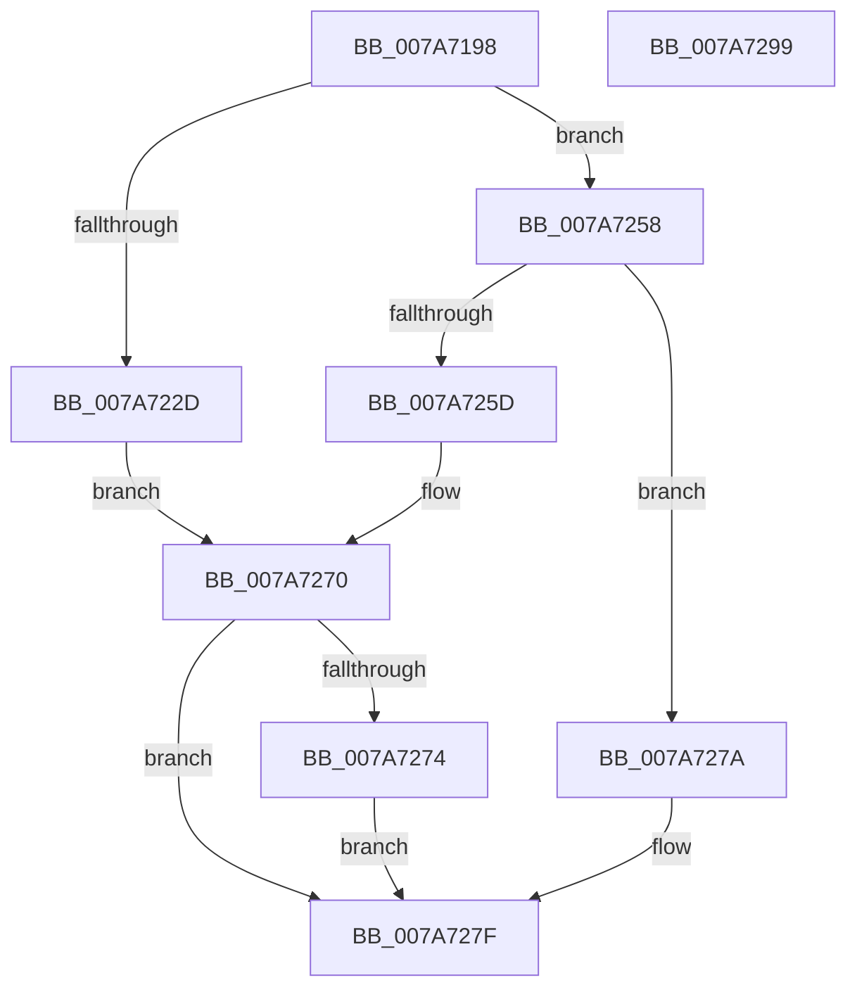

# SmStoreCreate

- RVA: `0x007A7198`–`0x007A729A` (길이 `258` bytes)
- VA: `0x00000001407A7198`
- 실행 섹션: `PAGE`
- PDB 이름 있음: `예`; PDB Function 태그: `아니요`
- unwind 정보 RVA: `0x000D1D84`
- 디코드: `72`개 명령, `258/258` bytes 표시
- 미해석 바이트: `0` (있으면 어셈블리에 `.byte`로 보존)

> 이 문서는 커널 이미지의 기계어와 PDB 기호를 분석해 생성했습니다. 4번과 5번은 함수 원형과 자료형을 바이너리 사용 방식에서 추정한 C 해석이며 원본 소스 복구 결과는 아닙니다.

## 1. Dependencies

- 직접 호출 지점: **4**; 고유 호출 대상: **4**
- 직접 호출자로 확인된 함수: **1**
- RIP 상대 이미지 참조: **1**

### Outgoing calls
- `0x007A71F4` → [memset](../../text/6C/memset_function_006C6C40.md) (function, `0x006C6C40`)
- `0x007A724E` → [SmStorePhysicalRequestIssue](SmStorePhysicalRequestIssue_function_007A732C.md) (function, `0x007A732C`)
- `0x007A7268` → [ZwSetSystemInformation](../../text/6B/ZwSetSystemInformation_function_006B0870.md) (function, `0x006B0870`)
- `0x007A7286` → [_security_check_cookie](../../text/6A/_security_check_cookie_function_006AC640.md) (function, `0x006AC640`)

### Direct callers
- [SmcStoreCreate](SmcStoreCreate_function_007ABFB4.md) at `0x007AC1DB`

### Static image references
- `0x007A71AB` → RVA `0x00E0A740` (`.data`; read)

## 2. Other-region calls and transfers

- 다른 실행 섹션으로 향하는 call: **3**
  - `0x007A71F4` → [memset](../../text/6C/memset_function_006C6C40.md) (`PAGE` → `.text`)
  - `0x007A7268` → [ZwSetSystemInformation](../../text/6B/ZwSetSystemInformation_function_006B0870.md) (`PAGE` → `.text`)
  - `0x007A7286` → [_security_check_cookie](../../text/6A/_security_check_cookie_function_006AC640.md) (`PAGE` → `.text`)
- 별도 외부 분기/꼬리 이동을 확인하지 못했습니다.

## 3. Assembly (complete function range)

```asm
007A7198  40 55                           push rbp
007A719A  53                              push rbx
007A719B  56                              push rsi
007A719C  57                              push rdi
007A719D  41 56                           push r14
007A719F  48 8D 6C 24 C9                  lea rbp, [rsp - 0x37]
007A71A4  48 81 EC C0 00 00 00            sub rsp, 0xc0
007A71AB  48 8B 05 8E 35 66 00            mov rax, qword ptr [rip + 0x66358e]
007A71B2  48 33 C4                        xor rax, rsp
007A71B5  48 89 45 27                     mov qword ptr [rbp + 0x27], rax
007A71B9  48 83 65 A7 00                  and qword ptr [rbp - 0x59], 0
007A71BE  48 8D 45 C7                     lea rax, [rbp - 0x39]
007A71C2  83 65 C3 00                     and dword ptr [rbp - 0x3d], 0
007A71C6  8B FA                           mov edi, edx
007A71C8  33 D2                           xor edx, edx
007A71CA  C7 45 AF 01 00 00 00            mov dword ptr [rbp - 0x51], 1
007A71D1  49 8B D8                        mov rbx, r8
007A71D4  C7 45 B3 03 00 00 00            mov dword ptr [rbp - 0x4d], 3
007A71DB  4C 8B F1                        mov r14, rcx
007A71DE  48 89 45 B7                     mov qword ptr [rbp - 0x49], rax
007A71E2  48 8D 4D CB                     lea rcx, [rbp - 0x35]
007A71E6  C7 45 BF 58 00 00 00            mov dword ptr [rbp - 0x41], 0x58
007A71ED  44 8D 42 54                     lea r8d, [rdx + 0x54]
007A71F1  49 8B F1                        mov rsi, r9
007A71F4  E8 47 FA F1 FF                  call 0x1406c6c40
007A71F9  0F 28 03                        movaps xmm0, xmmword ptr [rbx]
007A71FC  0F 28 4B 10                     movaps xmm1, xmmword ptr [rbx + 0x10]
007A7200  C7 45 C7 06 00 00 00            mov dword ptr [rbp - 0x39], 6
007A7207  0F 11 45 CF                     movups xmmword ptr [rbp - 0x31], xmm0
007A720B  0F 28 43 20                     movaps xmm0, xmmword ptr [rbx + 0x20]
007A720F  0F 11 45 EF                     movups xmmword ptr [rbp - 0x11], xmm0
007A7213  F2 0F 10 43 40                  movsd xmm0, qword ptr [rbx + 0x40]
007A7218  F2 0F 11 45 0F                  movsd qword ptr [rbp + 0xf], xmm0
007A721D  0F 11 4D DF                     movups xmmword ptr [rbp - 0x21], xmm1
007A7221  0F 28 4B 30                     movaps xmm1, xmmword ptr [rbx + 0x30]
007A7225  0F 11 4D FF                     movups xmmword ptr [rbp - 1], xmm1
007A7229  85 FF                           test edi, edi
007A722B  75 2B                           jne 0x1407a7258
007A722D  49 8B 8E 10 08 00 00            mov rcx, qword ptr [r14 + 0x810]
007A7234  48 8D 45 A7                     lea rax, [rbp - 0x59]
007A7238  48 89 44 24 28                  mov qword ptr [rsp + 0x28], rax
007A723D  44 8D 4F 58                     lea r9d, [rdi + 0x58]
007A7241  21 7C 24 20                     and dword ptr [rsp + 0x20], edi
007A7245  4C 8D 45 C7                     lea r8, [rbp - 0x39]
007A7249  BA 98 81 22 00                  mov edx, 0x228198
007A724E  E8 D9 00 00 00                  call 0x1407a732c
007A7253  8B 4D A7                        mov ecx, dword ptr [rbp - 0x59]
007A7256  EB 18                           jmp 0x1407a7270
007A7258  83 FF 01                        cmp edi, 1
007A725B  75 1D                           jne 0x1407a727a
007A725D  44 8D 47 17                     lea r8d, [rdi + 0x17]
007A7261  48 8D 55 AF                     lea rdx, [rbp - 0x51]
007A7265  8D 4F 6C                        lea ecx, [rdi + 0x6c]
007A7268  E8 03 96 F0 FF                  call 0x1406b0870
007A726D  8B 4D 17                        mov ecx, dword ptr [rbp + 0x17]
007A7270  85 C0                           test eax, eax
007A7272  78 0B                           js 0x1407a727f
007A7274  89 0E                           mov dword ptr [rsi], ecx
007A7276  33 C0                           xor eax, eax
007A7278  EB 05                           jmp 0x1407a727f
007A727A  B8 0D 00 00 C0                  mov eax, 0xc000000d
007A727F  48 8B 4D 27                     mov rcx, qword ptr [rbp + 0x27]
007A7283  48 33 CC                        xor rcx, rsp
007A7286  E8 B5 53 F0 FF                  call 0x1406ac640
007A728B  48 81 C4 C0 00 00 00            add rsp, 0xc0
007A7292  41 5E                           pop r14
007A7294  5F                              pop rdi
007A7295  5E                              pop rsi
007A7296  5B                              pop rbx
007A7297  5D                              pop rbp
007A7298  C3                              ret
007A7299  CC                              int3
```

## 4. C-style interpretation (structured pseudocode)

```c
__int64 __fastcall SmStoreCreate(__int64 a1, int a2, __int64 a3, __int64 a4)
{
    __int64 result;
    __int64 v_rsp;
    unsigned __int64 v_stack_m38;
    unsigned int v_stack_m48;
    unsigned __int64 v_stack_m50;
    unsigned __int64 v_stack_m5F;
    unsigned __int64 v_stack_m60;
    unsigned __int64 v_stack_m70;
    unsigned __int64 v_stack_m80;
    unsigned __int64 v_stack_m90;
    unsigned __int64 v_stack_m94;
    unsigned __int64 v_stack_m98;
    unsigned int v_stack_m9C;
    unsigned int v_stack_mA0;
    unsigned __int64 v_stack_mA8;
    unsigned int v_stack_mAC;
    unsigned int v_stack_mB0;
    unsigned __int64 v_stack_mB8;
    unsigned __int64 v_stack_mC0;
    unsigned int v_stack_mC8;

    v_rsp = (v_rsp) - (192);
    result = (*(unsigned __int64 *)(v_rip + 6698382)) ^ (v_rsp);
    v_stack_m38 = result;
    a2 = 0;
    v_stack_mB0 = 1;
    v_stack_mAC = 3;
    v_stack_mA8 = v_stack_m98;
    v_stack_mA0 = 88;
    result = memset(v_stack_m94, a2, a2 + 84, a4);
    v_stack_m98 = 6;
    v_stack_m90 = v_xmm0;
    v_stack_m70 = v_xmm0;
    v_stack_m50 = v_xmm0;
    v_stack_m80 = v_xmm1;
    v_stack_m60 = v_xmm1;
    if ((unsigned int)((unsigned int)(a2)) != 0) goto loc_007A7258;
    v_stack_mC0 = v_stack_mB8;
    result = SmStorePhysicalRequestIssue(*(unsigned __int64 *)(a1 + 2064), (unsigned int)(0x228198ULL), v_stack_m98, (unsigned int)(a2) + 88);
    goto loc_007A7270;
loc_007A7258:
    if (((unsigned int)((unsigned int)(a2))) != 1) goto loc_007A727A;
    result = ZwSetSystemInformation((unsigned int)(a2) + 108, v_stack_mB0, (unsigned int)(a2) + 23, (unsigned int)(a2) + 88);
loc_007A7270:
    if (sign_flag) goto loc_007A727F;
    *(unsigned int *)(a4) = (unsigned int)((unsigned int)(v_stack_m48));
    result = 0;
    goto loc_007A727F;
loc_007A727A:
loc_007A727F:
    a1 = (v_stack_m38) ^ (v_rsp);
    result = _security_check_cookie(a1, v_stack_mB0, (unsigned int)(a2) + 23, (unsigned int)(a2) + 88);
    v_rsp = (v_rsp) + (192);
    return result;
}
```

## 5. (Beta) C Style

```c
int64_t SmStoreCreate(void *Arg1, int32_t Arg2, void *Arg3, void *Arg4)
{
    uint8_t *arg1 = (uint8_t *)Arg1;
    uint8_t *arg3 = (uint8_t *)Arg3;
    uint8_t *arg4 = (uint8_t *)Arg4;

    int64_t result;
    int64_t local_rsp;
    uint64_t v_stack_m38;
    uint32_t v_stack_m48;
    uint64_t v_stack_m50;
    uint64_t v_stack_m5F;
    uint64_t v_stack_m60;
    uint64_t v_stack_m70;
    uint64_t v_stack_m80;
    uint64_t v_stack_m90;
    uint64_t v_stack_m94;
    uint64_t v_stack_m98;
    uint32_t v_stack_m9C;
    uint32_t v_stack_mA0;
    uint64_t v_stack_mA8;
    uint32_t v_stack_mAC;
    uint32_t v_stack_mB0;
    uint64_t v_stack_mB8;
    uint64_t v_stack_mC0;
    uint32_t v_stack_mC8;

    local_rsp = (local_rsp) - (192);
    result = (*(uint64_t *)(v_rip + 0x66358E)) ^ (local_rsp);
    v_stack_m38 = result;
    Arg2 = 0;
    v_stack_mB0 = 1;
    v_stack_mAC = 3;
    v_stack_mA8 = v_stack_m98;
    v_stack_mA0 = 88;
    result = memset(v_stack_m94, Arg2, Arg2 + 84, Arg4);
    v_stack_m98 = 6;
    v_stack_m90 = v_xmm0;
    v_stack_m70 = v_xmm0;
    v_stack_m50 = v_xmm0;
    v_stack_m80 = v_xmm1;
    v_stack_m60 = v_xmm1;
    if ((uint32_t)((uint32_t)(Arg2)) != 0) goto loc_007A7258;
    v_stack_mC0 = v_stack_mB8;
    result = SmStorePhysicalRequestIssue(*(uint64_t *)(arg1 + 0x810), (uint32_t)(0x228198ULL), v_stack_m98, (uint32_t)(Arg2) + 88);
    goto loc_007A7270;
loc_007A7258:
    if (((uint32_t)((uint32_t)(Arg2))) != 1) goto loc_007A727A;
    result = ZwSetSystemInformation((uint32_t)(Arg2) + 108, v_stack_mB0, (uint32_t)(Arg2) + 23, (uint32_t)(Arg2) + 88);
loc_007A7270:
    if (sign_flag) goto loc_007A727F;
    *(uint32_t *)(arg4) = (uint32_t)((uint32_t)(v_stack_m48));
    result = 0;
    goto loc_007A727F;
loc_007A727A:
loc_007A727F:
    Arg1 = (v_stack_m38) ^ (local_rsp);
    result = _security_check_cookie(Arg1, v_stack_mB0, (uint32_t)(Arg2) + 23, (uint32_t)(Arg2) + 88);
    local_rsp = (local_rsp) + (192);
    return result;
}
```

### 관측된 메모리 오프셋

구조체 형식이 확인되지 않은 접근은 인자 기준의 오프셋으로만 기록했습니다.

| 기준 인자 | 오프셋 표현 | 폭 (bit) | 접근 |
|---|---:|---:|---|
| `Arg1` | `+ 0x810` | `64` | `R` |
| `Arg3` | `+ 0x0` | `128` | `R` |
| `Arg3` | `+ 0x10` | `128` | `R` |
| `Arg3` | `+ 0x20` | `128` | `R` |
| `Arg3` | `+ 0x30` | `128` | `R` |
| `Arg3` | `+ 0x40` | `64` | `R` |
| `Arg4` | `+ 0x0` | `32` | `W` |

## 6. Execution-region graph

[열기: 2D/3D 그래프와 함수 탐색 컨트롤 패널](../../../control-panel.html?section=page&rva=0x007A7198&view=graph)

- 2D 그래프는 위에서 아래로 흐르고, 3D 그래프는 빈 공간을 드래그해 회전합니다. Shift+드래그는 이동, 휠은 확대·축소, 함수 노드 선택은 대상 보고서 이동입니다.

### Static fallback


