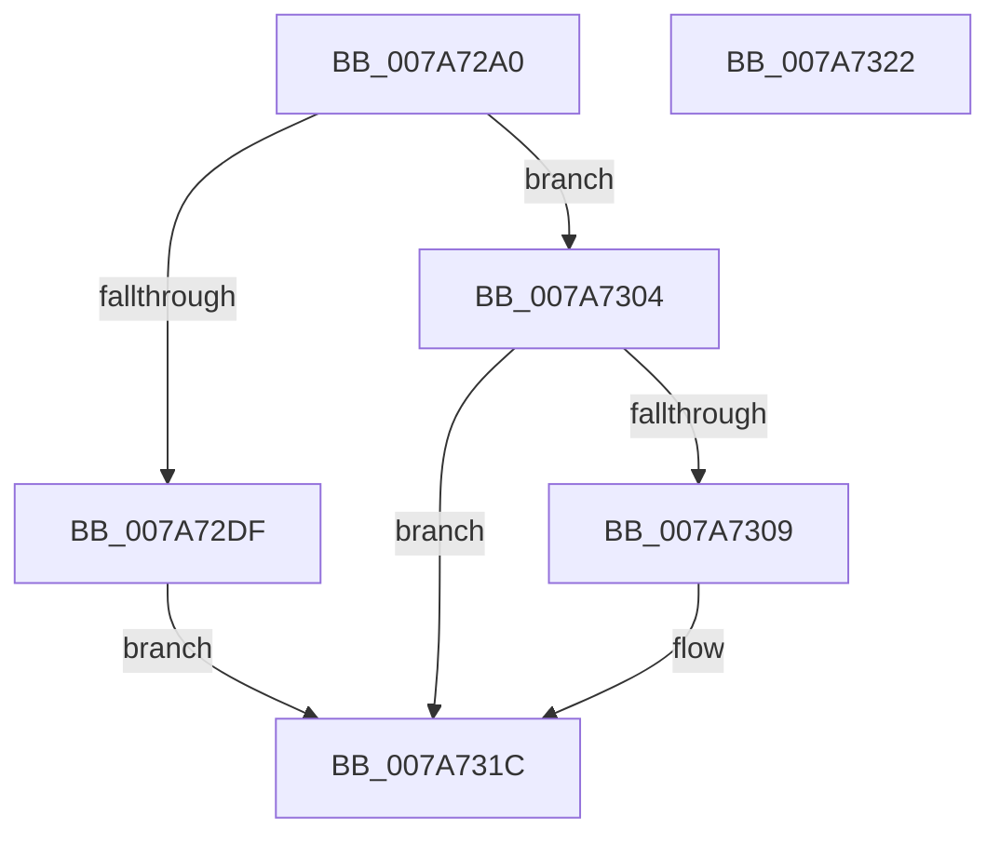

# SmStoreDelete

- RVA: `0x007A72A0`–`0x007A7323` (길이 `131` bytes)
- VA: `0x00000001407A72A0`
- 실행 섹션: `PAGE`
- PDB 이름 있음: `예`; PDB Function 태그: `아니요`
- unwind 정보 RVA: `0x0006EFC0`
- 디코드: `34`개 명령, `131/131` bytes 표시
- 미해석 바이트: `0` (있으면 어셈블리에 `.byte`로 보존)

> 이 문서는 커널 이미지의 기계어와 PDB 기호를 분석해 생성했습니다. 4번과 5번은 함수 원형과 자료형을 바이너리 사용 방식에서 추정한 C 해석이며 원본 소스 복구 결과는 아닙니다.

## 1. Dependencies

- 직접 호출 지점: **2**; 고유 호출 대상: **2**
- 직접 호출자로 확인된 함수: **2**
- RIP 상대 이미지 참조: **0**

### Outgoing calls
- `0x007A72FD` → [SmStorePhysicalRequestIssue](SmStorePhysicalRequestIssue_function_007A732C.md) (function, `0x007A732C`)
- `0x007A7317` → [ZwSetSystemInformation](../../text/6B/ZwSetSystemInformation_function_006B0870.md) (function, `0x006B0870`)

### Direct callers
- [SmcCacheCleanup](SmcCacheCleanup_function_007AB7B4.md) at `0x007AB7F1`
- [SmcStoreDelete](SmcStoreDelete_function_007AC214.md) at `0x007AC30D`

### Static image references
- 디코드된 RIP-relative 메모리 참조가 없습니다.

## 2. Other-region calls and transfers

- 다른 실행 섹션으로 향하는 call: **1**
  - `0x007A7317` → [ZwSetSystemInformation](../../text/6B/ZwSetSystemInformation_function_006B0870.md) (`PAGE` → `.text`)
- 별도 외부 분기/꼬리 이동을 확인하지 못했습니다.

## 3. Assembly (complete function range)

```asm
007A72A0  40 55                           push rbp
007A72A2  48 8B EC                        mov rbp, rsp
007A72A5  48 83 EC 50                     sub rsp, 0x50
007A72A9  45 33 DB                        xor r11d, r11d
007A72AC  48 C7 45 F8 08 00 00 00         mov qword ptr [rbp - 8], 8
007A72B4  4C 89 5D E0                     mov qword ptr [rbp - 0x20], r11
007A72B8  48 8D 45 28                     lea rax, [rbp + 0x28]
007A72BC  C7 45 EC 04 00 00 00            mov dword ptr [rbp - 0x14], 4
007A72C3  48 89 45 F0                     mov qword ptr [rbp - 0x10], rax
007A72C7  44 89 45 2C                     mov dword ptr [rbp + 0x2c], r8d
007A72CB  45 8D 53 01                     lea r10d, [r11 + 1]
007A72CF  44 89 55 E8                     mov dword ptr [rbp - 0x18], r10d
007A72D3  45 8D 4B 08                     lea r9d, [r11 + 8]
007A72D7  44 89 55 28                     mov dword ptr [rbp + 0x28], r10d
007A72DB  85 D2                           test edx, edx
007A72DD  75 25                           jne 0x1407a7304
007A72DF  48 8B 89 10 08 00 00            mov rcx, qword ptr [rcx + 0x810]
007A72E6  48 8D 45 E0                     lea rax, [rbp - 0x20]
007A72EA  48 89 44 24 28                  mov qword ptr [rsp + 0x28], rax
007A72EF  4C 8D 45 28                     lea r8, [rbp + 0x28]
007A72F3  BA 9C 81 22 00                  mov edx, 0x22819c
007A72F8  44 89 5C 24 20                  mov dword ptr [rsp + 0x20], r11d
007A72FD  E8 2A 00 00 00                  call 0x1407a732c
007A7302  EB 18                           jmp 0x1407a731c
007A7304  41 3B D2                        cmp edx, r10d
007A7307  75 13                           jne 0x1407a731c
007A7309  41 B8 18 00 00 00               mov r8d, 0x18
007A730F  48 8D 55 E8                     lea rdx, [rbp - 0x18]
007A7313  41 8D 48 55                     lea ecx, [r8 + 0x55]
007A7317  E8 54 95 F0 FF                  call 0x1406b0870
007A731C  48 83 C4 50                     add rsp, 0x50
007A7320  5D                              pop rbp
007A7321  C3                              ret
007A7322  CC                              int3
```

## 4. C-style interpretation (structured pseudocode)

```c
__int64 __fastcall SmStoreDelete(__int64 a1, int a2, int a3)
{
    __int64 result;
    __int64 v_r11;
    __int64 v_rsp;
    unsigned __int64 v_stack_m10;
    unsigned __int64 v_stack_m18;
    unsigned int v_stack_m1C;
    unsigned int v_stack_m20;
    unsigned __int64 v_stack_m28;
    unsigned __int64 v_stack_m30;
    unsigned int v_stack_m38;
    unsigned __int64 v_stack_p20;
    unsigned int v_stack_p24;

    v_rsp = (v_rsp) - (80);
    v_r11 = 0;
    v_stack_m10 = 8;
    v_stack_m28 = 0;
    v_stack_m1C = 4;
    v_stack_m18 = v_stack_p20;
    v_stack_p24 = a3;
    v_stack_m20 = (unsigned int)(v_r11 + 1);
    v_stack_p20 = (unsigned int)(v_r11 + 1);
    if (a2 != 0) goto loc_007A7304;
    v_stack_m30 = v_stack_m28;
    v_stack_m38 = 0;
    result = SmStorePhysicalRequestIssue(*(unsigned __int64 *)(a1 + 2064), (unsigned int)(0x22819CULL), v_stack_p20, v_r11 + 8);
    goto loc_007A731C;
loc_007A7304:
    if (((unsigned int)((unsigned int)(0x22819CULL))) == ((unsigned int)(v_r11 + 1))) {
        a3 = 24;
        a2 = v_stack_m20;
        a1 = a3 + 85;
        result = ZwSetSystemInformation(a1, a2, a3, v_r11 + 8);
    }
    v_rsp = (v_rsp) + (80);
    return result;
}
```

## 5. (Beta) C Style

```c
int64_t SmStoreDelete(void *Arg1, int32_t Arg2, int32_t Arg3)
{
    uint8_t *arg1 = (uint8_t *)Arg1;

    int64_t result;
    int64_t local_r11;
    int64_t local_rsp;
    uint64_t v_stack_m10;
    uint64_t v_stack_m18;
    uint32_t v_stack_m1C;
    uint32_t v_stack_m20;
    uint64_t v_stack_m28;
    uint64_t v_stack_m30;
    uint32_t v_stack_m38;
    uint64_t v_stack_p20;
    uint32_t v_stack_p24;

    local_rsp = (local_rsp) - (80);
    local_r11 = 0;
    v_stack_m10 = 8;
    v_stack_m28 = 0;
    v_stack_m1C = 4;
    v_stack_m18 = v_stack_p20;
    v_stack_p24 = Arg3;
    v_stack_m20 = (uint32_t)(local_r11 + 1);
    v_stack_p20 = (uint32_t)(local_r11 + 1);
    if (Arg2 != 0) goto loc_007A7304;
    v_stack_m30 = v_stack_m28;
    v_stack_m38 = 0;
    result = SmStorePhysicalRequestIssue(*(uint64_t *)(arg1 + 0x810), (uint32_t)(0x22819CULL), v_stack_p20, local_r11 + 8);
    goto loc_007A731C;
loc_007A7304:
    if (((uint32_t)((uint32_t)(0x22819CULL))) == ((uint32_t)(local_r11 + 1))) {
        Arg3 = 24;
        Arg2 = v_stack_m20;
        Arg1 = Arg3 + 85;
        result = ZwSetSystemInformation(Arg1, Arg2, Arg3, local_r11 + 8);
    }
    local_rsp = (local_rsp) + (80);
    return result;
}
```

### 관측된 메모리 오프셋

구조체 형식이 확인되지 않은 접근은 인자 기준의 오프셋으로만 기록했습니다.

| 기준 인자 | 오프셋 표현 | 폭 (bit) | 접근 |
|---|---:|---:|---|
| `Arg1` | `+ 0x810` | `64` | `R` |

## 6. Execution-region graph

[열기: 2D/3D 그래프와 함수 탐색 컨트롤 패널](../../../control-panel.html?section=page&rva=0x007A72A0&view=graph)

- 2D 그래프는 위에서 아래로 흐르고, 3D 그래프는 빈 공간을 드래그해 회전합니다. Shift+드래그는 이동, 휠은 확대·축소, 함수 노드 선택은 대상 보고서 이동입니다.

### Static fallback


