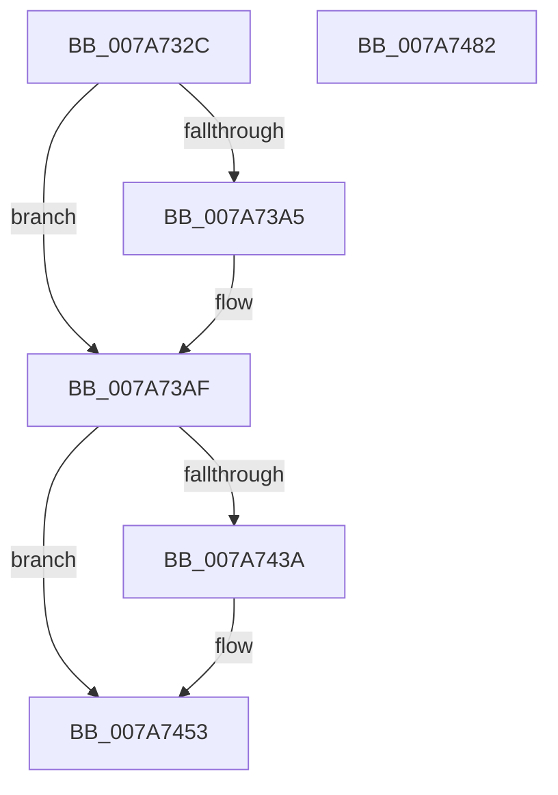

# SmStorePhysicalRequestIssue

- RVA: `0x007A732C`–`0x007A7483` (길이 `343` bytes)
- VA: `0x00000001407A732C`
- 실행 섹션: `PAGE`
- PDB 이름 있음: `예`; PDB Function 태그: `아니요`
- unwind 정보 RVA: `0x000D1DA4`
- 디코드: `90`개 명령, `343/343` bytes 표시
- 미해석 바이트: `0` (있으면 어셈블리에 `.byte`로 보존)

> 이 문서는 커널 이미지의 기계어와 PDB 기호를 분석해 생성했습니다. 4번과 5번은 함수 원형과 자료형을 바이너리 사용 방식에서 추정한 C 해석이며 원본 소스 복구 결과는 아닙니다.

## 1. Dependencies

- 직접 호출 지점: **6**; 고유 호출 대상: **6**
- 직접 호출자로 확인된 함수: **3**
- RIP 상대 이미지 참조: **2**

### Outgoing calls
- `0x007A7377` → [KeInitializeEvent](../../text/40/KeInitializeEvent_function_0040DD10.md) (function, `0x0040DD10`)
- `0x007A73B6` → [_chkstk](../../text/6B/_chkstk_function_006BA960.md) (function, `0x006BA960`)
- `0x007A73C6` → [IoInitializeIrp](../../text/44/IoInitializeIrp_function_00445050.md) (function, `0x00445050`)
- `0x007A742C` → [IofCallDriver](../../text/29/IofCallDriver_function_0029B4B0.md) (function, `0x0029B4B0`)
- `0x007A744C` → [KeWaitForSingleObject](../../text/20/KeWaitForSingleObject_function_0020E6B0.md) (function, `0x0020E6B0`)
- `0x007A7467` → [_security_check_cookie](../../text/6A/_security_check_cookie_function_006AC640.md) (function, `0x006AC640`)

### Direct callers
- [SmStoreCreate](SmStoreCreate_function_007A7198.md) at `0x007A724E`
- [SmStoreDelete](SmStoreDelete_function_007A72A0.md) at `0x007A72FD`
- [SmStoreResize](SmStoreResize_function_007A748C.md) at `0x007A750C`

### Static image references
- `0x007A7347` → RVA `0x00E0A740` (`.data`; read)
- `0x007A73CF` → RVA `0x0048B010` (`CmpCompleteFlushAndPurgeIrp`; read)

## 2. Other-region calls and transfers

- 다른 실행 섹션으로 향하는 call: **6**
  - `0x007A7377` → [KeInitializeEvent](../../text/40/KeInitializeEvent_function_0040DD10.md) (`PAGE` → `.text`)
  - `0x007A73B6` → [_chkstk](../../text/6B/_chkstk_function_006BA960.md) (`PAGE` → `.text`)
  - `0x007A73C6` → [IoInitializeIrp](../../text/44/IoInitializeIrp_function_00445050.md) (`PAGE` → `.text`)
  - `0x007A742C` → [IofCallDriver](../../text/29/IofCallDriver_function_0029B4B0.md) (`PAGE` → `.text`)
  - `0x007A744C` → [KeWaitForSingleObject](../../text/20/KeWaitForSingleObject_function_0020E6B0.md) (`PAGE` → `.text`)
  - `0x007A7467` → [_security_check_cookie](../../text/6A/_security_check_cookie_function_006AC640.md) (`PAGE` → `.text`)
- 별도 외부 분기/꼬리 이동을 확인하지 못했습니다.

## 3. Assembly (complete function range)

```asm
007A732C  40 55                           push rbp
007A732E  41 56                           push r14
007A7330  41 57                           push r15
007A7332  48 83 EC 50                     sub rsp, 0x50
007A7336  48 8D 6C 24 30                  lea rbp, [rsp + 0x30]
007A733B  48 89 5D 40                     mov qword ptr [rbp + 0x40], rbx
007A733F  48 89 75 48                     mov qword ptr [rbp + 0x48], rsi
007A7343  48 89 7D 50                     mov qword ptr [rbp + 0x50], rdi
007A7347  48 8B 05 F2 33 66 00            mov rax, qword ptr [rip + 0x6633f2]
007A734E  48 33 C5                        xor rax, rbp
007A7351  48 89 45 18                     mov qword ptr [rbp + 0x18], rax
007A7355  49 8B F8                        mov rdi, r8
007A7358  44 8B FA                        mov r15d, edx
007A735B  48 8B F1                        mov rsi, rcx
007A735E  0F 57 C0                        xorps xmm0, xmm0
007A7361  33 C0                           xor eax, eax
007A7363  48 8D 4D 00                     lea rcx, [rbp]
007A7367  45 33 C0                        xor r8d, r8d
007A736A  48 89 45 10                     mov qword ptr [rbp + 0x10], rax
007A736E  33 D2                           xor edx, edx
007A7370  45 8B F1                        mov r14d, r9d
007A7373  0F 11 45 00                     movups xmmword ptr [rbp], xmm0
007A7377  E8 94 69 C6 FF                  call 0x14040dd10
007A737C  44 0F BE 46 4C                  movsx r8d, byte ptr [rsi + 0x4c]
007A7381  41 0F B7 C0                     movzx eax, r8w
007A7385  66 C1 E0 03                     shl ax, 3
007A7389  42 8D 14 00                     lea edx, [rax + r8]
007A738D  B8 D0 00 00 00                  mov eax, 0xd0
007A7392  66 C1 E2 03                     shl dx, 3
007A7396  66 03 D0                        add dx, ax
007A7399  0F B7 C2                        movzx eax, dx
007A739C  48 8D 48 0F                     lea rcx, [rax + 0xf]
007A73A0  48 3B C8                        cmp rcx, rax
007A73A3  77 0A                           ja 0x1407a73af
007A73A5  48 B9 F0 FF FF FF FF FF FF 0F   movabs rcx, 0xffffffffffffff0
007A73AF  48 83 E1 F0                     and rcx, 0xfffffffffffffff0
007A73B3  48 8B C1                        mov rax, rcx
007A73B6  E8 A5 35 F1 FF                  call 0x1406ba960
007A73BB  48 2B E1                        sub rsp, rcx
007A73BE  48 8D 5C 24 30                  lea rbx, [rsp + 0x30]
007A73C3  48 8B CB                        mov rcx, rbx
007A73C6  E8 85 DC C9 FF                  call 0x140445050
007A73CB  48 89 7B 18                     mov qword ptr [rbx + 0x18], rdi
007A73CF  48 8D 0D 3A 3C CE FF            lea rcx, [rip - 0x31c3c6]
007A73D6  65 48 8B 04 25 88 01 00 00      mov rax, qword ptr gs:[0x188]
007A73DF  48 8D 7B 30                     lea rdi, [rbx + 0x30]
007A73E3  48 89 83 98 00 00 00            mov qword ptr [rbx + 0x98], rax
007A73EA  48 8B D3                        mov rdx, rbx
007A73ED  48 8B 83 B8 00 00 00            mov rax, qword ptr [rbx + 0xb8]
007A73F4  48 89 7B 48                     mov qword ptr [rbx + 0x48], rdi
007A73F8  C6 43 40 00                     mov byte ptr [rbx + 0x40], 0
007A73FC  48 89 48 F0                     mov qword ptr [rax - 0x10], rcx
007A7400  48 8D 4D 00                     lea rcx, [rbp]
007A7404  48 89 48 F8                     mov qword ptr [rax - 8], rcx
007A7408  C6 40 BB E0                     mov byte ptr [rax - 0x45], 0xe0
007A740C  48 8B 8B B8 00 00 00            mov rcx, qword ptr [rbx + 0xb8]
007A7413  8B 45 60                        mov eax, dword ptr [rbp + 0x60]
007A7416  C6 41 B8 0E                     mov byte ptr [rcx - 0x48], 0xe
007A741A  48 89 71 E0                     mov qword ptr [rcx - 0x20], rsi
007A741E  44 89 79 D0                     mov dword ptr [rcx - 0x30], r15d
007A7422  44 89 71 C8                     mov dword ptr [rcx - 0x38], r14d
007A7426  89 41 C0                        mov dword ptr [rcx - 0x40], eax
007A7429  48 8B CE                        mov rcx, rsi
007A742C  E8 7F 40 AF FF                  call 0x14029b4b0
007A7431  8B D0                           mov edx, eax
007A7433  3D 03 01 00 00                  cmp eax, 0x103
007A7438  75 19                           jne 0x1407a7453
007A743A  48 83 64 24 20 00               and qword ptr [rsp + 0x20], 0
007A7440  48 8D 4D 00                     lea rcx, [rbp]
007A7444  45 33 C9                        xor r9d, r9d
007A7447  45 33 C0                        xor r8d, r8d
007A744A  33 D2                           xor edx, edx
007A744C  E8 5F 72 A6 FF                  call 0x14020e6b0
007A7451  8B 17                           mov edx, dword ptr [rdi]
007A7453  48 8B 45 68                     mov rax, qword ptr [rbp + 0x68]
007A7457  48 8B 4B 38                     mov rcx, qword ptr [rbx + 0x38]
007A745B  48 89 08                        mov qword ptr [rax], rcx
007A745E  8B C2                           mov eax, edx
007A7460  48 8B 4D 18                     mov rcx, qword ptr [rbp + 0x18]
007A7464  48 33 CD                        xor rcx, rbp
007A7467  E8 D4 51 F0 FF                  call 0x1406ac640
007A746C  48 8B 5D 40                     mov rbx, qword ptr [rbp + 0x40]
007A7470  48 8B 75 48                     mov rsi, qword ptr [rbp + 0x48]
007A7474  48 8B 7D 50                     mov rdi, qword ptr [rbp + 0x50]
007A7478  48 8D 65 20                     lea rsp, [rbp + 0x20]
007A747C  41 5F                           pop r15
007A747E  41 5E                           pop r14
007A7480  5D                              pop rbp
007A7481  C3                              ret
007A7482  CC                              int3
```

## 4. C-style interpretation (structured pseudocode)

```c
__int64 __fastcall SmStorePhysicalRequestIssue(__int64 a1, int a2, __int64 a3, int a4, unsigned int a5, __int64 a6)
{
    __int64 result;
    __int64 v_rsp;
    unsigned __int64 v_stack_m18;
    unsigned __int64 v_stack_m20;
    unsigned __int64 v_stack_m28;
    unsigned __int64 v_stack_m38;
    unsigned __int64 v_stack_m48;
    unsigned __int64 v_stack_p10;
    unsigned __int64 v_stack_p18;
    unsigned __int64 v_stack_p8;

    v_rsp = (v_rsp) - (80);
    v_stack_p8 = v_rbx;
    v_stack_p10 = v_rsi;
    v_stack_p18 = v_rdi;
    result = (*(unsigned __int64 *)(v_rip + 6697970)) ^ (v_stack_m38);
    v_stack_m20 = result;
    result = 0;
    a3 = 0;
    v_stack_m28 = 0;
    a2 = 0;
    v_stack_m38 = v_xmm0;
    result = KeInitializeEvent(v_stack_m38, a2, a3, a4);
    result = (unsigned __int16)(((unsigned __int16)((__int8)(*(unsigned __int8 *)(a1 + 76)))) << (3));
    a2 = (unsigned __int16)((result + (__int8)(*(unsigned __int8 *)(a1 + 76)) * 1) << (3));
    a2 = (unsigned __int16)((a2) + (208));
    if (((unsigned __int16)(a2) + 15) <= ((unsigned __int16)(a2))) {
    }
    a1 = ((unsigned __int16)(a2) + 15) & (-16);
    result = _chkstk(a1, a2, (__int8)(*(unsigned __int8 *)(a1 + 76)), a4);
    v_rsp = (v_rsp) - (a1);
    result = IoInitializeIrp(v_stack_m38, a2, (__int8)(*(unsigned __int8 *)(a1 + 76)), a4);
    *(unsigned __int64 *)(v_stack_m38 + 24) = 0;
    *(unsigned __int64 *)(v_stack_m38 + 152) = *(unsigned __int64 *)(gs_base + (0 + 392));
    *(unsigned __int64 *)(v_stack_m38 + 72) = v_stack_m38 + 48;
    *(unsigned __int8 *)(v_stack_m38 + 64) = 0;
    *(unsigned __int64 *)(*(unsigned __int64 *)(v_stack_m38 + 184) - 16) = v_rip - 3261382;
    *(unsigned __int64 *)(*(unsigned __int64 *)(v_stack_m38 + 184) - 8) = v_stack_m38;
    *(unsigned __int8 *)(*(unsigned __int64 *)(v_stack_m38 + 184) - 69) = 224;
    *(unsigned __int8 *)(*(unsigned __int64 *)(v_stack_m38 + 184) - 72) = 14;
    *(unsigned __int64 *)(*(unsigned __int64 *)(v_stack_m38 + 184) - 32) = a1;
    *(unsigned int *)(*(unsigned __int64 *)(v_stack_m38 + 184) - 48) = (unsigned int)((unsigned int)(a2));
    *(unsigned int *)(*(unsigned __int64 *)(v_stack_m38 + 184) - 56) = (unsigned int)((unsigned int)(a4));
    *(unsigned int *)(*(unsigned __int64 *)(v_stack_m38 + 184) - 64) = (unsigned int)((unsigned int)(a5));
    result = IofCallDriver(a1, v_stack_m38, (__int8)(*(unsigned __int8 *)(a1 + 76)), a4);
    if (((unsigned int)(result)) == 259) {
        a1 = v_stack_m38;
        a4 = 0;
        a3 = 0;
        a2 = 0;
        result = KeWaitForSingleObject(a1, a2, a3, a4);
        a2 = *(unsigned int *)(v_stack_m38 + 48);
    }
    *(unsigned __int64 *)(a6) = *(unsigned __int64 *)(v_stack_m38 + 56);
    a1 = (v_stack_m20) ^ (v_stack_m38);
    result = _security_check_cookie(a1, a2, a3, a4);
    return result;
}
```

## 5. (Beta) C Style

```c
int64_t SmStorePhysicalRequestIssue(void *Arg1, int32_t Arg2, int64_t Arg3, int32_t Arg4, uint32_t Arg5, void *Arg6)
{
    uint8_t *arg1 = (uint8_t *)Arg1;
    uint8_t *arg6 = (uint8_t *)Arg6;

    int64_t result;
    int64_t local_rsp;
    uint64_t v_stack_m18;
    uint64_t v_stack_m20;
    uint64_t v_stack_m28;
    uint64_t v_stack_m38;
    uint64_t v_stack_m48;
    uint64_t v_stack_p10;
    uint64_t v_stack_p18;
    uint64_t v_stack_p8;

    local_rsp = (local_rsp) - (80);
    v_stack_p8 = local_rbx;
    v_stack_p10 = local_rsi;
    v_stack_p18 = local_rdi;
    result = (*(uint64_t *)(v_rip + 0x6633F2)) ^ (v_stack_m38);
    v_stack_m20 = result;
    result = 0;
    Arg3 = 0;
    v_stack_m28 = 0;
    Arg2 = 0;
    v_stack_m38 = v_xmm0;
    result = KeInitializeEvent(v_stack_m38, Arg2, Arg3, Arg4);
    result = (uint16_t)(((uint16_t)((int8_t)(*(uint8_t *)(arg1 + 0x4C)))) << (3));
    Arg2 = (uint16_t)((result + (int8_t)(*(uint8_t *)(arg1 + 0x4C)) * 1) << (3));
    Arg2 = (uint16_t)((Arg2) + (208));
    if (((uint16_t)(Arg2) + 15) <= ((uint16_t)(Arg2))) {
    }
    Arg1 = ((uint16_t)(Arg2) + 15) & (-16);
    result = _chkstk(Arg1, Arg2, (int8_t)(*(uint8_t *)(arg1 + 0x4C)), Arg4);
    local_rsp = (local_rsp) - (Arg1);
    result = IoInitializeIrp(v_stack_m38, Arg2, (int8_t)(*(uint8_t *)(arg1 + 0x4C)), Arg4);
    *(uint64_t *)(v_stack_m38 + 0x18) = 0;
    *(uint64_t *)(v_stack_m38 + 0x98) = *(uint64_t *)(gs_base + (0 + 0x188));
    *(uint64_t *)(v_stack_m38 + 0x48) = v_stack_m38 + 48;
    *(uint8_t *)(v_stack_m38 + 0x40) = 0;
    *(uint64_t *)(*(uint64_t *)(v_stack_m38 + 0xB8) - 0x10) = v_rip - 3261382;
    *(uint64_t *)(*(uint64_t *)(v_stack_m38 + 0xB8) - 0x8) = v_stack_m38;
    *(uint8_t *)(*(uint64_t *)(v_stack_m38 + 0xB8) - 0x45) = 224;
    *(uint8_t *)(*(uint64_t *)(v_stack_m38 + 0xB8) - 0x48) = 14;
    *(void **)(*(uint64_t *)(v_stack_m38 + 0xB8) - 0x20) = Arg1;
    *(uint32_t *)(*(uint64_t *)(v_stack_m38 + 0xB8) - 0x30) = (uint32_t)((uint32_t)(Arg2));
    *(uint32_t *)(*(uint64_t *)(v_stack_m38 + 0xB8) - 0x38) = (uint32_t)((uint32_t)(Arg4));
    *(uint32_t *)(*(uint64_t *)(v_stack_m38 + 0xB8) - 0x40) = (uint32_t)((uint32_t)(Arg5));
    result = IofCallDriver(Arg1, v_stack_m38, (int8_t)(*(uint8_t *)(arg1 + 0x4C)), Arg4);
    if (((uint32_t)(result)) == 259) {
        Arg1 = v_stack_m38;
        Arg4 = 0;
        Arg3 = 0;
        Arg2 = 0;
        result = KeWaitForSingleObject(Arg1, Arg2, Arg3, Arg4);
        Arg2 = *(uint32_t *)(v_stack_m38 + 0x30);
    }
    *(uint64_t *)(arg6) = *(uint64_t *)(v_stack_m38 + 0x38);
    Arg1 = (v_stack_m20) ^ (v_stack_m38);
    result = _security_check_cookie(Arg1, Arg2, Arg3, Arg4);
    return result;
}
```

### 관측된 메모리 오프셋

구조체 형식이 확인되지 않은 접근은 인자 기준의 오프셋으로만 기록했습니다.

| 기준 인자 | 오프셋 표현 | 폭 (bit) | 접근 |
|---|---:|---:|---|
| `Arg1` | `+ 0x4C` | `8` | `R` |
| `Arg6` | `+ 0x0` | `64` | `W` |

## 6. Execution-region graph

[열기: 2D/3D 그래프와 함수 탐색 컨트롤 패널](../../../control-panel.html?section=page&rva=0x007A732C&view=graph)

- 2D 그래프는 위에서 아래로 흐르고, 3D 그래프는 빈 공간을 드래그해 회전합니다. Shift+드래그는 이동, 휠은 확대·축소, 함수 노드 선택은 대상 보고서 이동입니다.

### Static fallback


