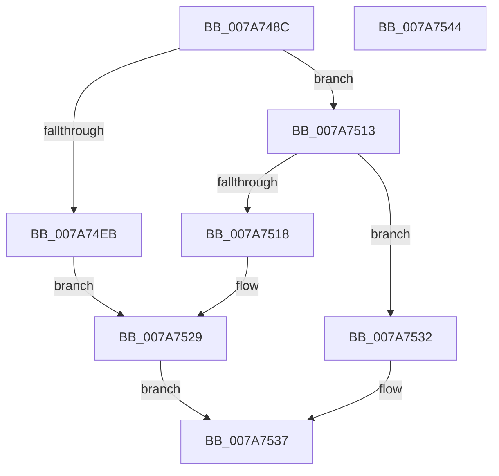

# SmStoreResize

- RVA: `0x007A748C`–`0x007A7545` (길이 `185` bytes)
- VA: `0x00000001407A748C`
- 실행 섹션: `PAGE`
- PDB 이름 있음: `예`; PDB Function 태그: `아니요`
- unwind 정보 RVA: `0x0009EAB4`
- 디코드: `51`개 명령, `185/185` bytes 표시
- 미해석 바이트: `0` (있으면 어셈블리에 `.byte`로 보존)

> 이 문서는 커널 이미지의 기계어와 PDB 기호를 분석해 생성했습니다. 4번과 5번은 함수 원형과 자료형을 바이너리 사용 방식에서 추정한 C 해석이며 원본 소스 복구 결과는 아닙니다.

## 1. Dependencies

- 직접 호출 지점: **2**; 고유 호출 대상: **2**
- 직접 호출자로 확인된 함수: **1**
- RIP 상대 이미지 참조: **0**

### Outgoing calls
- `0x007A750C` → [SmStorePhysicalRequestIssue](SmStorePhysicalRequestIssue_function_007A732C.md) (function, `0x007A732C`)
- `0x007A7524` → [ZwSetSystemInformation](../../text/6B/ZwSetSystemInformation_function_006B0870.md) (function, `0x006B0870`)

### Direct callers
- [SmcStoreResize](SmcStoreResize_function_007AC500.md) at `0x007AC6EF`

### Static image references
- 디코드된 RIP-relative 메모리 참조가 없습니다.

## 2. Other-region calls and transfers

- 다른 실행 섹션으로 향하는 call: **1**
  - `0x007A7524` → [ZwSetSystemInformation](../../text/6B/ZwSetSystemInformation_function_006B0870.md) (`PAGE` → `.text`)
- 별도 외부 분기/꼬리 이동을 확인하지 못했습니다.

## 3. Assembly (complete function range)

```asm
007A748C  48 89 5C 24 08                  mov qword ptr [rsp + 8], rbx
007A7491  55                              push rbp
007A7492  48 8B EC                        mov rbp, rsp
007A7495  48 83 EC 60                     sub rsp, 0x60
007A7499  48 8B 5D 30                     mov rbx, qword ptr [rbp + 0x30]
007A749D  48 8D 45 D0                     lea rax, [rbp - 0x30]
007A74A1  45 33 D2                        xor r10d, r10d
007A74A4  48 89 45 F0                     mov qword ptr [rbp - 0x10], rax
007A74A8  F7 5D 38                        neg dword ptr [rbp + 0x38]
007A74AB  4C 89 55 28                     mov qword ptr [rbp + 0x28], r10
007A74AF  1B C0                           sbb eax, eax
007A74B1  48 C7 45 F8 18 00 00 00         mov qword ptr [rbp - 8], 0x18
007A74B9  25 00 01 00 00                  and eax, 0x100
007A74BE  C7 45 E8 01 00 00 00            mov dword ptr [rbp - 0x18], 1
007A74C5  83 C0 06                        add eax, 6
007A74C8  C7 45 EC 11 00 00 00            mov dword ptr [rbp - 0x14], 0x11
007A74CF  89 45 D0                        mov dword ptr [rbp - 0x30], eax
007A74D2  45 8D 5A 18                     lea r11d, [r10 + 0x18]
007A74D6  8B 03                           mov eax, dword ptr [rbx]
007A74D8  89 45 D8                        mov dword ptr [rbp - 0x28], eax
007A74DB  44 89 55 DC                     mov dword ptr [rbp - 0x24], r10d
007A74DF  44 89 45 D4                     mov dword ptr [rbp - 0x2c], r8d
007A74E3  4C 89 4D E0                     mov qword ptr [rbp - 0x20], r9
007A74E7  85 D2                           test edx, edx
007A74E9  75 28                           jne 0x1407a7513
007A74EB  48 8B 89 10 08 00 00            mov rcx, qword ptr [rcx + 0x810]
007A74F2  48 8D 45 28                     lea rax, [rbp + 0x28]
007A74F6  48 89 44 24 28                  mov qword ptr [rsp + 0x28], rax
007A74FB  4C 8D 45 D0                     lea r8, [rbp - 0x30]
007A74FF  45 8B CB                        mov r9d, r11d
007A7502  44 89 5C 24 20                  mov dword ptr [rsp + 0x20], r11d
007A7507  BA CC 81 22 00                  mov edx, 0x2281cc
007A750C  E8 1B FE FF FF                  call 0x1407a732c
007A7511  EB 16                           jmp 0x1407a7529
007A7513  83 FA 01                        cmp edx, 1
007A7516  75 1A                           jne 0x1407a7532
007A7518  45 8B C3                        mov r8d, r11d
007A751B  48 8D 55 E8                     lea rdx, [rbp - 0x18]
007A751F  B9 6D 00 00 00                  mov ecx, 0x6d
007A7524  E8 47 93 F0 FF                  call 0x1406b0870
007A7529  8B C8                           mov ecx, eax
007A752B  8B 45 D8                        mov eax, dword ptr [rbp - 0x28]
007A752E  89 03                           mov dword ptr [rbx], eax
007A7530  EB 05                           jmp 0x1407a7537
007A7532  B9 0D 00 00 C0                  mov ecx, 0xc000000d
007A7537  48 8B 5C 24 70                  mov rbx, qword ptr [rsp + 0x70]
007A753C  8B C1                           mov eax, ecx
007A753E  48 83 C4 60                     add rsp, 0x60
007A7542  5D                              pop rbp
007A7543  C3                              ret
007A7544  CC                              int3
```

## 4. C-style interpretation (structured pseudocode)

```c
__int64 __fastcall SmStoreResize(__int64 a1, int a2, int a3, __int64 a4, __int64 a5, unsigned int a6)
{
    __int64 result;
    __int64 v_r10;
    __int64 v_rsp;
    unsigned __int64 v_stack_m10;
    unsigned __int64 v_stack_m18;
    unsigned int v_stack_m1C;
    unsigned int v_stack_m20;
    unsigned __int64 v_stack_m28;
    unsigned int v_stack_m2C;
    unsigned int v_stack_m30;
    unsigned int v_stack_m34;
    unsigned __int64 v_stack_m38;
    unsigned __int64 v_stack_m40;
    unsigned int v_stack_m48;
    unsigned __int64 v_stack_p20;
    unsigned __int64 v_stack_p8;

    v_stack_p8 = v_rbx;
    v_rsp = (v_rsp) - (96);
    v_r10 = 0;
    v_stack_m18 = v_stack_m38;
    v_stack_p20 = 0;
    v_stack_m10 = 24;
    result = (unsigned int)((v_stack_m38) & (256));
    v_stack_m20 = 1;
    result = (unsigned int)((result) + (6));
    v_stack_m1C = 17;
    v_stack_m38 = (unsigned int)(result);
    v_stack_m30 = (unsigned int)((unsigned int)(*(unsigned int *)(a5)));
    v_stack_m2C = 0;
    v_stack_m34 = a3;
    v_stack_m28 = a4;
    if (a2 != 0) goto loc_007A7513;
    v_stack_m40 = v_stack_p20;
    v_stack_m48 = (unsigned int)(v_r10 + 24);
    result = SmStorePhysicalRequestIssue(*(unsigned __int64 *)(a1 + 2064), (unsigned int)(0x2281CCULL), v_stack_m38, (unsigned int)((unsigned int)(v_r10 + 24)));
    goto loc_007A7529;
loc_007A7513:
    if (((unsigned int)((unsigned int)(0x2281CCULL))) != 1) goto loc_007A7532;
    result = ZwSetSystemInformation(109, v_stack_m20, (unsigned int)((unsigned int)(v_r10 + 24)), (unsigned int)((unsigned int)(v_r10 + 24)));
loc_007A7529:
    *(unsigned int *)(a5) = (unsigned int)((unsigned int)(v_stack_m30));
    goto loc_007A7537;
loc_007A7532:
loc_007A7537:
    v_rsp = (v_rsp) + (96);
    return (unsigned int)((unsigned int)((unsigned int)(0xC000000DULL)));
}
```

## 5. (Beta) C Style

```c
int64_t SmStoreResize(void *Arg1, int32_t Arg2, int32_t Arg3, int64_t Arg4, void *Arg5, uint32_t Arg6)
{
    uint8_t *arg1 = (uint8_t *)Arg1;
    uint8_t *arg5 = (uint8_t *)Arg5;

    int64_t result;
    int64_t local_r10;
    int64_t local_rsp;
    uint64_t v_stack_m10;
    uint64_t v_stack_m18;
    uint32_t v_stack_m1C;
    uint32_t v_stack_m20;
    uint64_t v_stack_m28;
    uint32_t v_stack_m2C;
    uint32_t v_stack_m30;
    uint32_t v_stack_m34;
    uint64_t v_stack_m38;
    uint64_t v_stack_m40;
    uint32_t v_stack_m48;
    uint64_t v_stack_p20;
    uint64_t v_stack_p8;

    v_stack_p8 = local_rbx;
    local_rsp = (local_rsp) - (96);
    local_r10 = 0;
    v_stack_m18 = v_stack_m38;
    v_stack_p20 = 0;
    v_stack_m10 = 24;
    result = (uint32_t)((v_stack_m38) & (256));
    v_stack_m20 = 1;
    result = (uint32_t)((result) + (6));
    v_stack_m1C = 17;
    v_stack_m38 = (uint32_t)(result);
    v_stack_m30 = (uint32_t)((uint32_t)(*(uint32_t *)(arg5)));
    v_stack_m2C = 0;
    v_stack_m34 = Arg3;
    v_stack_m28 = Arg4;
    if (Arg2 != 0) goto loc_007A7513;
    v_stack_m40 = v_stack_p20;
    v_stack_m48 = (uint32_t)(local_r10 + 24);
    result = SmStorePhysicalRequestIssue(*(uint64_t *)(arg1 + 0x810), (uint32_t)(0x2281CCULL), v_stack_m38, (uint32_t)((uint32_t)(local_r10 + 24)));
    goto loc_007A7529;
loc_007A7513:
    if (((uint32_t)((uint32_t)(0x2281CCULL))) != 1) goto loc_007A7532;
    result = ZwSetSystemInformation(109, v_stack_m20, (uint32_t)((uint32_t)(local_r10 + 24)), (uint32_t)((uint32_t)(local_r10 + 24)));
loc_007A7529:
    *(uint32_t *)(arg5) = (uint32_t)((uint32_t)(v_stack_m30));
    goto loc_007A7537;
loc_007A7532:
loc_007A7537:
    local_rsp = (local_rsp) + (96);
    return (uint32_t)((uint32_t)((uint32_t)(0xC000000DULL)));
}
```

### 관측된 메모리 오프셋

구조체 형식이 확인되지 않은 접근은 인자 기준의 오프셋으로만 기록했습니다.

| 기준 인자 | 오프셋 표현 | 폭 (bit) | 접근 |
|---|---:|---:|---|
| `Arg1` | `+ 0x810` | `64` | `R` |
| `Arg5` | `+ 0x0` | `32` | `R` |
| `Arg5` | `+ 0x0` | `32` | `W` |

## 6. Execution-region graph

[열기: 2D/3D 그래프와 함수 탐색 컨트롤 패널](../../../control-panel.html?section=page&rva=0x007A748C&view=graph)

- 2D 그래프는 위에서 아래로 흐르고, 3D 그래프는 빈 공간을 드래그해 회전합니다. Shift+드래그는 이동, 휠은 확대·축소, 함수 노드 선택은 대상 보고서 이동입니다.

### Static fallback


