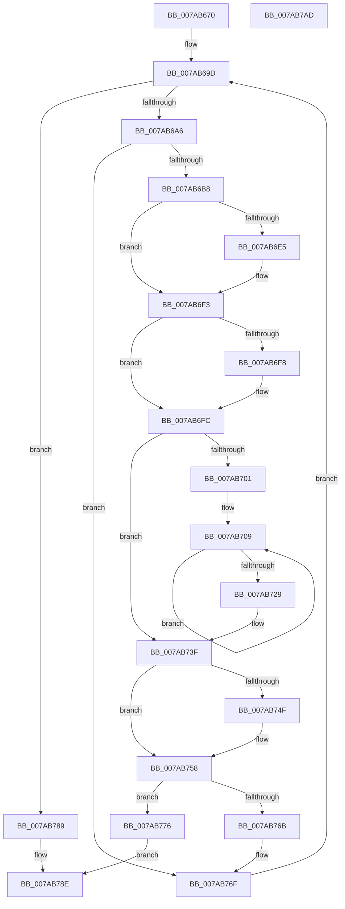

# SmcCacheAdd

- RVA: `0x007AB670`–`0x007AB7AE` (길이 `318` bytes)
- VA: `0x00000001407AB670`
- 실행 섹션: `PAGE`
- PDB 이름 있음: `예`; PDB Function 태그: `아니요`
- unwind 정보 RVA: `0x00075C18`
- 디코드: `96`개 명령, `318/318` bytes 표시
- 미해석 바이트: `0` (있으면 어셈블리에 `.byte`로 보존)

> 이 문서는 커널 이미지의 기계어와 PDB 기호를 분석해 생성했습니다. 4번과 5번은 함수 원형과 자료형을 바이너리 사용 방식에서 추정한 C 해석이며 원본 소스 복구 결과는 아닙니다.

## 1. Dependencies

- 직접 호출 지점: **7**; 고유 호출 대상: **7**
- 직접 호출자로 확인된 함수: **1**
- RIP 상대 이미지 참조: **0**

### Outgoing calls
- `0x007AB6D5` → [KeAbPreAcquire](../../text/21/KeAbPreAcquire_function_00210230.md) (function, `0x00210230`)
- `0x007AB6EE` → [ExfAcquirePushLockExclusiveEx](../../text/20/ExfAcquirePushLockExclusiveEx_function_0020FC90.md) (function, `0x0020FC90`)
- `0x007AB73A` → [ExAcquireRundownProtection](../../text/21/ExAcquireRundownProtection_function_00216620.md) (function, `0x00216620`)
- `0x007AB753` → [ExfTryToWakePushLock](../../text/26/ExfTryToWakePushLock_function_00265DD0.md) (function, `0x00265DD0`)
- `0x007AB75C` → [KeAbPostRelease](../../text/2E/KeAbPostRelease_function_002E1600.md) (function, `0x002E1600`)
- `0x007AB761` → [KeLeaveCriticalRegion](../../text/25/KeLeaveCriticalRegion_function_0025D8B0.md) (function, `0x0025D8B0`)
- `0x007AB782` → [KeSetEvent](../../text/33/KeSetEvent_function_0033F310.md) (function, `0x0033F310`)

### Direct callers
- [SmcProcessCreateRequest](SmcProcessCreateRequest_function_007A764C.md) at `0x007A7845`

### Static image references
- 디코드된 RIP-relative 메모리 참조가 없습니다.

## 2. Other-region calls and transfers

- 다른 실행 섹션으로 향하는 call: **7**
  - `0x007AB6D5` → [KeAbPreAcquire](../../text/21/KeAbPreAcquire_function_00210230.md) (`PAGE` → `.text`)
  - `0x007AB6EE` → [ExfAcquirePushLockExclusiveEx](../../text/20/ExfAcquirePushLockExclusiveEx_function_0020FC90.md) (`PAGE` → `.text`)
  - `0x007AB73A` → [ExAcquireRundownProtection](../../text/21/ExAcquireRundownProtection_function_00216620.md) (`PAGE` → `.text`)
  - `0x007AB753` → [ExfTryToWakePushLock](../../text/26/ExfTryToWakePushLock_function_00265DD0.md) (`PAGE` → `.text`)
  - `0x007AB75C` → [KeAbPostRelease](../../text/2E/KeAbPostRelease_function_002E1600.md) (`PAGE` → `.text`)
  - `0x007AB761` → [KeLeaveCriticalRegion](../../text/25/KeLeaveCriticalRegion_function_0025D8B0.md) (`PAGE` → `.text`)
  - `0x007AB782` → [KeSetEvent](../../text/33/KeSetEvent_function_0033F310.md) (`PAGE` → `.text`)
- 별도 외부 분기/꼬리 이동을 확인하지 못했습니다.

## 3. Assembly (complete function range)

```asm
007AB670  48 89 5C 24 08                  mov qword ptr [rsp + 8], rbx
007AB675  48 89 6C 24 10                  mov qword ptr [rsp + 0x10], rbp
007AB67A  48 89 74 24 18                  mov qword ptr [rsp + 0x18], rsi
007AB67F  57                              push rdi
007AB680  41 54                           push r12
007AB682  41 55                           push r13
007AB684  41 56                           push r14
007AB686  41 57                           push r15
007AB688  48 83 EC 20                     sub rsp, 0x20
007AB68C  33 FF                           xor edi, edi
007AB68E  4C 8B E9                        mov r13, rcx
007AB691  8B F7                           mov esi, edi
007AB693  48 83 C9 FF                     or rcx, 0xffffffffffffffff
007AB697  4D 8B E0                        mov r12, r8
007AB69A  4C 8B FA                        mov r15, rdx
007AB69D  83 FE 10                        cmp esi, 0x10
007AB6A0  0F 83 E3 00 00 00               jae 0x1407ab789
007AB6A6  8B DE                           mov ebx, esi
007AB6A8  48 C1 E3 05                     shl rbx, 5
007AB6AC  49 03 DD                        add rbx, r13
007AB6AF  48 39 3B                        cmp qword ptr [rbx], rdi
007AB6B2  0F 85 B7 00 00 00               jne 0x1407ab76f
007AB6B8  65 48 8B 04 25 88 01 00 00      mov rax, qword ptr gs:[0x188]
007AB6C1  4C 8D 73 10                     lea r14, [rbx + 0x10]
007AB6C5  45 33 C0                        xor r8d, r8d
007AB6C8  33 D2                           xor edx, edx
007AB6CA  66 01 88 E4 01 00 00            add word ptr [rax + 0x1e4], cx
007AB6D1  49 8B CE                        mov rcx, r14
007AB6D4  90                              nop
007AB6D5  E8 56 4B A6 FF                  call 0x140210230
007AB6DA  F0 49 0F BA 2E 00               lock bts qword ptr [r14], 0
007AB6E0  48 8B E8                        mov rbp, rax
007AB6E3  73 0E                           jae 0x1407ab6f3
007AB6E5  4D 8B C6                        mov r8, r14
007AB6E8  48 8B D0                        mov rdx, rax
007AB6EB  49 8B CE                        mov rcx, r14
007AB6EE  E8 9D 45 A6 FF                  call 0x14020fc90
007AB6F3  48 85 ED                        test rbp, rbp
007AB6F6  74 04                           je 0x1407ab6fc
007AB6F8  C6 45 0A 01                     mov byte ptr [rbp + 0xa], 1
007AB6FC  48 39 3B                        cmp qword ptr [rbx], rdi
007AB6FF  75 3E                           jne 0x1407ab73f
007AB701  4C 89 3B                        mov qword ptr [rbx], r15
007AB704  BD FF 0F 00 00                  mov ebp, 0xfff
007AB709  8B 4B 18                        mov ecx, dword ptr [rbx + 0x18]
007AB70C  8D 51 01                        lea edx, [rcx + 1]
007AB70F  8B C2                           mov eax, edx
007AB711  23 D5                           and edx, ebp
007AB713  33 C1                           xor eax, ecx
007AB715  C1 E2 04                        shl edx, 4
007AB718  23 C5                           and eax, ebp
007AB71A  0B D6                           or edx, esi
007AB71C  33 C1                           xor eax, ecx
007AB71E  89 43 18                        mov dword ptr [rbx + 0x18], eax
007AB721  41 89 17                        mov dword ptr [r15], edx
007AB724  83 FA FF                        cmp edx, -1
007AB727  74 E0                           je 0x1407ab709
007AB729  48 8D 4B 08                     lea rcx, [rbx + 8]
007AB72D  41 89 14 24                     mov dword ptr [r12], edx
007AB731  48 8B C7                        mov rax, rdi
007AB734  4C 8B FF                        mov r15, rdi
007AB737  48 87 01                        xchg qword ptr [rcx], rax
007AB73A  E8 E1 AE A6 FF                  call 0x140216620
007AB73F  48 83 C8 FF                     or rax, 0xffffffffffffffff
007AB743  F0 48 0F C1 43 10               lock xadd qword ptr [rbx + 0x10], rax
007AB749  24 06                           and al, 6
007AB74B  3C 02                           cmp al, 2
007AB74D  75 09                           jne 0x1407ab758
007AB74F  48 8D 4B 10                     lea rcx, [rbx + 0x10]
007AB753  E8 78 A6 AB FF                  call 0x140265dd0
007AB758  48 8D 4B 10                     lea rcx, [rbx + 0x10]
007AB75C  E8 9F 5E B3 FF                  call 0x1402e1600
007AB761  E8 4A 21 AB FF                  call 0x14025d8b0
007AB766  4D 85 FF                        test r15, r15
007AB769  74 0B                           je 0x1407ab776
007AB76B  48 83 C9 FF                     or rcx, 0xffffffffffffffff
007AB76F  FF C6                           inc esi
007AB771  E9 27 FF FF FF                  jmp 0x1407ab69d
007AB776  49 8B 8D 28 02 00 00            mov rcx, qword ptr [r13 + 0x228]
007AB77D  45 33 C0                        xor r8d, r8d
007AB780  33 D2                           xor edx, edx
007AB782  E8 89 3B B9 FF                  call 0x14033f310
007AB787  EB 05                           jmp 0x1407ab78e
007AB789  BF 99 00 00 C0                  mov edi, 0xc0000099
007AB78E  48 8B 5C 24 50                  mov rbx, qword ptr [rsp + 0x50]
007AB793  8B C7                           mov eax, edi
007AB795  48 8B 6C 24 58                  mov rbp, qword ptr [rsp + 0x58]
007AB79A  48 8B 74 24 60                  mov rsi, qword ptr [rsp + 0x60]
007AB79F  48 83 C4 20                     add rsp, 0x20
007AB7A3  41 5F                           pop r15
007AB7A5  41 5E                           pop r14
007AB7A7  41 5D                           pop r13
007AB7A9  41 5C                           pop r12
007AB7AB  5F                              pop rdi
007AB7AC  C3                              ret
007AB7AD  CC                              int3
```

## 4. C-style interpretation (structured pseudocode)

```c
__int64 __fastcall SmcCacheAdd(__int64 a1, __int64 a2, __int64 a3)
{
    __int64 result;
    __int64 v_rbx;
    __int64 v_rdi;
    __int64 v_rsi;
    __int64 v_rsp;
    unsigned __int64 v_stack_p10;
    unsigned __int64 v_stack_p18;
    unsigned __int64 v_stack_p8;

    v_stack_p8 = v_rbx;
    v_stack_p10 = v_rbp;
    v_stack_p18 = v_rsi;
    v_rsp = (v_rsp) - (32);
    v_rdi = 0;
    a1 = (a1) | (-1);
loc_007AB69D:
    if (0 >= 16) goto loc_007AB789;
    v_rbx = (0) << (5);
    v_rbx = (v_rbx) + (a1);
    if ((*(unsigned __int64 *)(v_rbx)) != 0) goto loc_007AB76F;
    a3 = 0;
    a2 = 0;
    result = KeAbPreAcquire(v_rbx + 16, a2, a3, a4);
    if (!(condition_is_above_or_equal)) {
        a3 = v_rbx + 16;
        a2 = result;
        a1 = v_rbx + 16;
        result = ExfAcquirePushLockExclusiveEx(a1, a2, a3, a4);
    }
    if (result != 0) {
        *(unsigned __int8 *)(result + 10) = 1;
    }
    if ((*(unsigned __int64 *)(v_rbx)) != 0) goto loc_007AB73F;
    *(unsigned __int64 *)(v_rbx) = a2;
loc_007AB709:
    a2 = (unsigned int)(((unsigned int)(*(unsigned int *)(v_rbx + 24)) + 1) & ((unsigned int)((unsigned int)(0xFFFULL))));
    result = (unsigned int)(((unsigned int)((unsigned int)((unsigned int)(*(unsigned int *)(v_rbx + 24)) + 1))) ^ ((unsigned int)((unsigned int)(*(unsigned int *)(v_rbx + 24)))));
    a2 = (unsigned int)((a2) << (4));
    result = (unsigned int)((result) & ((unsigned int)((unsigned int)(0xFFFULL))));
    a2 = (unsigned int)((a2) | (0));
    result = (unsigned int)((result) ^ ((unsigned int)((unsigned int)(*(unsigned int *)(v_rbx + 24)))));
    *(unsigned int *)(v_rbx + 24) = (unsigned int)(result);
    *(unsigned int *)(a2) = (unsigned int)(a2);
    if (((unsigned int)(a2)) == -1) goto loc_007AB709;
    *(unsigned int *)(a3) = (unsigned int)(a2);
    result = ExAcquireRundownProtection(v_rbx + 8, a2, a3, a4);
loc_007AB73F:
    result = (result) | (-1);
    result = (unsigned __int8)((result) & (6));
    if (((unsigned __int8)(result)) == 2) {
        a1 = v_rbx + 16;
        result = ExfTryToWakePushLock(a1, a2, a3, a4);
    }
    result = KeAbPostRelease(v_rbx + 16, a2, a3, a4);
    result = KeLeaveCriticalRegion(v_rbx + 16, a2, a3, a4);
    if (0 == 0) goto loc_007AB776;
    a1 = (v_rbx + 16) | (-1);
loc_007AB76F:
    v_rsi = (unsigned int)((0) + 1);
    goto loc_007AB69D;
loc_007AB776:
    a3 = 0;
    a2 = 0;
    result = KeSetEvent(*(unsigned __int64 *)(a1 + 552), a2, a3, a4);
    goto loc_007AB78E;
loc_007AB789:
loc_007AB78E:
    v_rsp = (v_rsp) + (32);
    return (unsigned int)((unsigned int)((unsigned int)(0xC0000099ULL)));
}
```

## 5. (Beta) C Style

```c
int64_t SmcCacheAdd(void *Arg1, int64_t Arg2, void *Arg3)
{
    uint8_t *arg1 = (uint8_t *)Arg1;
    uint8_t *arg3 = (uint8_t *)Arg3;

    int64_t result;
    int64_t local_rbx;
    int64_t local_rdi;
    int64_t local_rsi;
    int64_t local_rsp;
    uint64_t v_stack_p10;
    uint64_t v_stack_p18;
    uint64_t v_stack_p8;

    v_stack_p8 = local_rbx;
    v_stack_p10 = local_rbp;
    v_stack_p18 = local_rsi;
    local_rsp = (local_rsp) - (32);
    local_rdi = 0;
    Arg1 = (Arg1) | (-1);
loc_007AB69D:
    if (0 >= 16) goto loc_007AB789;
    local_rbx = (0) << (5);
    local_rbx = (local_rbx) + (Arg1);
    if ((*(uint64_t *)(local_rbx)) != 0) goto loc_007AB76F;
    Arg3 = 0;
    Arg2 = 0;
    result = KeAbPreAcquire(local_rbx + 16, Arg2, Arg3, a4);
    if (!(condition_is_above_or_equal)) {
        Arg3 = local_rbx + 16;
        Arg2 = result;
        Arg1 = local_rbx + 16;
        result = ExfAcquirePushLockExclusiveEx(Arg1, Arg2, Arg3, a4);
    }
    if (result != 0) {
        *(uint8_t *)(result + 0xA) = 1;
    }
    if ((*(uint64_t *)(local_rbx)) != 0) goto loc_007AB73F;
    *(uint64_t *)(local_rbx) = Arg2;
loc_007AB709:
    Arg2 = (uint32_t)(((uint32_t)(*(uint32_t *)(local_rbx + 0x18)) + 1) & ((uint32_t)((uint32_t)(0xFFFULL))));
    result = (uint32_t)(((uint32_t)((uint32_t)((uint32_t)(*(uint32_t *)(local_rbx + 0x18)) + 1))) ^ ((uint32_t)((uint32_t)(*(uint32_t *)(local_rbx + 0x18)))));
    Arg2 = (uint32_t)((Arg2) << (4));
    result = (uint32_t)((result) & ((uint32_t)((uint32_t)(0xFFFULL))));
    Arg2 = (uint32_t)((Arg2) | (0));
    result = (uint32_t)((result) ^ ((uint32_t)((uint32_t)(*(uint32_t *)(local_rbx + 0x18)))));
    *(uint32_t *)(local_rbx + 0x18) = (uint32_t)(result);
    *(uint32_t *)(Arg2) = (uint32_t)(Arg2);
    if (((uint32_t)(Arg2)) == -1) goto loc_007AB709;
    *(uint32_t *)(arg3) = (uint32_t)(Arg2);
    result = ExAcquireRundownProtection(local_rbx + 8, Arg2, Arg3, a4);
loc_007AB73F:
    result = (result) | (-1);
    result = (uint8_t)((result) & (6));
    if (((uint8_t)(result)) == 2) {
        Arg1 = local_rbx + 16;
        result = ExfTryToWakePushLock(Arg1, Arg2, Arg3, a4);
    }
    result = KeAbPostRelease(local_rbx + 16, Arg2, Arg3, a4);
    result = KeLeaveCriticalRegion(local_rbx + 16, Arg2, Arg3, a4);
    if (0 == 0) goto loc_007AB776;
    Arg1 = (local_rbx + 16) | (-1);
loc_007AB76F:
    local_rsi = (uint32_t)((0) + 1);
    goto loc_007AB69D;
loc_007AB776:
    Arg3 = 0;
    Arg2 = 0;
    result = KeSetEvent(*(uint64_t *)(arg1 + 0x228), Arg2, Arg3, a4);
    goto loc_007AB78E;
loc_007AB789:
loc_007AB78E:
    local_rsp = (local_rsp) + (32);
    return (uint32_t)((uint32_t)((uint32_t)(0xC0000099ULL)));
}
```

### 관측된 메모리 오프셋

구조체 형식이 확인되지 않은 접근은 인자 기준의 오프셋으로만 기록했습니다.

| 기준 인자 | 오프셋 표현 | 폭 (bit) | 접근 |
|---|---:|---:|---|
| `Arg1` | `+ 0x228` | `64` | `R` |
| `Arg3` | `+ 0x0` | `32` | `W` |

## 6. Execution-region graph

[열기: 2D/3D 그래프와 함수 탐색 컨트롤 패널](../../../control-panel.html?section=page&rva=0x007AB670&view=graph)

- 2D 그래프는 위에서 아래로 흐르고, 3D 그래프는 빈 공간을 드래그해 회전합니다. Shift+드래그는 이동, 휠은 확대·축소, 함수 노드 선택은 대상 보고서 이동입니다.

### Static fallback


