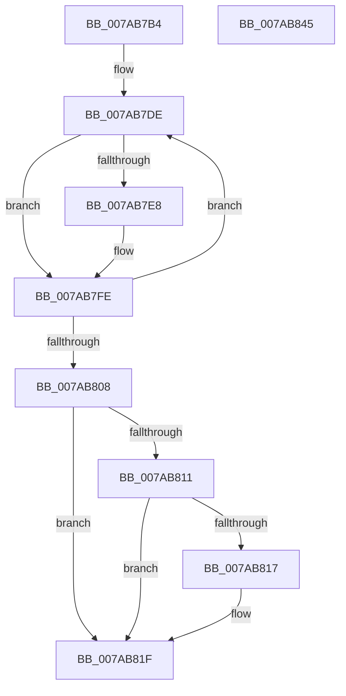

# SmcCacheCleanup

- RVA: `0x007AB7B4`–`0x007AB846` (길이 `146` bytes)
- VA: `0x00000001407AB7B4`
- 실행 섹션: `PAGE`
- PDB 이름 있음: `예`; PDB Function 태그: `아니요`
- unwind 정보 RVA: `0x0005C954`
- 디코드: `39`개 명령, `146/146` bytes 표시
- 미해석 바이트: `0` (있으면 어셈블리에 `.byte`로 보존)

> 이 문서는 커널 이미지의 기계어와 PDB 기호를 분석해 생성했습니다. 4번과 5번은 함수 원형과 자료형을 바이너리 사용 방식에서 추정한 C 해석이며 원본 소스 복구 결과는 아닙니다.

## 1. Dependencies

- 직접 호출 지점: **5**; 고유 호출 대상: **5**
- 직접 호출자로 확인된 함수: **2**
- RIP 상대 이미지 참조: **0**

### Outgoing calls
- `0x007AB7F1` → [SmStoreDelete](SmStoreDelete_function_007A72A0.md) (function, `0x007A72A0`)
- `0x007AB7F9` → [CmSiFreeMemory](../../text/47/CmSiFreeMemory_function_00475D80.md) (function, `0x00475D80`)
- `0x007AB81A` → [SmKmStoreFileDelete](SmKmStoreFileDelete_function_007A9680.md) (function, `0x007A9680`)
- `0x007AB822` → [SmKmFileInfoCleanup](../AC/SmKmFileInfoCleanup_function_00AC9A90.md) (function, `0x00AC9A90`)
- `0x007AB82B` → [StEtaCleanup](../../text/3B/StEtaCleanup_function_003B08EC.md) (function, `0x003B08EC`)

### Direct callers
- [SmcProcessCreateRequest](SmcProcessCreateRequest_function_007A764C.md) at `0x007A78AB`
- [SmcCacheDelete](SmcCacheDelete_function_007AB84C.md) at `0x007AB873`

### Static image references
- 디코드된 RIP-relative 메모리 참조가 없습니다.

## 2. Other-region calls and transfers

- 다른 실행 섹션으로 향하는 call: **2**
  - `0x007AB7F9` → [CmSiFreeMemory](../../text/47/CmSiFreeMemory_function_00475D80.md) (`PAGE` → `.text`)
  - `0x007AB82B` → [StEtaCleanup](../../text/3B/StEtaCleanup_function_003B08EC.md) (`PAGE` → `.text`)
- 별도 외부 분기/꼬리 이동을 확인하지 못했습니다.

## 3. Assembly (complete function range)

```asm
007AB7B4  48 89 5C 24 08                  mov qword ptr [rsp + 8], rbx
007AB7B9  48 89 6C 24 10                  mov qword ptr [rsp + 0x10], rbp
007AB7BE  48 89 74 24 18                  mov qword ptr [rsp + 0x18], rsi
007AB7C3  57                              push rdi
007AB7C4  48 83 EC 20                     sub rsp, 0x20
007AB7C8  48 8B FA                        mov rdi, rdx
007AB7CB  48 8D A9 10 F7 FF FF            lea rbp, [rcx - 0x8f0]
007AB7D2  48 8D 9A B0 00 00 00            lea rbx, [rdx + 0xb0]
007AB7D9  BE 10 00 00 00                  mov esi, 0x10
007AB7DE  44 8B 43 F8                     mov r8d, dword ptr [rbx - 8]
007AB7E2  41 83 F8 FF                     cmp r8d, -1
007AB7E6  74 16                           je 0x1407ab7fe
007AB7E8  8B 53 FC                        mov edx, dword ptr [rbx - 4]
007AB7EB  48 8B CD                        mov rcx, rbp
007AB7EE  83 E2 03                        and edx, 3
007AB7F1  E8 AA BA FF FF                  call 0x1407a72a0
007AB7F6  48 8B 0B                        mov rcx, qword ptr [rbx]
007AB7F9  E8 82 A5 CC FF                  call 0x140475d80
007AB7FE  48 83 C3 18                     add rbx, 0x18
007AB802  48 83 EE 01                     sub rsi, 1
007AB806  75 D6                           jne 0x1407ab7de
007AB808  48 8D 5F 28                     lea rbx, [rdi + 0x28]
007AB80C  48 39 33                        cmp qword ptr [rbx], rsi
007AB80F  74 0E                           je 0x1407ab81f
007AB811  48 39 77 30                     cmp qword ptr [rdi + 0x30], rsi
007AB815  74 08                           je 0x1407ab81f
007AB817  48 8B CB                        mov rcx, rbx
007AB81A  E8 61 DE FF FF                  call 0x1407a9680
007AB81F  48 8B CB                        mov rcx, rbx
007AB822  E8 69 E2 31 00                  call 0x140ac9a90
007AB827  48 8D 4F 68                     lea rcx, [rdi + 0x68]
007AB82B  E8 BC 50 C0 FF                  call 0x1403b08ec
007AB830  48 8B 5C 24 30                  mov rbx, qword ptr [rsp + 0x30]
007AB835  48 8B 6C 24 38                  mov rbp, qword ptr [rsp + 0x38]
007AB83A  48 8B 74 24 40                  mov rsi, qword ptr [rsp + 0x40]
007AB83F  48 83 C4 20                     add rsp, 0x20
007AB843  5F                              pop rdi
007AB844  C3                              ret
007AB845  CC                              int3
```

## 4. C-style interpretation (structured pseudocode)

```c
__int64 __fastcall SmcCacheCleanup(__int64 a1, __int64 a2)
{
    __int64 result;
    __int64 v_rbx;
    __int64 v_rsi;
    __int64 v_rsp;
    unsigned __int64 v_stack_p10;
    unsigned __int64 v_stack_p18;
    unsigned __int64 v_stack_p8;

    v_stack_p8 = v_rbx;
    v_stack_p10 = v_rbp;
    v_stack_p18 = v_rsi;
    v_rsp = (v_rsp) - (32);
loc_007AB7DE:
    if (((unsigned int)((unsigned int)(*(unsigned int *)(a2 + 176 - 8)))) != -1) {
        a2 = *(unsigned int *)(a2 + 176 - 4);
        a1 = a1 - 2288;
        a2 = (unsigned int)((a2) & (3));
        result = SmStoreDelete(a1, a2, (unsigned int)(*(unsigned int *)(a2 + 176 - 8)), a4);
        a1 = *(unsigned __int64 *)(a2 + 176);
        result = CmSiFreeMemory(a1, a2, (unsigned int)(*(unsigned int *)(a2 + 176 - 8)), a4);
    }
    v_rbx = (a2 + 176) + (24);
    v_rsi = (16) - (1);
    if (condition_is_not_equal) goto loc_007AB7DE;
    if ((*(unsigned __int64 *)(a2 + 40)) == v_rsi) goto loc_007AB81F;
    if ((*(unsigned __int64 *)(a2 + 48)) != v_rsi) {
        a1 = a2 + 40;
        result = SmKmStoreFileDelete(a1, a2, (unsigned int)(*(unsigned int *)(a2 + 176 - 8)), a4);
    }
    result = SmKmFileInfoCleanup(a2 + 40, a2, (unsigned int)(*(unsigned int *)(a2 + 176 - 8)), a4);
    result = StEtaCleanup(a2 + 104, a2, (unsigned int)(*(unsigned int *)(a2 + 176 - 8)), a4);
    v_rsp = (v_rsp) + (32);
    return result;
}
```

## 5. (Beta) C Style

```c
int64_t SmcCacheCleanup(void *Arg1, void *Arg2)
{
    uint8_t *arg1 = (uint8_t *)Arg1;
    uint8_t *arg2 = (uint8_t *)Arg2;

    int64_t result;
    int64_t local_rbx;
    int64_t local_rsi;
    int64_t local_rsp;
    uint64_t v_stack_p10;
    uint64_t v_stack_p18;
    uint64_t v_stack_p8;

    v_stack_p8 = local_rbx;
    v_stack_p10 = local_rbp;
    v_stack_p18 = local_rsi;
    local_rsp = (local_rsp) - (32);
loc_007AB7DE:
    if (((uint32_t)((uint32_t)(*(uint32_t *)(arg2 + 0xB0 - 0x8)))) != -1) {
        Arg2 = *(uint32_t *)(arg2 + 0xB0 - 0x4);
        Arg1 = Arg1 - 2288;
        Arg2 = (uint32_t)((Arg2) & (3));
        result = SmStoreDelete(Arg1, Arg2, (uint32_t)(*(uint32_t *)(arg2 + 0xB0 - 0x8)), a4);
        Arg1 = *(uint64_t *)(arg2 + 0xB0);
        result = CmSiFreeMemory(Arg1, Arg2, (uint32_t)(*(uint32_t *)(arg2 + 0xB0 - 0x8)), a4);
    }
    local_rbx = (Arg2 + 176) + (24);
    local_rsi = (16) - (1);
    if (condition_is_not_equal) goto loc_007AB7DE;
    if ((*(uint64_t *)(arg2 + 0x28)) == local_rsi) goto loc_007AB81F;
    if ((*(uint64_t *)(arg2 + 0x30)) != local_rsi) {
        Arg1 = Arg2 + 40;
        result = SmKmStoreFileDelete(Arg1, Arg2, (uint32_t)(*(uint32_t *)(arg2 + 0xB0 - 0x8)), a4);
    }
    result = SmKmFileInfoCleanup(Arg2 + 40, Arg2, (uint32_t)(*(uint32_t *)(arg2 + 0xB0 - 0x8)), a4);
    result = StEtaCleanup(Arg2 + 104, Arg2, (uint32_t)(*(uint32_t *)(arg2 + 0xB0 - 0x8)), a4);
    local_rsp = (local_rsp) + (32);
    return result;
}
```

### 관측된 메모리 오프셋

구조체 형식이 확인되지 않은 접근은 인자 기준의 오프셋으로만 기록했습니다.

| 기준 인자 | 오프셋 표현 | 폭 (bit) | 접근 |
|---|---:|---:|---|
| `Arg1` | `- 0x8F0` | `64` | `R` |
| `Arg2` | `- 0x8` | `32` | `R` |
| `Arg2` | `- 0x4` | `32` | `R` |
| `Arg2` | `+ 0x0` | `64` | `R` |
| `Arg2` | `+ 0x28` | `64` | `R` |
| `Arg2` | `+ 0x30` | `64` | `R` |
| `Arg2` | `+ 0x68` | `64` | `R` |
| `Arg2` | `+ 0xB0` | `64` | `R` |

## 6. Execution-region graph

[열기: 2D/3D 그래프와 함수 탐색 컨트롤 패널](../../../control-panel.html?section=page&rva=0x007AB7B4&view=graph)

- 2D 그래프는 위에서 아래로 흐르고, 3D 그래프는 빈 공간을 드래그해 회전합니다. Shift+드래그는 이동, 휠은 확대·축소, 함수 노드 선택은 대상 보고서 이동입니다.

### Static fallback


