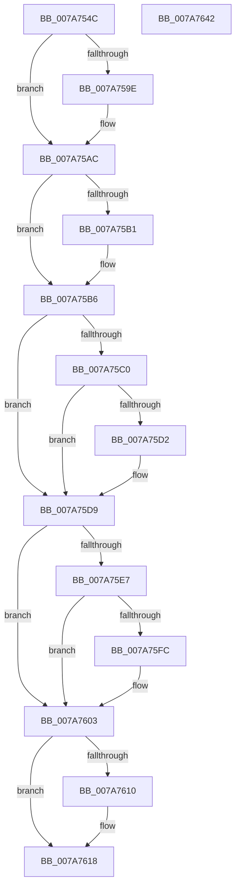

# SmcCacheCreatePrepare

- RVA: `0x007A754C`–`0x007A7643` (길이 `247` bytes)
- VA: `0x00000001407A754C`
- 실행 섹션: `PAGE`
- PDB 이름 있음: `예`; PDB Function 태그: `아니요`
- unwind 정보 RVA: `0x0005E6B4`
- 디코드: `66`개 명령, `247/247` bytes 표시
- 미해석 바이트: `0` (있으면 어셈블리에 `.byte`로 보존)

> 이 문서는 커널 이미지의 기계어와 PDB 기호를 분석해 생성했습니다. 4번과 5번은 함수 원형과 자료형을 바이너리 사용 방식에서 추정한 C 해석이며 원본 소스 복구 결과는 아닙니다.

## 1. Dependencies

- 직접 호출 지점: **7**; 고유 호출 대상: **7**
- 직접 호출자로 확인된 함수: **1**
- RIP 상대 이미지 참조: **0**

### Outgoing calls
- `0x007A758E` → [KeAbPreAcquire](../../text/21/KeAbPreAcquire_function_00210230.md) (function, `0x00210230`)
- `0x007A75A7` → [ExfAcquirePushLockExclusiveEx](../../text/20/ExfAcquirePushLockExclusiveEx_function_0020FC90.md) (function, `0x0020FC90`)
- `0x007A75C7` → [SmRegistrationCtxStart](../AC/SmRegistrationCtxStart_function_00ACCA90.md) (function, `0x00ACCA90`)
- `0x007A75F1` → [SmcCacheManagerStart](SmcCacheManagerStart_function_007AB958.md) (function, `0x007AB958`)
- `0x007A7613` → [ExfTryToWakePushLock](../../text/26/ExfTryToWakePushLock_function_00265DD0.md) (function, `0x00265DD0`)
- `0x007A761B` → [KeAbPostRelease](../../text/2E/KeAbPostRelease_function_002E1600.md) (function, `0x002E1600`)
- `0x007A7620` → [KeLeaveCriticalRegion](../../text/25/KeLeaveCriticalRegion_function_0025D8B0.md) (function, `0x0025D8B0`)

### Direct callers
- [SmcProcessCreateRequest](SmcProcessCreateRequest_function_007A764C.md) at `0x007A779C`

### Static image references
- 디코드된 RIP-relative 메모리 참조가 없습니다.

## 2. Other-region calls and transfers

- 다른 실행 섹션으로 향하는 call: **5**
  - `0x007A758E` → [KeAbPreAcquire](../../text/21/KeAbPreAcquire_function_00210230.md) (`PAGE` → `.text`)
  - `0x007A75A7` → [ExfAcquirePushLockExclusiveEx](../../text/20/ExfAcquirePushLockExclusiveEx_function_0020FC90.md) (`PAGE` → `.text`)
  - `0x007A7613` → [ExfTryToWakePushLock](../../text/26/ExfTryToWakePushLock_function_00265DD0.md) (`PAGE` → `.text`)
  - `0x007A761B` → [KeAbPostRelease](../../text/2E/KeAbPostRelease_function_002E1600.md) (`PAGE` → `.text`)
  - `0x007A7620` → [KeLeaveCriticalRegion](../../text/25/KeLeaveCriticalRegion_function_0025D8B0.md) (`PAGE` → `.text`)
- 별도 외부 분기/꼬리 이동을 확인하지 못했습니다.

## 3. Assembly (complete function range)

```asm
007A754C  48 8B C4                        mov rax, rsp
007A754F  48 89 58 08                     mov qword ptr [rax + 8], rbx
007A7553  48 89 68 10                     mov qword ptr [rax + 0x10], rbp
007A7557  48 89 70 18                     mov qword ptr [rax + 0x18], rsi
007A755B  48 89 78 20                     mov qword ptr [rax + 0x20], rdi
007A755F  41 56                           push r14
007A7561  48 83 EC 20                     sub rsp, 0x20
007A7565  65 48 8B 04 25 88 01 00 00      mov rax, qword ptr gs:[0x188]
007A756E  48 8D B1 78 FF FF FF            lea rsi, [rcx - 0x88]
007A7575  48 8B F9                        mov rdi, rcx
007A7578  48 83 CB FF                     or rbx, 0xffffffffffffffff
007A757C  45 33 C0                        xor r8d, r8d
007A757F  33 D2                           xor edx, edx
007A7581  48 8B CE                        mov rcx, rsi
007A7584  33 ED                           xor ebp, ebp
007A7586  66 01 98 E4 01 00 00            add word ptr [rax + 0x1e4], bx
007A758D  90                              nop
007A758E  E8 9D 8C A6 FF                  call 0x140210230
007A7593  F0 48 0F BA 2E 00               lock bts qword ptr [rsi], 0
007A7599  4C 8B F0                        mov r14, rax
007A759C  73 0E                           jae 0x1407a75ac
007A759E  4C 8B C6                        mov r8, rsi
007A75A1  48 8B D0                        mov rdx, rax
007A75A4  48 8B CE                        mov rcx, rsi
007A75A7  E8 E4 86 A6 FF                  call 0x14020fc90
007A75AC  4D 85 F6                        test r14, r14
007A75AF  74 05                           je 0x1407a75b6
007A75B1  41 C6 46 0A 01                  mov byte ptr [r14 + 0xa], 1
007A75B6  8B 87 68 FF FF FF               mov eax, dword ptr [rdi - 0x98]
007A75BC  A8 08                           test al, 8
007A75BE  75 19                           jne 0x1407a75d9
007A75C0  48 8D 8F 30 02 00 00            lea rcx, [rdi + 0x230]
007A75C7  E8 C4 54 32 00                  call 0x140acca90
007A75CC  8B E8                           mov ebp, eax
007A75CE  85 C0                           test eax, eax
007A75D0  78 07                           js 0x1407a75d9
007A75D2  83 8F 68 FF FF FF 08            or dword ptr [rdi - 0x98], 8
007A75D9  8B 8F 68 FF FF FF               mov ecx, dword ptr [rdi - 0x98]
007A75DF  80 E1 0C                        and cl, 0xc
007A75E2  80 F9 08                        cmp cl, 8
007A75E5  75 1C                           jne 0x1407a7603
007A75E7  48 8B 97 30 02 00 00            mov rdx, qword ptr [rdi + 0x230]
007A75EE  48 8B CF                        mov rcx, rdi
007A75F1  E8 62 43 00 00                  call 0x1407ab958
007A75F6  8B E8                           mov ebp, eax
007A75F8  85 C0                           test eax, eax
007A75FA  78 07                           js 0x1407a7603
007A75FC  83 8F 68 FF FF FF 04            or dword ptr [rdi - 0x98], 4
007A7603  F0 48 0F C1 1E                  lock xadd qword ptr [rsi], rbx
007A7608  80 E3 06                        and bl, 6
007A760B  80 FB 02                        cmp bl, 2
007A760E  75 08                           jne 0x1407a7618
007A7610  48 8B CE                        mov rcx, rsi
007A7613  E8 B8 E7 AB FF                  call 0x140265dd0
007A7618  48 8B CE                        mov rcx, rsi
007A761B  E8 E0 9F B3 FF                  call 0x1402e1600
007A7620  E8 8B 62 AB FF                  call 0x14025d8b0
007A7625  48 8B 5C 24 30                  mov rbx, qword ptr [rsp + 0x30]
007A762A  8B C5                           mov eax, ebp
007A762C  48 8B 6C 24 38                  mov rbp, qword ptr [rsp + 0x38]
007A7631  48 8B 74 24 40                  mov rsi, qword ptr [rsp + 0x40]
007A7636  48 8B 7C 24 48                  mov rdi, qword ptr [rsp + 0x48]
007A763B  48 83 C4 20                     add rsp, 0x20
007A763F  41 5E                           pop r14
007A7641  C3                              ret
007A7642  CC                              int3
```

## 4. C-style interpretation (structured pseudocode)

```c
__int64 __fastcall SmcCacheCreatePrepare(__int64 a1, int a2, int a3)
{
    __int64 result;
    __int64 v_rbp;
    __int64 v_rbx;
    __int64 v_rsp;
    unsigned __int64 v_stack_p10;
    unsigned __int64 v_stack_p18;
    unsigned __int64 v_stack_p20;
    unsigned __int64 v_stack_p8;

    *(unsigned __int64 *)(v_rsp + 8) = v_rbx;
    *(unsigned __int64 *)(v_rsp + 16) = v_rbp;
    *(unsigned __int64 *)(v_rsp + 24) = v_rsi;
    *(unsigned __int64 *)(v_rsp + 32) = v_rdi;
    v_rsp = (v_rsp) - (32);
    v_rbx = (v_rbx) | (-1);
    a3 = 0;
    a2 = 0;
    v_rbp = 0;
    result = KeAbPreAcquire(a1 - 136, a2, a3, a4);
    if (!(condition_is_above_or_equal)) {
        a3 = a1 - 136;
        a2 = result;
        a1 = a1 - 136;
        result = ExfAcquirePushLockExclusiveEx(a1, a2, a3, a4);
    }
    if (result != 0) {
        *(unsigned __int8 *)(result + 10) = 1;
    }
    if ((((unsigned __int8)((unsigned int)(*(unsigned int *)(a1 - 152)))) & (8)) != 0) goto loc_007A75D9;
    result = SmRegistrationCtxStart(a1 + 560, a2, a3, a4);
    if (!(sign_flag)) {
    }
    a1 = (unsigned __int8)(((unsigned int)(*(unsigned int *)(a1 - 152))) & (12));
    if (((unsigned __int8)(a1)) != 8) goto loc_007A7603;
    result = SmcCacheManagerStart(a1, *(unsigned __int64 *)(a1 + 560), a3, a4);
    if (!(sign_flag)) {
    }
    v_rbx = (unsigned __int8)((v_rbx) & (6));
    if (((unsigned __int8)(v_rbx)) == 2) {
        a1 = a1 - 136;
        result = ExfTryToWakePushLock(a1, *(unsigned __int64 *)(a1 + 560), a3, a4);
    }
    result = KeAbPostRelease(a1 - 136, *(unsigned __int64 *)(a1 + 560), a3, a4);
    result = KeLeaveCriticalRegion(a1 - 136, *(unsigned __int64 *)(a1 + 560), a3, a4);
    v_rsp = (v_rsp) + (32);
    return (unsigned int)((unsigned int)((unsigned int)((unsigned int)(result))));
}
```

## 5. (Beta) C Style

```c
int64_t SmcCacheCreatePrepare(void *Arg1, int32_t Arg2, int32_t Arg3)
{
    uint8_t *arg1 = (uint8_t *)Arg1;

    int64_t result;
    int64_t local_rbp;
    int64_t local_rbx;
    int64_t local_rsp;
    uint64_t v_stack_p10;
    uint64_t v_stack_p18;
    uint64_t v_stack_p20;
    uint64_t v_stack_p8;

    *(uint64_t *)(local_rsp + 0x8) = local_rbx;
    *(uint64_t *)(local_rsp + 0x10) = local_rbp;
    *(uint64_t *)(local_rsp + 0x18) = local_rsi;
    *(uint64_t *)(local_rsp + 0x20) = local_rdi;
    local_rsp = (local_rsp) - (32);
    local_rbx = (local_rbx) | (-1);
    Arg3 = 0;
    Arg2 = 0;
    local_rbp = 0;
    result = KeAbPreAcquire(Arg1 - 136, Arg2, Arg3, a4);
    if (!(condition_is_above_or_equal)) {
        Arg3 = Arg1 - 136;
        Arg2 = result;
        Arg1 = Arg1 - 136;
        result = ExfAcquirePushLockExclusiveEx(Arg1, Arg2, Arg3, a4);
    }
    if (result != 0) {
        *(uint8_t *)(result + 0xA) = 1;
    }
    if ((((uint8_t)((uint32_t)(*(uint32_t *)(arg1 - 0x98)))) & (8)) != 0) goto loc_007A75D9;
    result = SmRegistrationCtxStart(Arg1 + 560, Arg2, Arg3, a4);
    if (!(sign_flag)) {
    }
    Arg1 = (uint8_t)(((uint32_t)(*(uint32_t *)(arg1 - 0x98))) & (12));
    if (((uint8_t)(Arg1)) != 8) goto loc_007A7603;
    result = SmcCacheManagerStart(Arg1, *(uint64_t *)(arg1 + 0x230), Arg3, a4);
    if (!(sign_flag)) {
    }
    local_rbx = (uint8_t)((local_rbx) & (6));
    if (((uint8_t)(local_rbx)) == 2) {
        Arg1 = Arg1 - 136;
        result = ExfTryToWakePushLock(Arg1, *(uint64_t *)(arg1 + 0x230), Arg3, a4);
    }
    result = KeAbPostRelease(Arg1 - 136, *(uint64_t *)(arg1 + 0x230), Arg3, a4);
    result = KeLeaveCriticalRegion(Arg1 - 136, *(uint64_t *)(arg1 + 0x230), Arg3, a4);
    local_rsp = (local_rsp) + (32);
    return (uint32_t)((uint32_t)((uint32_t)((uint32_t)(result))));
}
```

### 관측된 메모리 오프셋

구조체 형식이 확인되지 않은 접근은 인자 기준의 오프셋으로만 기록했습니다.

| 기준 인자 | 오프셋 표현 | 폭 (bit) | 접근 |
|---|---:|---:|---|
| `Arg1` | `- 0x98` | `32` | `R` |
| `Arg1` | `- 0x98` | `32` | `R/W` |
| `Arg1` | `- 0x88` | `64` | `R` |
| `Arg1` | `+ 0x0` | `64` | `R/W` |
| `Arg1` | `+ 0x230` | `64` | `R` |

## 6. Execution-region graph

[열기: 2D/3D 그래프와 함수 탐색 컨트롤 패널](../../../control-panel.html?section=page&rva=0x007A754C&view=graph)

- 2D 그래프는 위에서 아래로 흐르고, 3D 그래프는 빈 공간을 드래그해 회전합니다. Shift+드래그는 이동, 휠은 확대·축소, 함수 노드 선택은 대상 보고서 이동입니다.

### Static fallback


