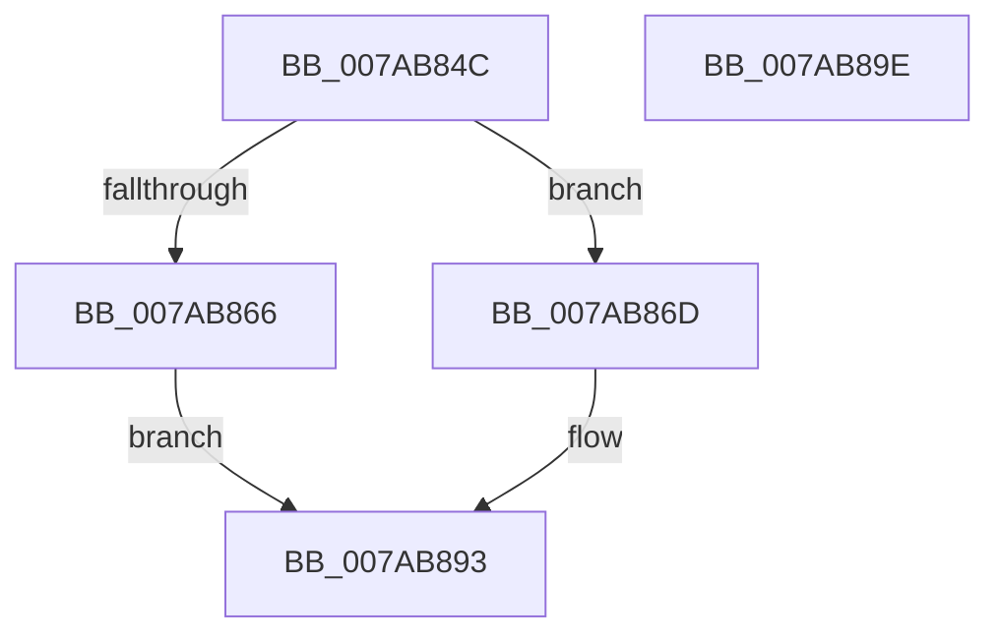

# SmcCacheDelete

- RVA: `0x007AB84C`–`0x007AB89F` (길이 `83` bytes)
- VA: `0x00000001407AB84C`
- 실행 섹션: `PAGE`
- PDB 이름 있음: `예`; PDB Function 태그: `아니요`
- unwind 정보 RVA: `0x0005CAAC`
- 디코드: `25`개 명령, `83/83` bytes 표시
- 미해석 바이트: `0` (있으면 어셈블리에 `.byte`로 보존)

> 이 문서는 커널 이미지의 기계어와 PDB 기호를 분석해 생성했습니다. 4번과 5번은 함수 원형과 자료형을 바이너리 사용 방식에서 추정한 C 해석이며 원본 소스 복구 결과는 아닙니다.

## 1. Dependencies

- 직접 호출 지점: **4**; 고유 호출 대상: **4**
- 직접 호출자로 확인된 함수: **3**
- RIP 상대 이미지 참조: **0**

### Outgoing calls
- `0x007AB859` → [SmcCacheRemove](SmcCacheRemove_function_007ABB68.md) (function, `0x007ABB68`)
- `0x007AB873` → [SmcCacheCleanup](SmcCacheCleanup_function_007AB7B4.md) (function, `0x007AB7B4`)
- `0x007AB87B` → [CmSiFreeMemory](../../text/47/CmSiFreeMemory_function_00475D80.md) (function, `0x00475D80`)
- `0x007AB88C` → [KeSetEvent](../../text/33/KeSetEvent_function_0033F310.md) (function, `0x0033F310`)

### Direct callers
- [SmcProcessCreateRequest](SmcProcessCreateRequest_function_007A764C.md) at `0x007A78C4`
- [SmcProcessDeleteRequest](SmcProcessDeleteRequest_function_007A7900.md) at `0x007A7967`
- [SmcVolumePnpNotification](SmcVolumePnpNotification_function_007ACB10.md) at `0x007ACBAD`

### Static image references
- 디코드된 RIP-relative 메모리 참조가 없습니다.

## 2. Other-region calls and transfers

- 다른 실행 섹션으로 향하는 call: **2**
  - `0x007AB87B` → [CmSiFreeMemory](../../text/47/CmSiFreeMemory_function_00475D80.md) (`PAGE` → `.text`)
  - `0x007AB88C` → [KeSetEvent](../../text/33/KeSetEvent_function_0033F310.md) (`PAGE` → `.text`)
- 별도 외부 분기/꼬리 이동을 확인하지 못했습니다.

## 3. Assembly (complete function range)

```asm
007AB84C  48 89 5C 24 08                  mov qword ptr [rsp + 8], rbx
007AB851  57                              push rdi
007AB852  48 83 EC 20                     sub rsp, 0x20
007AB856  48 8B D9                        mov rbx, rcx
007AB859  E8 0A 03 00 00                  call 0x1407abb68
007AB85E  48 8B F8                        mov rdi, rax
007AB861  48 85 C0                        test rax, rax
007AB864  75 07                           jne 0x1407ab86d
007AB866  B8 59 00 00 C0                  mov eax, 0xc0000059
007AB86B  EB 26                           jmp 0x1407ab893
007AB86D  48 8B D7                        mov rdx, rdi
007AB870  48 8B CB                        mov rcx, rbx
007AB873  E8 3C FF FF FF                  call 0x1407ab7b4
007AB878  48 8B CF                        mov rcx, rdi
007AB87B  E8 00 A5 CC FF                  call 0x140475d80
007AB880  48 8B 8B 28 02 00 00            mov rcx, qword ptr [rbx + 0x228]
007AB887  45 33 C0                        xor r8d, r8d
007AB88A  33 D2                           xor edx, edx
007AB88C  E8 7F 3A B9 FF                  call 0x14033f310
007AB891  33 C0                           xor eax, eax
007AB893  48 8B 5C 24 30                  mov rbx, qword ptr [rsp + 0x30]
007AB898  48 83 C4 20                     add rsp, 0x20
007AB89C  5F                              pop rdi
007AB89D  C3                              ret
007AB89E  CC                              int3
```

## 4. C-style interpretation (structured pseudocode)

```c
__int64 __fastcall SmcCacheDelete(__int64 a1, __int64 a2, int a3)
{
    __int64 result;
    __int64 v_rsp;
    unsigned __int64 v_stack_p8;

    v_stack_p8 = v_rbx;
    v_rsp = (v_rsp) - (32);
    result = SmcCacheRemove(a1, a2, a3, a4);
    if (result != 0) goto loc_007AB86D;
    goto loc_007AB893;
loc_007AB86D:
    result = SmcCacheCleanup(a1, result, a3, a4);
    result = CmSiFreeMemory(result, result, a3, a4);
    a3 = 0;
    a2 = 0;
    result = KeSetEvent(*(unsigned __int64 *)(a1 + 552), a2, a3, a4);
    result = 0;
loc_007AB893:
    v_rsp = (v_rsp) + (32);
    return result;
}
```

## 5. (Beta) C Style

```c
int64_t SmcCacheDelete(void *Arg1, int64_t Arg2, int32_t Arg3)
{
    uint8_t *arg1 = (uint8_t *)Arg1;

    int64_t result;
    int64_t local_rsp;
    uint64_t v_stack_p8;

    v_stack_p8 = local_rbx;
    local_rsp = (local_rsp) - (32);
    result = SmcCacheRemove(Arg1, Arg2, Arg3, a4);
    if (result != 0) goto loc_007AB86D;
    goto loc_007AB893;
loc_007AB86D:
    result = SmcCacheCleanup(Arg1, result, Arg3, a4);
    result = CmSiFreeMemory(result, result, Arg3, a4);
    Arg3 = 0;
    Arg2 = 0;
    result = KeSetEvent(*(uint64_t *)(arg1 + 0x228), Arg2, Arg3, a4);
    result = 0;
loc_007AB893:
    local_rsp = (local_rsp) + (32);
    return result;
}
```

### 관측된 메모리 오프셋

구조체 형식이 확인되지 않은 접근은 인자 기준의 오프셋으로만 기록했습니다.

| 기준 인자 | 오프셋 표현 | 폭 (bit) | 접근 |
|---|---:|---:|---|
| `Arg1` | `+ 0x228` | `64` | `R` |

## 6. Execution-region graph

[열기: 2D/3D 그래프와 함수 탐색 컨트롤 패널](../../../control-panel.html?section=page&rva=0x007AB84C&view=graph)

- 2D 그래프는 위에서 아래로 흐르고, 3D 그래프는 빈 공간을 드래그해 회전합니다. Shift+드래그는 이동, 휠은 확대·축소, 함수 노드 선택은 대상 보고서 이동입니다.

### Static fallback


