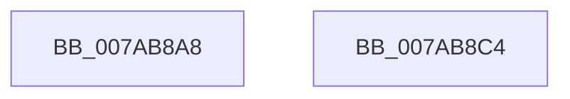

# SmcCacheDereference

- RVA: `0x007AB8A8`–`0x007AB8C5` (길이 `29` bytes)
- VA: `0x00000001407AB8A8`
- 실행 섹션: `PAGE`
- PDB 이름 있음: `예`; PDB Function 태그: `아니요`
- unwind 정보 RVA: `0x0005C788`
- 디코드: `9`개 명령, `29/29` bytes 표시
- 미해석 바이트: `0` (있으면 어셈블리에 `.byte`로 보존)

> 이 문서는 커널 이미지의 기계어와 PDB 기호를 분석해 생성했습니다. 4번과 5번은 함수 원형과 자료형을 바이너리 사용 방식에서 추정한 C 해석이며 원본 소스 복구 결과는 아닙니다.

## 1. Dependencies

- 직접 호출 지점: **1**; 고유 호출 대상: **1**
- 직접 호출자로 확인된 함수: **6**
- RIP 상대 이미지 참조: **0**

### Outgoing calls
- `0x007AB8BA` → [ExReleaseRundownProtection](../../text/34/ExReleaseRundownProtection_function_00349E80.md) (function, `0x00349E80`)

### Direct callers
- [SmcProcessCreateRequest](SmcProcessCreateRequest_function_007A764C.md) at `0x007A789B`
- [SmcGetCacheStats](SmcGetCacheStats_function_007ABE0C.md) at `0x007ABF86`
- [SmcStoreCreate](SmcStoreCreate_function_007ABFB4.md) at `0x007AC152`
- [SmcStoreDelete](SmcStoreDelete_function_007AC214.md) at `0x007AC38A`
- [SmcStoreResize](SmcStoreResize_function_007AC500.md) at `0x007AC7AD`
- [SmcVolumePnpNotification](SmcVolumePnpNotification_function_007ACB10.md) at `0x007ACB9E`

### Static image references
- 디코드된 RIP-relative 메모리 참조가 없습니다.

## 2. Other-region calls and transfers

- 다른 실행 섹션으로 향하는 call: **1**
  - `0x007AB8BA` → [ExReleaseRundownProtection](../../text/34/ExReleaseRundownProtection_function_00349E80.md) (`PAGE` → `.text`)
- 별도 외부 분기/꼬리 이동을 확인하지 못했습니다.

## 3. Assembly (complete function range)

```asm
007AB8A8  48 83 EC 28                     sub rsp, 0x28
007AB8AC  83 E2 0F                        and edx, 0xf
007AB8AF  48 83 C1 08                     add rcx, 8
007AB8B3  48 C1 E2 05                     shl rdx, 5
007AB8B7  48 03 CA                        add rcx, rdx
007AB8BA  E8 C1 E5 B9 FF                  call 0x140349e80
007AB8BF  48 83 C4 28                     add rsp, 0x28
007AB8C3  C3                              ret
007AB8C4  CC                              int3
```

## 4. C-style interpretation (structured pseudocode)

```c
__int64 __fastcall SmcCacheDereference(__int64 a1, int a2)
{
    __int64 result;
    __int64 v_rsp;

    v_rsp = (v_rsp) - (40);
    a2 = (unsigned int)((a2) & (15));
    a1 = (a1) + (8);
    a2 = (a2) << (5);
    a1 = (a1) + (a2);
    result = ExReleaseRundownProtection(a1, a2, a3, a4);
    v_rsp = (v_rsp) + (40);
    return result;
}
```

## 5. (Beta) C Style

```c
int64_t SmcCacheDereference(int64_t Arg1, int32_t Arg2)
{
    int64_t result;
    int64_t local_rsp;

    local_rsp = (local_rsp) - (40);
    Arg2 = (uint32_t)((Arg2) & (15));
    Arg1 = (Arg1) + (8);
    Arg2 = (Arg2) << (5);
    Arg1 = (Arg1) + (Arg2);
    result = ExReleaseRundownProtection(Arg1, Arg2, a3, a4);
    local_rsp = (local_rsp) + (40);
    return result;
}
```

## 6. Execution-region graph

[열기: 2D/3D 그래프와 함수 탐색 컨트롤 패널](../../../control-panel.html?section=page&rva=0x007AB8A8&view=graph)

- 2D 그래프는 위에서 아래로 흐르고, 3D 그래프는 빈 공간을 드래그해 회전합니다. Shift+드래그는 이동, 휠은 확대·축소, 함수 노드 선택은 대상 보고서 이동입니다.

### Static fallback


