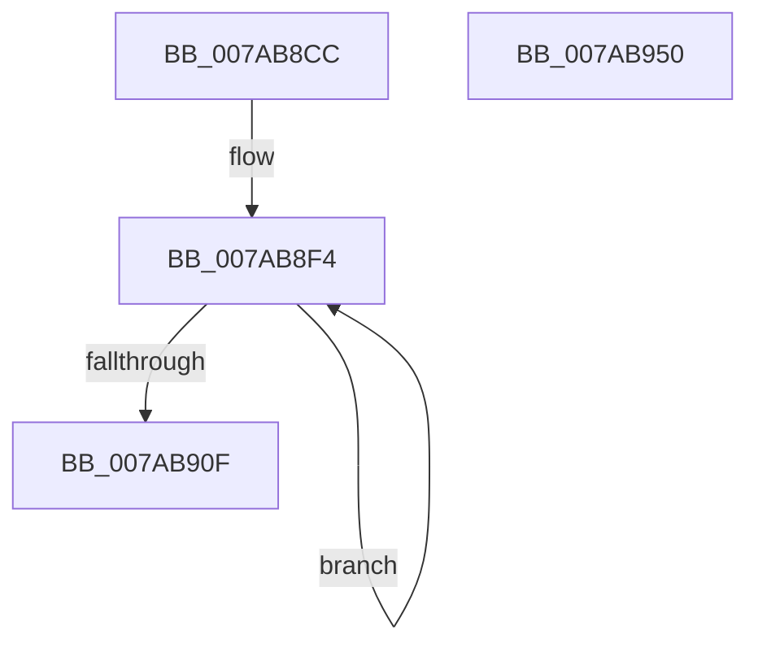

# SmcCacheManagerInitialize

- RVA: `0x007AB8CC`–`0x007AB951` (길이 `133` bytes)
- VA: `0x00000001407AB8CC`
- 실행 섹션: `PAGE`
- PDB 이름 있음: `예`; PDB Function 태그: `아니요`
- unwind 정보 RVA: `0x00060BC4`
- 디코드: `31`개 명령, `133/133` bytes 표시
- 미해석 바이트: `0` (있으면 어셈블리에 `.byte`로 보존)

> 이 문서는 커널 이미지의 기계어와 PDB 기호를 분석해 생성했습니다. 4번과 5번은 함수 원형과 자료형을 바이너리 사용 방식에서 추정한 C 해석이며 원본 소스 복구 결과는 아닙니다.

## 1. Dependencies

- 직접 호출 지점: **2**; 고유 호출 대상: **2**
- 직접 호출자로 확인된 함수: **1**
- RIP 상대 이미지 참조: **0**

### Outgoing calls
- `0x007AB8E6` → [memset](../../text/6C/memset_function_006C6C40.md) (function, `0x006C6C40`)
- `0x007AB8FB` → [ExWaitForRundownProtectionRelease](../../text/2A/ExWaitForRundownProtectionRelease_function_002A4CB0.md) (function, `0x002A4CB0`)

### Direct callers
- [SmPartitionInitialize](SmPartitionInitialize_function_007A5D04.md) at `0x007A5DCA`

### Static image references
- 디코드된 RIP-relative 메모리 참조가 없습니다.

## 2. Other-region calls and transfers

- 다른 실행 섹션으로 향하는 call: **2**
  - `0x007AB8E6` → [memset](../../text/6C/memset_function_006C6C40.md) (`PAGE` → `.text`)
  - `0x007AB8FB` → [ExWaitForRundownProtectionRelease](../../text/2A/ExWaitForRundownProtectionRelease_function_002A4CB0.md) (`PAGE` → `.text`)
- 별도 외부 분기/꼬리 이동을 확인하지 못했습니다.

## 3. Assembly (complete function range)

```asm
007AB8CC  48 89 5C 24 08                  mov qword ptr [rsp + 8], rbx
007AB8D1  48 89 74 24 10                  mov qword ptr [rsp + 0x10], rsi
007AB8D6  57                              push rdi
007AB8D7  48 83 EC 20                     sub rsp, 0x20
007AB8DB  33 D2                           xor edx, edx
007AB8DD  41 B8 30 02 00 00               mov r8d, 0x230
007AB8E3  48 8B D9                        mov rbx, rcx
007AB8E6  E8 55 B3 F1 FF                  call 0x1406c6c40
007AB8EB  48 8D 7B 08                     lea rdi, [rbx + 8]
007AB8EF  BE 10 00 00 00                  mov esi, 0x10
007AB8F4  48 83 27 00                     and qword ptr [rdi], 0
007AB8F8  48 8B CF                        mov rcx, rdi
007AB8FB  E8 B0 93 AF FF                  call 0x1402a4cb0
007AB900  48 83 67 08 00                  and qword ptr [rdi + 8], 0
007AB905  48 83 C7 20                     add rdi, 0x20
007AB909  48 83 EE 01                     sub rsi, 1
007AB90D  75 E5                           jne 0x1407ab8f4
007AB90F  48 21 B3 08 02 00 00            and qword ptr [rbx + 0x208], rsi
007AB916  48 8D 83 08 02 00 00            lea rax, [rbx + 0x208]
007AB91D  48 21 B3 10 02 00 00            and qword ptr [rbx + 0x210], rsi
007AB924  48 21 B3 18 02 00 00            and qword ptr [rbx + 0x218], rsi
007AB92B  48 21 B3 20 02 00 00            and qword ptr [rbx + 0x220], rsi
007AB932  48 21 B3 00 02 00 00            and qword ptr [rbx + 0x200], rsi
007AB939  48 8B 5C 24 30                  mov rbx, qword ptr [rsp + 0x30]
007AB93E  48 8B 74 24 38                  mov rsi, qword ptr [rsp + 0x38]
007AB943  48 89 40 08                     mov qword ptr [rax + 8], rax
007AB947  48 89 00                        mov qword ptr [rax], rax
007AB94A  48 83 C4 20                     add rsp, 0x20
007AB94E  5F                              pop rdi
007AB94F  C3                              ret
007AB950  CC                              int3
```

## 4. C-style interpretation (structured pseudocode)

```c
__int64 __fastcall SmcCacheManagerInitialize(__int64 a1, int a2)
{
    __int64 result;
    __int64 v_rdi;
    __int64 v_rsi;
    __int64 v_rsp;
    unsigned __int64 v_stack_p10;
    unsigned __int64 v_stack_p8;

    v_stack_p8 = v_rbx;
    v_stack_p10 = v_rsi;
    v_rsp = (v_rsp) - (32);
    a2 = 0;
    result = memset(a1, a2, 560, a4);
loc_007AB8F4:
    result = ExWaitForRundownProtectionRelease(a1 + 8, a2, 560, a4);
    v_rdi = (a1 + 8) + (32);
    v_rsi = (16) - (1);
    if (condition_is_not_equal) goto loc_007AB8F4;
    *(unsigned __int64 *)(a1 + 520 + 8) = a1 + 520;
    *(unsigned __int64 *)(a1 + 520) = a1 + 520;
    v_rsp = (v_rsp) + (32);
    return a1 + 520;
}
```

## 5. (Beta) C Style

```c
void *SmcCacheManagerInitialize(void *Arg1, int32_t Arg2)
{
    uint8_t *arg1 = (uint8_t *)Arg1;

    int64_t result;
    int64_t local_rdi;
    int64_t local_rsi;
    int64_t local_rsp;
    uint64_t v_stack_p10;
    uint64_t v_stack_p8;

    v_stack_p8 = local_rbx;
    v_stack_p10 = local_rsi;
    local_rsp = (local_rsp) - (32);
    Arg2 = 0;
    result = memset(Arg1, Arg2, 560, a4);
loc_007AB8F4:
    result = ExWaitForRundownProtectionRelease(Arg1 + 8, Arg2, 560, a4);
    local_rdi = (Arg1 + 8) + (32);
    local_rsi = (16) - (1);
    if (condition_is_not_equal) goto loc_007AB8F4;
    *(void **)(arg1 + 0x208 + 0x8) = Arg1 + 520;
    *(void **)(arg1 + 0x208) = Arg1 + 520;
    local_rsp = (local_rsp) + (32);
    return Arg1 + 520;
}
```

### 관측된 메모리 오프셋

구조체 형식이 확인되지 않은 접근은 인자 기준의 오프셋으로만 기록했습니다.

| 기준 인자 | 오프셋 표현 | 폭 (bit) | 접근 |
|---|---:|---:|---|
| `Arg1` | `+ 0x0` | `64` | `R/W` |
| `Arg1` | `+ 0x0` | `64` | `W` |
| `Arg1` | `+ 0x8` | `64` | `R` |
| `Arg1` | `+ 0x8` | `64` | `R/W` |
| `Arg1` | `+ 0x8` | `64` | `W` |
| `Arg1` | `+ 0x200` | `64` | `R/W` |
| `Arg1` | `+ 0x208` | `64` | `R` |
| `Arg1` | `+ 0x208` | `64` | `R/W` |
| `Arg1` | `+ 0x210` | `64` | `R/W` |
| `Arg1` | `+ 0x218` | `64` | `R/W` |
| `Arg1` | `+ 0x220` | `64` | `R/W` |

## 6. Execution-region graph

[열기: 2D/3D 그래프와 함수 탐색 컨트롤 패널](../../../control-panel.html?section=page&rva=0x007AB8CC&view=graph)

- 2D 그래프는 위에서 아래로 흐르고, 3D 그래프는 빈 공간을 드래그해 회전합니다. Shift+드래그는 이동, 휠은 확대·축소, 함수 노드 선택은 대상 보고서 이동입니다.

### Static fallback


