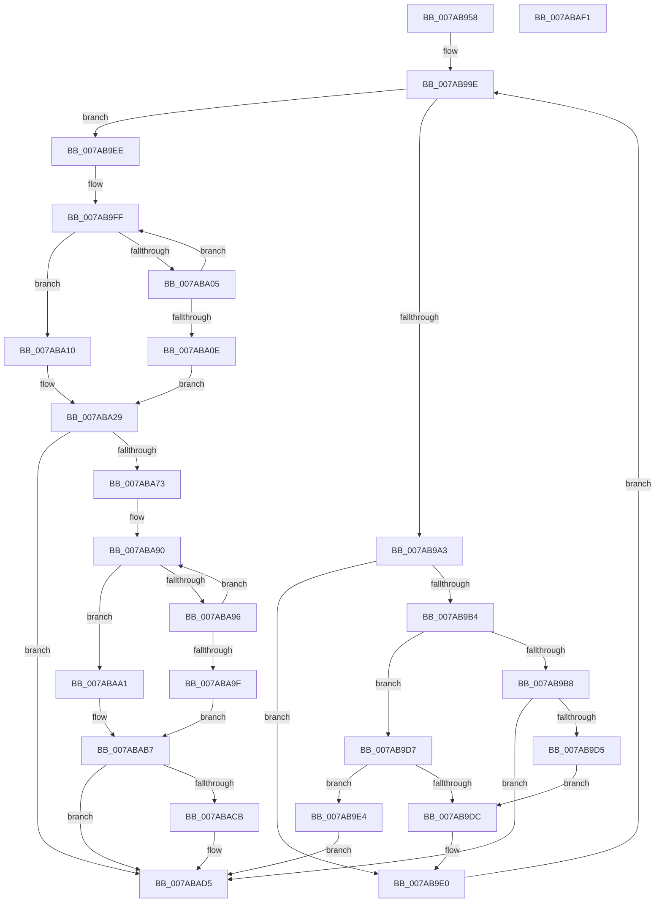

# SmcCacheManagerStart

- RVA: `0x007AB958`–`0x007ABAF2` (길이 `410` bytes)
- VA: `0x00000001407AB958`
- 실행 섹션: `PAGE`
- PDB 이름 있음: `예`; PDB Function 태그: `아니요`
- unwind 정보 RVA: `0x000D2104`
- 디코드: `117`개 명령, `410/410` bytes 표시
- 미해석 바이트: `0` (있으면 어셈블리에 `.byte`로 보존)

> 이 문서는 커널 이미지의 기계어와 PDB 기호를 분석해 생성했습니다. 4번과 5번은 함수 원형과 자료형을 바이너리 사용 방식에서 추정한 C 해석이며 원본 소스 복구 결과는 아닙니다.

## 1. Dependencies

- 직접 호출 지점: **4**; 고유 호출 대상: **4**
- 직접 호출자로 확인된 함수: **1**
- RIP 상대 이미지 참조: **2**

### Outgoing calls
- `0x007AB9C8` → [SmpUtilsGetControlDevice](SmpUtilsGetControlDevice_function_007ACBE0.md) (function, `0x007ACBE0`)
- `0x007ABA6A` → [ZwCreateKey](../../text/6A/ZwCreateKey_function_006AD470.md) (function, `0x006AD470`)
- `0x007ABA77` → [ZwClose](../../text/6A/ZwClose_function_006AD2B0.md) (function, `0x006AD2B0`)
- `0x007ABAC2` → [SmKmKeyGenStart](SmKmKeyGenStart_function_007A8BA0.md) (function, `0x007A8BA0`)

### Direct callers
- [SmcCacheCreatePrepare](SmcCacheCreatePrepare_function_007A754C.md) at `0x007A75F1`

### Static image references
- `0x007AB9F3` → RVA `0x00B06410` (` ?? ::NNGAKEGL::`string'`; read)
- `0x007ABA7F` → RVA `0x00B065B0` (` ?? ::NNGAKEGL::`string'`; read)

## 2. Other-region calls and transfers

- 다른 실행 섹션으로 향하는 call: **2**
  - `0x007ABA6A` → [ZwCreateKey](../../text/6A/ZwCreateKey_function_006AD470.md) (`PAGE` → `.text`)
  - `0x007ABA77` → [ZwClose](../../text/6A/ZwClose_function_006AD2B0.md) (`PAGE` → `.text`)
- 별도 외부 분기/꼬리 이동을 확인하지 못했습니다.

## 3. Assembly (complete function range)

```asm
007AB958  48 89 5C 24 10                  mov qword ptr [rsp + 0x10], rbx
007AB95D  48 89 74 24 18                  mov qword ptr [rsp + 0x18], rsi
007AB962  55                              push rbp
007AB963  57                              push rdi
007AB964  41 54                           push r12
007AB966  41 56                           push r14
007AB968  41 57                           push r15
007AB96A  48 8B EC                        mov rbp, rsp
007AB96D  48 81 EC 80 00 00 00            sub rsp, 0x80
007AB974  45 33 FF                        xor r15d, r15d
007AB977  0F 57 C9                        xorps xmm1, xmm1
007AB97A  0F 57 C0                        xorps xmm0, xmm0
007AB97D  4C 89 7D 30                     mov qword ptr [rbp + 0x30], r15
007AB981  4C 8B F2                        mov r14, rdx
007AB984  48 8B F9                        mov rdi, rcx
007AB987  0F 11 45 C0                     movups xmmword ptr [rbp - 0x40], xmm0
007AB98B  45 8D 67 02                     lea r12d, [r15 + 2]
007AB98F  41 8B DF                        mov ebx, r15d
007AB992  0F 11 4D D0                     movups xmmword ptr [rbp - 0x30], xmm1
007AB996  0F 11 4D E0                     movups xmmword ptr [rbp - 0x20], xmm1
007AB99A  0F 11 4D F0                     movups xmmword ptr [rbp - 0x10], xmm1
007AB99E  41 3B DC                        cmp ebx, r12d
007AB9A1  73 4B                           jae 0x1407ab9ee
007AB9A3  8B C3                           mov eax, ebx
007AB9A5  48 83 E8 0A                     sub rax, 0xa
007AB9A9  48 8D 34 40                     lea rsi, [rax + rax*2]
007AB9AD  8B 04 F7                        mov eax, dword ptr [rdi + rsi*8]
007AB9B0  A8 01                           test al, 1
007AB9B2  75 2C                           jne 0x1407ab9e0
007AB9B4  85 DB                           test ebx, ebx
007AB9B6  75 1F                           jne 0x1407ab9d7
007AB9B8  4C 8D 47 10                     lea r8, [rdi + 0x10]
007AB9BC  48 8D 57 08                     lea rdx, [rdi + 8]
007AB9C0  4D 8D 04 F0                     lea r8, [r8 + rsi*8]
007AB9C4  48 8D 14 F2                     lea rdx, [rdx + rsi*8]
007AB9C8  E8 13 12 00 00                  call 0x1407acbe0
007AB9CD  85 C0                           test eax, eax
007AB9CF  0F 88 00 01 00 00               js 0x1407abad5
007AB9D5  EB 05                           jmp 0x1407ab9dc
007AB9D7  83 FB 01                        cmp ebx, 1
007AB9DA  75 08                           jne 0x1407ab9e4
007AB9DC  83 0C F7 01                     or dword ptr [rdi + rsi*8], 1
007AB9E0  FF C3                           inc ebx
007AB9E2  EB BA                           jmp 0x1407ab99e
007AB9E4  B8 0D 00 00 C0                  mov eax, 0xc000000d
007AB9E9  E9 E7 00 00 00                  jmp 0x1407abad5
007AB9EE  BB FF 7F 00 00                  mov ebx, 0x7fff
007AB9F3  48 8D 15 16 AA 35 00            lea rdx, [rip + 0x35aa16]
007AB9FA  8B CB                           mov ecx, ebx
007AB9FC  48 8B C2                        mov rax, rdx
007AB9FF  66 44 39 38                     cmp word ptr [rax], r15w
007ABA03  74 0B                           je 0x1407aba10
007ABA05  49 03 C4                        add rax, r12
007ABA08  48 83 E9 01                     sub rcx, 1
007ABA0C  75 F1                           jne 0x1407ab9ff
007ABA0E  EB 19                           jmp 0x1407aba29
007ABA10  48 8B C3                        mov rax, rbx
007ABA13  48 89 55 C8                     mov qword ptr [rbp - 0x38], rdx
007ABA17  48 2B C1                        sub rax, rcx
007ABA1A  66 03 C0                        add ax, ax
007ABA1D  66 89 45 C0                     mov word ptr [rbp - 0x40], ax
007ABA21  66 41 03 C4                     add ax, r12w
007ABA25  66 89 45 C2                     mov word ptr [rbp - 0x3e], ax
007ABA29  48 8D 45 C0                     lea rax, [rbp - 0x40]
007ABA2D  4C 89 7C 24 30                  mov qword ptr [rsp + 0x30], r15
007ABA32  0F 57 C0                        xorps xmm0, xmm0
007ABA35  44 89 7C 24 28                  mov dword ptr [rsp + 0x28], r15d
007ABA3A  45 33 C9                        xor r9d, r9d
007ABA3D  48 89 45 E0                     mov qword ptr [rbp - 0x20], rax
007ABA41  4C 8D 45 D0                     lea r8, [rbp - 0x30]
007ABA45  4C 89 7C 24 20                  mov qword ptr [rsp + 0x20], r15
007ABA4A  BA 06 00 02 00                  mov edx, 0x20006
007ABA4F  C7 45 D0 30 00 00 00            mov dword ptr [rbp - 0x30], 0x30
007ABA56  48 8D 4D 30                     lea rcx, [rbp + 0x30]
007ABA5A  4C 89 7D D8                     mov qword ptr [rbp - 0x28], r15
007ABA5E  F3 0F 7F 45 F0                  movdqu xmmword ptr [rbp - 0x10], xmm0
007ABA63  C7 45 E8 40 02 00 00            mov dword ptr [rbp - 0x18], 0x240
007ABA6A  E8 01 1A F0 FF                  call 0x1406ad470
007ABA6F  85 C0                           test eax, eax
007ABA71  78 62                           js 0x1407abad5
007ABA73  48 8B 4D 30                     mov rcx, qword ptr [rbp + 0x30]
007ABA77  E8 34 18 F0 FF                  call 0x1406ad2b0
007ABA7C  0F 57 C0                        xorps xmm0, xmm0
007ABA7F  48 8D 15 2A AB 35 00            lea rdx, [rip + 0x35ab2a]
007ABA86  0F 11 45 C0                     movups xmmword ptr [rbp - 0x40], xmm0
007ABA8A  48 8B C2                        mov rax, rdx
007ABA8D  48 8B CB                        mov rcx, rbx
007ABA90  66 44 39 38                     cmp word ptr [rax], r15w
007ABA94  74 0B                           je 0x1407abaa1
007ABA96  49 03 C4                        add rax, r12
007ABA99  48 83 E9 01                     sub rcx, 1
007ABA9D  75 F1                           jne 0x1407aba90
007ABA9F  EB 16                           jmp 0x1407abab7
007ABAA1  48 2B D9                        sub rbx, rcx
007ABAA4  48 89 55 C8                     mov qword ptr [rbp - 0x38], rdx
007ABAA8  66 03 DB                        add bx, bx
007ABAAB  66 89 5D C0                     mov word ptr [rbp - 0x40], bx
007ABAAF  66 41 03 DC                     add bx, r12w
007ABAB3  66 89 5D C2                     mov word ptr [rbp - 0x3e], bx
007ABAB7  48 8D 8F 00 02 00 00            lea rcx, [rdi + 0x200]
007ABABE  48 8D 55 C0                     lea rdx, [rbp - 0x40]
007ABAC2  E8 D9 D0 FF FF                  call 0x1407a8ba0
007ABAC7  85 C0                           test eax, eax
007ABAC9  78 0A                           js 0x1407abad5
007ABACB  4C 89 B7 28 02 00 00            mov qword ptr [rdi + 0x228], r14
007ABAD2  41 8B C7                        mov eax, r15d
007ABAD5  4C 8D 9C 24 80 00 00 00         lea r11, [rsp + 0x80]
007ABADD  49 8B 5B 38                     mov rbx, qword ptr [r11 + 0x38]
007ABAE1  49 8B 73 40                     mov rsi, qword ptr [r11 + 0x40]
007ABAE5  49 8B E3                        mov rsp, r11
007ABAE8  41 5F                           pop r15
007ABAEA  41 5E                           pop r14
007ABAEC  41 5C                           pop r12
007ABAEE  5F                              pop rdi
007ABAEF  5D                              pop rbp
007ABAF0  C3                              ret
007ABAF1  CC                              int3
```

## 4. C-style interpretation (structured pseudocode)

```c
__int64 __fastcall SmcCacheManagerStart(__int64 a1, __int64 a2, __int64 a3, int a4)
{
    __int64 result;
    __int64 v_r15;
    __int64 v_rbx;
    __int64 v_rsp;
    unsigned __int64 v_stack_m28;
    unsigned __int64 v_stack_m38;
    unsigned int v_stack_m40;
    unsigned __int64 v_stack_m48;
    unsigned __int64 v_stack_m50;
    unsigned __int64 v_stack_m58;
    unsigned __int64 v_stack_m60;
    unsigned __int16 v_stack_m66;
    unsigned __int64 v_stack_m68;
    unsigned __int64 v_stack_m78;
    unsigned int v_stack_m80;
    unsigned __int64 v_stack_m88;
    unsigned __int64 v_stack_p10;
    unsigned __int64 v_stack_p18;
    unsigned __int64 v_stack_p8;

    v_stack_p10 = v_rbx;
    v_stack_p18 = v_rsi;
    v_rsp = (v_rsp) - (128);
    v_r15 = 0;
    v_stack_p8 = 0;
    v_stack_m68 = v_xmm0;
    v_stack_m58 = v_xmm1;
    v_stack_m48 = v_xmm1;
    v_stack_m38 = v_xmm1;
loc_007AB99E:
    if (0 >= ((unsigned int)(v_r15 + 2))) goto loc_007AB9EE;
    result = (0) - (10);
    if ((((unsigned __int8)((unsigned int)(*(unsigned int *)(a1 + result + result * 2 * 8)))) & (1)) != 0) goto loc_007AB9E0;
    if (0 != 0) goto loc_007AB9D7;
    result = SmpUtilsGetControlDevice(a1, a1 + 8 + result + result * 2 * 8, a1 + 16 + result + result * 2 * 8, a4);
    if (sign_flag) goto loc_007ABAD5;
    goto loc_007AB9DC;
loc_007AB9D7:
    if (0 != 1) goto loc_007AB9E4;
loc_007AB9DC:
loc_007AB9E0:
    v_rbx = (unsigned int)((0) + 1);
    goto loc_007AB99E;
loc_007AB9E4:
    goto loc_007ABAD5;
loc_007AB9EE:
loc_007AB9FF:
    if ((*(unsigned __int16 *)(v_rip + 3516950)) == 0) goto loc_007ABA10;
    result = (v_rip + 3516950) + (v_r15 + 2);
    a1 = ((unsigned int)((unsigned int)((unsigned int)(0x7FFFULL)))) - (1);
    if (condition_is_not_equal) goto loc_007AB9FF;
    goto loc_007ABA29;
loc_007ABA10:
    v_stack_m60 = v_rip + 3516950;
    result = ((unsigned int)(0x7FFFULL)) - (a1);
    result = (unsigned __int16)((result) + ((unsigned __int16)(result)));
    v_stack_m68 = (unsigned __int16)(result);
    result = (unsigned __int16)((result) + ((unsigned __int16)(v_r15 + 2)));
    v_stack_m66 = (unsigned __int16)(result);
loc_007ABA29:
    v_stack_m78 = 0;
    v_stack_m80 = 0;
    a4 = 0;
    v_stack_m48 = v_stack_m68;
    v_stack_m88 = 0;
    v_stack_m58 = 48;
    v_stack_m50 = 0;
    v_stack_m38 = v_xmm0;
    v_stack_m40 = 576;
    result = ZwCreateKey(v_stack_p8, (unsigned int)(0x20006ULL), v_stack_m58, a4);
    if (sign_flag) goto loc_007ABAD5;
    result = ZwClose(v_stack_p8, (unsigned int)(0x20006ULL), v_stack_m58, a4);
    v_stack_m68 = v_xmm0;
loc_007ABA90:
    if ((*(unsigned __int16 *)(v_rip + 3517226)) == 0) goto loc_007ABAA1;
    result = (v_rip + 3517226) + (v_r15 + 2);
    a1 = ((unsigned int)(0x7FFFULL)) - (1);
    if (condition_is_not_equal) goto loc_007ABA90;
    goto loc_007ABAB7;
loc_007ABAA1:
    v_rbx = ((unsigned int)(0x7FFFULL)) - (a1);
    v_stack_m60 = v_rip + 3517226;
    v_rbx = (unsigned __int16)((v_rbx) + ((unsigned __int16)(v_rbx)));
    v_stack_m68 = (unsigned __int16)(v_rbx);
    v_rbx = (unsigned __int16)((v_rbx) + ((unsigned __int16)(v_r15 + 2)));
    v_stack_m66 = (unsigned __int16)(v_rbx);
loc_007ABAB7:
    result = SmKmKeyGenStart(a1 + 512, v_stack_m68, v_stack_m58, a4);
    if (!(sign_flag)) {
        *(unsigned __int64 *)(a1 + 552) = a2;
        result = 0;
    }
    return result;
}
```

## 5. (Beta) C Style

```c
int64_t SmcCacheManagerStart(void *Arg1, int64_t Arg2, int64_t Arg3, int32_t Arg4)
{
    uint8_t *arg1 = (uint8_t *)Arg1;

    int64_t result;
    int64_t local_r15;
    int64_t local_rbx;
    int64_t local_rsp;
    uint64_t v_stack_m28;
    uint64_t v_stack_m38;
    uint32_t v_stack_m40;
    uint64_t v_stack_m48;
    uint64_t v_stack_m50;
    uint64_t v_stack_m58;
    uint64_t v_stack_m60;
    uint16_t v_stack_m66;
    uint64_t v_stack_m68;
    uint64_t v_stack_m78;
    uint32_t v_stack_m80;
    uint64_t v_stack_m88;
    uint64_t v_stack_p10;
    uint64_t v_stack_p18;
    uint64_t v_stack_p8;

    v_stack_p10 = local_rbx;
    v_stack_p18 = local_rsi;
    local_rsp = (local_rsp) - (128);
    local_r15 = 0;
    v_stack_p8 = 0;
    v_stack_m68 = v_xmm0;
    v_stack_m58 = v_xmm1;
    v_stack_m48 = v_xmm1;
    v_stack_m38 = v_xmm1;
loc_007AB99E:
    if (0 >= ((uint32_t)(local_r15 + 2))) goto loc_007AB9EE;
    result = (0) - (10);
    if ((((uint8_t)((uint32_t)(*(uint32_t *)(arg1 + result + result * 2 * 8)))) & (1)) != 0) goto loc_007AB9E0;
    if (0 != 0) goto loc_007AB9D7;
    result = SmpUtilsGetControlDevice(Arg1, Arg1 + 8 + result + result * 2 * 8, Arg1 + 16 + result + result * 2 * 8, Arg4);
    if (sign_flag) goto loc_007ABAD5;
    goto loc_007AB9DC;
loc_007AB9D7:
    if (0 != 1) goto loc_007AB9E4;
loc_007AB9DC:
loc_007AB9E0:
    local_rbx = (uint32_t)((0) + 1);
    goto loc_007AB99E;
loc_007AB9E4:
    goto loc_007ABAD5;
loc_007AB9EE:
loc_007AB9FF:
    if ((*(uint16_t *)(v_rip + 0x35AA16)) == 0) goto loc_007ABA10;
    result = (v_rip + 3516950) + (local_r15 + 2);
    Arg1 = ((uint32_t)((uint32_t)((uint32_t)(0x7FFFULL)))) - (1);
    if (condition_is_not_equal) goto loc_007AB9FF;
    goto loc_007ABA29;
loc_007ABA10:
    v_stack_m60 = v_rip + 3516950;
    result = ((uint32_t)(0x7FFFULL)) - (Arg1);
    result = (uint16_t)((result) + ((uint16_t)(result)));
    v_stack_m68 = (uint16_t)(result);
    result = (uint16_t)((result) + ((uint16_t)(local_r15 + 2)));
    v_stack_m66 = (uint16_t)(result);
loc_007ABA29:
    v_stack_m78 = 0;
    v_stack_m80 = 0;
    Arg4 = 0;
    v_stack_m48 = v_stack_m68;
    v_stack_m88 = 0;
    v_stack_m58 = 48;
    v_stack_m50 = 0;
    v_stack_m38 = v_xmm0;
    v_stack_m40 = 576;
    result = ZwCreateKey(v_stack_p8, (uint32_t)(0x20006ULL), v_stack_m58, Arg4);
    if (sign_flag) goto loc_007ABAD5;
    result = ZwClose(v_stack_p8, (uint32_t)(0x20006ULL), v_stack_m58, Arg4);
    v_stack_m68 = v_xmm0;
loc_007ABA90:
    if ((*(uint16_t *)(v_rip + 0x35AB2A)) == 0) goto loc_007ABAA1;
    result = (v_rip + 3517226) + (local_r15 + 2);
    Arg1 = ((uint32_t)(0x7FFFULL)) - (1);
    if (condition_is_not_equal) goto loc_007ABA90;
    goto loc_007ABAB7;
loc_007ABAA1:
    local_rbx = ((uint32_t)(0x7FFFULL)) - (Arg1);
    v_stack_m60 = v_rip + 3517226;
    local_rbx = (uint16_t)((local_rbx) + ((uint16_t)(local_rbx)));
    v_stack_m68 = (uint16_t)(local_rbx);
    local_rbx = (uint16_t)((local_rbx) + ((uint16_t)(local_r15 + 2)));
    v_stack_m66 = (uint16_t)(local_rbx);
loc_007ABAB7:
    result = SmKmKeyGenStart(Arg1 + 512, v_stack_m68, v_stack_m58, Arg4);
    if (!(sign_flag)) {
        *(uint64_t *)(arg1 + 0x228) = Arg2;
        result = 0;
    }
    return result;
}
```

### 관측된 메모리 오프셋

구조체 형식이 확인되지 않은 접근은 인자 기준의 오프셋으로만 기록했습니다.

| 기준 인자 | 오프셋 표현 | 폭 (bit) | 접근 |
|---|---:|---:|---|
| `Arg1` | `+ 0x0 + rsi*8` | `32` | `R` |
| `Arg1` | `+ 0x0 + rsi*8` | `32` | `R/W` |
| `Arg1` | `+ 0x0 + rsi*8` | `64` | `R` |
| `Arg1` | `+ 0x8` | `64` | `R` |
| `Arg1` | `+ 0x10` | `64` | `R` |
| `Arg1` | `+ 0x200` | `64` | `R` |
| `Arg1` | `+ 0x228` | `64` | `W` |

## 6. Execution-region graph

[열기: 2D/3D 그래프와 함수 탐색 컨트롤 패널](../../../control-panel.html?section=page&rva=0x007AB958&view=graph)

- 2D 그래프는 위에서 아래로 흐르고, 3D 그래프는 빈 공간을 드래그해 회전합니다. Shift+드래그는 이동, 휠은 확대·축소, 함수 노드 선택은 대상 보고서 이동입니다.

### Static fallback


