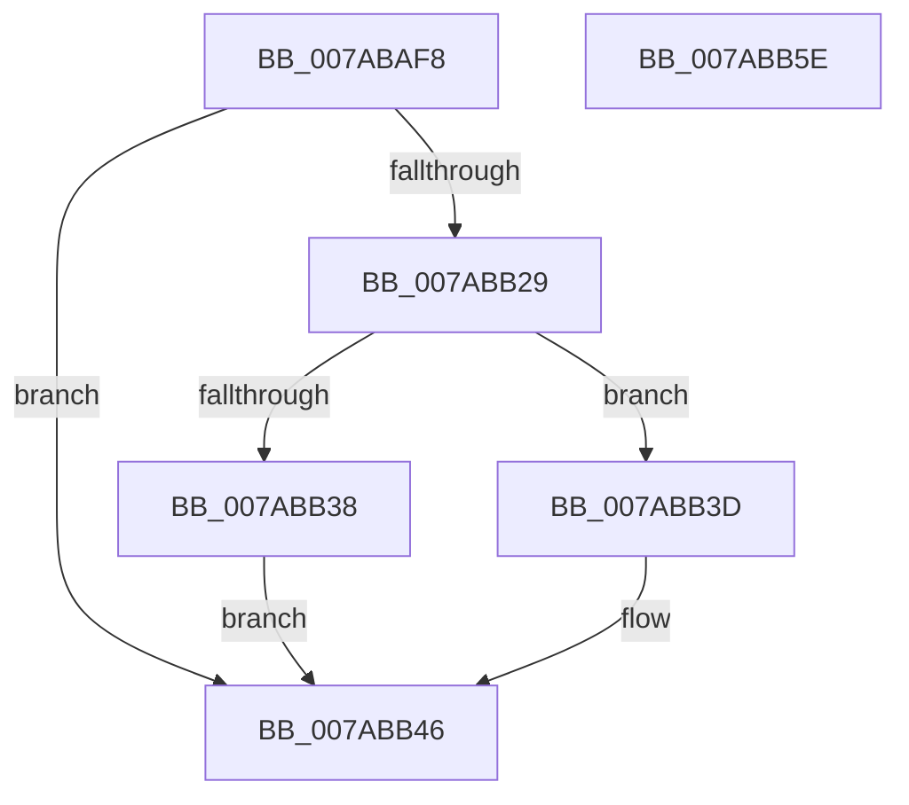

# SmcCacheReference

- RVA: `0x007ABAF8`–`0x007ABB5F` (길이 `103` bytes)
- VA: `0x00000001407ABAF8`
- 실행 섹션: `PAGE`
- PDB 이름 있음: `예`; PDB Function 태그: `아니요`
- unwind 정보 RVA: `0x0005C954`
- 디코드: `32`개 명령, `103/103` bytes 표시
- 미해석 바이트: `0` (있으면 어셈블리에 `.byte`로 보존)

> 이 문서는 커널 이미지의 기계어와 PDB 기호를 분석해 생성했습니다. 4번과 5번은 함수 원형과 자료형을 바이너리 사용 방식에서 추정한 C 해석이며 원본 소스 복구 결과는 아닙니다.

## 1. Dependencies

- 직접 호출 지점: **2**; 고유 호출 대상: **2**
- 직접 호출자로 확인된 함수: **5**
- RIP 상대 이미지 참조: **0**

### Outgoing calls
- `0x007ABB20` → [ExAcquireRundownProtection](../../text/21/ExAcquireRundownProtection_function_00216620.md) (function, `0x00216620`)
- `0x007ABB41` → [ExReleaseRundownProtection](../../text/34/ExReleaseRundownProtection_function_00349E80.md) (function, `0x00349E80`)

### Direct callers
- [SmcGetCacheStats](SmcGetCacheStats_function_007ABE0C.md) at `0x007ABE46`
- [SmcStoreCreate](SmcStoreCreate_function_007ABFB4.md) at `0x007AC019`
- [SmcStoreDelete](SmcStoreDelete_function_007AC214.md) at `0x007AC23F`
- [SmcStoreResize](SmcStoreResize_function_007AC500.md) at `0x007AC546`
- [SmcVolumePnpNotification](SmcVolumePnpNotification_function_007ACB10.md) at `0x007ACB81`

### Static image references
- 디코드된 RIP-relative 메모리 참조가 없습니다.

## 2. Other-region calls and transfers

- 다른 실행 섹션으로 향하는 call: **2**
  - `0x007ABB20` → [ExAcquireRundownProtection](../../text/21/ExAcquireRundownProtection_function_00216620.md) (`PAGE` → `.text`)
  - `0x007ABB41` → [ExReleaseRundownProtection](../../text/34/ExReleaseRundownProtection_function_00349E80.md) (`PAGE` → `.text`)
- 별도 외부 분기/꼬리 이동을 확인하지 못했습니다.

## 3. Assembly (complete function range)

```asm
007ABAF8  48 89 5C 24 08                  mov qword ptr [rsp + 8], rbx
007ABAFD  48 89 6C 24 10                  mov qword ptr [rsp + 0x10], rbp
007ABB02  48 89 74 24 18                  mov qword ptr [rsp + 0x18], rsi
007ABB07  57                              push rdi
007ABB08  48 83 EC 20                     sub rsp, 0x20
007ABB0C  8B FA                           mov edi, edx
007ABB0E  8B F2                           mov esi, edx
007ABB10  83 E7 0F                        and edi, 0xf
007ABB13  33 DB                           xor ebx, ebx
007ABB15  48 C1 E7 05                     shl rdi, 5
007ABB19  48 03 F9                        add rdi, rcx
007ABB1C  48 8D 4F 08                     lea rcx, [rdi + 8]
007ABB20  E8 FB AA A6 FF                  call 0x140216620
007ABB25  84 C0                           test al, al
007ABB27  74 1D                           je 0x1407abb46
007ABB29  8B 47 18                        mov eax, dword ptr [rdi + 0x18]
007ABB2C  25 FF 0F 00 00                  and eax, 0xfff
007ABB31  C1 EE 04                        shr esi, 4
007ABB34  3B C6                           cmp eax, esi
007ABB36  75 05                           jne 0x1407abb3d
007ABB38  48 8B 1F                        mov rbx, qword ptr [rdi]
007ABB3B  EB 09                           jmp 0x1407abb46
007ABB3D  48 8D 4F 08                     lea rcx, [rdi + 8]
007ABB41  E8 3A E3 B9 FF                  call 0x140349e80
007ABB46  48 8B 6C 24 38                  mov rbp, qword ptr [rsp + 0x38]
007ABB4B  48 8B C3                        mov rax, rbx
007ABB4E  48 8B 5C 24 30                  mov rbx, qword ptr [rsp + 0x30]
007ABB53  48 8B 74 24 40                  mov rsi, qword ptr [rsp + 0x40]
007ABB58  48 83 C4 20                     add rsp, 0x20
007ABB5C  5F                              pop rdi
007ABB5D  C3                              ret
007ABB5E  CC                              int3
```

## 4. C-style interpretation (structured pseudocode)

```c
__int64 __fastcall SmcCacheReference(__int64 a1, int a2)
{
    __int64 result;
    __int64 v_rbx;
    __int64 v_rdi;
    __int64 v_rsi;
    __int64 v_rsp;
    unsigned __int64 v_stack_p10;
    unsigned __int64 v_stack_p18;
    unsigned __int64 v_stack_p8;

    v_stack_p8 = v_rbx;
    v_stack_p10 = v_rbp;
    v_stack_p18 = v_rsi;
    v_rsp = (v_rsp) - (32);
    v_rdi = (unsigned int)(((unsigned int)(a2)) & (15));
    v_rbx = 0;
    v_rdi = (v_rdi) << (5);
    v_rdi = (v_rdi) + (a1);
    result = ExAcquireRundownProtection(v_rdi + 8, a2, a3, a4);
    if ((unsigned __int8)(result) == 0) goto loc_007ABB46;
    result = (unsigned int)(((unsigned int)(*(unsigned int *)(v_rdi + 24))) & (0xFFFULL));
    v_rsi = (unsigned int)(((unsigned int)(a2)) >> (4));
    if (((unsigned int)(result)) != ((unsigned int)(v_rsi))) goto loc_007ABB3D;
    goto loc_007ABB46;
loc_007ABB3D:
    result = ExReleaseRundownProtection(v_rdi + 8, a2, a3, a4);
loc_007ABB46:
    v_rsp = (v_rsp) + (32);
    return *(unsigned __int64 *)(v_rdi);
}
```

## 5. (Beta) C Style

```c
int64_t SmcCacheReference(int64_t Arg1, int32_t Arg2)
{
    int64_t result;
    int64_t local_rbx;
    int64_t local_rdi;
    int64_t local_rsi;
    int64_t local_rsp;
    uint64_t v_stack_p10;
    uint64_t v_stack_p18;
    uint64_t v_stack_p8;

    v_stack_p8 = local_rbx;
    v_stack_p10 = local_rbp;
    v_stack_p18 = local_rsi;
    local_rsp = (local_rsp) - (32);
    local_rdi = (uint32_t)(((uint32_t)(Arg2)) & (15));
    local_rbx = 0;
    local_rdi = (local_rdi) << (5);
    local_rdi = (local_rdi) + (Arg1);
    result = ExAcquireRundownProtection(local_rdi + 8, Arg2, a3, a4);
    if ((uint8_t)(result) == 0) goto loc_007ABB46;
    result = (uint32_t)(((uint32_t)(*(uint32_t *)(local_rdi + 0x18))) & (0xFFFULL));
    local_rsi = (uint32_t)(((uint32_t)(Arg2)) >> (4));
    if (((uint32_t)(result)) != ((uint32_t)(local_rsi))) goto loc_007ABB3D;
    goto loc_007ABB46;
loc_007ABB3D:
    result = ExReleaseRundownProtection(local_rdi + 8, Arg2, a3, a4);
loc_007ABB46:
    local_rsp = (local_rsp) + (32);
    return *(uint64_t *)(local_rdi);
}
```

## 6. Execution-region graph

[열기: 2D/3D 그래프와 함수 탐색 컨트롤 패널](../../../control-panel.html?section=page&rva=0x007ABAF8&view=graph)

- 2D 그래프는 위에서 아래로 흐르고, 3D 그래프는 빈 공간을 드래그해 회전합니다. Shift+드래그는 이동, 휠은 확대·축소, 함수 노드 선택은 대상 보고서 이동입니다.

### Static fallback


