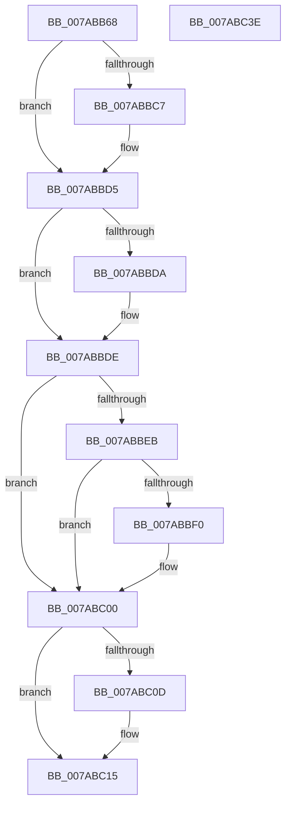

# SmcCacheRemove

- RVA: `0x007ABB68`–`0x007ABC3F` (길이 `215` bytes)
- VA: `0x00000001407ABB68`
- 실행 섹션: `PAGE`
- PDB 이름 있음: `예`; PDB Function 태그: `아니요`
- unwind 정보 RVA: `0x00060300`
- 디코드: `62`개 명령, `215/215` bytes 표시
- 미해석 바이트: `0` (있으면 어셈블리에 `.byte`로 보존)

> 이 문서는 커널 이미지의 기계어와 PDB 기호를 분석해 생성했습니다. 4번과 5번은 함수 원형과 자료형을 바이너리 사용 방식에서 추정한 C 해석이며 원본 소스 복구 결과는 아닙니다.

## 1. Dependencies

- 직접 호출 지점: **6**; 고유 호출 대상: **6**
- 직접 호출자로 확인된 함수: **1**
- RIP 상대 이미지 참조: **0**

### Outgoing calls
- `0x007ABBB7` → [KeAbPreAcquire](../../text/21/KeAbPreAcquire_function_00210230.md) (function, `0x00210230`)
- `0x007ABBD0` → [ExfAcquirePushLockExclusiveEx](../../text/20/ExfAcquirePushLockExclusiveEx_function_0020FC90.md) (function, `0x0020FC90`)
- `0x007ABBF4` → [ExWaitForRundownProtectionRelease](../../text/2A/ExWaitForRundownProtectionRelease_function_002A4CB0.md) (function, `0x002A4CB0`)
- `0x007ABC10` → [ExfTryToWakePushLock](../../text/26/ExfTryToWakePushLock_function_00265DD0.md) (function, `0x00265DD0`)
- `0x007ABC18` → [KeAbPostRelease](../../text/2E/KeAbPostRelease_function_002E1600.md) (function, `0x002E1600`)
- `0x007ABC1D` → [KeLeaveCriticalRegion](../../text/25/KeLeaveCriticalRegion_function_0025D8B0.md) (function, `0x0025D8B0`)

### Direct callers
- [SmcCacheDelete](SmcCacheDelete_function_007AB84C.md) at `0x007AB859`

### Static image references
- 디코드된 RIP-relative 메모리 참조가 없습니다.

## 2. Other-region calls and transfers

- 다른 실행 섹션으로 향하는 call: **6**
  - `0x007ABBB7` → [KeAbPreAcquire](../../text/21/KeAbPreAcquire_function_00210230.md) (`PAGE` → `.text`)
  - `0x007ABBD0` → [ExfAcquirePushLockExclusiveEx](../../text/20/ExfAcquirePushLockExclusiveEx_function_0020FC90.md) (`PAGE` → `.text`)
  - `0x007ABBF4` → [ExWaitForRundownProtectionRelease](../../text/2A/ExWaitForRundownProtectionRelease_function_002A4CB0.md) (`PAGE` → `.text`)
  - `0x007ABC10` → [ExfTryToWakePushLock](../../text/26/ExfTryToWakePushLock_function_00265DD0.md) (`PAGE` → `.text`)
  - `0x007ABC18` → [KeAbPostRelease](../../text/2E/KeAbPostRelease_function_002E1600.md) (`PAGE` → `.text`)
  - `0x007ABC1D` → [KeLeaveCriticalRegion](../../text/25/KeLeaveCriticalRegion_function_0025D8B0.md) (`PAGE` → `.text`)
- 별도 외부 분기/꼬리 이동을 확인하지 못했습니다.

## 3. Assembly (complete function range)

```asm
007ABB68  48 89 5C 24 08                  mov qword ptr [rsp + 8], rbx
007ABB6D  48 89 6C 24 10                  mov qword ptr [rsp + 0x10], rbp
007ABB72  48 89 74 24 18                  mov qword ptr [rsp + 0x18], rsi
007ABB77  57                              push rdi
007ABB78  41 56                           push r14
007ABB7A  41 57                           push r15
007ABB7C  48 83 EC 20                     sub rsp, 0x20
007ABB80  65 48 8B 04 25 88 01 00 00      mov rax, qword ptr gs:[0x188]
007ABB89  8B FA                           mov edi, edx
007ABB8B  44 8B FA                        mov r15d, edx
007ABB8E  83 E7 0F                        and edi, 0xf
007ABB91  48 C1 E7 05                     shl rdi, 5
007ABB95  48 83 CB FF                     or rbx, 0xffffffffffffffff
007ABB99  48 03 F9                        add rdi, rcx
007ABB9C  41 C1 EF 04                     shr r15d, 4
007ABBA0  66 01 98 E4 01 00 00            add word ptr [rax + 0x1e4], bx
007ABBA7  45 33 C0                        xor r8d, r8d
007ABBAA  33 D2                           xor edx, edx
007ABBAC  45 33 F6                        xor r14d, r14d
007ABBAF  90                              nop
007ABBB0  48 8D 77 10                     lea rsi, [rdi + 0x10]
007ABBB4  48 8B CE                        mov rcx, rsi
007ABBB7  E8 74 46 A6 FF                  call 0x140210230
007ABBBC  F0 48 0F BA 2E 00               lock bts qword ptr [rsi], 0
007ABBC2  48 8B E8                        mov rbp, rax
007ABBC5  73 0E                           jae 0x1407abbd5
007ABBC7  4C 8B C6                        mov r8, rsi
007ABBCA  48 8B D0                        mov rdx, rax
007ABBCD  48 8B CE                        mov rcx, rsi
007ABBD0  E8 BB 40 A6 FF                  call 0x14020fc90
007ABBD5  48 85 ED                        test rbp, rbp
007ABBD8  74 04                           je 0x1407abbde
007ABBDA  C6 45 0A 01                     mov byte ptr [rbp + 0xa], 1
007ABBDE  8B 47 18                        mov eax, dword ptr [rdi + 0x18]
007ABBE1  25 FF 0F 00 00                  and eax, 0xfff
007ABBE6  44 3B F8                        cmp r15d, eax
007ABBE9  75 15                           jne 0x1407abc00
007ABBEB  4C 39 37                        cmp qword ptr [rdi], r14
007ABBEE  74 10                           je 0x1407abc00
007ABBF0  48 8D 4F 08                     lea rcx, [rdi + 8]
007ABBF4  E8 B7 90 AF FF                  call 0x1402a4cb0
007ABBF9  4C 8B 37                        mov r14, qword ptr [rdi]
007ABBFC  48 83 27 00                     and qword ptr [rdi], 0
007ABC00  F0 48 0F C1 1E                  lock xadd qword ptr [rsi], rbx
007ABC05  80 E3 06                        and bl, 6
007ABC08  80 FB 02                        cmp bl, 2
007ABC0B  75 08                           jne 0x1407abc15
007ABC0D  48 8B CE                        mov rcx, rsi
007ABC10  E8 BB A1 AB FF                  call 0x140265dd0
007ABC15  48 8B CE                        mov rcx, rsi
007ABC18  E8 E3 59 B3 FF                  call 0x1402e1600
007ABC1D  E8 8E 1C AB FF                  call 0x14025d8b0
007ABC22  48 8B 5C 24 40                  mov rbx, qword ptr [rsp + 0x40]
007ABC27  49 8B C6                        mov rax, r14
007ABC2A  48 8B 6C 24 48                  mov rbp, qword ptr [rsp + 0x48]
007ABC2F  48 8B 74 24 50                  mov rsi, qword ptr [rsp + 0x50]
007ABC34  48 83 C4 20                     add rsp, 0x20
007ABC38  41 5F                           pop r15
007ABC3A  41 5E                           pop r14
007ABC3C  5F                              pop rdi
007ABC3D  C3                              ret
007ABC3E  CC                              int3
```

## 4. C-style interpretation (structured pseudocode)

```c
__int64 __fastcall SmcCacheRemove(__int64 a1, int a2, int a3)
{
    __int64 result;
    __int64 v_r14;
    __int64 v_r15;
    __int64 v_rbx;
    __int64 v_rdi;
    __int64 v_rsp;
    unsigned __int64 v_stack_p10;
    unsigned __int64 v_stack_p18;
    unsigned __int64 v_stack_p8;

    v_stack_p8 = v_rbx;
    v_stack_p10 = v_rbp;
    v_stack_p18 = v_rsi;
    v_rsp = (v_rsp) - (32);
    v_rdi = (unsigned int)(((unsigned int)(a2)) & (15));
    v_rdi = (v_rdi) << (5);
    v_rbx = (v_rbx) | (-1);
    v_rdi = (v_rdi) + (a1);
    v_r15 = (unsigned int)(((unsigned int)(a2)) >> (4));
    a3 = 0;
    a2 = 0;
    v_r14 = 0;
    result = KeAbPreAcquire(v_rdi + 16, a2, a3, a4);
    if (!(condition_is_above_or_equal)) {
        a3 = v_rdi + 16;
        a2 = result;
        a1 = v_rdi + 16;
        result = ExfAcquirePushLockExclusiveEx(a1, a2, a3, a4);
    }
    if (result != 0) {
        *(unsigned __int8 *)(result + 10) = 1;
    }
    result = (unsigned int)(((unsigned int)(*(unsigned int *)(v_rdi + 24))) & (0xFFFULL));
    if (((unsigned int)(v_r15)) != ((unsigned int)(result))) goto loc_007ABC00;
    if ((*(unsigned __int64 *)(v_rdi)) != 0) {
        a1 = v_rdi + 8;
        result = ExWaitForRundownProtectionRelease(a1, a2, a3, a4);
        v_r14 = *(unsigned __int64 *)(v_rdi);
    }
    v_rbx = (unsigned __int8)((v_rbx) & (6));
    if (((unsigned __int8)(v_rbx)) == 2) {
        a1 = v_rdi + 16;
        result = ExfTryToWakePushLock(a1, a2, a3, a4);
    }
    result = KeAbPostRelease(v_rdi + 16, a2, a3, a4);
    result = KeLeaveCriticalRegion(v_rdi + 16, a2, a3, a4);
    v_rsp = (v_rsp) + (32);
    return v_r14;
}
```

## 5. (Beta) C Style

```c
int64_t SmcCacheRemove(int64_t Arg1, int32_t Arg2, int32_t Arg3)
{
    int64_t result;
    int64_t local_r14;
    int64_t local_r15;
    int64_t local_rbx;
    int64_t local_rdi;
    int64_t local_rsp;
    uint64_t v_stack_p10;
    uint64_t v_stack_p18;
    uint64_t v_stack_p8;

    v_stack_p8 = local_rbx;
    v_stack_p10 = local_rbp;
    v_stack_p18 = local_rsi;
    local_rsp = (local_rsp) - (32);
    local_rdi = (uint32_t)(((uint32_t)(Arg2)) & (15));
    local_rdi = (local_rdi) << (5);
    local_rbx = (local_rbx) | (-1);
    local_rdi = (local_rdi) + (Arg1);
    local_r15 = (uint32_t)(((uint32_t)(Arg2)) >> (4));
    Arg3 = 0;
    Arg2 = 0;
    local_r14 = 0;
    result = KeAbPreAcquire(local_rdi + 16, Arg2, Arg3, a4);
    if (!(condition_is_above_or_equal)) {
        Arg3 = local_rdi + 16;
        Arg2 = result;
        Arg1 = local_rdi + 16;
        result = ExfAcquirePushLockExclusiveEx(Arg1, Arg2, Arg3, a4);
    }
    if (result != 0) {
        *(uint8_t *)(result + 0xA) = 1;
    }
    result = (uint32_t)(((uint32_t)(*(uint32_t *)(local_rdi + 0x18))) & (0xFFFULL));
    if (((uint32_t)(local_r15)) != ((uint32_t)(result))) goto loc_007ABC00;
    if ((*(uint64_t *)(local_rdi)) != 0) {
        Arg1 = local_rdi + 8;
        result = ExWaitForRundownProtectionRelease(Arg1, Arg2, Arg3, a4);
        local_r14 = *(uint64_t *)(local_rdi);
    }
    local_rbx = (uint8_t)((local_rbx) & (6));
    if (((uint8_t)(local_rbx)) == 2) {
        Arg1 = local_rdi + 16;
        result = ExfTryToWakePushLock(Arg1, Arg2, Arg3, a4);
    }
    result = KeAbPostRelease(local_rdi + 16, Arg2, Arg3, a4);
    result = KeLeaveCriticalRegion(local_rdi + 16, Arg2, Arg3, a4);
    local_rsp = (local_rsp) + (32);
    return local_r14;
}
```

## 6. Execution-region graph

[열기: 2D/3D 그래프와 함수 탐색 컨트롤 패널](../../../control-panel.html?section=page&rva=0x007ABB68&view=graph)

- 2D 그래프는 위에서 아래로 흐르고, 3D 그래프는 빈 공간을 드래그해 회전합니다. Shift+드래그는 이동, 휠은 확대·축소, 함수 노드 선택은 대상 보고서 이동입니다.

### Static fallback


